# GAT Assignments 1–20

> Text and graphics converted from the supplied Word document. Formula-only graphics have been transcribed to LaTeX; diagrams remain images. See [conversion notes](conversion-report.md) and the [formula review](formula-review.md) for remaining issues.

[Assignment 1](#assignment-01) | [Assignment 2](#assignment-02) | [Assignment 3](#assignment-03) | [Assignment 4](#assignment-04) | [Assignment 5](#assignment-05) | [Assignment 6](#assignment-06) | [Assignment 7](#assignment-07) | [Assignment 8](#assignment-08) | [Assignment 9](#assignment-09) | [Assignment 10](#assignment-10) | [Assignment 11](#assignment-11) | [Assignment 12](#assignment-12) | [Assignment 13](#assignment-13) | [Assignment 14](#assignment-14) | [Assignment 15](#assignment-15) | [Assignment 16](#assignment-16) | [Assignment 17](#assignment-17) | [Assignment 18](#assignment-18) | [Assignment 19](#assignment-19) | [Assignment 20](#assignment-20)

## Assignment #1

### I.

<strong>Geometric Figures and Transformations</strong>

A geometric figure is a single point or a collection of points.

In your future work in mathematics, some of the geometric figures will have familiar shapes such as line segments, lines, triangles, parallelograms, and circles.  Others will have shapes that you may not have seen before.  Here are two examples:

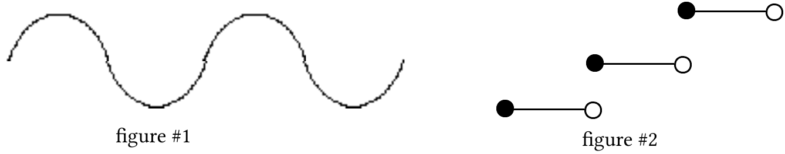

Notice that figure #2 is made up of three disconnected pieces.

A transformation can usually be thought of as a way to place at least some of the points of a geometric figure in new positions.

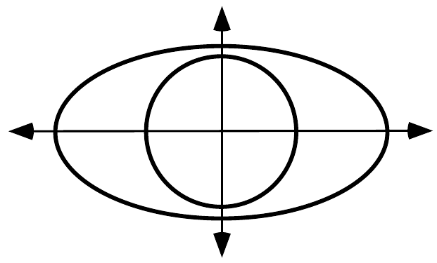

How does the number of points on the inner circle compare to the number of points on the oval shaped figure that surrounds it?

### II.

<strong>Reflections</strong>

The first type of transformation that we will work with in this course is called a <strong>line reflection</strong>, commonly called just a <strong>reflection</strong>.  When a point is reflected in a line, the new position of that point is on a path perpendicular to the line of reflection.  The distance from the line of reflection to the new position is equal to the distance from the original position to the line of reflection.

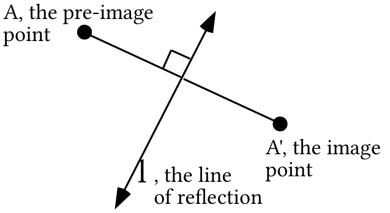

The point in its original position is called the <strong>pre-image</strong> and in its new position is called the <strong>image</strong>, as labeled in the illustration above.  This language arises from the experience of seeing the images of objects in mirrors.  The labeling of the image point with the same letter followed by a prime symbol, “ ' ”, is often used.  “A' ” is read “A prime.”

Here are three important characteristics of reflections that you should understand and know:

<strong>Reflections preserve collinearity.</strong>  This means that if a set of points all lie

on the same line, then their images under a reflection will all lie on the same line.

<strong>Reflections preserve distance.</strong>  This means that if a pre-image, such as

a line segment or the arc of a circle has a length, then the image of that figure when it is reflected, has the same length.

<strong>Reflections preserve angle measure.</strong>  This means that when an

angle is reflected, the image has the same measure as the pre-image.

First, trace the triangle, ABC, and the line of reflection, $\ell$, from the figure below onto your homework paper.  Then sketch the image of the triangle and label the images of the vertices using “prime” notation.

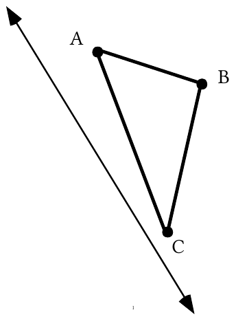

A. How does the measure of angle A'B'C' compare to the measure of angle ABC?  Give a reason for your answer.

B. How does the length of segment AB compare to the length of segment A'B'?  Give a reason for your answer.

C. If a path through the vertices of the pre-image is traced clockwise from A, in what order are the other two vertices crossed?

D. If a path through the vertices of the image is traced clockwise from A', in what order are the other two vertices crossed?

### III.

Trace the segment, AB, and the line of reflection, $\ell$. Now sketch the image of the segment and label key points using “prime” notation.

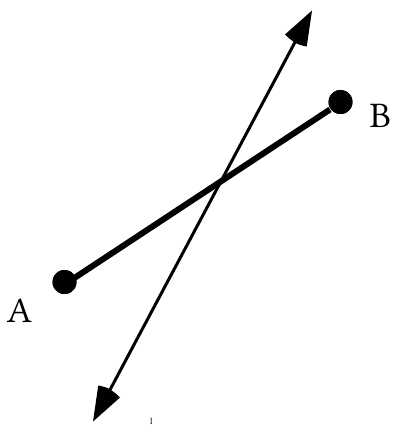

Are any points on segment AB equal to their own image under a reflection in line $\ell$?

### IV.

A. Sketch a coordinate system and use a dot to represent point A with coordinates (5,3).   Label the dot as “A.”

B. Use a dot to represent the image of point A when it is reflected in the $x\text{-axis}$.  Label this dot using “prime” notation.  Also label the coordinates of this image.

C. Use another dot to represent the image of point A when it is reflected in the $y\text{-axis}$.  Label this second dot using “prime” notation.  Then also label the coordinates of this image.

### V.

Give the number of the description which describes a reflection in the $x\text{-axis}$.

Description #1: The first coordinate of the image is equal to the first coordinate of the pre-image and the second coordinate of the image is the opposite of the second coordinate of the pre-image.

Description #2: The first coordinate of the image is the opposite of the first coordinate of the pre-image and the second coordinate of the image is equal to the second coordinate of the pre-image.

### VI.

A. Trace the coordinate system below and use a dot with a letter next to it to represent each of the following points:  A=(¯2,¯1),   B=(¯2,1),   C=(¯2,2)

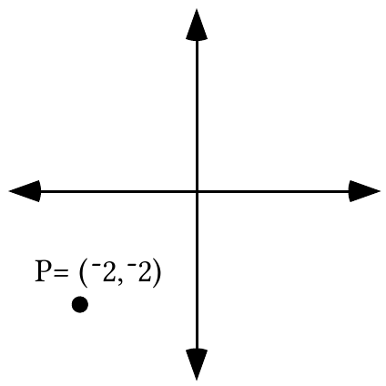

B. Give the numbers of any equations in the following list which have all the points, P, A, B, and C, as solutions.

#1:  $1\cdot x+0\cdot y={}^{-}2$      #2:  $0\cdot x+1\cdot y={}^{-}2$       #3:  $x+y={}^{-}4$

#4:  $1\cdot x+2=0\cdot y$       #5:  $x={}^{-}2$

C. Is the line containing P, A, B, and C horizontal or vertical?

### VII.

A. Use your calculator to compute each of the following:

1\. ¯3.152  2. (¯3.15)2

B. Does the phrase “the square of the opposite of 3.15” describe your answer to “A, 1” or “A, 2”?

### VIII.

This question introduces you to the use of lists on your calculator.  After turning on your calculator, push the \[STAT\] key and then select Edit by pushing the \[ENTER\] key.  You should now see the following:

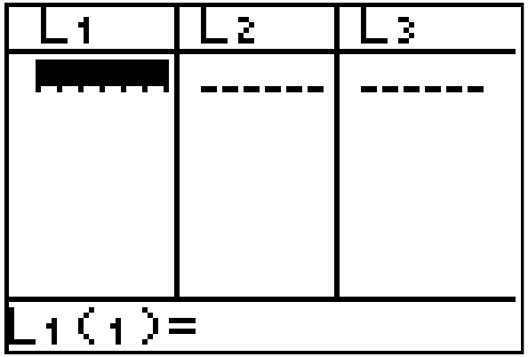

You can now make an entry in list #1, headed by “L1” by keying in a number.  To enter another number below the first in the same list push \[ENTER\] and key in this new number.  At this point enter any seven numbers you choose in list #1.

Now push the blue arrow key that points to the right edge of your calculator.  You are now ready to make entries in list #2.  Make the entries in list #2 exactly the same as the entries you made in list #1.  The numbers in each of the first seven rows across the first two lists should match.

### IX.

A number is a solution of an equation if you create a true statement by writing that number in place of the variable in that equation.  For each of the equations below give its solution or solutions.   To aid in the search for solutions it may help to solve an equation for “<em>x</em>.”

A. $5\cdot x+{}^{-}7=3$  B. $5\cdot x+{}^{-}6={}^{-}9$  C. $\sqrt{3}\cdot x+2=8$

## Assignment #2

### I.

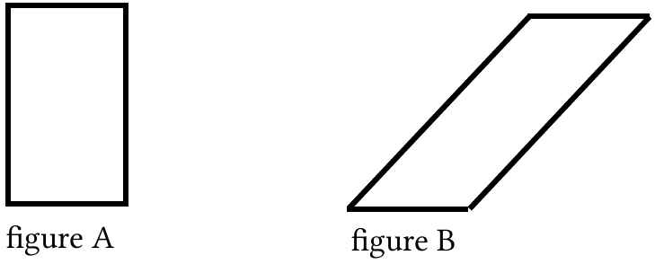

Do you think it would be possible to create figure B by repositioning the points in figure A?

### II.

<strong>More Facts About Reflections</strong>

Think about your sketch for question II of assignment #1.  When the vertices of the pre-image triangle are touched in alphabetical order, the movement from one to the other is clockwise.  However, if the images of these vertices are touched in alphabetical order, the movement from one to another is counterclockwise.  This experience illustrated an characteristic of reflections that should be kept in mind together with the three cited in question II of assignment #1:

#4.  <strong>Reflections reverse orientation</strong>.

Look back at question III of assignment #1.  Here the pre-image is a line segment that intersects the line of reflection.  Most of the points on the pre-image are placed in new positions by the reflection.  The one exception is the single point where the pre-image intersects the line of reflection.  This one point does not move to a new position.  It is its own image.

#5.  <strong>A point on a line of reflection is its own image</strong>.

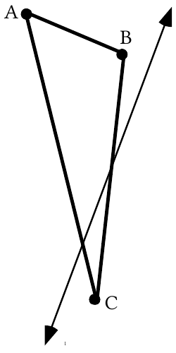

A. Trace the triangle, ABC, and the line of reflection,  , and sketch the image of the triangle and label key points using “prime” notation.

B. How does the length of segment AC compare to the length of segment A'C'?  Give a reason for your answer.

C. How many points on triangle ABC are their own image under a reflection in line $\ell$?

### III.

A. Supply the phrases to fill the numbered blanks to complete the following description of a reflection in the $x\text{-axis}$:

“the first coordinate of the image is (1) \_\_\_\_\_\_\_\_\_\_\_\_\_\_ the first coordinate of the pre-image, and the second coordinate of the image is (2) \_\_\_\_\_\_\_\_\_\_\_\_\_\_\_\_\_\_ the second coordinate of the pre-image.”

B. Give the number of the equation, or “formula,” which describes a reflection in the $x\text{-axis}$.  “$r_x$” is a symbol for a reflection in the <em>x</em>-axis.

#1:  $r_x(x,y)=({}^{-}x,y)$    #2:  $r_x(x,y)=(x,{}^{-}y)$

### IV.

A. Give the coordinates of the image of each point when it is reflected in the $x\text{-axis}$:

1\. $(3,{}^{-}\sqrt{23})$  2. $(3,\sqrt{23})$  3.$({}^{-}5,0)$  4. $(13.2,0)$

5\. (a,b)  6. (a,-b)

B. Give the coordinates of the indicated image.  Keep in mind what “$r_x$” means.

1\. $r_x({}^{-}4,{}^{-}5)$     2. $r_x(5,{}^{-}2)$      3. $r_x(0,{}^{-}3)$      4. $r_x(a,b)$    5. $r_x({}^{-}a,{}^{-}b)$

C. There is a point which is its own image under both a reflection in the $x\text{-axis}$ and a reflection in the $y\text{-axis}$. Give the coordinates of this point.

### V.

<strong>Equations for Vertical Lines</strong>

The points with coordinates (¯2,¯2), (¯2,¯1), (¯2,1), and (¯2,2) all appeared in question VI of assignment #1.  When graphed on a coordinate system, these points all lie on a line parallel to the $y\text{-axis}$.  In question VI, the $y\text{-axis}$ is illustrated in its usual “vertical” direction, relative to the top and bottom of the page.  The points, (¯2,¯2), (¯2,¯1), (¯2,1), and (¯2,2) all lie on the same vertical line.  (¯2,¯1) is a <strong>solution</strong> of the two-variable equation

$$
1\cdot x+0\cdot y={}^{-}2
$$

because when the first and second coordinates are used to replace the variables, $x$ and $y$, in alphabetical order, the result is to form the true statement

$$
1\cdot{}^{-}2+0\cdot{}^{-}1={}^{-}2.
$$

When the coordinates of the pairs (¯2,¯2), (¯2,1) and (¯2,2) are used to replace $x$ and $y$ in

$$
1\cdot x+0\cdot y={}^{-}2
$$

in alphabetical order, other true statements are formed.  Therefore, (¯2,¯2), (¯2,1) and (¯2,2) are also solutions of

$$
1\cdot x+0\cdot y={}^{-}2.
$$

In fact, any point with first coordinate ¯2 is a solution of

$$
1\cdot x+0\cdot y={}^{-}2.
$$

Furthermore, any point with first coordinate ¯2 is also on the same vertical line as (¯2,¯2), (¯2,¯1), (¯2,1), and (¯2,2).  It is for this reason that the two-variable equation

$$
1\cdot x+0\cdot y={}^{-}2
$$

is said to <strong>describe</strong> that vertical line.  The points (¯2,¯2), (¯2,-1), (¯2,1), and (¯2,2) are also solutions of

$$
1\cdot x+2=0\cdot y.
$$

Two equations that have exactly the same solutions are said to be <strong>equivalent</strong>.

$1\cdot x+0\cdot y={}^{-}2$ and $1\cdot x+2=0\cdot y$ are examples of equivalent equations describing the same vertical line.

In the context of working with the vertical line described by 1·<em>x</em> + 0·<em>y</em> = ¯2, “<em>x</em> = ¯2” is considered to be an abbreviation of “1·<em>x</em> + 0·<em>y</em> = ¯2.”  Therefore in that context, $1\cdot x+0\cdot y={}^{-}2$ is considered to be equivalent to <em>x</em> = ¯2.  The use of the abbreviation, “<em>x</em> = ¯2” emphasizes the fact that all the points on that vertical line described have ¯2 as their first coordinate.

These questions are all about the vertical line passing through (¯3,${}^{-}\sqrt{7}$):

A. Give the coordinates of three other points on the same vertical line.

B. Write an equation containing both “$x$” and “$y$” which describes this line.

C. Write an equation containing only one variable which describes this line.

### VI.

These questions have to do with the horizontal line through (3,4):

A. Give the coordinates of any three other points on that line.

B. Give the number of any of the following equations that describe that line.

#1:  $1\cdot x+0\cdot y=4$

#2:  $0\cdot x+1\cdot y=3$

#3:  $x+y=7$

#4:  $0\cdot x+{}^{-}4={}^{-}1\cdot y$

#5:  $y=4$

### VII.

<strong>An Introduction to the</strong> <em><strong>y</strong></em> <strong>=</strong> <em><strong>x</strong></em> <strong>Line</strong>

In class you used your calculator to get a representation of seven different points whose first and second coordinates are equal.  These points are collinear.  We were able to get a representation of the line that contains such points by having your calculator generate a graph from the expression “Y1=X.”  The line of points with equal first and second coordinates is called the “$y=x$ line.”  We will soon be using the $y=x$ line as a line of reflection.

Write a simple equation to describe the line of points whose first and second coordinates are equal.

### VIII.

In this question you are going to make new entries in lists #1 and #2 to replace those you entered there on the last assignment.  One way to clear these lists is to do the following:

Push \[STAT\] and then push \[4\] to select “ClrList.”  You will now be at the home screen with “ClrList” displayed.  To clear lists #1 and #2, push the blue \[2nd\] key and the \[1\] key, then push the comma key \[,\] and then push \[2nd\] and \[2\].  Now push \[ENTER\]. You should see “Done” on the right of the home screen.  This confirms that the lists have been cleared.

Now push \[STAT\] and select “Edit.”  Enter any seven numbers (including some negative numbers) of your choice in list #1.  Then make entries in list #2 so that the list #1, list #2 entries in each row are opposites.

### IX.

A. Enter the following expressions into your calculator and give the computed results accurate to the three decimal places:

1\. $\surd(3)$ + 7  2. $\surd$(3+7)

You get the radical symbol by pushing the \[2nd\] key and then pushing the key labeled in white as “$x^2$.”

B. Which of your answers in “A” best approximates $\sqrt{10}$?

C. Use your calculator to compute $\sqrt{3+\sqrt{47}}$ and give the result accurate to three decimal places.

### X.

A. Solve each of these equations for <em>x</em>.

1\. $11\cdot x+4=9$         2. $11\cdot x+4=\sqrt{11}$      3. $5\cdot x+6\cdot x+\sqrt{3}=5$

B. Give the exact solution of third equation in “A” right above.  Your answer should be a number and not an equation.

## Assignment #3

### I.

Finish all portions of Reflections in Parallel Lines, Sketch Sheet #1, that you did not complete in class.

### II.

This question involves the vertical line passing through (3,¯4).

A. Give the coordinates of three other points on the same vertical line.

B. Give an equation containing both “$x$” and “$y$” which describes this line.

C. Give an equation containing only one variable (either “$x$” or “$y$”) which gives an abbreviated description of this line.

### III.

Give an equation containing only one variable (either “$x$” or “$y$”) which describes the horizontal line through (3,¯4).

### IV.

<strong>Reflections in the</strong> <em><strong>x</strong></em><strong>-axis</strong>

When any point is reflected in the $x\text{-axis}$, the first coordinate of the image is the same as the first coordinate of the pre-image and the second coordinate of the image is the opposite of the second coordinate of the pre-image.  The statement about second coordinates is true even when the second coordinate is 0, because 0 is its own opposite.  The relationship between the coordinates of a pre-image and an image when points are reflected in the $x\text{-axis}$ is expressed by the equation

$$
r_x(x,y)=(x,{}^{-}y).
$$

This equation provided a formula for giving the coordinates of an image when a point is reflected in the $x\text{-axis}$, it will therefore be referred to as an <strong>image formula</strong> for a reflection in the $x\text{-axis}$.

The given image formula, $r_x(x,y)=(x,{}^{-}y)$, for a reflection in the $x\text{-axis}$ can be read

“<em>r</em> sub <em>x</em> of <em>x</em>, <em>y</em> is <em>x</em>, opposite <em>y</em>.”

However, rather than just reading the symbols in the image formula, it is far more important to get the “message” these symbols give about the relationship between the coordinates of the pre-image and image.  That message is—

“when a point in reflected in the $x\text{-axis}$, the first coordinate of the image is equal to the first coordinate of the pre-image and the second coordinate of the image is the opposite of second coordinate of the pre-image.”

You should understand that the same message could be given by

$$
r_x({}^{-}x,{}^{-}y)=({}^{-}x,y).
$$

A. Give phrases to fill the numbered blanks to complete a description of a reflection in the $y\text{-axis}$: “the first coordinate of the image is (1) \_\_\_\_\_\_\_\_\_\_\_\_\_\_ the first coordinate of the pre-image and the second coordinate of the image is (2) \_\_\_\_\_\_\_\_\_\_\_\_\_\_\_\_ the second coordinate of the pre-image.”

B. Give the number of any of the following that are image formulas for a reflection in the $y\text{-axis}$.

#1: $r_y(x,y)=({}^{-}x,y)$    #2: $r_y(x,y)=(x,{}^{-}y)$    #3: $r_y(y,x)=({}^{-}y,x)$    #4: $r_y({}^{-}x,y)=(x,y)$

### V.

<strong>The “</strong><em><strong>y</strong></em> <strong>Equals Opposite</strong> <em><strong>x</strong></em><strong>” Line</strong>

In doing question VIII of assignment #2 you entered into lists #1 and #2 the coordinates of seven points.  In class you saw that these points appeared to be collinear.  It is also true that for each point, the first and second coordinates are opposites of each other.  We were able to get your calculator to generate a graph that covered and connected these points from the entry Y1=¯X.

This entry expresses the relationship between the first and coordinates of the points on the line that contains your seven points.  That line will often be called the “<em>y</em> equal opposite <em>x</em>” line and this will be written as the “<em>y</em> = ¯<em>x</em> ” line.

Give a simple equation for the line of points whose first and second coordinates are opposites of each other.

### VI.

Calculate each of the following using your calculator and give the results accurate to three decimal places.

A. $\sqrt{({}^{-}13.2)^2}$  B. $\sqrt{\sqrt{26}+5}$

### VII.

Give the indicated images as ordered pairs.

A. $r_x({}^{-}3,{}^{-}4)$  B. $r_y({}^{-}3,{}^{-}4)$  C. $r_x(r_y({}^{-}3,{}^{-}4))$

D. $r_x({}^{-}a,b)$  E. $r_y({}^{-}a,b)$  F. $r_x(r_y({}^{-}a,b))$

### VIII.

Solve each of these equations for $x$.

A. $2\cdot x+5\cdot x=23$  B. $2\cdot x+x=23$  C. $2\cdot x+\sqrt{7}\cdot x=23$

### IX.

Give the number of the phrase which describes the expression:   $2\cdot(c+d)$.

#1:  The sum of two addends             #2: The product of two factors

### X.

<strong>A Reminder About the Pythagorean Theorem</strong>

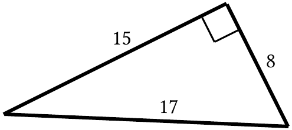

As indicated by the “square” symbol in one vertex, the above illustration is of a right triangle.  The two sides that meet at the vertex of the right angle are perpendicular. They are called the <strong>legs</strong> of the right triangle.  The longest side, the side across from the right angle, is called the <strong>hypotenuse</strong>.

In the illustrated right triangle, the sum of the squares of the lengths of the legs is equal to the square of the length of the hypotenuse.  That is, $15^2+8^2=17^2$ or   225 + 64 = 289.

This illustrates a relationship that exists between the sum of the squares of the lengths of the legs and the square of the length of the hypotenuse of any right triangle.  This relationship was clearly stated by a sect of Greek mathematicians called the Pythagoreans whose founder was Pythagoras.  The relationship is commonly stated by the equation

$$
a^2+b^2=c^2.
$$

In this equation “a” and “b” represent the lengths of the legs of a right triangle and “c” represents the length of the hypotenuse.  The equation expresses what is known as <strong>The Pythagorean Theorem</strong>.  Soon in this course you will see how transformations can be used to neatly explain why the squares of the lengths of the sides of any right triangle must have the relationship expressed by the above equation.

Give the number of any of the following statements that are true of side AB in the right triangle shown in the illustration.  The lengths of sides AC and CB are labeled.

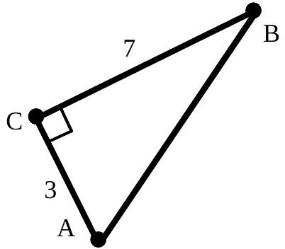

#1:  Its length is more than 10.

#2:  Its length is exactly equal to $\sqrt{58}$.

#3:  Accurate to the nearest hundredth its length is 7.61.

#4:  It is called the “hypotenuse.”

## Assignment #4

### I.

<strong>An Image Formula for a Reflection in the</strong> <em><strong>y</strong></em><strong>-axis</strong>

When points are reflected in the $y\text{-axis}$, the first coordinates of the images are always the opposites of the first coordinates of the pre-images while the second coordinates are unchanged.  You should understand and be able to create on you own the following image formula for a reflection in the $y\text{-axis}$:

$$
r_y(x,y)=({}^{-}x,y).
$$

You should also be able to read from this image formula a message about how the coordinates of the pre-image and image are related.

A. Give the coordinates of the image represented by $r_y({}^{-}7,{}^{-}4)$.

B. Is the line connecting (¯7,¯4) and $r_y({}^{-}7,{}^{-}4)$ horizontal or vertical?

C. Write an equation containing two variables that describes the line passing through (¯7,¯4) and $r_y({}^{-}7,{}^{-}4)$.

D. Write an equation containing only one variable that describes the line passing through (¯7,¯4) and $r_y({}^{-}7,{}^{-}4)$.

### II.

Trace the illustration below onto your homework paper:

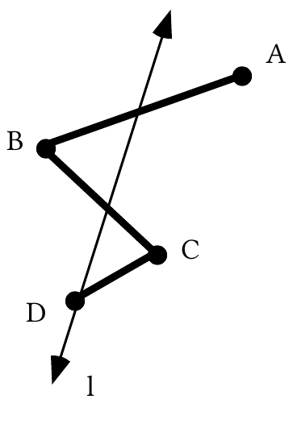

A. Figure ABCD is made up of three line segments. Add to your tracing a sketch of the image of figure ABCD under a reflection in line $\ell$. Use prime notation (') to label key points on the image.

B. What the property of reflections that guarantees that segments AB and A'B' have the same length?

C. If the measure of angle ABC is 47˚, what is the measure of angle A'B'C'?

### III.

Suppose a triangle, ABC, is reflected in a line, $\ell$, to produce image triangle A'B'C'.  If the movement from vertex A to vertex B to vertex C and then back to vertex A is counter-clockwise, in what direction is the movement from vertex A' to vertex B' to vertex C' and back to vertex A'?

### IV.

Given that (¯6,a), (b,5) and (7,c) represent three points,

A. If these points are on the line described by $y=x$, give the values of a, b, and c.

B. If these points are on the line described by $y={}^{-}x$, give the values of a, b, and c.

### V.

Use your calculator to compute each of the following.  Give the result accurate to two decimal places (the nearest hundredth).

A. $({}^{-}1.732)^2$          B. ${}^{-}1.732^2$           C. $\sqrt{7+\sqrt{4.1}}$           D. $\sqrt{7}+\sqrt{4.1}$

### VI.

Solve each of these equations.  Then give the exact solution.  Do not give an equation for a vertical line instead of the solution.

A. $11x+{}^{-}21=12$          B. $11\cdot x+{}^{-}\sqrt{21}=12$          C. $\sqrt{11}\cdot x+{}^{-}21=12$

### VII.

Represent each of the following as a simple ordered pair.

A. $r_x({}^{-}5,2)$          B. $r_y(5,{}^{-}2)$          C. $r_x(r_y(5,{}^{-}2))$          D. $r_x(r_x(5,{}^{-}2))$

E. $r_y(r_x({}^{-}a,b))$

### VIII.

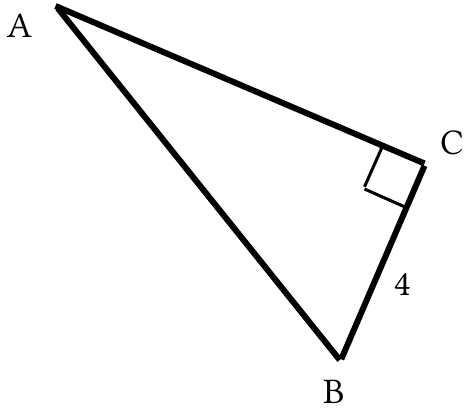

A. The longer leg of right triangle ABC is twice the length of the shorter leg.  Give the length of the longer leg.

B. Give the exact length of the hypotenuse of the right triangle.

C. Give the length of the longest side of the triangle accurate to the nearest hundredth.

### IX.

Give the number of the phrase that best describes the expression

$$
c\cdot d+c\cdot d.
$$

#1: The product of two factors                #2: The sum of two products

### X.

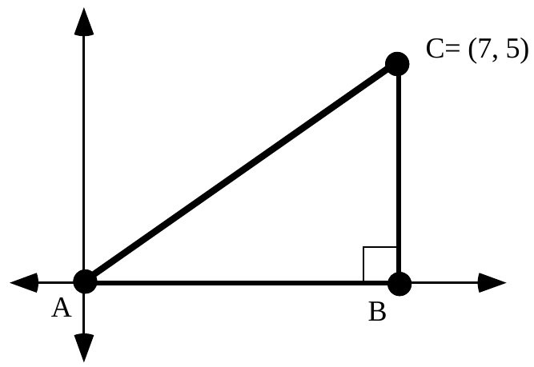

A. Give the length of segment AB.

B. Give the length of segment BC.

C. Compute the exact length of segment AC.

### XI.

Complete Sketch Sheet #2 for Composites of Reflections in Parallel Lines.  The Sketch Sheet and instructions have been given to you in class

## Assignment #5

### I.

<strong>Transformations Created by Reflecting in Two Parallel Lines</strong>

As you made sketches about reflections in parallel lines, you were repositioning the original three points in two steps.  After the first reflection, you found the image of the images under a second reflection.  In the first sketch, you reflected first in the vertical line with the abbreviated description <em>x</em> =¯3.  After that, you reflected in the line described by <em>x</em> = 2. The following equations focus on the two stage journey of point A, (¯5,0), to its new position.

<strong>first stage:</strong>  $r_{x={}^{-}3}(A)=r_{x={}^{-}3}({}^{-}5,0)=$ A' = (¯1,0)

<strong>second stage:</strong>  $r_{x=2}$(A')$=r_{x=2}({}^{-}1,0)=A''=(5,0)$

<strong>combining the stages:</strong>

$$
r_{x=2}(\circ r_{x={}^{-}3}(A))=r_{x=2}(r_{x={}^{-}3}({}^{-}5,0)=r_{x=2}({}^{-}1,0)=(5,0)=A''
$$

If we think only about the original points and the final image points, the “double prime” points, we notice that each final image is ten units to the right of the original pre-image.  The transformation which causes this repositioning is called the composite of the two reflections, with $r_{x=2}$coming after $r_{x={}^{-}3}$  The composite is represented by

$$
r_{x=2}\circ r_{x={}^{-}3}.
$$

<strong>Please note the order in which the reflections appear in the above notation.  The name of the reflection for the first stage in the repositioning is written to the right of “</strong>$\circ$<strong>,” the symbol for composition.  To the left is written the name of the reflection for the second stage.</strong>

Look above at the string of equations labeled “combining the stages” to see why the composite is represented with the reflection for the first stage on the right.  In the first of those equations the reflection in the <em>x</em> = -3 line closer to the original pre-image.

In your second sketch you repositioned the same three points with a different composite— the one represented by

$$
r_{x={}^{-}3}\circ r_{x=2}.
$$

This notation indicated that the reflection in the$x={}^{-}3$ line comes after the reflection in the $x=2$line.  The result on point A =(-5,0) is summarized by:

$$
r_{x={}^{-}3}\circ(r_{x=2}(A))=r_{x={}^{-}3}(9,0)=({}^{-}15.0)=A''
$$

For the composite $r_{x=2}\circ r_{x={}^{-}3}$,each final image had a first coordinate 10 more than the first coordinate of the pre-image.  But for the composite $r_{x={}^{-}3}\circ r_{x=2}$ , each final image had a first coordinate ten less than the first coordinate of the pre-image.  In both cases the second coordinates were unchanged.  The following image formulas state in concise algebraic language the relationship between the coordinates of the original pre-images and the final images:

$(r_{x=2}\circ r_{x={}^{-}3})(x,y)=(x+10,y)$  and  $(r_{x={}^{-}3}\circ r_{x=2})(x,y)=(x+{}^{-}10,y)$.

The two composites discussed above are different from a single reflection because each of the pre-images moved the same direction and the same distance to their final images.  A new type of transformation is created when you compose reflections in parallel lines.  These composites are called <strong>translations</strong>. You will soon be learning more about translations.

Suppose triangle ABC in the illustration below is mapped with the composite $r_{x={}^{-}1}\circ r_{x=3}$.

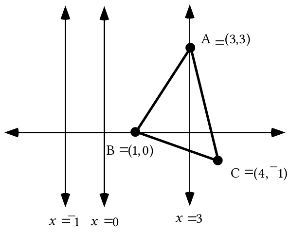

A. Which of the following statements are true about the composite $r_{x={}^{-}1}\circ r_{x=3}$ used to reposition the triangle in the illustration above?

#1: The composite preserves collinearity and distance.

#2: The transformation preserves angle measure.

#3: The transformation reverses orientation.

B. Write an equation that describes the line in which the triangle is first reflected when repositioned with $r_{x={}^{-}1}\circ r_{x=3}$.

C.

1\. What are the coordinates of point A'?

2\. What are the coordinates of point A"?

### II.

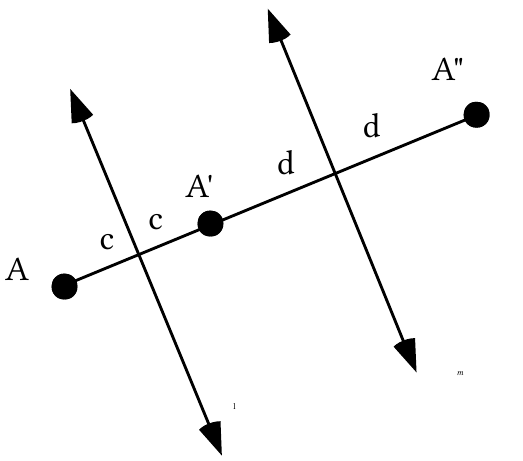

In the illustration above $r_{\ell}(A)=$A' and $r_m$(A') = A".  The lower case letters represent distances.

A. Represent the total distance from A to A" as a sum of four addends.

B. Represent the total distance from A to A" as the sum of two products.

C. Represent the total distance from A to A" as the product of two factors.

D. Represent as the sum of two addends the distance from line $\ell$ to line $m$, (measured along a line perpendicular to both of them).

E. How does the distance from A to A" compare to the distance between the two lines of reflection?

### III.

Use your calculator to compute each of the following accurate to three decimal places:

A. $\sqrt{3.6^2+5.7^2}$  B. $\sqrt{{}^{-}3.6^2+5.7^2}$  C. $\sqrt{({}^{-}3.6)^2+5.7^2}$

### IV.

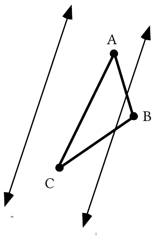

Trace triangle ABC and the two parallel lines in the illustration at the bottom of the previous page onto your homework paper.  Then do the following:

A. Sketch the image of the triangle under a reflection in line $\ell$.  Use prime notation to label the vertices of the image.

B. Sketch the image of the image you just sketched of the triangle under a reflection in line $m$.  Use double prime notation to label the vertices of this second image.

C. Give the number of any of the following that are true about the composite which maps triangle ABC onto triangle A"B"C":

#1:  it is $r_{\ell}$ after $r_m$  #2:  it is $r_m$ after $r_{\ell}$

#3:  it reverses orientation  #4:  it is a translation

### V.

A. Give the length of segment AB.

B. Give the length of segment BC.

C. Compute the exact length of segment AC.

D. Give the length of segment AC accurate to the nearest tenth.

### VI.

Here is a description of a transformation:

the first coordinate of the image is 3 more than the first coordinate of the pre-image and the second coordinate of the image is 4 more than the second coordinate of the pre-image.

A. Copy and complete this image formula for the transformation:

T$(x,y)=$

B. Give the image of (0,0) when it is mapped with this transformation.

C. Make a sketch showing (0,0) and its image on a coordinate system and use the Pythagorean Theorem to compute the distance between these two points.

### VII.

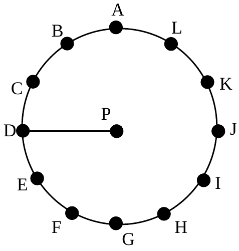

In this figure the 12 points marking positions on the circle are evenly spaced around it.

A. Give the new position of point D if it is turned about point P in the ways described:

1\. It is turned 30˚ clockwise.

2\. It is turned 120˚ counter-clockwise.

3\. It is turned 390˚ counter-clockwise.

B. Describe two different ways to turn point D about point P to point I.

### VIII.

Describe four different ways to turn line $\ell$ onto line $m$.  Use descriptions similar to those used in question VII, A.

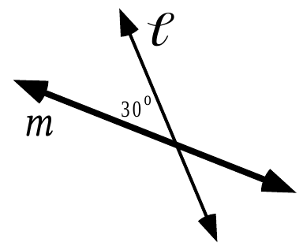

### IX.

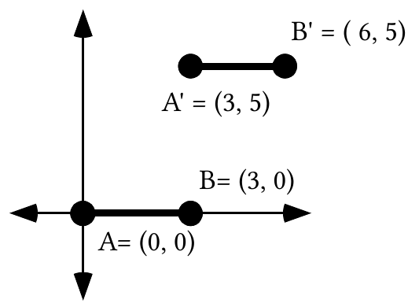

In the figure at the bottom of the previous page, segment A'B' is the image of segment AB under a transformation.

A. Give the phrases that complete these statements about the relationship between the coordinates of A, B, A' and B':

#1: The first coordinate of each image point is \_\_\_\_\_\_\_\_\_\_\_\_\_\_\_\_\_ the first coordinate of its pre-image.

#2: The second coordinate of each image point is \_\_\_\_\_\_\_\_\_\_\_\_\_\_\_\_ the second coordinate of its pre-image.

B. Find a way to use the Pythagorean Theorem to compute these distances:

1\. The distance from A to A'.

2\. The distance from B to B'.

C. Answer Yes or No:  Does it appear that the direction from A to A' is the same as the direction from B to B'?

## Assignment #6

### I.

You have recently seen a computer compose several pairs of reflections.  In each case the two lines of reflection were parallel.  Each composite of reflections was a translation. Think about these experiments and write a short answer to each of these questions:

#1:  Given that you know in which of two parallel lines a pre-image will be first reflected, how can you predict the direction of the translation?

.

#2: Given that you know the distance between the lines of reflection (measured along a line perpendicular to both of them), how can you predict the magnitude of the translation?

### II.

<strong>Some Properties of Translations</strong>

In discussing question I of assignment #5, we agreed that translations “inherit” certain properties from the reflections from which they can be composed. Reflections preserve collinearity.  Collinear points in an original pre-image have collinear intermediate images and the collinear intermediate image points have collinear final images.  Therefore

<strong>Translations preserve collinearity.</strong>

For similar reasons translations “inherit” the properties of preserving distance and angle measure from the reflections from which they can be composed.

<strong>Translations preserve distance.</strong>

<strong>Translations preserve angle measure.</strong>

Your experience with questions I and IV of assignment #5 should have suggested that translations do not reverse orientation.  Each translation can be composed from two reflections.  The first one will reverse orientation and the second will reverse the orientation of the intermediate image.  This means that the final image will have the same orientation as the original pre-image.  This property is not as significant as the three highlighted above.

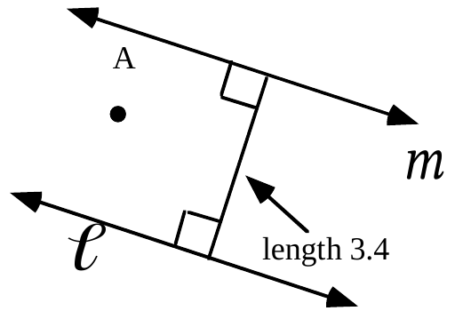

Answer these questions about the composite $r_{\ell}\circ r_m$, which will move point A to an intermediate image and then a final image.

A. What type of transformation is this composite?

B. On your homework paper sketch an arrow that represents the composite.

C. Give the magnitude of the composite.

### III.

In the figure below, $r_{\ell}(A)=A'$ and $r_m$(A') = A".

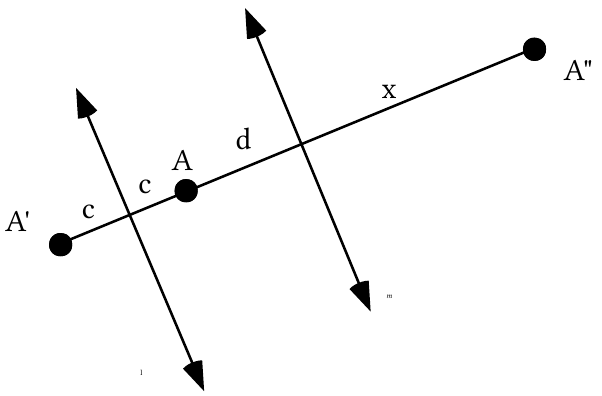

A. Represent x (the distance from line $m$ to A") as the sum of three addends.  To do this, use the fact that $r_m$(A') = A".

B. Represent the total distance from A to A" as a sum of four addends.

C. Represent the total distance from A to A" as the sum of two products.

D. Represent the total distance from A to A" as the product of two factors.

E. Represent the distance from line $\ell$ to line $m$, (along a line perpendicular to both of them), as the sum of two addends.

F. How does the distance from A to A" compare to the distance between the two lines of reflection?

### IV.

First, trace the figure below onto your homework paper.

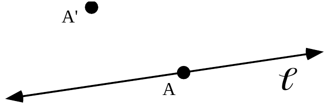

The same translation that moves point A to point A' will move line $\ell$ onto a line we will call $m$.  Sketch line $m$.

### V.

<strong>Oblique Translations</strong>

The parallel lines of reflection in question IV of assignment #5 were neither horizontal nor vertical relative to the sides of the paper.  But a composite of reflections in these lines is still called a translation because arrows from each of the original pre-image points to their final images are all in the same direction and have the same length.  <strong>When the arrows from the pre-images to the final images for a translation are neither horizontal or vertical, the translation is called an oblique translation.</strong>

<strong>Oblique Translations on a Coordinate System and Computing Magnitudes</strong>

In discussing question VI of assignment #5, we agreed that if points in a coordinate system are all repositioned by using an image formula of the form

T$(x,y)=(x+a,y+b)$

the arrows connecting pre-images to their images will all have the same length and point in the same directions.  For this reason, the repositioning based on such an image formula is called a translation.  It was demonstrated that it is possible to identify two lines of reflection so that a composite of reflections in these lines produces the translation.  However, it is usually easier to work directly from an image formula for a translation without identifying it as a composite of reflections.

In the case of question VI of assignment #5 it was easy to use the Pythagorean Theorem to compute the distance from (0,0) to its image, (3,4).  This distance is $\sqrt{3^2+4^2}=5$.  5 is the length of any arrow that  connects a pre-image to its image for this particular translation.  The shared length of these arrows is called the <strong>magnitude</strong> of the translation.

A. Give an image formula for the translation that maps (0,0) to (4,-5). .

B. Give the exact magnitude for this translation (this means represent the magnitude with a radical sign over an integer and not as a decimal).

### VI.

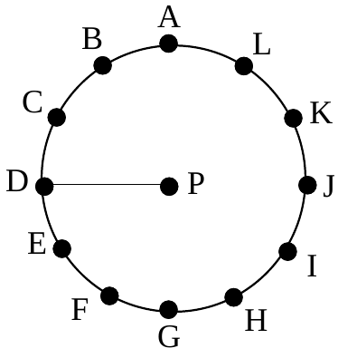

With reference to the figure above, the 12 points marking positions on the circle are again evenly spaced.  As an alternative to using the words “counter-clockwise” and “clockwise,” signs are often used to indicate the direction of a turn.  For reasons you will learn later, counter-clockwise turns are indicated by a positive number of degrees and clockwise turns are indicated with a negative number of degrees.

A. Give the new position of point D if it is moved about point P with turns described by each of the following:

1\. A turn of ¯210˚          2. A turn of 150˚

3\. A turn of 450˚           4. A turn of ¯450˚

B. Write four copies of the phrase “A turn of \_\_\_\_\_\_\_” on your homework paper. Each time fill in the blank differently, but fill it in so that it will describe how point H can be moved about point P so that it comes to position A.

### VII.

A. On Composite of Reflections in Intersecting Lines, Sketch Sheet #1, which you have been provided separately, do the following:

1\. Sketch the image of point A under a reflection in the $x\text{-axis}$ and label the image A'.

2\. Now sketch the image of A' under a reflection in the line labeled “$y=x$” and label this second image A".

3\. Repeat steps “1” and “2” above for points B and C.  Again, use prime notation to label the two intermediate images and the two final images.

4\. Answer Yes or No:  If you connect each pre-image to its final image (the one labeled with the double prime) with arrows, each of these arrows will point in the same direction and have the same length.

B. On Composite of Reflections in Intersecting Lines, Sketch Sheet #2, which you have also been given, do the following:

1\. Sketch the image of point A under a reflection in the $y=x$ line and label the image A'.

2\. Now sketch the image of A' under a reflection in the “$y\text{-axis}$” and label this second image A".

3\. Repeat steps “1” and “2” above for points B and C.  Again, use prime notation to label the images.  You should be adding two intermediate images and two final images to the sketch.

4\. Compare your work on sketch sheet 1 to your work on sketch sheet 2, then answer Yes or No: A reflection in the $y\text{-axis}$ after a reflection in the $y=x$ line appears to produce the same images as a reflection in the $y=x$ line after a reflection in the $x\text{-axis}$.

### VIII.

Use signed degree expressions like those used in question VI, A, above to describe four different ways to turn line $\ell$ onto line $m$.

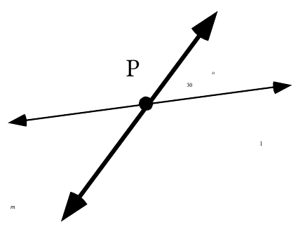

### IX.

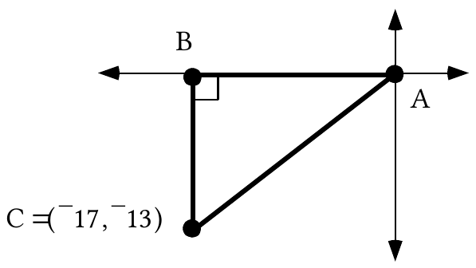

A. Give the length of segment AB.

B. Give the length of segment BC.

C. Calculate the length of segment AC accurate to the nearest hundredth.

## Assignment #7

### I.

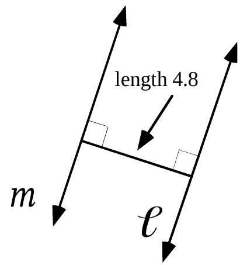

These questions are about the composite $r_m\circ r_{\ell}$ for lines <em>m</em> and $\ell$in the illustration above:

A. Give the magnitude of this translation.

B. Sketch on your homework paper an arrow that represents the translation.

### II.

In the illustration, $r_{\ell}(A)=$A' and $r_m$(A') = A".

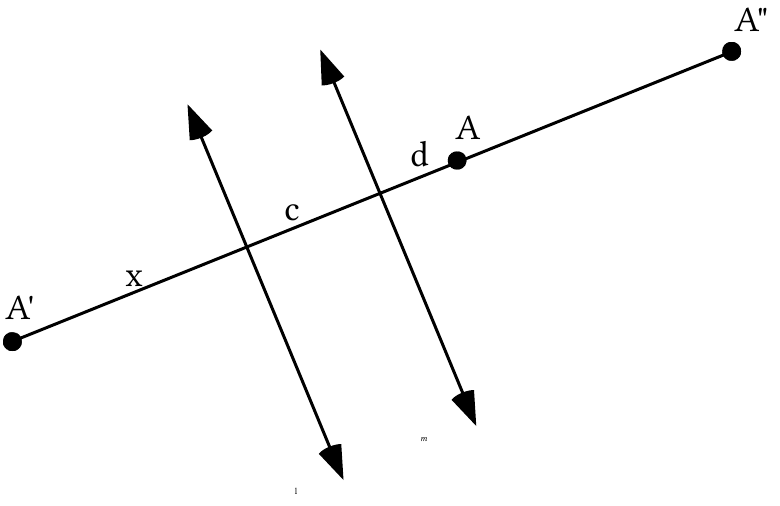

A. Give x (the distance from line $\ell$to A') as the sum of two addends.

B. Give the distance from A' to line $m$ as the sum of three addends.

C. Give the distance from line <em>m</em> to A" as the sum of two addends.

D. Give the distance from A to A" as the sum of two addends.

E. How does the distance from A to A" compare to the distance from line $\ell$ to line $m$ , (measured along a line perpendicular to both of them)?

### III.

<strong>The Translation-Parallelism Assumption–Part I</strong>

This illustration is from question IV of assignment #6.  A representation of the image of line $\ell$ under the same translation that moves point A to point A' has been added.  That image, $\ell$', appears to be parallel to the pre-image $\ell$. This is because all points on $\ell$ move the same distance in the same direction to their new position.

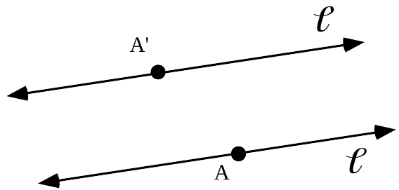

This example is presented to introduce part I of

The Translation-Parallelism Assumption, Part I.

When a line is mapped with a translation, the image is parallel to the pre-image.

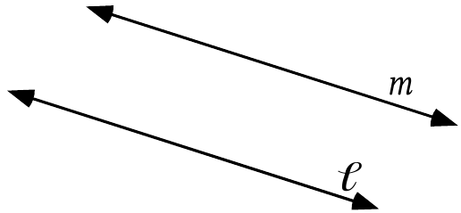

Trace the above representation of two parallel lines.  Then draw arrows for two different translations that will move line $\ell$ onto line $m$.

### IV.

<strong>Something New from Composing Two Reflections–Rotations</strong>

The sketch sheets for question VII of assignment #6 asked you to move points to new positions in two steps, using a reflection at each step. However, when each original pre-image was connected to its final image with an arrow, the arrows did not all have the same length and they definitely did not all point in the same direction.  The composites of reflections for these sketches were therefore not translations.  What was new in these cases was that the lines of reflection were not parallel.

Later you connected each pre-image and its final image to the origin with line segments.  This made it easier to see that the movement from the pre-images to the final images could be described as a turning about the origin.

When repositioning is done with a composite of reflections in intersecting lines, that composite is called a <strong>rotation</strong>.

The point of intersection of the two lines of reflection is the only point that does not move at all.  That point is called the <strong>center</strong> of the rotation.

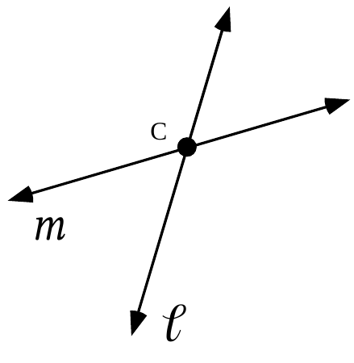

A. The composite, $r_m\circ r_{\ell}$, is what type of transformation?

B. What is the center of the composite, $r_m\circ r_{\ell}$?

### V.

<strong>The Use of Directed Arcs to Describe How One Object Can Be Turned Onto Another</strong>

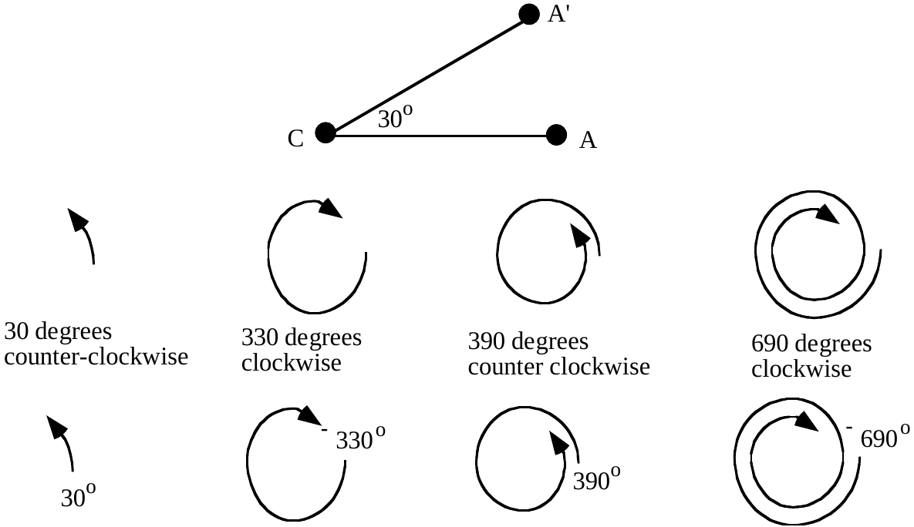

Look at angle ACA' in the illustration at the bottom of the previous page.  There are many ways to describe how point A can be turned onto point A' about center point C.  Four of these ways are illustrated in the row under the illustration showing A, A' and C.  These representations are called <strong>directed arcs</strong>.  Under each directed arc is written a description of how much turning is done.

There is a second row of directed arcs.  With each of these directed arcs a signed number of degrees has been included to give a measure of precisely how much turning is done.  Notice that turns in the counter-clockwise direction are indicated with a positive number of degrees and turns in the clockwise direction are indicated with a negative number of degrees.

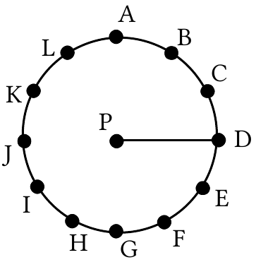

Again, the 12 points marking positions on the circle are evenly spaced.

A. Give the new position of point D if it is moved about point P with turns described by each of the following:

1\. 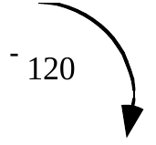  2. 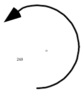

3\. 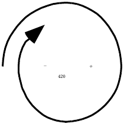  4.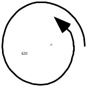

B. Copy the phrase “A turn of \_\_\_\_\_\_\_” four times. Each time fill in the blank differently, but fill it in so that it will describe how point H can be moved about point P so that it comes to position A.  Used signed degrees to fill in the blanks.

### VI.

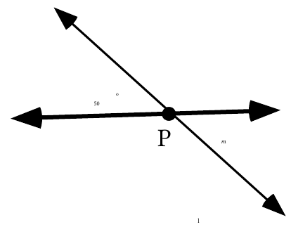

Use directed arcs to indicate four different ways to rotate line $\ell$ onto line $m$ about point P.

### VII.

The following questions are about the translation that moves (5,-2) to the origin, (0,0).

A.  Copy and complete this image formula that translation. :

T(<em>x</em>,<em>y</em>) =

B.  Give the coordinates of the image of (11,4) under that same translation.

### VIII.

Give the <strong>exact</strong> distance from (0,0), the origin, to each of the following points:

A. (¯9,0)  B. (1,1)  C. $\left(\frac{{}^{-}1}{2},\frac{1}{2}\right)$  D. (6,6)

### IX.

“Solve” each of the following and then give the solution without an “<em>x</em>” or an equal sign:

A. $7\cdot x+11=6\cdot x+13$      B. $12\cdot x+{}^{-}13=13\cdot x+{}^{-}5$

C. $\sqrt{3}\cdot x+17=2\cdot x+{}^{-}8$

## Assignment #8

### I.

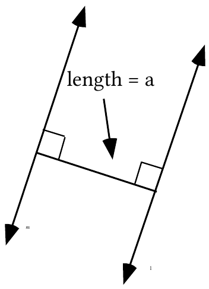

A.  Sketch an arrow that represents the translation $r_{\ell}\circ r_m$.

B. If the magnitude of this translation is 24.2, what is the value of a, the length of the segment shown perpendicular to both lines of reflection?

### II.

Use directed arcs to indicate four different ways to rotate line $\ell$ onto line $m$ about point P.

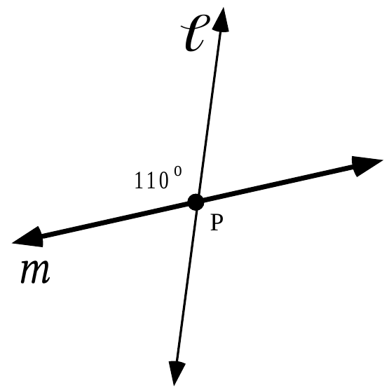

### III.

Give an exact representation of the distance from (0,0), the origin, to each of the following points:

A. (0,¯5)  B. (2,3)  C. $\left(\frac{1}{\sqrt{2}},\frac{1}{\sqrt{2}}\right)$  D. (¯8,15)

### IV.

<strong>The Translation-Parallelism Assumption–Part II</strong>

The figure at the top of the next page is from question III of assignment #7.

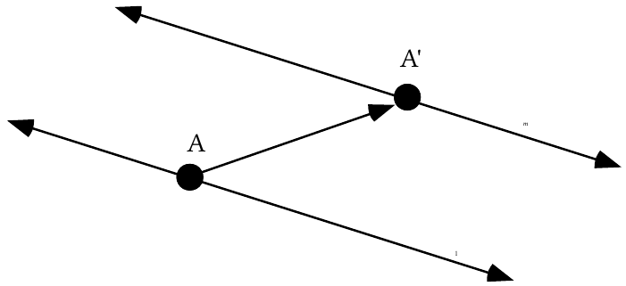

In discussing that question we agreed that if we pick any point, A, on line $\ell$ and then any point, A', on line $m$ to be its image, the translation that moves the chosen pre-image to the chosen image must also move line $\ell$ onto line $m$.  This supports the statement that if two lines are parallel, it is always possible to move them onto each other with translations.  Thus we have

The Translation-Parallelism Assumption, Part II.

Any two parallel lines can be translated onto each other.

Here again is part I of the Translation-Parallelism Assumption

When a line is mapped with a translation, the image is parallel to the pre-image.

These two parts can be combined to form

<strong>The Translation-Parallelism Assumption</strong>

The translation image of a line is always a parallel line and any two parallel lines can be translated onto each other.

<strong>Mapping Terminology</strong>

A map maker pairs points on a portion of the surface of the Earth with points on the map. This pairing is like the pairing of a pre-image with an image.  The map is in fact an image of a portion of the surface of the Earth.  For this reason, we will adopt a common way of speaking.  When a point is moved, or repositioned by a transformation, we will say that the point is <strong>mapped</strong> by the transformation.  We will also say that a transformation <strong>maps</strong> points to their images.

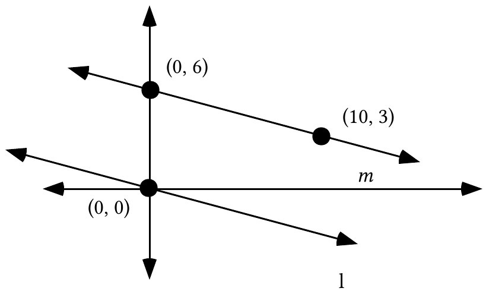

In the figure above lines $\ell$ and $m$ are parallel.

A. Give an image formula for translation T1 that will map (0,0) to (0,6).

B. Give an image formula for a different translation, T2, that will also map line $\ell$ onto line $m$.

C. Give the exact magnitudes for the two translations for which you gave image formulas as your answers to A and B right above.  Make it clear which magnitude goes with which translation.

### V.

A. What is the image of (4,¯1) under the same translation that maps (¯2,¯3) to the origin, (0,0)?

B. What is the image of (¯2,¯3) under the same translation that maps (4,¯1) to the origin?

C. What is the distance from the origin to your answer to “A” right above?

D. What is the distance from the origin to your answer to “B” right above?

### VI.

Give the number that can be put in place of <em>x</em> to make each of these open sentences true.  In other words, give the solution of each open sentence.

A. $11\cdot x+{}^{-}17=9\cdot x+{}^{-}9$      B. $3\cdot x+23=\frac{1}{3}\cdot x+{}^{-}7$

C. $4\cdot x+23=\pi\cdot x+{}^{-}7$

## Assignment #9

### I.

<strong>A Reminder That Reflections Reverse Orientation</strong>

The illustration below shows a four-sided figure, called a quadrilateral, and its image under a reflection in a line, $\ell$.

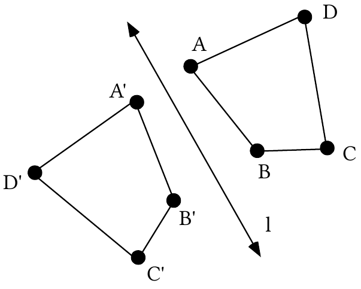

If you trace with a finger about the pre-image figure, starting at A and passing through the vertices in alphabetical order, the movement of your finger will be counter-clockwise.  However, if you trace with a finger about the image figure, starting at A' and passing through the vertices in alphabetical order, the movement of your finger will be clockwise.  This illustrates the “reversal of orientation” that occurs when a figure is mapped with a <strong>single</strong> reflection.

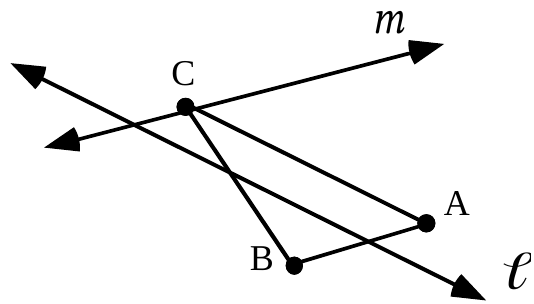

Trace the two lines of reflection and triangle ABC above onto your homework paper.  Then do the following:

A. Sketch the image of the triangle under a reflection in line $\ell$.  Use prime notation to label the vertices of the image.

B. Sketch the image of the image you just sketched under a reflection in line $m$.  Use double prime notation to label the vertices of this second image.

C. Give the number of any of the following that are true about the transformation which maps triangle ABC onto triangle A"B"C":

#1:  it is $r_m$ after $r_{\ell}$      #2:  it is $r_{\ell}$ after $r_m$

#3:  it reverses orientation    #4:  it is a translation

### II.

Part of a town plan is shown below, where the distances between consecutive streets is 200 meters for North-South running streets and 100 meters for East-West running streets.

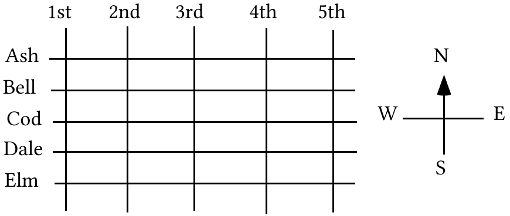

A. “As the crow flies,” what is the exact distance from 1st and Elm to 3rd and Bell?

B. What is the shortest distance along streets from 1st and Elm to 3rd and Bell?

### III.

These questions involve the translation that will map (¯3,8) to the origin, (0,0).

A. Give an image formula for that translation.

B. Give the image of (5,¯2) under that translation.

C. Give an exact representation of the distance from the origin to your answer to “B” right above.

D. True or False: Your answer to “C” right above is also the distance from (¯3,8) to (5,¯2).

### IV.

<strong>Using a Translation to Help Compute the Distance Between Two Points</strong>

The work in questions VII and VIII of assignment #7 is illustrated below:

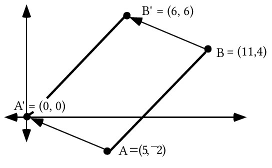

Point B was translated to B' by the same translation that moved A to A'.  Since translations preserve distance, the length of the segment from A to B is equal to the length of the segment from A' to B'. It is rather easy to use the Pythagorean Theorem to compute the distance from (0,0) to any other point.  Thus it is easy to compute the exact distance from A' to B' as $\sqrt{6^2+6^2}=\sqrt{72}$.  Therefore the exact distance from A to B is also $\sqrt{72}$.

This question illustrates a technique you can use to compute the exact distance between two points when neither of them is the origin.

Step #1: Translate either of the two points to (0,0).

Step #2: Compute the coordinates of the image of the second point under the same translation.

Step #3: Use the Pythagorean Theorem to compute the exact distance between (0,0) and the image you computed in step #2.

In doing Step #3, you have also computed the distance between the original two points because translations preserve distance.  The work illustrated above for (5,-2) and (11,4) can be organized neatly as shown below:

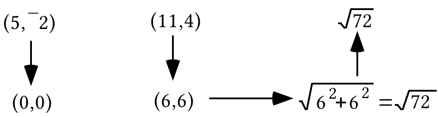

The above discussion has presented the <strong>translation technique</strong> for computing the distance between two points.

Use the translation technique described above to compute the distance between each of the following pairs of points.  Give your answers accurate to the nearest hundredth.

A. (¯5,¯3) and (9,¯6)    B. (1.3, 12.9) and (6.7, 15.3)

### V.

A. Give two different directed arcs for rotating the $y\text{-axis}$ onto the $y={}^{-}x$ line.

B. Give two different directed arcs for rotating the $y={}^{-}x$ line onto the $x\text{-axis}$.

### VI.

On Reflections in Intersecting Lines, sketch sheet #3, which you have been provided separately, do the following:

A. Sketch the image of point A under a reflection in the $y\text{-axis}$ and label the image A'.

B. Now sketch the image of A' under a reflection in the line labeled “$y={}^{-}x$” and label this second image A".

C.. Repeat steps “1” and “2” above for points B and C.  Again, use prime notation to label the images.  In the process you should add a total of four images to your sketch (two imtermediate images and two final images).  Connect the three double-prime images to form a triangle.

D. A reflection in the $y={}^{-}x$ line after a reflection in the $y\text{-axis}$ is a rotation.  Give a directed arc for this rotation.

### VII.

Which of the following figures, if any, would you describe as having symmetry?

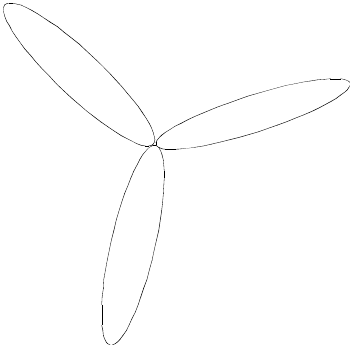  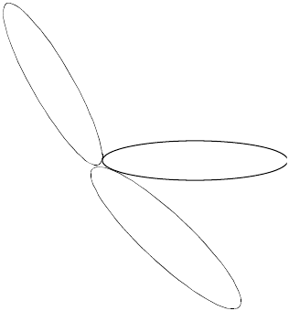

Figure #1  Figure #2

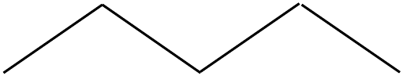  

Figure #3  Figure #4

## Assignment #10

### I.

<strong>Symmetry and Transformations</strong>

Of the four figures presented in question VII of assignment #9, numbers 1 and 3 deserved to be called “symmetric.”  In mathematics, different types of symmetry are identified using transformations.

When we discussed these figures we were able to identify a line of reflection that can be used to map figure #3 onto itself.  Figure #3 with this line of reflection are shown below:

Figure #3 has only one line of reflection symmetry.

Figure #1 was richer in reflection symmetry.  As shown below, it has reflection symmetry in different lines.

Any figure that can be mapped onto itself with even one reflection is said to have reflection symmetry.

You have seen that when reflections in two intersecting lines are composed, the result is a rotation.  If figure #1 is mapped with a composite of reflections in any two of its three lines of reflection symmetry, it is also its own image.  For this reason, figure #1 is said to have rotation symmetry as well as reflection symmetry.

A. Trace the figure above and add to it so that the resulting figure has reflection symmetry.  Then add to your figure a line of reflection symmetry.  (There are many ways to do this.)

B. Trace the figure above a second time and add to it so that the resulting figure has rotation symmetry.  Then label with “P” a dot that is a center of rotation symmetry for the figure you have drawn.

### II.

On Reflections in Intersecting Lines, Sketch Sheet #4, with which you have also been provided, do the following:

A. Sketch the image of point A under a reflection in the $y={}^{-}x$ line and label the image A'.

B. Now sketch the image of A' under a reflection in the “$x\text{-axis}$“ and label this second image A".

C. Repeat steps “1” and “2” above for points B and C.  Again, use prime notation to label the images. In the process you should add a total of four images to your sketch.  Join the three double-prime images to form a triangle.

D. A reflection in the $x\text{-axis}$ line after a reflection in the $y={}^{-}x$ is a rotation.  Give a directed arc for this rotation.

### III.

A. Give an exact representation of the distance from the origin to (5,¯7).

B. In each case use the translation technique with a diagram as described in question IV of assignment #9 to calculate the distance between the given pairs of points:

1\. (4,8) and (9,1)          2. (¯3,4) and (2,¯3)

### IV.

Because rotations can be composed from reflections, they “inherit” at least some of the properties of reflections.  Look back at assignments #1 and #2 to remind yourself of the properties of reflections that were presented there. Then make a list of any of those properties that are “inherited” by rotations.

### V.

Give the solution, without unnecessary attachments, for each of these open sentences:

A. $\frac{1}{7}\cdot x+11={}^{-}2\cdot x+{}^{-}9$           B. $\sqrt{3}\cdot x+5=2x+8$          C. $x+{}^{-}4=\sqrt{11}\cdot x$

### VI.

In the figure at the top of the next page each of the small triangles is equilateral.  This means that in each of these triangles, the three sides are equal in length and the three angles are equal in measure.

In the following, T is the translation that maps point O to point A and R is the rotation with a magnitude of 60˚ centered at O.  Describe, with a letter or a phrase, the images represented by each of the following:

A. T(N)     B. R(N)      C. T$\circ$T(N)      D. R$\circ$T(I)     E. R(triangle OMA)

### VII.

A. In the figure above, the lines $\ell$ and $m$ are parallel and eight different angles are identified by numerals written near their vertices.  List all the pairs of angles that can be mapped onto each other with translations.

B. Certain pairs of these angles can be rotated onto each other with a rotation with magnitude 180˚ centered at their common vertex.  List all such pairs.

C. Certain pairs of angles in the figure can be mapped onto each other with a translation after a rotation of magnitude of 180˚.  List all such pairs.

### VIII.

<strong>Magnitudes for Rotations Composed from Two Reflections</strong>

In question VI of assignment #9 as well as Question II of this assignment, you connected the original three pre-image points to show a triangle. Then you connected the three final image points to show the image of that triangle.  You should have found that both the composite $r_{y={}^{-}x}\circ r_y$ and the composite $r_x\circ r_{y={}^{-}x}$

produced the same final images for the triangles we drew:

<strong>What distinguishes one transformation from another is not how we describe moving pre-images to the images, but what images the pre-images have.  In the case of the sketch sheets, we have seen that both the composite</strong>

$$
r_{y={}^{-}x}\circ r_y
$$

<strong>and the composite</strong>

$$
r_x\circ r_{y={}^{-}x}
$$

<strong>produce the same images from the same pre-images.  They are therefore considered to be two different representations of the same transformation.</strong>  The one transformation with these representation is called a rotation centered at (0,0), the one point on all four lines of reflection.

There is more than one way to turn the pre-image triangle onto the image triangle.  In each case, the center of the turn was (0,0), the point where the lines of reflection intersected.  The directed arcs shown below all describe ways to turn the pre-image triangle onto the final image triangle for both sketch sheet #3 and sketch sheet #4 for Reflections in Intersecting Lines:

There are, in fact, an unlimited number of directed arcs that could be drawn for turning the pre-image triangle onto the final image triangle.  Even different movements of the pre-image onto the final image can be described.  <strong>The numbers for the four turns represented by arcs above, 90˚, ¯270˚, 450˚, and ¯630˚ degrees are among the unlimited number of magnitudes for the one rotation represented by</strong> $r_{y={}^{-}x}\circ r_y$ <strong>and</strong> $r_x\circ r_{y={}^{-}x}$<strong>.</strong>

It is also important to notice that doubling any turn number for moving the first line of reflection onto the second one always gives a magnitude for the rotation.  Keep this in mind as you work on this question.

A. Use directed arcs to indicate four different ways to rotate line $\ell$ onto line $m$

B. Give two different magnitudes for the composite $r_m\circ r_{\ell}$.

C. Use directed arcs to indicate four different ways to rotate line $m$ onto line $\ell$.

D. Give two different magnitudes for the composite $r_{\ell}\circ r_m$.

## Assignment #11

### I.

<strong>Relating the Measures of Angles Formed when a Pair of Parallel Lines is Crossed by a Third Line</strong>

Here is the figure from question VI of assignment #10.  Lines $\ell$ and $m$ are parallel.

Eight angles are identified with numerals near their vertices.  Several pairs of these angles can be mapped onto each other with transformations that preserve angle measure.  Angles that can be mapped onto each other with angle preserving transformations are called <strong>congruent angles</strong>.

Congruent angles can be classified according to the type of transformation that will map one onto another. Angles 6 and 8 can be mapped onto each other with a rotation with a magnitude of 180˚ centered at their shared vertex.  This pair is an example of <strong>congruent vertical angles</strong>. The word "vertical" comes from the same root as the word "vertex."

<strong>Congruent vertical angles</strong> are angles that can be mapped onto

each other with a 180˚ rotation centered at their shared vertex.

Since lines $\ell$ and $m$ in the figure above are parallel, the Translation-Parallelism Assumption guarantees they can be mapped onto each other with translations.  Line $\ell$ can be mapped onto line $m$ with the translation that maps the vertex of angle 3 onto the vertex of angle 7.  That translation also maps angle 3 onto angle 7.  Since translations preserve angle measure, angles 3 and 7 are congruent.  Congruent angles that can be mapped onto each other with translations are called <strong>congruent corresponding angles</strong>.

<strong>Congruent corresponding angles</strong> are angles that

can be mapped onto each other with a translation.

Angle 3 in the figure above can be mapped onto angle 5 by first rotating it onto angle 1 with a 180˚ rotation centered at the common vertex of angles 1 and 3 and then using a translation. The translation is the one that maps the common vertex of 1 and 3 onto the common vertex of 5 and 7.  3 and 5 are <strong>congruent alternate angles.</strong>

<strong>Congruent alternate angles</strong> are those that can be mapped onto

each other with a composite of a 180˚ rotation and a translation.

A. What type of transformation maps one of two congruent corresponding angles onto the other?

B. Describe how to map one of two congruent alternate angles onto the other.

### II.

In the figure below, line $\ell$ is parallel to line $m$.

A. Use lower case letters to name the angles asked for below:

1\. Name four pairs of congruent corresponding angles.

2\. Name four pairs of vertical angles.

3\. Name four pairs of congruent alternate angles.

B. In the figure above, if angle c has measure 62˚, give the measure of:

1\. angle a  2. angle d  3. angle h

4\. angle b  5. angle f  6. angle e

### III.

In the figure below, line $\ell$ is parallel to line $m$.  In the figure, the letters represent the measures of angles.

Give the value of:

A.  a  B.  b  C.  c

### IV.

In the figure below, line $\ell$ is parallel to line $m$.  Again, the letters represent the measures of angles.

Give the value of:

A.  a    B.  b        C.  c

### V.

Trace this square onto your homework paper and sketch all the lines of reflection symmetry for it.

### VI.

In the figure below, each of the small triangles is equilateral.  This means that in each of these triangles, the three sides are equal in length and the three angles are equal in measure.

In the following, T is the translation that maps point O to point A and R is the rotation with a magnitude of 60˚ centered at O.  Describe with a letter or a phrase the images represented by each of the following:

A. T(O)  B. R(O)  C. T$\circ$R(E)

D. R$\circ$T(E)  E. R$\circ$R$\circ$R(triangle POI)

### VII.

Give the solution for each of these open sentences:

A. $4\cdot x+11=3\cdot x+{}^{-}8$         B. $4\cdot a+11=3\cdot a+{}^{-}8$            C. $\sqrt{7}\cdot y+11=\pi\cdot y+{}^{-}8$

### VIII.

<strong>Magnitudes for Rotations Generated by Reflecting in a Pair of Intersecting Lines</strong>

Study the above illustration carefully.  It shows point A, its intermediate image and its final image when it is mapped with the composite $r_{\ell}\circ r_m$.

1\. Can you see that the smaller pair of congruent vertical angles formed by the lines of reflection, $\ell$ and $m$, have a measure of 30˚?

2\. Can you then see that the sum of the measure of angle ACA' and the measure of angle A'CA" is 60˚?

This means that a turn of ¯30˚ centered at C will move $m$, the line of reflection used first, onto $\ell$, the line of reflection used second.  This also means that a turn of ¯60˚ centered at C will move the original pre-image, A, onto the final image, A".

Now see if you agree that $m$, the first used line of reflection, can also be moved onto $\ell$ with a turn of 150˚ centered at C.  Finally, can you also see that point A could be moved onto point A" with a turn of 300˚, again centered at C?

The above examples are intended to help you understand the following general rule about composites of reflections in a pair of intersecting lines:

If “d” is a degree number for turning the line of reflection used first onto the line of reflection used second, then “2.d” is a magnitude for the rotation arising from a composite of reflections in the two lines.

A. Use directed arcs to indicate four different ways to rotate the $y\text{-axis}$ onto the $y={}^{-}x$ line.

B. Give two different magnitudes for the composite $r_{y={}^{-}x}\circ r_y$.

C. Use directed arcs to indicate four different ways to rotate the $y={}^{-}x$ line onto the $y\text{-axis}$.

D. Give two different magnitudes for the composite $r_y\circ r_{y={}^{-}x}$.

### IX.

A. Use directed arcs to indicate four different ways to rotate line $\ell$ onto line $m$ about point P.

B. Give two different magnitudes for the composite $r_m\circ r_{\ell}$.

C. Use directed arcs to indicate four different ways to rotate line $m$ onto line $\ell$.

D. Give two different magnitudes for the composite $r_{\ell}\circ r_m$.

### X.

Use the translation technique to compute the distance between each pair of points accurate to the nearest hundredth:

A. (5,¯8) and (13, 9)      B. (5.67,¯8.73) and (13.21, 9.33)

## Assignment #12

### I.

In the figure above, lines p, q, and r are all parallel to each other.

A. Give the congruent angles corresponding to angle a.

B. Give the alternate angles congruent to angle a.

C. Give all the angles that have the same measure as angle a.

### II.

In each case give the exact solution of the open sentence given:

A. $5\cdot x+{}^{-}21=3\cdot x+11$    B. $5\cdot x+{}^{-}21=\sqrt{3}\cdot x+11$

C. $5\cdot a+{}^{-}\sqrt{7}=3\cdot a+11$

### III.

In the figure above “a,” “b,” “c,” “e,” and “f” all represent angle measures. Also, line $\ell$ is parallel to line $m$.  In each case, give the expression, letter or number that can fill the blank to create a true statement:

A. The sum, a + b + c = \_\_\_\_\_\_\_\_\_\_\_\_\_ degrees.

B. a = \_\_\_\_\_ because they are measures of congruent alternate angles.

C. c = \_\_\_\_\_ because they are measures of congruent alternate angles.

D. By substituting letters that represent the measures of congruent angles, a + b + c = \_\_\_\_\_ + b + \_\_\_\_\_\_.

E. Therefore the sum of the measures of the three angles of any triangle is \_\_\_\_\_\_\_\_\_\_ degrees.

### IV.

In the figure below, each of the small triangles is equilateral.  This means that in each of these triangles, the three sides are equal in length and the three angles are equal in measure.

In the following, T is the translation that maps point O to point A and R is the rotation with a magnitude of 60˚ centered at O.  Describe with a letter or a phrase the images represented by each of the following:

A. T$\circ$T$\circ$T(H)      B. R$\circ$R(I)    C. T$\circ$R(segment EN)

D. R$\circ$T(segment GH)  E. R$\circ$T$\circ$T(F)

### V.

A. Trace the figure above and add to it so that the resulting figure has reflection symmetry.  Then add to your figure a line of reflection symmetry.  (There are many ways to do this.)

B. Trace the figure above a second time and add to it so that the resulting figure has rotation symmetry.  Then highlight and label with “P” a center of rotation symmetry for the figure you have drawn.

### VI.

Trace the parallelogram at the top of the next page and sketch any lines of reflection symmetry that it has.

### VII.

Use the translation technique to compute the distance between each pair of points accurate to the nearest hundredth:

A. (¯6,11) and (7, ¯10)

B. (¯6.22, 11.45) and (7.92, ¯10.03)

### VIII.

<strong>A Reminder About Magnitudes for the Rotations Composed from Reflections in a Pair of Intersecting Lines</strong>

Line $\ell$ can be moved onto line $m$ counterclockwise with turns of 60˚, 60˚ + 180˚ = 240˚, 60˚ + 2·180˚ = 420˚, <em>etc.</em>  Recall that this means that 2·60˚ = 120˚, 2·240˚ = 480˚, 2·420˚ = 840˚, <em>etc</em>. are all magnitudes for the one rotation represented by $r_m\circ r_{\ell}$.

Line $\ell$ can also be moved onto line $m$ clockwise with turns of ¯120˚, ¯120˚ + ¯180˚ = ¯300˚, ¯120˚ + 2·¯180˚ = ¯480˚, <em>etc</em>.  This means that the rotation represented by $r_m\circ r_{\ell}$ also has magnitudes 2·¯120˚ = ¯240˚, 2·¯300˚ = ¯600˚, 2·¯480˚ = ¯960˚, <em>etc</em>.

The composite $r_{\ell}\circ r_m$ is also a rotation.  $r_{\ell}\circ r_m$ has the same center as $r_m\circ r_{\ell}$, but it has a different set of magnitudes.  To identify some of these, one can think about how to move line $m$ onto line $\ell$.  Counterclockwise, this can be done with turns of 120˚, 300˚, 480˚, <em>etc</em>..  This means that $r_{\ell}\circ r_m$ has 240˚, 600˚, 960˚, etc. as magnitudes.

But since line $m$ can be turned onto line $\ell$ clockwise with turns of ¯60˚, ¯240˚, ¯420˚, <em>etc</em>., $r_{\ell}\circ r_m$ also has magnitudes ¯120˚, ¯480˚, ¯840˚, <em>etc</em>.

A. Use directed arcs to indicate four different ways to rotate the $x\text{-axis}$ onto the $y={}^{-}x$ line about the origin.

B. Give two different magnitudes for the composite $r_{y={}^{-}x}\circ r_x$.

C. Use directed arcs to indicate four different ways to rotate the $y={}^{-}x$ line onto the $x\text{-axis}$.

D. Give two different magnitudes for the composite $r_x\circ r_{y={}^{-}x}$.

### IX.

A. Use directed arcs to indicate four different ways to rotate line $\ell$ onto line $m$ .

B. Give two different magnitudes for the composite $r_m\circ r_{\ell}$.

C. Use directed arcs to indicate four different ways to rotate line $m$ onto line $\ell$.

D. Give two different magnitudes for the composite $r_{\ell}\circ r_m$.

## Assignment #13

### I.

In each case give the angle measure represented by the letter “a.”  You might find it helpful to refer back to question III of Assignment #12.

A.  B.

  

C. Line $\ell$ is a line of reflection symmetry for the larger triangle below.

### II.

In the illustration above, line $\ell$ and line $m$ are parallel.  Expressions representing the measure of two angles are written near their vertices.  Determine the value of “a.”

### III.

For this question you are to use the Symmetry Series, Sketch Sheet #1, with which you have been provided.

A. Shown with darker segments is only a portion of a complete figure.  The complete figure has two lines of reflection symmetry, the $y=x\text{ line}$ and the $y\text{-axis}$.  Sketch what could be the rest of the figure.

B. Answer Yes or No: Does the complete figure have rotation symmetry?

### IV.

A. Answer Yes or No: Can the figure above be mapped onto itself with the rotation centered at P with magnitude 360˚?

B. Answer Yes or No: Would you describe the figure above as “symmetric”?

### V.

A. Trace the parallelogram above onto your homework paper and add what is needed to the tracing to locate precisely a center of rotation symmetry for it.

B. Give the smallest positive magnitude for the rotation that will map the parallelogram onto itself.

### VI.

In the figure below, each of the small triangles is equilateral.  This means that in each of these triangles, the three sides are equal in length and the three angles are equal in measure.

In the following, T is the translation that maps point O to point A and R is the rotation with a magnitude of 60˚ centered at O.

A. Describe with a letter or a phrase the images represented by each of the following:

1\. R$\circ$T$\circ$T(H)            2. T$\circ$R$\circ$R(segment AB)

3\. T$\circ$R$\circ$T(triangle GFN)

B.

1\. Give a composite that will map segment NI onto segment OA.

2\. Give a composite that will map triangle OAM onto triangle ONI.

### VII.

Two crafts people make fancy cutting boards by hand.  The boards are made by gluing strips of wood together.  The tables above contain information about their work.

A. How many style #3 cutting boards does worker #2 make each day?

B. How many strips of oak are needed for each style #3 cutting board?

C. How many strips of walnut will worker #1 use each day in making style #3 cutting boards?

## Assignment #14

### I.

For each figure below give the value of the angle measure represented by “a.”

A.  B.

  

C.            D.

      

In the illustration above line $\ell$ is parallel to line $m$.

### II.

A. In figure #1 above, lines $\ell$ and $m$ are both parallel.  Give the value of “a.”

B. In figure #2, lines $k$,$\ell$ and $m$ are all parallel.  Determine the value of “a,” “b” and “c.”

### III.

In the figure below, each of the small triangles is equilateral.  This means that in each of these triangles, the three sides are equal in length and the three angles are equal in measure.

In the following, T is the translation that maps point O to point A and R is the rotation with a magnitude of 60˚ centered at O.

A. Describe with a letter or a phrase the images represented by each of the following:

1\. R(H)          2. T$\circ$R$\circ$R(segment OM)    3. T$\circ$R$\circ$T(triangle NOE)

B.

1\. Give a composite that will map segment EN onto segment NO.

2\. Give a composite that will map triangle FEN onto triangle APO.

### IV.

<strong>Refining the Idea of Rotation Symmetry</strong>

In question IV of assignment #13 you found that any figure at all would be its own image under a rotation that has 360˚ as one of its magnitudes, regardless of the center of that rotation.  This is because any point will come right back onto itself if it makes one full turn about any center.

Here is the figure from question IV.

No one would call this figure “symmetric.”  Nonetheless it could be rotated onto itself by making one full turn about any center.  We need a more careful description of rotation symmetry.

A figure has <strong>rotation symmetry</strong> when it can be mapped onto itself by at least one rotation that has a magnitude between 0° and 360°.

For this question you will work on the separate sheet with the title Symmetry Series, Sketch Sheet #2.

A. On this sheet in heavy outline to the right of the $y\text{-axis}$ is only a portion of a complete figure.  The complete figure has rotation symmetry.  The center is the origin and the smallest positive magnitude for any rotation that will map the figure onto itself is 90˚.  Sketch what could be the rest of the figure.  Since rotations preserve lines, you need only concentrate on the images of three points.

B. Answer Yes or No: Does the complete figure have reflection symmetry?  If it does, add to your sketch so that any lines of symmetry are shown.

### V.

<strong>The Dimension of a Matrix and Addresses within a Matrix</strong>

Here is one of the matrices from question VII of assignment #13.

The rows of a matrix run horizontally.  The two rows of the matrix are numbered from top to bottom.  The columns of a matrix run vertically.  The middle of the three columns of the matrix is boxed and numbered.  The <strong>dimensions</strong> of this matrix are 2$\cdot$3, the number of rows $\cdot$

the number of columns.  The symbol “$\cdot$” is read “by.”  This is a “two by three” matrix.

The <strong>dimensions</strong> of a matrix are (the number of rows) by (the number of columns).

In this course you will find numbers, variables, or even expressions made from numbers and variables arranged in matrices.  The things arranged into a matrix are called the <strong>elements</strong> of the matrix.  It is sometimes convenient to be able to refer to the specific location of an element in a matrix.  The “4” in row #1 and column #2 of the matrix above is said to be in address 1,2.  Notice that the address is made by giving the row number first then the column number.

It is common to name matrices with upper case letters.  For example

$$
A=\begin{bmatrix}x & 4 \\ {}^{-}3 & y \\ 7 & 0 \\ 2\cdot{x} & {}^{-}1\end{bmatrix}.
$$

Notice the eight elements in this matrix, including two variables.  There is also a variable expression in row four, column one.  The address is 4,1 and $a_{41}$ is a way to refer to “2.<em>x</em>” which identifies the matrix in which it appears and gives its address in a subscript.

These questions are about the matrix A = $\begin{bmatrix}5 & {}^{-}2 \\ 3 & 7 \\ {}^{-}1 & {}^{-}3\end{bmatrix}$

A. Give the dimensions of the matrix.

B. Give the matrix address of ¯1.

C. Give the number represented by a12.

D. Give the number represented by a21.

### VI.

A. There is an operation called “matrix multiplication.”  Matrix A = $\begin{bmatrix}2 & {}^{-}5 \\ 3 & 4\end{bmatrix}$ and matrix B = $\begin{bmatrix}1 & 3 \\ {}^{-}2 & 0\end{bmatrix}$.  Make a “guess” and write on your homework paper what you think is the product of these two matrices:

A.B=$\begin{bmatrix}2 & {}^{-}5 \\ 3 & 4\end{bmatrix}$.$\begin{bmatrix}1 & 3 \\ {}^{-}2 & 0\end{bmatrix}$= ?

B. Calculate the integer represented by $a_{11}\cdot b_{11}+a_{12}\cdot b_{21}$.

C. Calculate the integer represented by $a_{21}\cdot b_{12}+a_{22}\cdot b_{22}$.

### VII.

Here again are the matrices containing information about the work of two crafts people who each day make three different styles of cutting board.

$$
\begin{gathered}\text{Matrix A - daily production}\\\text{number of each style made}\\\begin{array}{c|ccc}\text{worker}\backslash\text{style number}&\#1&\#2&\#3\\\#1&8&4&6\\\#2&6&6&8\end{array}\end{gathered}\qquad\begin{gathered}\text{Matrix B - number of strips}\\\text{of each type of wood}\\\text{for each style}\\\begin{array}{c|ccc}\text{style}&\text{oak }\#1&\text{walnut }\#2&\text{cherry }\#3\\\#1&10&10&0\\\#2&8&6&6\\\#3&0&10&10\end{array}\end{gathered}
$$

A. How many strips of walnut (wood type #2) will be used by worker #2 each day to make her quota of style #3 cutting boards?

B. How many strips of walnut will be used by worker #2 each day?

C. How many strips of cherry (wood type #3) will be used by worker #1 each day?

### VIII.

A. Give one positive and one negative magnitude for the composite $r_m\circ r_{\ell}$.

B. Give one positive and one negative magnitude for the composite $r_{\ell}\circ r_m$.

## Assignment #15

### I.

As usual, use T to name the translation that maps point O to point A.  Use R to name the rotation with a magnitude of 60˚ centered at O.

A. Describe with a letter or a phrase the images represented by each of the following:

1\. R(F)             2. R$\circ$T$\circ$R$\circ$R(segment AM)

3\. R$\circ$T$\circ$R(triangle NOE)

B.

1\. Give a composite that will map segment FE onto segment OM.

2\. Give a composite that will map triangle HIN onto triangle BMA.

### II.

In each case give the angle measure represented by the letter “a.”

A.                B.

                    

C. In the figure below, quadrilateral ABCD is a parallelogram.

### III.

A. In figure #1 above, line $\ell$ is parallel to line $m$.  Give the value of “a.”

B. In figure #2 above, line $j$ is parallel to line $k$ and line $\ell$ is parallel to line $m$.  Give the values of “b” and “c.”

### IV.

For this question you are to work on the separate sheet labeled Symmetry Series, Sketch Sheet #3.  On that sheet are three line segments that make up a portion of a figure.  For this figure, the $x\text{-axis}$, the $y=x$ line and the $y\text{-axis}$ are all lines of symmetry.

A. Add to the sketch what could be the rest of the figure.

B. Give any other lines of reflection symmetry the complete figure has, if any.

C. Answer Yes or No: Does the complete figure have rotation symmetry?

D. If the complete figure has rotation symmetry, give the center of any rotation that will map the figure onto itself.

E. If the complete figure has rotation symmetry, give one magnitude between 0˚ and 360˚ for each different rotation that will map the figure onto itself.

### V.

Mr. Ford’s 1st period class has 18 males and 16 females.  His 2nd period class has 15 males and 15 females.  His third period class has 17 males and 9 females.

A.  Display this information in a matrix named “S” in which there is a row for each of the class periods.  Label each row and column of your matrix.

B.  Give the dimensions of your matrix, S.

C.  Give the address of the number which represents the number of females in his third period class.

D.  Give the number represented by $s_{21}$ and tell what information it gives about one of Mr. Ford’s classes.

### VI.

<strong>Moving Toward a Useful Way to Compute Numbers from Two Matrices</strong>

Here are the matrices from question VII of assignment #14:

The following sum of three products represents the number of strips of walnut used by worker #2 each day:

6 style #1 boards $\cdot$10 walnut strips per board  + 6 style #2 boards $\cdot$ 6 walnut strips per board + 8 style #3 boards $\cdot$ 10 walnut strips per board.

or, without the words

(6 $\cdot$ 10) + (6 $\cdot$ 6) + (8 $\cdot$ 10).

The arrows shown in the matrices show how this meaningful sum of products is formed by moving simultaneously across row #2 of Matrix A and down column #2 of Matrix B.  Can you see that altogether, six different sums of three products can be formed by moving across a row of matrix A and down a column of matrix B?  This is true because matrix A has two rows and matrix B has three columns.

This row-column pattern is used to define “multiplication” of certain pairs of matrices.  The details will be given in the next assignment.

To answer these questions, refer to the matrices given above containing information about the work of two crafts people who each day make three different styles of cutting board.

Give each of the following as a sum of three products.  Just write the sum—do not compute it.

A. The number of strips of oak used by worker #2 each day.

B. The number of strips of walnut used by worker #1 each day.

### VII.

For this question matrix A = $\begin{bmatrix}1 & 0 \\ 0 & {}^{-}1\end{bmatrix}$ and matrix B = $\begin{bmatrix}5 \\ {}^{-}2\end{bmatrix}$.  Create the 2$\times$1 matrix C whose elements are:

c11 =  a11.b11 + a12.b21  and  c21 =  a21.b11 + a22.b21.

## Assignment #16

### I.

As usual, use T to name the translation that maps point O to point A. Use R to name the rotation with a magnitude of 60˚ centered at O.

A. Describe with a letter or a phrase the images represented by each of the following:

1\. R$\circ$T$\circ$T$\circ$R(E)    2. R$\circ$T$\circ$T(triangle GNF)

B.

1\. Give a composite that will map point D onto point I.

2\. Give a composite that will map triangle FEN onto triangle POA.

### II.

A. In each case, give the angle measure represented by “a.”

1\. In the figure below, segment $\ell$ is parallel to segment $m$.

2\.

The four-sided polygon above is a parallelogram.

B.

Give the value of the angle measure sum, a + b + c.

### III.

In each case give the value of “a.”

A.

Line $\ell$ is parallel to line $m$.

B.

Line$\ell$ is parallel to segment $m$.

### IV.

For this question you will use the sheet labeled Symmetry Series Sketch #4.  Shown are two segments that make up only part of a figure.  The complete figure has 180˚ rotation symmetry centered at the origin.  Also, the lines described by <em>x</em> = 4 and x = 0 are lines of reflection symmetry for the complete figure.  Sketch what could be the complete figure.

### V.

<strong>The Pattern, Also Called the Algorithm, for Multiplying Certain Pairs of Matrices</strong>

The sum of three products,

$$
6\cdot0+6\cdot6+8\cdot10,
$$

formed by moving simultaneously across Row #2 of matrix A and down column #3 of matrix B, has a meaning.  It computes to 116 and this is the number of cherry wood strips used by worker #2 each day.  This number, formed from row #2 of matrix A and column #3 of matrix B, belongs in the 2,3 address of matrix C, below.  Notice that <strong>the address of this number identifies the row and column from which it is computed.</strong>

$$
\begin{gathered}\text{total number of strips}\\\text{needed each day}\\C=\begin{array}{c|ccc}\text{worker}&\text{oak}&\text{walnut}&\text{cherry}\\\#1&\phantom{116}&\phantom{116}&\phantom{116}\\\#2&\phantom{116}&\phantom{116}&116\end{array}\end{gathered}
$$

In a similar fashion, the five remaining blank addresses remaining in matrix C can each be filled with the correct number by forming sums of three products by moving across a row of matrix A and simultaneously down a column of matrix B.  The number of the row used in matrix A and the number of the column used in matrix B identify the proper address in matrix C for the computed result.

When matrix C is formed from matrices A and B in this way described, matrix C is called the product of matrix A and matrix B.  Or,

$$
A\cdot B=C.
$$

This example of how to form a new matrix using rows from a matrix on the left and columns from a matrix on the right sets the pattern for multiplying certain pairs of matrices.  It is required that the rows of the matrix on the left and the columns of the matrix on the right have the same number of elements in them.  However, this requirement will be met automatically in the pairs of matrices with which we work in this course.  You will see that this row-column interaction provides meaningful sums of products in a variety of other situations besides the one you have seen involving wood workers.

As you answer these questions, refer to the matrices given in the above discussion of matrix multiplication.  Matrix C has one row for each worker and one column for each type of wood.  The numbers in matrix C give information about the number of strips of each type of wood used daily by each worker.

A. Give the dimensions of matrix C.

B. Compute the number represented by c13

C. Compute the number represented by c21.

### VI.

The Cinema Center Four is composed of four theaters:  Cinemas I, II, III, and IV.  The admission price for one feature at the Center is \$3.00 for children, \$5.00 for students and \$8.00 for adults.  Attendance information for one particular Sunday matinee is given by matrix A =

$$
\begin{array}{c|ccc}&\text{Children}&\text{Students}&\text{Adults}\\\text{Cinema I}&225&110&50\\\text{Cinema II}&75&180&225\\\text{Cinema III}&280&85&110\\\text{Cinema IV}&0&250&225\end{array}
$$

A.  Represent the total amount paid for tickets to Cinema II as the sum of three products.

B. Represent the total amount paid for tickets to Cinema IV as the sum of three products.

C. If information about the ticket prices is stored in matrix B =$\begin{bmatrix}3 \\ 5 \\ 8\end{bmatrix}$,

1\. Calculate the integer represented by $a_{21}\cdot b_{11}+a_{22}\cdot b_{21}+a_{23}\cdot b_{31}$.

2\. Give the dimensions of matrix A.

3\. Give the dimensions of matrix B.

4\. Calculate the number in the 4,1 address of the product A.B.

### VII.

A. Calculate the matrix product $\begin{bmatrix}2 & {}^{-}5 \\ 3 & 4\end{bmatrix}$.$\begin{bmatrix}1 & 3 \\ {}^{-}2 & 0\end{bmatrix}$

B. Calculate the matrix product $\begin{bmatrix}1 & 3 \\ {}^{-}2 & 0\end{bmatrix}$.$\begin{bmatrix}2 & {}^{-}5 \\ 3 & 4\end{bmatrix}$

C. Calculate the matrix product $\begin{bmatrix}2 & 0 \\ 0 & 2\end{bmatrix}\cdot\begin{bmatrix}1 & 0 & 1 \\ 0 & 1 & 1\end{bmatrix}$

### VIII.

For each statement below, tell whether it is true without exception.

A. “If it is nighttime, then the sun is not shining.”

B. “If the sun is not shining, then it is nighttime.”

Note: Assume that both statements are being made about the place where you live.

## Assignment #17

### I.

In the figure above, line $\ell$ is parallel to line $m$.  Also, the measure of angle ABD (represented as “3a+7”) is equal to the measure of angle DBC.  Give the value of “b.”

### II.

The illustration below is of a “network.”  The numbered points in the network can be thought of as locations, such as cities or work sites in a building, that are interconnected with paths that are like roads between cities or communication links between work sites.

The incomplete matrix, N = $\begin{bmatrix}0 & 1 & 2 & 1 & 0 \\ 1 & 0 & 0 & \phantom{0} & \phantom{0} \\ 1 & 0 & \phantom{0} & \phantom{0} & \phantom{0} \\ \phantom{0} & \phantom{0} & \phantom{0} & \phantom{0} & \phantom{0} \\ \phantom{0} & \phantom{0} & \phantom{0} & \phantom{0} & \phantom{0}\end{bmatrix}$ contains information about how the points in the network are interconnected.  Study the matrix carefully.  Then copy it and fill in the fifteen missing entries.

### III.

Compute the following matrix products.  Use your calculator as you see fit.

A. $\begin{bmatrix}1 & 0 \\ 0 & {}^{-}1\end{bmatrix}\cdot\begin{bmatrix}1 \\ 1\end{bmatrix}$        B. $\begin{bmatrix}0 & 1 \\ 1 & 0\end{bmatrix}\cdot\begin{bmatrix}1 \\ {}^{-}1\end{bmatrix}$

C. $\begin{bmatrix}0 & 1 \\ 1 & 0\end{bmatrix}\cdot\begin{bmatrix}1 & 0 \\ 0 & {}^{-}1\end{bmatrix}$        D. $\begin{bmatrix}0 & {}^{-}1 \\ 1 & 0\end{bmatrix}\cdot\begin{bmatrix}1 \\ 1\end{bmatrix}$

### IV.

<strong>The Converse of the Pythagorean Theorem</strong>

The Pythagorean Theorem says that if a triangle such as the one in the at the top of the next page is a right triangle,

then $a^2+b^2=c^2$.  That is not the same as saying:

<strong>If the square of the length of one side of a triangle is equal</strong>

<strong>to the sum of the squares of the lengths of the other two</strong>

<strong>sides, then that triangle must be a right triangle.</strong>

The boxed statement above is called the <strong>converse</strong> of the Pythagorean Theorem.  Here is another statement and its converse:

statement: If it is nighttime, then the sun is not shining.

the converse of that statement:  If the sun is not shining, then it is nighttime.

The “nighttime” statement is true but its converse might not be true.  Rather than being nighttime, it might be a time when the sky is full of thick clouds.  However, the converse of the Pythagorean Theorem is a statement that is just as true as the Pythagorean Theorem itself. Make use of this statement to answer part D below.

A. What is the distance from the origin to (1,1)?

B. What is the distance from the origin to (¯1,1)?

C. What is the distance from (1,1) to (¯1,1)?

D. Sketch a graph of the triangle whose vertices are (0,0), (1,1) and (¯1,1).  Now, answer Yes or No: Is the triangle a right triangle?

### V.

Compute the following matrix products:

A. $\begin{bmatrix}1 & 0 \\ 0 & {}^{-}1\end{bmatrix}\cdot\begin{bmatrix}{}^{-}5 \\ 2\end{bmatrix}$      B. $\begin{bmatrix}1 & 0 \\ 0 & {}^{-}1\end{bmatrix}\cdot\begin{bmatrix}4 \\ {}^{-}6\end{bmatrix}$

C. $\begin{bmatrix}1 & 0 \\ 0 & {}^{-}1\end{bmatrix}\cdot\begin{bmatrix}{}^{-}5 & 4 \\ 2 & {}^{-}6\end{bmatrix}$    D. $\begin{bmatrix}1 & 0 \\ 0 & {}^{-}1\end{bmatrix}\cdot\begin{bmatrix}x \\ y\end{bmatrix}$

### VI.

Trace the illustration below onto your homework paper.

Use the illustration above to help answer these questions:

A. What is the image of (1,0) under a reflection in the $x\text{-axis}$?

B. What is the image of (0,1) under  a reflection in the $x\text{-axis}$?

### VII.

The following are open sentences in which “X” is used as a matrix variable.  In each case, give the solution.

A. $\begin{bmatrix}3 & {}^{-}7 \\ 4 & 2\end{bmatrix}\cdot X=\begin{bmatrix}3 & {}^{-}7 \\ 4 & 2\end{bmatrix}$    B. $X\cdot\begin{bmatrix}5 & \sqrt{3} \\ {}^{-}2 & 1\end{bmatrix}=\begin{bmatrix}5 & \sqrt{3} \\ {}^{-}2 & 1\end{bmatrix}$

### VIII.

Let matrix N =  $\begin{bmatrix}0 & 2 & 1 \\ 1 & 0 & 3 \\ 1 & 1 & 0\end{bmatrix}$

A. Compute the number represented by $n_{21}\cdot n_{13}+n_{22}\cdot n_{23}+n_{23}\cdot n_{33}$

B. The number you computed as your answer to “A” is in a particular address of the product N$\cdot$

N.  What is that address?

## Assignment #18

### I.

A. In the network above there is no direct path from point 2 to point 3.  However it is possible to get from point 2 to point 3 by going through one additional point.

1\. How many such two step connections are there between point 2 and point 3?

2\. How many two step connections are there from point 4 to point 1?

3\. How many two step connections are there from point 5 to point 1?

B. Give the complete $5\times5$  one step connection matrix for the network.

C. Use your calculator to multiply the one step connection matrix by itself.  Write the results on your homework paper.

D. Give the number in the 2,3 address of your answer to C right above.

E. Now give the numbers in the 4,1 and 5,1 addresses, respectively.

### II.

Compute the following matrix products.  Use your calculator as you see fit.

A. $\begin{bmatrix}0 & 1 \\ 1 & 0\end{bmatrix}\cdot\begin{bmatrix}3 \\ 4\end{bmatrix}$           B. $\begin{bmatrix}{}^{-}1 & 0 \\ 0 & 1\end{bmatrix}\cdot\begin{bmatrix}4 \\ 3\end{bmatrix}$           C. $\begin{bmatrix}{}^{-}1 & 0 \\ 0 & 1\end{bmatrix}\cdot\begin{bmatrix}0 & 1 \\ 1 & 0\end{bmatrix}$

D. $\begin{bmatrix}0 & {}^{-}1 \\ 1 & 0\end{bmatrix}\cdot\begin{bmatrix}3 \\ 4\end{bmatrix}$

### III.

A. What is the distance from the origin to (3,4)?

B. What is the distance from the origin to (¯4,3)?

C. What is the distance from (3,4) to (¯4,3)?

D. Answer Yes or No: Is the triangle whose vertices are (0,0), (3,4) and (¯4,3) a right  triangle?

### IV.

<strong>A Connection Between Matrix Multiplication and Transformations</strong>

Here is a matrix product from question V on assignment #17:

$$
\begin{bmatrix}1 & 0 \\ 0 & {}^{-}1\end{bmatrix}\cdot\begin{bmatrix}{}^{-}5 \\ 2\end{bmatrix}=\begin{bmatrix}{}^{-}5 \\ {}^{-}2\end{bmatrix}
$$

This product can be related to the study of transformations if the $2\times1$ matrix $\begin{bmatrix}{}^{-}5 \\ 2\end{bmatrix}$ is considered to be an alternative representation of the point (¯5,2).  $\begin{bmatrix}{}^{-}5 \\ 2\end{bmatrix}$ is called the <strong>point matrix</strong> for (¯5,2).  To the right of the equal sign is another point matrix, $\begin{bmatrix}{}^{-}5 \\ {}^{-}2\end{bmatrix}$, which represents (¯5,¯2).  If $\begin{bmatrix}{}^{-}5 \\ 2\end{bmatrix}$= (¯5,2) is considered a pre-image, then $\begin{bmatrix}{}^{-}5 \\ {}^{-}2\end{bmatrix}$ = (¯5,¯2) can be considered its image produced by multiplication by the $2\times2$ matrix, $\begin{bmatrix}1 & 0 \\ 0 & {}^{-}1\end{bmatrix}$.  Notice that (¯5,¯2) is the image of (¯5,2) under a reflection in the $x\text{-axis}$.  Soon you will learn how to predict that multiplication by $\begin{bmatrix}1 & 0 \\ 0 & {}^{-}1\end{bmatrix}$ will produce images under a reflection in the $x\text{-axis}$.  You will also learn how to create other $2\times2$ matrices that will map points with other transformations.

The matrix product $\begin{bmatrix}1 & 0 \\ 0 & {}^{-}1\end{bmatrix}\cdot\begin{bmatrix}4 \\ {}^{-}6\end{bmatrix}$ = $\begin{bmatrix}4 \\ 6\end{bmatrix}$ produces (4,6) as the image of (4,¯6) under a reflection in the $x\text{-axis}$.  But it is not necessary to map only one point at a time when matrix multiplication is used to compute the images.  The images of both (¯5,2) and (4,¯6) can be computed with just one matrix multiplication.

The image of two or more points can be computed at the same time.  Stack the coordinates of the pre-images in separate columns of a matrix.  Multiply a $2\times2$ transformation matrix on their left by the matrix containing the coordinates of the pre-images.  The images can then be read from the columns of the product.  The image of the first pre-image is in the first column, the image of the second image is in the second column, etc.  Thus the pattern for matrix multiplication not only produces information about cutting board production or revenues from a theater complex, it also provides an important tool for working with transformations.

Compute the following matrix products:

A. $\begin{bmatrix}{}^{-}1 & 0 \\ 0 & 1\end{bmatrix}\cdot\begin{bmatrix}2 \\ {}^{-}7\end{bmatrix}$               B. $\begin{bmatrix}{}^{-}1 & 0 \\ 0 & 1\end{bmatrix}\cdot\begin{bmatrix}{}^{-}3 \\ {}^{-}5\end{bmatrix}$

C. $\begin{bmatrix}{}^{-}1 & 0 \\ 0 & 1\end{bmatrix}\cdot\begin{bmatrix}2 & {}^{-}3 & a \\ {}^{-}7 & {}^{-}5 & b\end{bmatrix}$                   D. $\begin{bmatrix}{}^{-}1 & 0 \\ 0 & 1\end{bmatrix}\cdot\begin{bmatrix}x \\ y\end{bmatrix}$

E. Based on your answers to A-D above, the matrix $\begin{bmatrix}{}^{-}1 & 0 \\ 0 & 1\end{bmatrix}$ can be used to compute images of points under what transformation?

### V.

Show how to use one matrix multiplication to find the images of both (1,0) (the first pre-image) and (0,1) (the second pre-image) under the transformation associated with $\begin{bmatrix}{}^{-}1 & 0 \\ 0 & 1\end{bmatrix}$.  Refer to Question IV right above see how to create a matrix for the two pre-image points and then use that matrix and $\begin{bmatrix}{}^{-}1 & 0 \\ 0 & 1\end{bmatrix}$ to form the product.

### VI.

Trace the illustration below onto your homework paper.

Now use your tracing to help answer these questions:

A. What is the image of (1,0) under a reflection in the $y\text{-axis}$?

B. What is the image of (0,1) under  a reflection in the $y\text{-axis}$?

### VII.

<strong>The 2</strong>$\times$<strong>2 Identity Matrix</strong>

In question VII of assignment #17 you were presented with the two matrix equations,

$\begin{bmatrix}3 & {}^{-}7 \\ 4 & 2\end{bmatrix}\cdot X=\begin{bmatrix}3 & {}^{-}7 \\ 4 & 2\end{bmatrix}$    and   $X\cdot\begin{bmatrix}5 & \sqrt{3} \\ {}^{-}2 & 1\end{bmatrix}=\begin{bmatrix}5 & \sqrt{3} \\ {}^{-}2 & 1\end{bmatrix}$.

Both equations had the same solution, $\begin{bmatrix}1 & 0 \\ 0 & 1\end{bmatrix}$.  Note that the 2$\times$2 matrix $\begin{bmatrix}1 & 0 \\ 0 & 1\end{bmatrix}$ acts in multiplication with another 2$\times$2 matrix the way “0” behaves in addition with another real number, or the way “1” behaves in multiplication with another real number.  When “0” is used as an addend in a two addend sum, the sum is identical with the other addend.  When “1” is used as a factor in a two factor product, the product is identical with the other factor.  For this reason, “0” is called the <strong>identity number</strong> for addition and “1” is called the <strong>identity number</strong> for multiplication.  Similarly, $\begin{bmatrix}1 & 0 \\ 0 & 1\end{bmatrix}$ is called the <strong>identity</strong> matrix for multiplication by another 2$\times$2 matrix.

Give the solution for each of these matrix equations:

A. $\begin{bmatrix}a & b \\ c & d\end{bmatrix}\cdot X=\begin{bmatrix}a & b \\ c & d\end{bmatrix}$              B. $X\cdot\begin{bmatrix}k & l \\ m & n\end{bmatrix}=\begin{bmatrix}k & l \\ m & n\end{bmatrix}$

C. $X\cdot\begin{bmatrix}1 & 0 \\ 0 & 1\end{bmatrix}=\begin{bmatrix}{}^{-}1 & 0 \\ 0 & 1\end{bmatrix}$

### VIII.

Compute the following matrix products:

A. $\begin{bmatrix}4 & 1 \\ 11 & 3\end{bmatrix}\cdot\begin{bmatrix}3 & {}^{-}1 \\ {}^{-}11 & 4\end{bmatrix}$    B. $\begin{bmatrix}1 & 0 & 2 \\ 0 & 1 & 1 \\ 0 & 1 & 0\end{bmatrix}\cdot\begin{bmatrix}1 & 0 & 2 \\ 0 & 1 & 1 \\ 0 & 1 & 0\end{bmatrix}$

### IX.

Give the center and the smallest positive magnitude for each of these rotations:

A. $r_{y=x}\circ r_x$          B. $r_y\circ r_{y=x}$          C. $r_{y={}^{-}x}\circ r_y$

## Assignment #19

### I.

<strong>The Use of Matrix Multiplication to Reveal Information About Two-Step Connections in Networks</strong>

Here is the network from question I of assignment #18:

Here is the matrix that identifies the one-step, or direct, connections in that network.  That matrix is then multiplied by itself.

The number in the 2,3 address of the square of the matrix is:

1 $\cdot$2  \[(the number of direct connections from 2 to 1) $\cdot$ (the number of direct connections from 1 to 3)\]  +

0 $\cdot$ 0 \[(the number of direct connections from 2 to 2) $\cdot$ (the number of direct connections from 2 to 3) \]  +

0 $\cdot$ 0 \[(the number of direct connections from 2 to 3) $\cdot$ (the number of direct connections from 3 to 3)\]  +

0 $\cdot$ 1 \[(the number of direct connections from 2 to 4) $\cdot$ (the number of direct connections of 4 to 3)   +

0 $\cdot$ 0 \[(the number of direct connections from 2 to 5) $\cdot$ (the number of direct connections from 5 to 3)\]  =

2 + 0 + 0 + 0 + 0 = 2.

Notice that the first of the five products is the only one not equal to 0.  This happens because there is a direct connection from point 2 to point 1, and  then from point 1 there are two direct connections with point 3.  This means that there are two different 2-step connections between from 2 through 1 to 3.

The computation of the number in a particular address of the product of the network matrix with itself is a mathematical search for links from one point to another through an intermediate point.  The starting point is associated with the row of the left copy of the network matrix. The destination point is the one associated with the column of the right copy of the network matrix.

If the network matrix is entered into your calculator as \[A\], then \[A\]\*\[A\] or \[A\]2 is the matrix that displays the number of two step connections between the points of the network.  This is yet another example of how the pattern for multiplying matrices can give useful information about a real situation matrices represent.

A. Give the one step connection matrix for the network represented above.

B. Use your calculator to help compute the two step connection matrix for the network.  Give that matrix on your homework paper.

C.

1\. What number is in the 2,4 address of the two step connection matrix?

2\. How many two-step connections are there from point 2 to point 4?

3\. From what point to what point is the number of two-step connections greatest?

D. How many three-step connections are there from point 1 to point 2?

### II.

Trace the illustration below onto your homework paper.

Now add to your tracing a representation of the $y={}^{-}x$ line.

A. Give the image of (1,0) under a reflection in the $y={}^{-}x$ line.  Represent this image both as a standard ordered pair and as a $2\times1$ point matrix.

B. Give the image of (0,1) under a reflection in the $y={}^{-}x$ line.  Represent this image both as a standard ordered pair and as a $2\times1$ point matrix.

C. Give the solution of this matrix equation:

$$
X\cdot\begin{bmatrix}1 & 0 \\ 0 & 1\end{bmatrix}=\begin{bmatrix}0 & {}^{-}1 \\ {}^{-}1 & 0\end{bmatrix}
$$

D. Give a matrix associated with a reflection in the $y={}^{-}x$ line.

### III.

A. Give the solution of this matrix equation:

$$
X\cdot\begin{bmatrix}1 & 0 \\ 0 & 1\end{bmatrix}=\begin{bmatrix}0 & 1 \\ 1 & 0\end{bmatrix}
$$

B. Give the image of (1,0) under the transformation associated with your answer to “A” right above.

C. Give the image of (0,1) under the transformation associated with your answer to “A.”

D. What transformation is associated with your answer to “A”?

### IV.

Compute the following matrix products.  Use your calculator as you see fit.

A. $\begin{bmatrix}{}^{-}1 & 0 \\ 0 & 1\end{bmatrix}\cdot\begin{bmatrix}3 \\ 0\end{bmatrix}$                    B. $\begin{bmatrix}0 & {}^{-}1 \\ {}^{-}1 & 0\end{bmatrix}\cdot\begin{bmatrix}{}^{-}3 \\ 0\end{bmatrix}$

C. $\begin{bmatrix}0 & {}^{-}1 \\ {}^{-}1 & 0\end{bmatrix}\cdot\begin{bmatrix}{}^{-}1 & 0 \\ 0 & 1\end{bmatrix}$          D. $\begin{bmatrix}0 & {}^{-}1 \\ 1 & 0\end{bmatrix}\cdot\begin{bmatrix}3 \\ 0\end{bmatrix}$

### V.

A. If $\begin{bmatrix}3 & {}^{-}2 \\ 4 & 1\end{bmatrix}\cdot\left(\begin{bmatrix}2 & 5 \\ {}^{-}3 & {}^{-}1\end{bmatrix}\cdot\begin{bmatrix}2 \\ 1\end{bmatrix}\right)$= $\begin{bmatrix}3 & {}^{-}2 \\ 4 & 1\end{bmatrix}\cdot T$, give the matrix, T.

B. Compute the product $\begin{bmatrix}3 & {}^{-}2 \\ 4 & 1\end{bmatrix}\cdot T$, where “T” is your answer to A right above.

C. If $\left(\begin{bmatrix}3 & {}^{-}2 \\ 4 & 1\end{bmatrix}\cdot\begin{bmatrix}2 & 5 \\ {}^{-}3 & {}^{-}1\end{bmatrix}\right)\cdot\begin{bmatrix}2 \\ 1\end{bmatrix}=U\cdot\begin{bmatrix}2 \\ 1\end{bmatrix}$, give the matrix, U.

D. Compute $U\cdot\begin{bmatrix}2 \\ 1\end{bmatrix}$, where “U” is your answer to C right above.

E. Your answers for B and D above should match.  If they do not, rework steps A through D until they do.

### VI.

A. Compute this matrix product: $\begin{bmatrix}{}^{-}1 & 0 \\ 0 & {}^{-}1\end{bmatrix}\cdot\begin{bmatrix}1 & 0 & 1 \\ 0 & 1 & 1\end{bmatrix}$.

B. Consider the 2$\times$2 matrix on the left in A right above as being associated with a certain origin centered rotation.  Using your answer to “A”:

1\. Give the image of (1,0) under that rotation.

2\. Give the image of (0,1) under that rotation.

3\. Give the image of (1,1) under that rotation.

C. By thinking about your answers in B right above, give the center and a positive magnitude for the rotation associated with $\begin{bmatrix}{}^{-}1 & 0 \\ 0 & {}^{-}1\end{bmatrix}$.

### VII.

This question is about the rotation associated with the matrix $\begin{bmatrix}0 & 1 \\ {}^{-}1 & 0\end{bmatrix}$.

A. Show how to use one matrix multiplication to calculate the images of both (1,0) and (0,1) under that rotation.

B. Give the center and a negative magnitude for that rotation.

### VIII.

Let matrix N = $\begin{bmatrix}0 & 1 & 0 & 2 \\ 1 & 0 & 0 & 1 \\ 2 & 0 & 0 & 1 \\ 1 & 1 & 0 & 0\end{bmatrix}$.

A. Give the number in the 3,2 address of the product of N $\times$ N.

B. Compute the number represented by $n_{31}\cdot n_{12}+n_{32}\cdot n_{22}+n_{33}\cdot n_{32}+n_{34}\cdot n_{42}$.

## Assignment #20

### I.

<strong>The Matrix Basis Theorem</strong>

If the 2$\times$2 matrix, A, is associated with a certain transformation, the columns of the product

will give the image of (1,0) and (0,1), as shown.  But the matrix $\begin{bmatrix}1 & 0 \\ 0 & 1\end{bmatrix}$ is not only the way of representing (1,0) and (0,1) together as the pre-images, it is also the identity for 2$\times$2 matrix multiplication.  <strong>Therefore matrix A must be the same as the matrix to the right of the equal sign.</strong>

<strong>If the images of (1,0) and (0,1) can be known by some other means,</strong>

then the matrix to the right of the equal sign can be created by putting the images of (1,0) and (0,1) in side by side columns.

(1,0) and (0,1) are called the <strong>basis points</strong> of the standard coordinate system.  Thus we have

<strong>The Matrix Basis Theorem</strong>

If a transformation has an associated matrix, that matrix can be created from the images of (1,0) and (0,1) as shown below:

The matrix associated with $r_x$ is $\begin{bmatrix}1 & 0 \\ 0 & {}^{-}1\end{bmatrix}$.

Sketch the images of (1,0) and (0,1) under each of the following transformations.  Then use the Matrix Basis Theorem to give a matrix that can be used to compute images under them.

A. A reflection in the <em>y</em>-axis.

B. The rotation centered at the origin with magnitude 90˚

C. The rotation centered at the origin with magnitude ¯270˚

### II.

A. Give the one step connection matrix for the network illustrated above.

B. Use matrix multiplication to help answer the following questions:

1\. From what point to what point is the number of two step connections the greatest?  What is the number of such connections?

2\. What point has the most two-step connections to other points?  What is the total number of the two-step connections from that point?

C. How many three-step connections are there from point 4 to the three other points?

### III.

A. Give the matrix for a reflection in the $x\text{-axis}$. Give this matrix the name “A.”

B. Give the matrix for a reflection in the $y=x$ line. Give this matrix the name “B.”

C.  Calculate the matrix product $B\cdot A$.

D. Use your answer to C right above to calculate the images of (1,0) and (0,1) under the rotation associated with that matrix.

E. Give the center and two different magnitudes for the rotation associated with the matrix product $B\cdot A$.

### IV.

A. Calculate the matrix product $\begin{bmatrix}0 & 1 \\ 1 & 0\end{bmatrix}\cdot\begin{bmatrix}1 & 0 \\ 0 & {}^{-}1\end{bmatrix}$.

B. Calculate the matrix product $\begin{bmatrix}1 & 0 \\ 0 & {}^{-}1\end{bmatrix}\cdot\begin{bmatrix}0 & 1 \\ 1 & 0\end{bmatrix}$.

C. Answer True or False: The product of two matrices is always the same regardless of the order in which the two matrices are written.

### V.

<strong>A Special Case of the Associative Property for Matrix Multiplication</strong>

In a sum of three addends, parentheses are sometimes used to indicate which sum of two addends is to be computed first.  There two orders of computation as shown in the example below:

(11 + 7) + 2        or         11 + (7 + 2).

The parentheses are often not used because the computed sum is the same regardless of whether the sum of the left two or the sum of the right two addends is computed first.  This example illustrated the <strong>associative</strong> pattern for addition of real numbers.

In question V of assignment #19 you worked with the following product of three matrices:

$$
\begin{bmatrix}3 & {}^{-}2 \\ 4 & 1\end{bmatrix}\cdot\begin{bmatrix}2 & 5 \\ {}^{-}3 & {}^{-}1\end{bmatrix}\cdot\begin{bmatrix}2 \\ 1\end{bmatrix}
$$

The parts A and B of the question led you through the computation of the product of the right two matrices first followed by the computation of the left most matrix with that result.  Then in parts C and D you computed the product of the left two matrices and that result times the right matrix.  The final results were the same in each case.  This illustrates a special case of the <strong>associative pattern for multiplying matrices</strong>.  When the product is of the form a 2$\cdot$2 matrix times a 2$\cdot$2 matrix times a 2$\cdot$1 matrix the final result will be the same whether the product of the left two matrices or the product of the right two matrices is computed first.  You will soon see that this has great significance in working with transformations.

A. Give the product of matrices #2 and #1, in that order from left to right.

B. Give the product of matrix #3 and your answer to A.

C. Give the product of matrices #3 and #2, in that order from left to right.

D. Give the product of your answer to C and matrix #1.

E. What property of matrix multiplication implies that your answers to B and D above should match?  If these answers do not match, make any needed corrections in your work.

### VI.

A. Give this matrix product:  $\begin{bmatrix}0 & 1 \\ 1 & 0\end{bmatrix}\cdot\begin{bmatrix}x \\ y\end{bmatrix}$

B. Copy and complete this description of how the coordinates of images are related to the coordinates of pre-images for the transformation associated with the 2$\cdot$2 matrix in A right above:

The first coordinate of the image is \_\_\_\_\_\_\_\_\_\_\_\_\_\_\_\_\_

and

The second coordinate of the image is \_\_\_\_\_\_\_\_\_\_\_\_\_\_\_\_\_

C. Copy and complete this image formula for the transformation associated with the matrix associated with the 2$\cdot$2 matrix in A:

$$
r_{y=x}(x,y)=
$$

### VII.

A. Give the solution of this matrix equation:

$$
X\cdot\begin{bmatrix}1 & 0 \\ 0 & 1\end{bmatrix}=\begin{bmatrix}0 & 1 \\ 1 & 0\end{bmatrix}
$$

B. Give the image of (1,0) under the transformation associated with your answer to A right above.

C. Give the image of (0,1) under the transformation associated with your answer to A right above.

### VIII.

A. Compute the image of (0,0) under the transformation associated with the matrix $\begin{bmatrix}1 & 0.3 \\ 0 & 1\end{bmatrix}$

B. If matrix A is a “typical” 2$\cdot$2 matrix associated with some transformation, T, can you say anything about T(0,0) without knowing anything more about either A or T?
