# GAT Assignments 101–119

> Converted from the supplied Word document. [Conversion notes](conversion-report.md) describe the graphics and remaining review items.

[Assignment 101](#assignment-101) | [Assignment 102](#assignment-102) | [Assignment 103](#assignment-103) | [Assignment 104](#assignment-104) | [Assignment 105](#assignment-105) | [Assignment 106](#assignment-106) | [Assignment 107](#assignment-107) | [Assignment 108](#assignment-108) | [Assignment 109](#assignment-109) | [Assignment 110](#assignment-110) | [Assignment 111](#assignment-111) | [Assignment 112](#assignment-112) | [Assignment 113](#assignment-113) | [Assignment 114](#assignment-114) | [Assignment 115](#assignment-115) | [Assignment 116](#assignment-116) | [Assignment 117](#assignment-117) | [Assignment 118](#assignment-118) | [Assignment 119](#assignment-119)

## Assignment #101

### I.

Here is a reminder about the location of cabs of the Green Taxi Company.  It has a fleet of 720 cabs that it operates in Gatville.  Each morning the dispatcher sends half the cabs to the west side of the city and the remainder to the east side.  Past experience has shown that each cab gets new riders about each half hour.  Past experience has also shown that two-thirds of the people picked up on the west side of town ask to go to another location on the west side while the others ask to go to some point on the east side.  Meanwhile, only one-half of those picked up on the east side ask to go to a point on the east side and the remainder ask to go to a point on the west side.

In the following diagram for the location of the Green Taxi Company’s cabs at one-half hour time intervals, the numbers of cabs at the first level of the diagram are being represented as a product of 360 and a fraction.

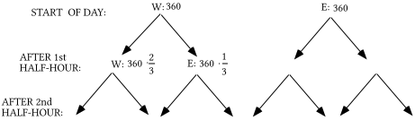

A. Represent the other two numbers at the first level as a product of 360 and a fraction.

B. Represent the eight numbers at the second level as a product of 360 and two fractions.

C. Give as a sum of four, three-factor products, the number of taxis that are on the west side of town after the second half-hour.

### II.

A. Give the entry in the 1,1 address of the product $\left[ \begin{matrix}360 & 360\end{matrix} \right]\cdot \left[ \begin{matrix}\frac{2}{3} & \frac{1}{3} \\ \frac{1}{2} & \frac{1}{2}\end{matrix} \right]$ as the sum of two, two-factor products.

B. Give this matrix product $\left[ \begin{matrix}\frac{2}{3} & \frac{1}{3} \\ \frac{1}{2} & \frac{1}{2}\end{matrix} \right]\cdot \left[ \begin{matrix}\frac{2}{3} & \frac{1}{3} \\ \frac{1}{2} & \frac{1}{2}\end{matrix} \right]$ with each entry shown in the form of a sum of products of two fractions.  Do not compute these sums.

C. Give the entry in the 1,1 address of the product of the matrix $\left[ \begin{matrix}360 & 360\end{matrix} \right]$ and your answer to “B” right above as a sum of four three-factor products.  You will need to use a distributive form two times to do this.

### III.

Give the solution of the system $\left\{ \begin{array}{l}1\cdot x+{}^{-}2\cdot y=0 \\ {}^{-}1\cdot x+2\cdot y=0 \\ 1\cdot x+1\cdot y=6\end{array} \right.$  This system does have a solution.  It is OK to “guess” what it is.

### IV.

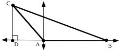

For the triangle in the illustration, the length of side AC is 200, the length of side AB is 350, and the measure of angle BAC is 130˚.

A. Give the exact coordinates of point C.

B. Give the exact coordinates of point B.

C. Give the length of the altitude, segment CD.

D. Represent exactly the area of triangle ABC.

E. Represent as a sum of two squares the square of the length of side BC.

### V.

<strong>A Reminder about Preservation of Angle Measures and Distances and an Important New Use of Preservation Properties</strong>

At the beginning of this course we made the assumptions that reflections in a line preserved distances and angle measures.  This means that the reflection image of a segment has the same length as the pre-image.  It also means that the reflection image of an angle has the same measure as its pre-image.  You may recall the discovery that every translation can be created from a composite of reflections in parallel lines and every rotation can be created from a composite of reflections in intersecting lines.  This implies that translations and rotations as well as reflections preserve distance and angle measures.

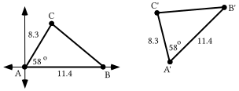

Triangle ABC is in a very convenient position.  One of its sides lies on the $x-\text{axis}$ and one of its vertices is at the origin.  This makes it relatively easy to determine the coordinates for points B and C in terms of the lengths of sides AB and AC and the measure of angle BAC.  Once these coordinates are known, it is possible to represent first the square of the length of side BC and then that length itself.

You have seen that the length of side BC is dependent entirely upon the lengths of sides AB and BC and the measure of angle BAC.  Triangle A'B'C' is in a different position, but it should not be hard to imagine that it could be the image of triangle ABC under some composite of transformations that preserve distances and angle measures.  Therefore, the length of side B'C' should be the same as the length of side BC and it should have the same relationship to the lengths of sides A'B' and A'C' and the measure of angle B'A'C' as the length of side BC has to the lengths of sides AB and AC and the measure of angle BAC.  <strong>This means that any relationships found to be true for some of the measures of triangles in “convenient” positions will also be true for the measures of their images under composites of reflections, translations or rotations</strong><em><strong>.</strong></em>

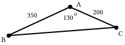

A. Represent the square of the length of side CB as the sum of two squares.

B. Represent the exact area of triangle ABC.

### VI.

Copy all of the following and fill in the blanks so that each expression after an equal sign is equivalent to the one before it.

$\begin{array}{l}\mathrm{(}200\cdot \mathrm{cos(}130^{\text{o}}\mathrm{)}+{}^{-}350\mathrm{)}^{2}+\mathrm{(}200\cdot \mathrm{sin(}130^{\text{o}}\mathrm{))}^{2} \\ =\mathrm{(}200\cdot \mathrm{cos(}130^{\text{o}}\mathrm{)}+{}^{-}350\mathrm{)}\cdot \mathrm{(}200\cdot \mathrm{cos(}130^{\text{o}}\mathrm{)}+{}^{-}350\mathrm{)}+\mathrm{(}200\cdot \mathrm{sin(}130^{\text{o}}\mathrm{))}^{2} \\ =\mathrm{(}200\cdot \mathrm{cos(}130^{\text{o}}\mathrm{))}^{2}+200\cdot {}^{-}350\cdot \mathrm{cos(}130^{\text{o}}\mathrm{)}+200\cdot {}^{-}350\cdot \mathrm{\_\_\_\_\_}+\mathrm{(}{}^{-}350\mathrm{)}^{2}+200^{2}\cdot \mathrm{\_\_\_\_\_\_} \\ =\mathrm{\_\_\_\_}\cdot \mathrm{(cos(}130^{\text{o}}\mathrm{))}^{2}+{}^{-}1\cdot 200\cdot 350\cdot \mathrm{cos(}130^{\text{o}}\mathrm{)}+{}^{-}1\cdot 200\cdot 350\cdot \mathrm{\_\_\_\_\_}+\mathrm{(}350\mathrm{)}^{2}+200^{2}\cdot \mathrm{\_\_\_\_\_\_} \\ =200^{2}\cdot \mathrm{(cos(}130^{\text{o}}\mathrm{))}^{2}+200^{2}\cdot \mathrm{(sin(}130^{\text{o}}\mathrm{))}^{2}+350^{2}+\mathrm{(}{}^{-}1+{}^{-}1\mathrm{)}\cdot \mathrm{\_\_\_\_\_\_\_\_\_\_\_} \\ =\mathrm{(\_\_\_\_\_\_\_\_\_\_\_\_\_\_\_\_\_\_)}\cdot 200^{2}+350^{2}+{}^{-}2\cdot \mathrm{\_\_\_\_\_\_\_\_\_\_\_\_\_}\end{array}$

### VII.

Give an equivalent to

$\left( \mathrm{(cos(}130^{\text{o}}\mathrm{))}^{2}+\mathrm{(sin(}130^{\text{o}}\mathrm{))}^{2} \right)\cdot 200^{2}+350^{2}+{}^{-}2\cdot 200\cdot 350\cdot \mathrm{(cos(}130^{\text{o}}\mathrm{))}$

as the sum of three addends that contain “cos” but not “sin.”

### VIII.

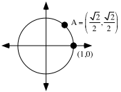

A. Give two different magnitudes, one positive and one negative, for the origin centered rotation that will map (1,0) onto point A.

B. Push the \[MODE\] key on your calculator and make sure that DEGREE in the third row of options is highlighted.  Then push \[2nd\] and \[MODE\] to return to the home screen.  Now push \[2nd\] and \[cos\] so that you see “$\mathrm{cos}^{{}^{-}1}$” on the screen.  Push the keys needed so that “($\mathrm{cos}^{{}^{-}1}\mathrm{(}\sqrt{\mathrm{(}2\mathrm{)}}\mathrm{/}2\mathrm{)}$)” is on the home screen. Finally, push \[ENTER\] and record the result that appears to the right of the screen on your homework paper.

## Assignment #102

### I.

<strong>Computing the Distribution of Taxicabs after the Second Half-Hour Using Matrix Multiplication</strong>

Here is a diagram of the distributions of taxicabs for the Green Taxi Company after the first two half-hour periods of a day when the initial west-east distribution is given by the matrix $\left[ \begin{matrix}360 & 360\end{matrix} \right]$.

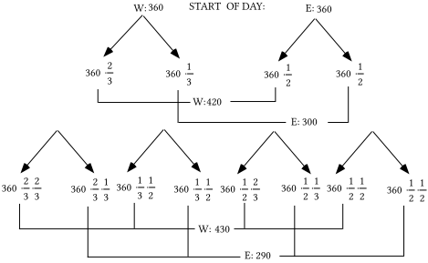

Shown below are three representations of the product of the original disposition matrix and the transition matrix.  When you compare the middle and right representations to the portion of the diagram below the first four arrows, you will be reminded how the disposition after the first half-hour can be computed with matrix multiplication.  The bold vertical in the middle representation is there only to make it easier to see separately the sums of products for the 1,1 and 1,2 addresses.

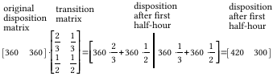

Here now are four representations of the product of the disposition matrix after the first half-hour and the transition matrix.  Compare the third and fourth representations to the portion of the diagram on the previous page below the second set of arrows.  You should see that the product does give the disposition of the taxicabs after the second half-hour.  (Remember that a three-factor product such as $\frac{2}{3}\cdot \frac{2}{3}\cdot 360$is equivalent to $360\cdot \frac{2}{3}\cdot \frac{2}{3}$.)

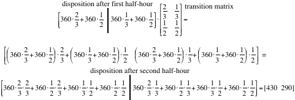

If \[A\] is used to represent the original disposition matrix and \[B\] is used to represent the transition matrix then the above can be summarized as follows:

<strong>To get the distribution after the first half-hour, compute the matrix product   \[A\]\*\[B\].</strong>

<strong>To get the distribution after the second half-hour, compute the matrix product  (\[A\]\*\[B\])\*\[B\].</strong>

Because matrix multiplication is associative, the product (\[A\]\*\[B\])\*\[B\] is equivalent to \[A\]\*(\[B\]\*\[B\]), which for convenience can represented as \[A\]\*\[B\]2.

Here is a different description of the location of cabs of the Green Taxi Company.  It has a fleet of 720 cabs that it operates in Gatville.  Suppose one morning the dispatcher sends 120 cabs to the west side of the city and the remaining 600 to the east side.  Past experience has shown that each cab gets new riders about each half- hour.  Past experience has also shown that two-thirds of the people picked up on the west side of town ask to go to another location on the west side while the others ask to go to some point on the east side.  Meanwhile, only one-half of those picked up on the east side ask to go to a point on the east side and the remainder ask to go to a point on the west side.

A. Copy each of the diagram and fill in the four numbers for the location of cabs after the first half-hour:

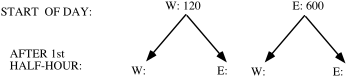

B. Give the transition matrix for the change in the location of the cabs from one half-hour to the next.

C. Give the initial disposition matrix for the case when 120 of the taxis were on the west side and 600 were on the east side.

D. Use your answers to “C” and “B” above to give the number of taxis on the west and east sides after the end of the first half-hour of the day.

E. Use your answers to “D” and “B” above help answer these questions:

1\. After the second half hour, how many of the company’s cabs are on the west side of town?

2\. After the second half hour, how many of the company’s cabs are on the east side of town?

F. Try to use your answers to “E” and “B” above to give the numbers of taxis on the west and east sides after the end of the third half-hour of the day.

### II.

A.  The matrix equation $\left[ \begin{matrix}x & y\end{matrix} \right]\cdot \left[ \begin{matrix}\frac{2}{3} & \frac{1}{3} \\ \frac{1}{2} & \frac{1}{2}\end{matrix} \right]=\left[ \begin{matrix}x & y\end{matrix} \right]$ is the matrix form of a system.  Give the two equations of that system.

B. Give an equivalent to your answer to “A” right above in the form

$\left\{ \begin{array}{l}\text{a}\cdot x+\text{b}\cdot y=\text{c} \\ \text{d}\cdot x+\text{e}\cdot y=\text{f}\end{array} \right.$.

C. If possible, give a solution for the system you created as your answer to “B” right above.

D. This system does have a solution: $\left\{\begin{array}{l}\frac{{}^{-}1}{3}\cdot x+\frac12\cdot y=0 \\ \frac13\cdot x+\frac{{}^{-}1}{2}\cdot y=0 \\ x+y=720\end{array}\right.$

Somehow, determine what it is.

### III.

Express each of the following as a product of decimals:

A. 75% of 5%.    B. 25% of 75% of 5%.

### IV.

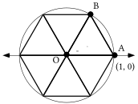

A. Calculate the area of triangle AOB with your calculator and write on your homework paper an estimate of the result accurate to five decimal places.

B. Each of the six triangles in the illustration above can be mapped onto the others with origin centered rotations.  Based on this, calculate an estimate of the area of the region in the interior of the unit circle.  Give on your homework paper an estimate of the result accurate to five decimal places.

### V.

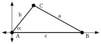

In the illustration above the Greek letter alpha $\mathrm{(}\alpha \mathrm{)}$(the first letter of the Greek alphabet) is used to represent the measure of angle BAC.  In addition “b” represents the length of side AC and “c” represents the length of side AB.

A. Represent the coordinates of point B using one or more letters.

B. Represent the coordinates of point C using one or more letters.

C. Represent “a2,” the square of the length of side BC, as the sum of two squares using one or more letters from the illustration.

### VI.

Copy the following and fill in the blanks so that all the expressions connected by equal signs are equivalent to each other.

$\text{(b}\cdot \text{cos(}\alpha \text{)}+{}^{-}\text{c)}^{\text{2}}+\text{(b}\cdot \text{sin(}\alpha \text{))}^{\text{2}}$=

$\begin{array}{l}\text{b}^{\text{2}}\cdot \text{\_\_\_\_}+{}^{-}\text{2}\cdot \text{b}\cdot \text{c}\cdot \text{\_\_\_\_}+\text{(}{}^{-}\text{c)}^{\text{2}}+\text{b}^{\text{2}}\cdot \text{\_\_\_\_} \\ =\text{b}^{\text{2}}\cdot \text{(cos(}\alpha \text{))}^{\text{2}}+\text{b}^{\text{2}}\cdot \text{\_\_\_\_}+\text{c}^{\text{2}}+{}^{-}\text{2}\cdot \text{bc}\cdot \text{(cos(}\alpha \text{))} \\ =\text{b}^{\text{2}}\cdot \text{(\_\_\_\_}+\text{\_\_\_\_)}+\text{c}^{\text{2}}+{}^{-}\text{2}\cdot \text{b}\cdot \text{c}\cdot \text{(cos(}\alpha \text{))} \\ =\text{\_\_\_}+\text{c}^{\text{2}}+{}^{-}\text{2}\cdot \text{b}\cdot \text{c}\cdot \text{(cos(}\alpha \text{))}\end{array}$

### VII.

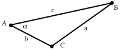

With reference to the illustration above, represent “a2,” the square of the length of side BC, as the sum of three addends using one or more letters from the illustration.

### VIII.

A. Solve the equation given below for “<em>x</em>” by writing an equivalent in the form “<em>x</em> = a fraction.”  Do not use your calculator at all, just correctly “isolate” <em>x</em>.

$500^{2}=200^{2}+400^{2}+{}^{-}2\cdot 200\cdot 400\cdot x$

B. Calculate the solution of the equation you wrote as your answer to “A” right above accurate to the nearest hundredth (two decimal places).

### IX.

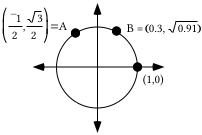

A. Give two different magnitudes, one positive and one negative, for the origin centered rotation that will map (1,0) onto point A.

B. Push the \[MODE\] key on your calculator and make sure that DEGREE in the third row of options is highlighted.  Then push \[2nd\] and \[MODE\] to return to the home screen.  Now push \[2nd\] and \[cos\] so that you see “$\mathrm{cos}^{{}^{-}1}$” on the screen.  Push the keys needed so that “$\mathrm{cos}^{{}^{-}1}$(${}^{-}1\mathrm{/}2$)” is on the home screen. Finally, push \[ENTER\] and record the result that appears to the right of the screen on your homework paper.

C. Give, accurate to the nearest tenth of a degree, the smallest positive magnitude for the origin centered rotation that will map (1,0) to point B.

## Assignment #103

### I.

<strong>Calculating the Disposition of Cabs after Longer and Longer Time Intervals</strong>

You have seen that if \[A\] is a $1\times 2$ matrix representing the original disposition of taxicabs and if \[B\] is a $2\times 2$ matrix representing the half-hourly transitions from one side of town to another, the product \[A\]\*\[B\] is a representation of the distribution of the taxicabs after the first half-hour.

You have also seen that the matrix product \[A\]\*\[B\]2 is a representation of the taxicabs after the second half-hour.   A diagram for the distribution after the third half-hour would have sixteen arrows each of which leads to a product of 360 and three fraction factors.  Eight of these products would sum to an approximation of the number of taxicabs on the west side after the third half-hour and they would also sum to the number in the 1,1 address of the matrix product \[A\]\*\[B\]3.  The other eight products would sum to an approximation of number of taxicabs on the east side after the third half-hour and this sum would also be the number in the 1,2 address of the matrix product  \[A\]\*\[B\]3.

The pattern involving matrix multiplication for computing the dispositions after the first three half-hour periods generalizes to the following:

<strong>If \[A\] is a</strong> $1\times 2$ <strong>representation of the original disposition</strong>

<strong>of taxicabs and \[B\] is a transition matrix to the new dispositions,</strong>

<strong>then when they are rounded to the nearest integer</strong>

<strong>the entries in the matrix product</strong>

<strong>\[A\]\*\[B\]n</strong>

<strong>approximate the disposition after “n” transitions.</strong>

Here is another reminder about the utilization of the 720 cabs of the Green Taxi Company.  Past experience has shown that each cab gets new riders about each half hour.  Past experience has also shown that two-thirds of the people picked up on the west side of town ask to go to another location on the west side while the others ask to go to some point on the east side.  Meanwhile, only one-half of those picked up on the east side ask to go to a point on the east side and the remainder ask to go to a point on the west side. In each case, give five $1\times 2$ matrices that show the disposition of the taxi cabs after the first half-hour, the second half-hour, the fourth half-hour, the eighth half-hour, and the sixteenth half-hour.  Give the entries in these matrices rounded to the nearest tenth.  Hint: if you push \[2nd\] and then \[ENTER\] you can edit a matrix product to use a different power of the transition matrix.  This can save time.

A. When 144 of the taxis start the day on the west side and 576 on the east side.

B. When 576 of the taxis start the day on the west side and 144 are on the east side.

C. When 432 the taxis start the day on the west side and 288 are originally on the east side.

D. When all the taxis are originally on the west side.

E. When all the taxis are originally on the east side.

### II.

<strong>Calculating the Solution of a Special Kind of</strong> $3\times 2$ <strong>Linear System</strong>

The linear system $\left\{\begin{array}{l}\frac{{}^{-}1}{3}\cdot x+\frac12\cdot y=0 \\ \frac13\cdot x+\frac{{}^{-}1}{2}\cdot y=0 \\ x+y=720\end{array}\right.$ is called a $3\times 2$ system because these are the dimensions of its coefficient matrix, $\left[\begin{array}{cc}\frac{{}^{-}1}{3} & \frac12 \\ \frac13 & \frac{{}^{-}1}{2} \\ 1 & 1\end{array}\right]$.

The coefficient matrix does not have an inverse, so the usual multiplication of the inverse of a coefficient matrix and a matrix of constants will not work in a case like this.  Furthermore, the first two equations of the system can be transformed into each other by multiplying each side by -1.  This means that these two equations are equivalent and therefore both describe the same line.  However, the third equation of the system describes a different line that intersects the line described by each of the first two equations.

If a new system is formed using either the first and third or second and third equations of the original system, the solution of either of these new systems can be computed by matrix multiplication to be (432,288).  Since the first two equations are equivalent, (432,288) is a solution of both of them as well as the third equation, and therefore it is the solution of the system.  You will soon see the significance of this particular system in relation to the question about the shifting distributions of taxicabs in Gatville.

In each case give the solution of the given system:

A. $\left\{ \begin{array}{l}\frac{{}^{-}1}{3}\cdot x+\frac{1}{2}\cdot y=0 \\ 1\cdot x+1\cdot y=720\end{array} \right.$      B. $\left\{ \begin{array}{l}\frac{1}{3}\cdot x+\frac{{}^{-}1}{2}\cdot y=0 \\ 1\cdot x+1\cdot y=720\end{array} \right.$

C. $\left\{ \begin{array}{l}\frac{{}^{-}1}{3}\cdot x+\frac{1}{2}\cdot y=0 \\ \frac{1}{3}\cdot x+\frac{{}^{-}1}{2}\cdot y=0 \\ 1\cdot x+1\cdot y=720\end{array} \right.$

### III.

For the system: $\left\{ \begin{array}{l}3\cdot x+7\cdot y+{}^{-}10\cdot z=33 \\ 5\cdot x+11\cdot y+2\cdot z=14 \\ {}^{-}9\cdot x+5\cdot y+17\cdot z=29\end{array} \right.$

A. Give the matrix of coefficients.

B. Give the matrix of constants.

C. Calculate the <strong>exact</strong> solution of the system.

### IV.

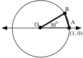

A. Calculate the area of triangle AOB accurate to six decimal places.

B. Use your answer to “A” right above to calculate an estimate of the area of the unit circle.  Briefly explain your method.

### V.

<strong>The Law of Cosines</strong>

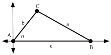

To relate “a<em>,</em>” the length of side BC in the triangle illustrated above, to the lengths of sides AB (c) and AC (b) and the measure of angle BAC ($\alpha$) the key steps are:

Step #1: Represent the coordinates of point C as $\left( \text{b}\cdot \text{cos(}\alpha \text{),b}\cdot \text{sin(}\alpha \text{)} \right)$.

Step #2: Represent the coordinates of point B as (c,0).

Step #3: Use the translation that will map point B to the origin and represent the square of the length of the image of side BC as

$\left( \text{b}\cdot \text{cos(}\alpha \text{)}+{}^{-}\text{c} \right)^{\text{2}}+\text{(b}\cdot \text{sin(}\alpha \text{))}^{\text{2}}$.

Based on step #3, the relationship sought can be expressed as

$\text{a}^{\text{2}}=\left( \text{b}\cdot \text{cos(}\alpha \text{)}+{}^{-}\text{c} \right)^{\text{2}}+\text{(b}\cdot \text{sin(}\alpha \text{))}^{\text{2}}$

However, the right side of the equation above can be replaced with any of the following sequence of equivalents:

$\begin{array}{l}\text{b}^{\text{2}}\cdot \text{(cos(}\alpha \text{))}^{\text{2}}+{}^{-}\text{2}\cdot \text{b}\cdot \text{c}\cdot \text{(cos(}\alpha \text{))}+\text{(}{}^{-}\text{c)}^{\text{2}}+\text{b}^{\text{2}}\cdot \text{(sin(}\alpha \text{))}^{\text{2}} \\ =\text{b}^{\text{2}}\cdot \text{(cos(}\alpha \text{))}^{\text{2}}+\text{b}^{\text{2}}\cdot \text{(sin(}\alpha \text{))}^{\text{2}}+\text{c}^{\text{2}}+{}^{-}\text{2}\cdot \text{b}\cdot \text{c}\cdot \text{(cos(}\alpha \text{))} \\ =\text{b}^{\text{2}}\cdot \text{((cos(}\alpha \text{))}^{\text{2}}+\text{(sin(}\alpha \text{))}^{\text{2}}\text{)}+\text{c}^{\text{2}}+{}^{-}\text{2}\cdot \text{b}\cdot \text{c}\cdot \text{(cos(}\alpha \text{))} \\ =\text{b}^{\text{2}}+\text{c}^{\text{2}}+{}^{-}\text{2}\cdot \text{b}\cdot \text{c}\cdot \text{(cos(}\alpha \text{))}\end{array}$

It is traditional to use the last of these equivalents and express the relationship between <em>a</em>, <em>b</em>, <em>c</em> and $\alpha$ as

$\text{a}^{\text{2}}=\text{b}^{\text{2}}+\text{c}^{\text{2}}+{}^{-}\text{2}\cdot \text{b}\cdot \text{c}\cdot \text{(cos(}\alpha \text{))}$

in this form, the relationship is known as <strong>The Law of Cosines</strong>.

To become skilled in making use of the Law of Cosines it will be useful to know it in the following descriptive form:

<strong>The Law of Cosines</strong>

The square of the length of any side of a triangle is equal to the sum of three

addends.  Two of these addends are the squares of the lengths of the other two

sides.  The third addend is the four-factor product of -2, the lengths of each

of the other two sides, and the cosine value of the measure of the angle

whose vertex is the point where these other two sides intersect.

In other words, the square of any side of a triangle is equal to

the sum of the squares of the other two sides and-2 times the other

two sides times the cosine of the measure of the angle between them.

Here is an illustration of the use of the Law of Cosines.

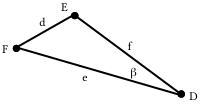

In triangle DEF,

$\text{d}^{\text{2}}=\text{e}^{\text{2}}+\text{f}^{\text{2}}+{}^{-}\text{2}\cdot \text{e}\cdot \text{f}\cdot \text{cos(}\beta \text{)}$

It is the relationship between the measures, and not the letters used to represent the measures, that is the useful essence of the Law of Cosines.  You should re-read the description in the box above and see how it relates to the equation for $\text{d}^{\text{2}}$.

In the illustration at the top of the next page, the measures of the angles of the triangle are represented by the lower case Greek letters, alpha ($\alpha$ ), beta ($\beta$ ), and gamma ($\gamma$).

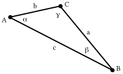

A. Give a version of the Law of Cosines that relates $\alpha$ and “a,” the length of side BC.

B. Give a second version of the Law of Cosines that relates $\beta$ and “b,” the length of side AC.

C. Give a third version of the Law of Cosines that relates $\gamma$ and “c,” the length of side AB.

### VI.

A. Solve the following equation for “<em>x</em>.”

$400^{2}=300^{2}+350^{2+}{}^{-}2\cdot 300\cdot 350\cdot x$

B. Solve the following equation for “cos$\mathrm{(}\alpha \mathrm{)}$).”  “$\alpha$” is the lower case form of the Greek letter, alpha.  Alpha is the first letter of in the Greek alphabet and we will be using it to represent an angle measure.

$300^{2}=400^{2}+350^{2}+{}^{-}2\cdot 400\cdot 350\cdot \mathrm{cos(}\alpha \mathrm{)}$

### VII.

A.  Use your calculator to compute each of the following accurate to the nearest hundredth:

1\. $\mathrm{cos}^{{}^{-}1}\left( \frac{400^{2}-300^{2}-350^{2}}{{}^{-}2\cdot 300\cdot 350} \right)$  2. $\mathrm{cos}^{{}^{-}1}\left( \frac{300^{2}-350^{2}-400^{2}}{{}^{-}2\cdot 350\cdot 400} \right)$

3\. $\mathrm{cos}^{{}^{-}1}\left( \frac{350^{2}-300^{2}-400^{2}}{{}^{-}2\cdot 300\cdot 400} \right)$

B. What is the sum of the three answers you gave for “A” right above?

### VIII.

Give the heading for the leg of a journey represented by the dashed arrow:

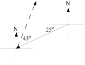

### IX.

Give an equivalent to $\mathrm{(}y+{}^{-}11\mathrm{)}=\frac{17}{13}\cdot \mathrm{(}x+4\mathrm{)}$ in the form $\text{a}\cdot x+\text{b}\cdot y=\text{c}$.  You may want to make use of both a distributive form and your calculator.

## Assignment #104

### I.

<strong>A Discovery about the Trend in the Disposition of Taxicabs</strong>

In doing question I of assignment #103 you should have made a discovery–the dispositions of taxicabs after several transitions appear to move toward the same state regardless of the initial disposition.  Though there are some special alternative transition matrices for which this would not be true, the behavior illustrated in making the computations for question I is typical.

There was one initial disposition, \[432,288\] that had two special characteristics:

Characteristic #1: This disposition was stable–it did not change from one half-hour to the next.  This is an example of a <strong>stable disposition</strong>.

Characteristic #2: <strong>The stable disposition, \[432,288\] predicted the long term distributions from any initial disposition</strong><em><strong>.</strong></em>

The stable disposition for the Green Taxi Company in Gatville is the solution of the system created by taking the following steps:

Step #1: The equations, $\frac{2}{3}\cdot x+\frac{1}{2}\cdot y=1\cdot x$ and $\frac{1}{3}\cdot x+\frac{1}{2}\cdot y=1\cdot y$, were created from $\left[ \begin{matrix}x & y\end{matrix} \right]\cdot \left[ \begin{matrix}\frac{2}{3} & \frac{1}{3} \\ \frac{1}{2} & \frac{1}{2}\end{matrix} \right]=\left[ \begin{matrix}x & y\end{matrix} \right]$ by equating the 1,1 address entries on the left and right side to form the first equation, and equating the 1,2 address entries to form the second equation.

Step #2: The equation, $\frac{2}{3}\cdot x+\frac{1}{2}\cdot y=1\cdot x$, was replaced with an equivalent of the form $\text{a}\cdot x+\text{b}\cdot y=\text{c}$, by adding ${}^{-}1\cdot x$ to each side.  The new equation is:

$\frac{{}^{-}1}{3}\cdot x+\frac{1}{2}\cdot y=0$

Note that an equally useful equivalent could have been formed by adding ${}^{-}1\cdot y$ to each side of $\frac{1}{3}\cdot x+\frac{1}{2}\cdot y=1\cdot y$.

Step #3: One of the equations from step #2 was used with the equation $x+y=720$

to create the system

$\left\{ \begin{array}{l}\frac{{}^{-}1}{3}\cdot x+\frac{1}{2}\cdot y=0 \\ 1\cdot x+1\cdot y=720\end{array} \right.$.

The solution of this system can be computed by matrix multiplication and it is (432, 288). This solution gives the stable disposition.  It is also the predictor of the long term distributions from any initial disposition.

In another city, Mathville, the Purple Taxi Company operates a fleet of cabs.  Past experience has shown that each cab gets new riders about each half hour.  Past experience has also shown that one-third of the people picked up on the west side of town ask to go to another location on the west side while the others ask to go to some point on the east side.  Meanwhile, one-half of those picked up on the east side ask to go to a point on the east side and the remainder ask to go to a point on the west side.

A. Give the transition matrix for the movement of taxis from one half-hour to the next.  Use the first row and the first column for the west side of Mathville.

B. Use your calculator to compute the sixteenth power of the transition matrix and report the results by writing fractions in each address.

C. If the Purple Taxi Company operates a fleet of 350 cabs:

1\. About how many would you expect to find on the west side of town at the end of an eight hour day if 250 started on the west side and 100 started on the east side?  Hint: how many transitions would occur in eight hours?

2\. About how many would you expect to find on the west side of town at the end of an eight hour day if 100 started on the west side and 250 started on the east side?  Hint: how many transitions would occur in eight hours?

D. There is a special original disposition, expressed as a $1\times 2$ matrix, that would not change from one half-hour to the next.  Use \[<em>x</em>,<em>y</em>\] as a matrix of variables for this disposition and create a system whose solution would give the entries in the matrix for this disposition.

### II.

A. Compute the solution of the system: $\left\{\begin{array}{l}\frac13\cdot x+\frac12\cdot y=1\cdot x \\ \frac23\cdot x+\frac12\cdot y=1\cdot y \\ x+y=350\end{array}\right.$

B. Predict the “long term” disposition of taxicabs toward the end of the day for the situation described for the Purple Taxi Company in Mathville from question I above.

### III.

Suppose that there are only three brands of a certain type of cleaner on the market.  Suppose further that a market purchase survey reveals that currently brand A, which is relatively new, was purchased by only 5% percent of those who use this type of cleaner.  The same survey showed that at this time brand B was purchased by 35% and brand C by 60%.  Those who use this type of cleaner buy a new supply about every 2 months and buyer behavior surveys have revealed the following:

for brand A:  75% of those who use this brand buy it again, while 15% switch to brand B and 10 % switch to brand C.

for brand B: 60% of those using it buy it again while 30% switch to brand A and 10% switch to brand C.

for brand C: 80% of those using it buy it again while 5% switch to brand A and 15% switch to brand B.

A. Represent each of the following as a product of decimals:

1\. The percent of all cleaner users who were using brand A at the time of the purchase survey and bought brand A again on their first re-supply purchase.

2\. The percent of all cleaner users who were using brand B at the time of the purchase survey but bought brand A on their first re-supply purchase.

3\. The percent of all cleaner users who were using brand C at the time of the purchase survey but bought brand A on their first re-supply purchase.

B. Use your answers from “A” right above to compute the percent of all cleaner users who would be using brand A after their first re-supply purchase after the purchase survey was conducted

C. Compute the percent of all cleaner users who would be using brand B after their first re-supply purchase after the purchase survey was conducted.

D. It is possible to write a matrix product, S.T, where S is a $1\times 3$ matrix and T is a $3\times 3$ matrix, where the number in the 1,1 address of the matrix product is equal to your answer to “B” right above and the number in the 1,2 address of the matrix product is equal to your answer to “C.”  On your homework paper, write matrices S and T that form such a product.

### IV.

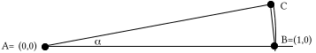

By using three different choices for the value of $\alpha$, the measure of angle BAC, calculate three different estimates of the area of the unit circle.  Give each estimate accurate to at least six decimal places.  Make a table showing your choices for the value of $\alpha$ and the calculated estimates. Chose your three values so that each new choice gives a better estimate.

### V.

In each case, calculate the solution of the given system:

A. $\left\{ \begin{array}{l}0\mathrm{.}15\cdot x+{}^{-}0\mathrm{.}40\cdot y+0\mathrm{.}15\cdot z=0 \\ 0\mathrm{.}10\cdot x+0\mathrm{.}10\cdot y+{}^{-}0\mathrm{.}20\cdot z=0 \\ \hspace{4.75em}1\cdot x+1\cdot y+1\cdot z=1\end{array} \right.$          B. $\left\{ \begin{array}{l}{}^{-}0\mathrm{.}25\cdot x+0\mathrm{.}30\cdot y+0\mathrm{.}05\cdot z=0 \\ 0\mathrm{.}10\cdot x+0\mathrm{.}10\cdot y+{}^{-}0\mathrm{.}20\cdot z=0 \\ \hspace{4.75em}1\cdot x+1\cdot y+1\cdot z=1\end{array} \right.$

### VI.

<strong>Using the Law of Cosines to Compute the Measure of an Angle</strong>

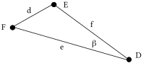

For triangle DEF, the Law of Cosines guides the formation of the equation:

$\text{d}^{\text{2}}=\text{e}^{\text{2}}+\text{f}^{\text{2}}+{}^{-}\text{2}\cdot \text{e}\cdot \text{f}\cdot \text{cos(}\beta \text{)}$.

This equation can be “solved” for $\mathrm{cos(}\beta \mathrm{)}$ by taking the following steps:

Step #1: add ${}^{-}\text{e}^{\text{2}}$ and ${}^{-}\text{f}^{\text{2}}$ to each side to get the equivalent

$\text{d}^{\text{2}}+{}^{-}\text{e}^{\text{2}}+{}^{-}\text{f}^{\text{2}}={}^{-}\text{2}\cdot \text{e}\cdot \text{f}\cdot \text{cos(}\beta \text{)}$

Step #2: Multiply each side by $\frac{\text{1}}{{}^{-}\text{2}\cdot \text{e}\cdot \text{f}}$ to get the equivalent

$\frac{\text{d}^{\text{2}}+{}^{-}\text{e}^{\text{2}}+{}^{-}\text{f}^{\text{2}}}{{}^{-}\text{2}\cdot \text{e}\cdot \text{f}}=\text{cos(}\beta \text{)}$ or $\text{cos(}\beta \text{)}=\frac{\text{d}^{\text{2}}+{}^{-}\text{e}^{\text{2}}+{}^{-}\text{f}^{\text{2}}}{{}^{-}\text{2}\cdot \text{e}\cdot \text{f}}$.

For any triangle, the expression on the opposite side of the equal sign from the cosine expression will represent a number between ¯1 and 1.  It will therefore represent the first coordinate of a pair of points on the unit circle.  You have seen in recent assignments that when a number between ¯1 and 1 is entered in parentheses after $\mathrm{cos}^{{}^{-}1}$, your calculator will return a magnitude between 0˚ and 180˚ for the rotation which will map (1,0) to the point on the upper half of the unit circle whose first coordinate was entered in the parentheses.  If the expression in parentheses is based on the Law of Cosines, the value returned will be the measure of an angle of a triangle.

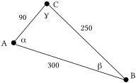

A. Calculate $\alpha$, the measure of angle BAC, accurate to the nearest tenth of a degree.  Show the Law of Cosines equation on which your answer was based.  Take care to use enough parentheses so that your calculator will correctly interpret the rather complicated fraction you will enter after “$\mathrm{cos}^{{}^{-}1}$.”

B. Calculate $\beta$, the measure of angle ABC, accurate to the nearest tenth of a degree.  Show the Law of Cosines equation on which your answer was based.

C. Calculate $\gamma$, the measure of angle BCA, accurate to the nearest tenth of a degree.  Again, show the Law of Cosines equation on which your answer was based.

### VII.

A journey by airplane is to be taken in two legs.  The first leg will be on a heading of 110˚ for a distance of 250 miles.  The second leg will be on a heading of 230˚ for a distance of 400 miles.

A. Use direction indicators as you sketch on your homework paper a representation of the entire two-legged journey.

B. Give the measure of the smaller angle formed by the arrows for the first and second legs of the journey.

C. Use the Law of Cosines to calculate, accurate to the nearest mile, the distance from the end of the second leg of the journey back to the point where the first leg began.

D. Estimate the heading the pilot should take to return to the starting point of the journey from the point where she will after the second leg.

### VIII.

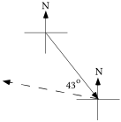

The arrows in the illustration above represent two legs of a journey.  The solid arrow represents the first leg and the heading for this leg was 155˚ and the smaller angle formed by the two arrows has a measure of 43˚.  Give the heading for the second leg of the journey.

### IX.

A. Write an equation for the line that passes through (3,1.5) and (11.7,8.3).

B. Give an equivalent to your answer to “A” right above in the form $\text{a}\cdot x+\text{b}\cdot y=\text{c}$.

## Assignment #105

### I.

<strong>Initial Distribution and Transition Matrices for Market Shares</strong>

Here again is the information given in question III of Assignment #104 about the current condition and buying behavior of those who purchase a certain type of cleaner:

There are only three brands of that type of cleaner on the market.  A market purchase survey reveals that currently brand A, which is relatively new, was purchased by only 5% percent of those who use this type of cleaner.  The same survey showed that at this time brand B is purchased by 35% and brand C by 60%.  Those who use this type of cleaner buy a new supply about every 2 months and buyer behavior surveys have revealed the following:

for brand A:  75% of those who use this brand buy it again, while 15% switch to brand B and 10 % switch to brand C.

for brand B: 60% of those using it buy it again while 30% switch to brand A and 10% switch to brand C.

for brand C: 80% of those using it buy it again while 5% switch to brand A and 15% switch to brand B.

Figures like those given above might be collected by surveying records of sales at some of the markets selling all three brands of cleaner.  If the markets providing the figures were “typical” markets, the figures might give an accurate picture of the behavior of all cleaner purchasers.  Because it is more common to base information about the purchase of competing brands from surveys involving only some of the product users, a matrix for the initial distribution will contain estimated percents rather than actual numbers of those using each brand.

In the illustrative example we will explore, we are first assuming that the initial estimates are that 5% use brand A, 35% use brand B and 60% use brand C.  This information will be represented with the $1\times 3$ matrix

$\left[ \begin{matrix}0\mathrm{.}05 & 0\mathrm{.}35 & 0\mathrm{.}60\end{matrix} \right]$.

This will be called the <strong>initial market share distribution</strong> for the cleaners.

A companion to the initial market share matrix is a matrix that represents the tendency of users of various brands to re-purchase the same brand or switch to one of the competing brands.  In this case this matrix is

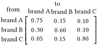.

This matrix will be called the <strong>transition matrix</strong> for market shares.

The diagram below shows how to compute the market share for brand A after the first repurchase of cleaner.

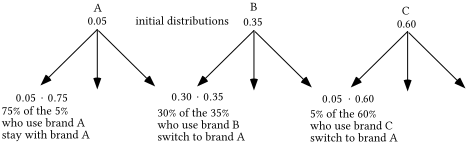

The sum of products

$0\mathrm{.}75\times 0\mathrm{.}05+0\mathrm{.}30\times 0\mathrm{.}35+0\mathrm{.}05\times 0\mathrm{.}60$= 0.1725

gives the market share of brand A after the first round of repurchases.  This sum of products is also the number in the 1,1 address of the matrix product

$\left[ \begin{matrix}0\mathrm{.}05 & 0\mathrm{.}35 & 0\mathrm{.}60\end{matrix} \right]\cdot \left[ \begin{matrix}0\mathrm{.}75 & 0\mathrm{.}15 & 0\mathrm{.}10 \\ 0\mathrm{.}30 & 0\mathrm{.}60 & 0\mathrm{.}10 \\ 0\mathrm{.}05 & 0\mathrm{.}15 & 0\mathrm{.}80\end{matrix} \right]$.

This suggests that the product of the initial market share distribution matrix and the market share transition matrix will give the market share distribution after the first re-purchase.  This is correct, and it is similar to the use of matrix multiplication in the taxicab questions done previously.

A. Give a sum of three products that is equal to the market share of brand B after the first round of repurchases.

B. Compute the product of the initial market share distribution matrix given on p. 444 and the transition matrix given at the top of this page.  Write this product on your homework paper.

C. Assume that the transition matrix given at the top of p. 445 is still valid as consumers make their second repurchase.  Based on this assumption, give a sum of three products equal to the market share for brand A after the second repurchase of cleaner.

D. Use “D” as a name for the initial market share matrix given on p. 444 and use “T” as a name for the transition matrix given at the top of p. 445.  On your homework paper use “D” and “T” to represent a matrix product which has your answer for “C” in the 1,1 address.  .

### II.

A. Create a $3\times 3$ system based on the matrix equation:

$\left[ \begin{matrix}x & y & z\end{matrix} \right]\cdot \left[ \begin{matrix}0\mathrm{.}75 & 0\mathrm{.}15 & 0\mathrm{.}10 \\ 0\mathrm{.}30 & 0\mathrm{.}60 & 0\mathrm{.}10 \\ 0\mathrm{.}05 & 0\mathrm{.}15 & 0\mathrm{.}80\end{matrix} \right]=\left[ \begin{matrix}x & y & z\end{matrix} \right]$

B. Give a system equivalent to your answer to “A” right above in which each of the three equations has the form $\text{a}\cdot x+\text{b}\cdot y+\text{c}\cdot z=0$.

C. If possible, compute a solution of the system you gave as your answer to “B” right above.

### III.

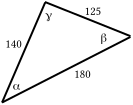

A. Calculate, accurate to the nearest tenth of a degree, the measure of each of the three angles in the triangle in the illustration.  These measures are represented by the Greek letters alpha, $\alpha$, beta, $\beta$, and gamma, $\gamma$.  Label your answers with the Greek letters representing them.

B. If possible, calculate the area of the illustrated triangle.

### IV.

A journey by airplane is to be taken in two legs.  The first leg will be on a heading of 280˚ for a distance of 300 miles.  The second leg will be on a heading of 140˚ for a distance of 500 miles.

A. Use direction indicators as you sketch on your homework paper a representing of the entire two-legged journey.

B. Give the measure of the smaller angle formed by the arrows for the first and second legs of the journey.

C. Use the Law of Cosines to calculate, accurate to the nearest mile, the distance from the end of the second leg of the journey back to the point where the first leg began.

D. Add to your sketch an arrow representing a leg to return to the starting point from the point reached after the second leg.  Then use the Law of Cosines to calculate, accurate to the nearest tenth of a degree, the smaller angle formed by the arrow for the second leg of the journey and the arrow for the return to the starting point that your just sketched.

E. Based on your answer to “D” right above, on what heading should the pilot fly to return from the end of the second leg to the starting point of the journey?

### V.

<strong>A Reminder about Writing an Equation for the Line That Passes Through Two Given Points</strong>

In this question you are asked to write an equation for the line that passes through two points.  This is a very, very important skill to in this course.  Here is an example to serve as a quick reminder of the primary method used in previous work.

To create an equation for the line that passes through (¯5,7) and (10,¯2):

Step #1: Use a translation that will map one of the points to (0,0) and use that translation on both points:

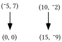

Step #2: Create an equation for the line that passes through the image points, (0,0) and (15,¯9).  The slope of this line is $\frac{{}^{-}9}{15}$ and an equation that describes it is $y=\frac{{}^{-}9}{15}\cdot x$.

Step #3: Connect the equation through the image points to an equation for a line passing through the original two points by using a translation that will map one of the image points to one of the original points.  T with  T($x\mathrm{,}y\mathrm{)}=\mathrm{(}x+{}^{-}5\mathrm{,}y+7\mathrm{)}$ will do the job.  Here is the connection diagram:

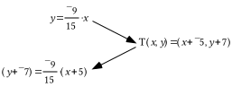

Note how the expressions that have replaced “<em>x</em>” and “<em>y</em>” in the pre-image equation relate the two expressions in the image formula for T.

A. Enter the coordinates of the points (¯13,7) and (8,¯3) into lists #1 and #2.  Then turn on Plot 1 to show a disconnected scatter plot of these points.

B. Give an expression that can be entered as Y1 so that your calculator will generate from this expression a representation of a portion of the line that passes through the two points given in “A” right above.

C. Give an equation of the form $\text{a}\cdot x+\text{b}\cdot y=\text{c}$ for the line passing through (¯13,7) and (8,¯3).

### VI.

Give each of these products or powers in polar notation:

A. $\mathrm{[}1\mathrm{,}120^{\text{o}}\mathrm{]}^{2}$    B. $\mathrm{[}1\mathrm{,}120^{\text{o}}\mathrm{]}\cdot \mathrm{[}1\mathrm{,}120^{\text{o}}\mathrm{]}^{2}$    C. $\mathrm{[}1\mathrm{,}120^{\text{o}}\mathrm{]}^{3}$

## Assignment #106

### I.

<strong>Computing Market Shares after Two or More Re-Purchases</strong>

To compute the distribution of taxicabs after two half-hour time periods, the second power of the transition matrix can be multiplied on the left by the original disposition matrix.  Your work on the special handout for the last assignment revealed that there is a similar situation with market shares.  To compute the market shares for the three brands after the second re-purchase, the second power of the transition matrix can be multiplied on the left by the matrix displaying the original disposition of market shares.

Some larger companies either do market share research or they hire research firms to do market share studies for them.  These companies then respond to what the research finds by, among other things, trying to improve their product or by seeking ways to advertise their products more effectively.  Because of this active response to market share information, the transition matrix for brand switching may change over time.  None the less, a company might still use a transition matrix based on current market share research to predict what might happen if the transition matrix did not change.  Doing so would give them an idea of how important it might be to work to increase the loyalty of their own customers or lure the customers of other producers to their own brand.

If it is assumed that the market share transition matrix will not change through several future re-purchases, the future distribution of market shares can be computed in a manner similar to the way later taxicab distributions were computed.

If \[T\] represents the market share transition matrix and \[S\] represents the initial market share distribution matrix then

\[S\]\*\[T\]3 computes to the predicted market share distribution after the third re-purchase,

\[S\]\*\[T\]4 computes to the predicted market share distribution after the fourth re-purchase, etc.

Here is another reminder about the market share question:  A market purchase survey reveals that currently brand A, which is relatively new, was purchased by only 5% percent of those who use this type of cleaner.  The same survey showed that at this time brand B is purchased by 35% and brand C by 60%.

for brand A:  75% of those who use this brand buy it again, while 15% switch to brand B and 10 % switch to brand C.

for brand B: 60% of those using it buy it again while 30% switch to brand A and 10% switch to brand C.

for brand C: 80% of those using it buy it again while 5% switch to brand A and 15% switch to brand B.

A.  If “S” represents the distribution of the market shares at the time of the purchase survey and “T” represents the transition matrix for re-supplying that occurs every two months, use these letters to write the matrix product that will show the market shares distribution six months after the original purchase survey.

B. If the behavior of cleaner buyers remains as reflected in the transition matrix, will brand A’s market share ever exceed that for brand C?

C. Give a new initial disposition matrix that reflects a different initial condition--brands A and C have virtually no share of the market and brand B has all the market.

D. Based on your answer to “C” and the transition matrix from “A,” explore what might happen to market shares.  Give your conclusion and give the matrix product that leads to your conclusion.

### II.

A. Make from this system a $3\times 3$ system that has only one solution and calculate that solution:

$\left\{ \begin{array}{l}{}^{-}0\mathrm{.}25\cdot x+0\mathrm{.}30\cdot y+0\mathrm{.}05\cdot z=0 \\ 0\mathrm{.}15\cdot x+{}^{-}0\mathrm{.}40\cdot y+0\mathrm{.}15\cdot z=0 \\ 0\mathrm{.}10\cdot x+0\mathrm{.}10\cdot y+{}^{-}0\mathrm{.}20\cdot z=0 \\ \hspace{4.75em}1\cdot x+1\cdot y+1\cdot z=1\end{array} \right.$

B. Create a $3\times 3$ matrix each of whose rows contains the coordinates of your solution from “A” right above.  Specifically, the first coordinate of your solution should be in the 1,1 address of this new matrix. The second coordinate of your solution should be in the 1,2 address of this new matrix, and the third coordinate of your solution should be in the 1,3 address.  The next two rows of the new matrix should be copies of the first row.  After it is formed, multiply this new matrix by each of the following and give the results on your homework paper.  These $1\times 3$ matrices should be placed to the left of the matrix your created.

1\. $\left[ \begin{matrix}\frac{1}{3} & \frac{1}{3} & \frac{1}{3}\end{matrix} \right]$     2. $\left[ \begin{matrix}0\mathrm{.}1 & 0\mathrm{.}1 & 0\mathrm{.}8\end{matrix} \right]$     3. $\left[ \begin{matrix}0\mathrm{.}5 & 0\mathrm{.}5 & 0\end{matrix} \right]$    4. $\left[ \begin{matrix}0 & 1 & 0\end{matrix} \right]$

### III.

Suppose surveys have determined that 75% of Americans who buy cars manufactured in America will buy an American-made car as their next car as well, while the rest will buy a car manufactured in another country.  The same surveys showed that 65% of those who buy foreign-made cars will buy another foreign-made car as their next car, while the rest will buy an American-made car.  Suppose that on the average, car owners buy a new car every three years. Give the transition matrix for the source of cars, using row one and column one for American-made cars.

### IV.

A journey by airplane is to be taken in two legs.  The first leg will be on a heading of 160˚ for a distance of 500 miles.  The second leg will be on a heading of 320˚ for a distance of 700 miles.

A. Use direction indicators as you sketch of your homework paper a representing of the entire two-legged journey.

B. Give the measure of the smaller angle formed by the arrows for the first and second legs of the journey.

C. Use the Law of Cosines to calculate, accurate to the nearest mile, the distance from the end of the second leg of the journey back to the point where the first leg began.

D. Add to your sketch an arrow representing a leg to return to the starting point from the point reached after the second leg.  Then use the Law of Cosines to calculate, accurate to the nearest tenth of a degree, the smaller angle formed by the arrow for the second leg of the journey and the arrow for the return to the starting point that your just sketched.

E. Based on your answer to “D” right above, on what heading should the pilot fly to return from the end of the second leg to the starting point of the journey?

### V.

Enter the coordinates of the four points (¯4,9), (10,2), (¯5,¯2) and (8,4) into lists #1 and #2 of your calculator and use Plot 1 to show a disconnected scatter plot of these points.

A. Give a calculator-friendly equation for the line that passes through (-4,9) and (10,2).  Test your answer by having your calculator generate a graph.

B. Give a calculator friendly equation for the line that passes through (¯5,¯2) and (8,4).  Again, test your answer by having your calculator generate a graph.

C. Give a system in the form $\left\{ \begin{array}{l}\text{a}\cdot x+\text{b}\cdot y=\text{c} \\ \text{d}\cdot x+\text{e}\cdot y=\text{f}\end{array} \right.$ whose solution will be the intersection of the lines described by the expressions you gave as your answers to “A” and “B” above.

D. Use matrix multiplication to give the exact coordinates the point of intersection of the lines described by the equations in the system you created as your answer to “C” right above.

### VI.

In each case give any and all solutions of the equation given:

A. $x^{1}=1$    B. $x^{2}=1$    C. $x^{3}=1$     D. $x^{4}=1$

### VII.

Put your calculator in parametric mode and get it to show you an image of the equilateral triangle centered on the origin that has one of its vertices at (1,0).  On your homework paper give the expressions you made for X1T and Y1T.  Also give the settings you used for Tmin, Tmax and TStep.

### VIII.

A. Compute $\mathrm{[}1\mathrm{,}240^{\text{o}}\mathrm{]}^{3}$ and give the result in polar notation with the second coordinate positive but no more than 360˚.

B. True or False: Your answer to “A” right above represents a real number.

### IX.

In each case give the coordinates of the midpoint of the segment connecting the given points:

A. (0,0) and (15,¯7).                     B.(15,¯7) and (8,5).

### X.

<strong>Solutions of Linear Inequalities</strong>

Linear inequalities were used to describe constraining conditions in linear programming questions.  Here is an example to provide a quick review about the geometry of the solutions of a linear inequality.

Step #1: $3\cdot x+5\cdot y=150$ describes the boundary of the collection of points that form the region of solutions of the linear inequality  $3\cdot x+5\cdot y\leq 150$.  The graph of the boundary can be quickly sketched by determining the solutions on the <em>x</em>- and <em>y</em>-axes.  These solutions are (0,30) and (50,0), respectively.

Step #2: All the points on the line with equation $3\cdot x+5\cdot y=150$ are solutions of $3\cdot x+5\cdot y\leq 150$ because “equals” is part of the verb, “$\leq$”.  The remaining solutions are all the points on one side of the boundary.  One way to determine the solution side of the boundary is to pick an easy-to-use test point.  If (0,0) is not on the boundary, it is a handy choice.  In the case of $3\cdot x+5\cdot y\leq 150$, (0,0) is not on the boundary.  When the coordinates of (0,0) are used in $3\cdot x+5\cdot y\leq 150$the result is $3\cdot 0+5\cdot 0\leq 150$, a true statement.  This means that all the solutions of $3\cdot x+5\cdot y\leq 150$ that are not on the boundary are on the same side of the boundary as is (0,0).  In the illustration below, the boundary is indicated with a heavy, solid line segment.

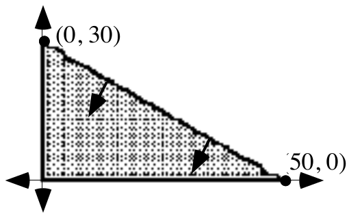

Note the short arrows pointing into the region of solutions.  It is handy to use such arrows when graphing a system whose components are two or more linear inequalities.  Then the solution of the system will be the region into which all the arrows point.

The system $\left\{ \begin{array}{l}x\geq 0 \\ y\geq 0 \\ 3\cdot x+5\cdot y\leq 150\end{array} \right.$

has as its solutions only those points in the above illustration that are either in the shaded portion of the first quadrant, on the segment from (0,0) to (50,0) or on the segment from (0,0) to (0,30).

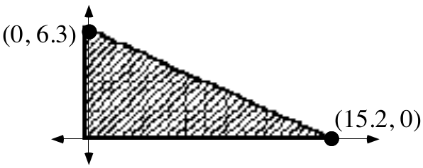

Create a system of linear inequalities whose solutions are represented in the above illustration.

## Assignment #107

### I.

Here again are some imaginary survey results about the behavior of those who purchase new cars roughly every three years.

75% of Americans who buy cars manufactured in America will buy an American- made car as their next car as well, while the rest will buy a car manufactured in another country.  Meanwhile, 65% of those who buy foreign-made cars will buy another foreign-made car as their next car, while the rest will buy an American- made car.

A. Give again the transition matrix for the country in which new cars are manufactured, using the first row and first column for American cars.

B. Suppose that in California 55% of those who recently purchased a new car bought an American-made car and the rest bought a foreign made car:

1\. Use matrix multiplication to calculate the percents of those in California who will own American and foreign made cars after the next purchases of new cars have taken place.  Give the answers accurate to the nearest tenth of a percent.

2\. Use matrix multiplication to calculate the percents of those in California who will own American and foreign made-cars after the next five purchases of new cars have taken place.  Again, give the answers accurate to the nearest tenth of a percent.

3\. Use some matrix products to help answer this question.  If the transition matrix you have used remained accurate, “in the long run” about what fraction of Californians buying new cars will own American made cars and what fraction will own foreign made cars?

C. Suppose that in Ohio 75% of those who recently purchased a new car bought an American-made car and the rest bought a foreign-made car.

1\. Use matrix multiplication to calculate the percents of those in Ohio who will own American and foreign-made cars after the next purchases of new cars have taken place.  Give the answers accurate to the nearest tenth of a percent.

2\. Use matrix multiplication to calculate the percents of those in Ohio who will own American and foreign-made cars after the next five purchases of new cars have taken place.  Again, give the answers accurate to the nearest tenth of a percent.

3\. If the transition matrix you have used remained accurate, “In the long run” about what fraction of Ohioans buying new cars will own American- made cars and what fraction will own foreign-made cars?

### II.

A journey by airplane is to be taken in two legs.  The first leg will be on a heading of 70˚ for a distance of 200 miles.  The second leg will be on a heading of 200˚ for a distance of 500 miles.

A. Use direction indicators as you sketch on your homework paper a representing of the entire two-legged journey.

B. Give the measure of the smaller angle formed by the arrows for the first and second legs of the journey.

C. Use the Law of Cosines to calculate, accurate to the nearest mile, the distance from the end of the second leg back to the point where the first leg began.

D. Add to your sketch an arrow representing a leg to return to the starting points from the point reached after the second leg.  Then use the Law of Cosines to calculate, accurate to the nearest tenth of a degree, the smaller angle formed by the arrow for the second leg of the journey and the arrow for the return to the starting point that your just sketched.

E. Based on your answer to “D” right above, on what heading should the pilot fly to return from the end of the second leg to the starting point of the journey?

### III.

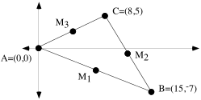

A. In the illustration above, the subscripted M's are used to represent the midpoints of the sides of the triangle.  On your homework paper make a list of these points together with their coordinates.

B. Create an equation for the line that passes through points A and M2.

C. Create an equation for the line that passes through points B and M3.

D. Use any convenient means to calculate the exact intersection of the lines you described with your answers to “B” and “C” right above.

E. Create an equation for the line that passes through points C and M1.

F. Use any convenient means to calculate the exact intersection of the lines you described with your answers to “E” and “B.”

G. True or False: In this triangle, the medians (segments connecting the vertices to the midpoints of the opposite sides) all intersect in the same point.

H. If possible, <strong>based on your answers above</strong>, give the coordinates of the center of a circle that will pass through all three vertices of the triangle in the illustration.

### IV.

<strong>Generating Calculator Images of Regular Polygons with Their Vertices on a Circle Centered at the Origin</strong>

A regular polygon is one in which all the sides have the same length and all the angles have the same measure.  In the first illustration below are four examples of representations of regular polygons generated by a calculator in parametric MODE.  In each case the settings for X1T, Y1T, Tmin, Tmax, and Tstep are given.  In these four cases the calculator computed the coordinates of only a few evenly spaced points on the unit circle. The calculator was set to make connected graphs, so the points whose coordinates were computed were connected.  The position of the first point was controlled by the setting for Tmin. The spacing of the points about the origin was controlled by the setting for Tstep.  When these images were generated the settings for Xmin, Xmax, Ymin, and Ymax were ¯1.1, 1.1, ¯1.1, and 1.1 respectively.  \[ZOOM\] and \[5\] were pushed to eliminate distortion.

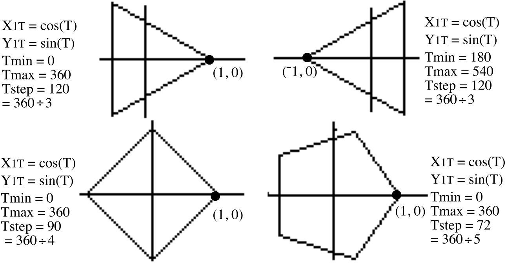

In the next illustration, the vertices of the regular six-sided polygon, also called a regular hexagon, all lie on a circle with radius 2.  The radius of the circle was controlled by the factors used with “cos(T)” and “sin(T)”.

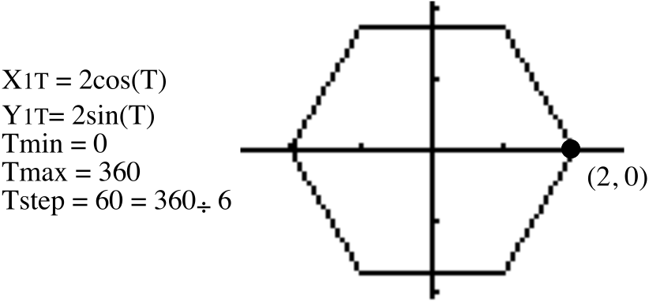

You will soon see that the images of the regular polygons are not only fun to make, they give a geometric image of the solutions of some important equations.

A. Use your calculator in parametric MODE to get a representation of the equilateral triangle which has one of its vertices at (1,0) and the other two vertices on the unit circle. After viewing the triangle using the \[ZOOM\] and \[5\] keys, push \[2nd\] and \[FORMAT\] (over the ZOOM key) and then select PolarGC in the first row of menu choices. Then return to a view of your graph by pushing \[GRAPH\].  Now push \[TRACE\].   You will see on the screen three values–a value for T, a value for R and a value for $\theta$ .  The values for R and $\theta$ can be used to create polar coordinate representations of the vertices of the triangle.  To move from one vertex to another, use the right and left arrow keys.   Record on your homework paper the polar coordinates of the vertices from the values shown on the screen.

B. True or False: Each of the complex numbers you gave as your answer to “A” right above is a solution of the equation

$x^{3}=1$.

C. True or False: \[1,240˚\] is a solution of $x^{3}=1$.

### V.

For this question, enter the coordinates of (0,0) and (11,¯2) into lists #1 and #2 and get a view of a connected scatter plot of these two points.

A. Calculate the exact slope of the line containing the segment represented by the connected scatter plot.

B. Create an equation for the line that is perpendicular to the segment represented by the scatter plot and intersects it at its midpoint. Check your answer by using it as the basis of an expression you enter as Y1.  Then use the \[ZOOM\] and \[5\] keys to get a distortion-free view of the segment and the line you described.  If it does not look like the perpendicular bisector of the segment, check your work and make a new entry for Y1.  Do not give up until it looks like you have succeeded.

### VI.

Use the Matrix Basis Theorem to create the matrix associated with a reflection in the $y-\text{axis}\mathrm{.}$

### VII.

Here are three transformation image formulas:

$\text{T}_{\mathrm{(}{}^{-}2\mathrm{,}0\mathrm{)}}\mathrm{(}x\mathrm{,}y\mathrm{)}=\mathrm{(}x+{}^{-}2\mathrm{,}y\mathrm{)}$,     $r_{y}\mathrm{(}x\mathrm{,}y\mathrm{)}=\mathrm{(}{}^{-}x\mathrm{,}y\mathrm{)}$    and    $\text{T}_{\mathrm{(}2\mathrm{,}0\mathrm{)}}\mathrm{(}x\mathrm{,}y\mathrm{)}=\mathrm{(}x+2\mathrm{,}y\mathrm{)}$

A. Give the image of (3,5) under the composite $r_{y}\circ \text{T}_{\text{(}{}^{-}2\mathrm{,}0\mathrm{)}}$.

B. Give the image of (3,5) under the triple composite $\text{T}_{\mathrm{(}2\mathrm{,}0\mathrm{)}}\circ \mathrm{(}r_{y}\circ \text{T}_{\mathrm{(}{}^{-}2\mathrm{,}0\mathrm{)}}\mathrm{)}$.

### VIII.

Give the image of (3,5) when it is reflected in the line described by $x=2$.  Making a sketch might help.

### IX.

Give an equivalent to ${}^{-}\mathrm{(}\text{a}+{}^{-}2\mathrm{)}$that does not contain any parentheses.

## Assignment #108

### I.

Here for the last time are the results of hypothetical polls about the behavior of people who buy new cars about every three years:

75% of Americans who buy cars manufactured in America will buy an American- made car as their next car as well, while the rest will buy a car manufactured in another country.  Meanwhile, 65% of those who buy foreign made cars will buy another foreign-made car as their next car, while the rest will buy an American made car.

A. Again, write the transition matrix for the country in which newly purchased cars were manufactured and use the first row and first column for American made cars.

B. If there were a state in which the fraction of those owning American cars would not change, use the matrix of variables $\mathrm{[}x\mathrm{,}y\mathrm{]}$ to create a matrix equation that reflects this condition.

C. Based on your answer to “B” right above, create a system in the form $\left\{ \begin{array}{l}\text{a}\cdot x+\text{b}\cdot y=\text{c} \\ \text{d}\cdot x+\text{e}\cdot y=\text{f} \\ \text{ 1}\cdot x+\text{1}\cdot y=\text{1}\end{array} \right.$ whose solution will have as its coordinates elements of the stable matrix described.

D. Give the solution of the system you created as your answer to “C” right above.

E. Calculate the thirty-second power to the transition matrix you gave as your answer to “A” and express the four entries as fractions.

F. Multiply your answer to “E” right above by each of the following:

1\. $\mathrm{[}0\mathrm{.}01\mathrm{,}0\mathrm{.}99\mathrm{]}$         2. \[$0\mathrm{.}99\mathrm{,}0\mathrm{.}01\mathrm{]}$   3.$\mathrm{[}0\mathrm{.}5\mathrm{,}0\mathrm{.}5\mathrm{]}$

G. True or False: After many years, the fraction of people in any state who will buy American cars will be about the same regardless of their buying behavior at the present time provided that the transition matrix given as your answer to “A” does not change over those years.

H. Do you think that it is realistic to assume that the transition matrix about car purchases will not change over a period of many years?

### II.

A. Use lists #1 and #2 to make a connected scatter plot of the triangle with its vertices at (3,2), (11,¯5) and (7,6).  Do not forget to list one of the vertices twice so that the scatter plot will show all three sides of the triangle. Then give commands that can be used to generate entries in lists #3 and #4 that are the coordinates of the images of the vertices of this triangle when it is reflected in the $y-\text{axis}\mathrm{.}$ Check your answer by viewing a connected scatter plot of the list #3, list #4 points.  To eliminate significant distortion, push first \[ZOOM\] and \[9\] and then \[ZOOM\] again and \[5\].  Give the commands you used for lists #3 and #4 on your homework paper.

B. Now give a new set of commands for lists #3 and #4 so that a connected scatter plot of those points will show a representation of the list #1, list #2 triangle when it is reflected in the $x-\text{axis}$.  Again, check your work by viewing connected scatter plots.

### III.

Here again are three transformation image formulas:

$\text{T}_{\mathrm{(}{}^{-}2\mathrm{,}0\mathrm{)}}\mathrm{(}x\mathrm{,}y\mathrm{)}=\mathrm{(}x+{}^{-}2\mathrm{,}y\mathrm{)}$,     $r_{y}\mathrm{(}x\mathrm{,}y\mathrm{)}=\mathrm{(}{}^{-}x\mathrm{,}y\mathrm{)}$    and      $\text{T}_{\mathrm{(}2\mathrm{,}0\mathrm{)}}\mathrm{(}x\mathrm{,}y\mathrm{)}=\mathrm{(}x+2\mathrm{,}y\mathrm{)}$

A. Give the image of (0,-2) under the triple composite $\text{T}_{\mathrm{(}2\mathrm{,}0\mathrm{)}}\circ \left( r_{y}\circ \text{T}_{\mathrm{(}{}^{-}2\mathrm{,}0\mathrm{)}} \right)$.

B. If (a,b) represents a “typical” point, give a representation of its image under the triple composite $\text{T}_{\mathrm{(}2\mathrm{,}0\mathrm{)}}\circ \left( r_{y}\circ \text{T}_{\mathrm{(}{}^{-}2\mathrm{,}0\mathrm{)}} \right)$.

C. The triple composite $\text{T}_{\mathrm{(}2\mathrm{,}0\mathrm{)}}\circ \left( r_{y}\circ \text{T}_{\mathrm{(}{}^{-}2\mathrm{,}0\mathrm{)}} \right)$ is equal to a reflection in some line.  Give an equation for that line.

### IV.

<strong>The Cube Roots of 1</strong>

It is rather easy to see that 1 is a solution of the equation

$x^{3}=1$.

But 1 is not the only solution.  From doing the last assignment you learned that both \[1,120˚\] and \[1,240˚\] are also solutions of $x^{3}=1$because

$\mathrm{[}1\mathrm{,}120{}^{\circ}\mathrm{]}^{3}=\mathrm{[}1\mathrm{,}120{}^{\circ}\mathrm{]}\cdot \mathrm{([}1\mathrm{,}120{}^{\circ}\mathrm{]}\cdot \mathrm{[}1\mathrm{,}120{}^{\circ}\mathrm{])}=\mathrm{[}1\mathrm{,}120{}^{\circ}\mathrm{]}\cdot \mathrm{[}1\mathrm{,}240{}^{\circ}\mathrm{]}=\mathrm{[}1\mathrm{,}360{}^{\circ}\mathrm{]}=\mathrm{(}1\mathrm{,}0\mathrm{)}=1$

and

$\mathrm{[}1\mathrm{,}240{}^{\circ}\mathrm{]}^{3}=\mathrm{[}1\mathrm{,}240{}^{\circ}\mathrm{]}\cdot \mathrm{([}1\mathrm{,}2420{}^{\circ}\mathrm{]}\cdot \mathrm{[}1\mathrm{,}240{}^{\circ}\mathrm{])}=\mathrm{[}1\mathrm{,}240{}^{\circ}\mathrm{]}\cdot \mathrm{[}1\mathrm{,}480{}^{\circ}\mathrm{]}=\mathrm{[}1\mathrm{,}720{}^{\circ}\mathrm{]}=\mathrm{(}1\mathrm{,}0\mathrm{)}=1$.

1, \[1,120˚\] and \[1,240˚\] are all called <strong>cube roots</strong> of 1.  They are in fact <strong>the</strong> cube roots of 1 because they are the only solutions of $x^{3}=1$.  (\[1,¯120˚\] does not represent a fourth solution, and therefore a fourth cube root of 1, because it is just an alternate representation of \[1,240˚\].)

There is a beautiful geometric connection between the cube roots of 1.   As shown in the illustration below, they are the vertices of an equilateral triangle whose sides connect points on the unit circle.

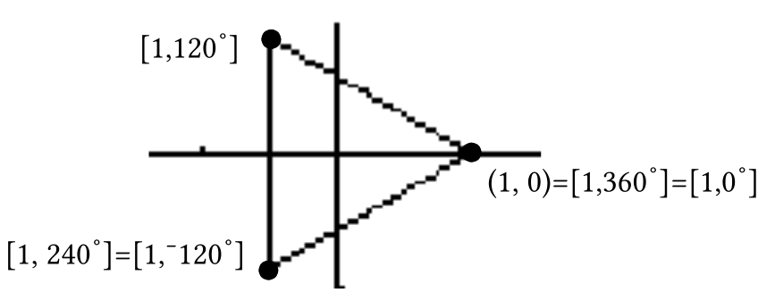.

In this question and later assignments you will be exploring the geometry of other roots.

A. The equation $x^{4}=1$ has two real solutions.  Give these solutions in full rectangular notation (this means with parentheses and two coordinates).

B. With your calculator in parametric MODE and X1T set at cos(T) and Y1T set at sin(T), set your calculator to show you the square that has the two solutions from “A” right above as two of its vertices.

C. Give polar coordinate representations of the vertices of the square that are not on the $x-\text{axis}$.

D. True or false: all four vertices of the square are solutions of $x^{4}=1$.

### V.

<strong>A Reminder about the Kite Theorem</strong>

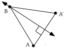

In the illustration above, point A' is the image of point A under a reflection in line $\ell$.  This means that line $\ell$ is perpendicular to segment AA'.  It also means that line $\ell$ intersects segment AA' at its midpoint.  In other words, line $\ell$ is the perpendicular bisector of segment AA'.

Point B is its own image under the same reflection in line $\ell$.  Because reflections preserve distance, the image of segment AB has the same length as segment A'B.  This means that point B is the same distance from each end of segment AA'.  This should remind you of

<strong>The Kite Theorem</strong>

Every point on the perpendicular bisector of a line segment is

the same distance from each end of that segment.

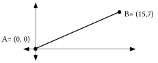

A. Create an equation for the line of points that are the same distance from point A as they are from point B.

B. Give the value of “b,” the second coordinate of the point which has first coordinate 11 and is on the line described by your answer to “A” right above.

C. If (11,b) represents the point referred to in “B” right above, use PROGRAM DISTANCE to calculate an estimate, accurate to the nearest thousandth, of the distance from (11,b) to the origin.  Give the estimate on your homework paper.

D. Again using (11,b) to represent the point referred to in “B” above, use PROGRAM DISTANCE to calculate an estimate, accurate to the nearest thousandth, of the distance from (11,b) to point B.  Again, give your calculated estimate on your homework paper.  If your answers to “C” and “D” do not match, check your answer to “A” and “B.”

### VI.

Enter “X2” as Y1 and then “3X2” as Y2.  Then push \[WINDOW\] and set Xmin = ¯2, Xmax = 2, Ymin = ¯0.5 and Ymax = 12.  Then push \[GRAPH\] to get a partial view of two parabolas.  Based on what you see, would you agree or disagree with the following statement:

“All parabolas have the same shape.”

### VII.

In each case copy and complete the given connection diagram.  Also give an equivalent to each image equation in the form $y=\text{k}\cdot x^{2}$.

A.                                                                     B.

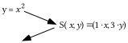             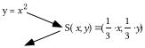

C.

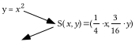

### VIII.

<strong>A Reminder about the Special Shape of a Parabola</strong>

When we first described the special shape of parabolas we worked first with the parabola with equation $y=x^{2}$.  Any point on that parabola is the same distance from the point $\mathrm{(}0\mathrm{,}\frac{1}{4}\mathrm{)}$as it is from the line described by $y=\frac{{}^{-}1}{4}$.  The illustration below is intended to remind you how the distance from a point to a line is determined.

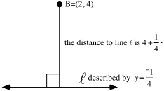

In mathematical discussions, the distance from a point is the measure of the segment that begins at the point, is perpendicular to the line, and ends at the line.

A. Give the distance from the point (1,3) to the line described by $y=\frac{{}^{-}1}{12}$.

B. Calculate the exact distance from the point (1,3) to the point $\mathrm{(}0\mathrm{,}\frac{1}{12}\mathrm{)}$.

C. Write an equation for the image of the line described by $y=\frac{{}^{-}1}{4}$ when it is mapped with the scale change S:$\text{S}\mathrm{(}x\mathrm{,}y\mathrm{)}=\mathrm{(}\frac{1}{3}\cdot x\mathrm{,}\frac{1}{3}\cdot y\mathrm{)}$.

D. Give the image of the point $\mathrm{(}0\mathrm{,}\frac{1}{4}\mathrm{)}$ when it is mapped with S:$\text{S}\mathrm{(}x\mathrm{,}y\mathrm{)}=\mathrm{(}\frac{1}{3}\cdot x\mathrm{,}\frac{1}{3}\cdot y\mathrm{)}$.

### IX.

Use lists #1 and #2 to generate a connected scatter plot of the triangle with vertices (0,0), (24,0), and (18,12).

A. Give commands that can be used to generate in lists #3 and #4 the images of the list #1, list #2 triangle under the origin centered size transformation with image formula $S\mathrm{(}x\mathrm{,}y\mathrm{)}=\left( \frac{1}{3}\cdot x\mathrm{,}\frac{1}{3}\cdot y \right)$.  Also use these commands.

B. Get a view of a connected scatter plot of the list #3, list #4 points.  Then tell whether or not you agree with the following statement:

“The list #1, list #2 triangle and the list #3, list #4 triangle have the same shape.”

## Assignment #109

### I.

<strong>A Reflection in a Vertical Line other than the</strong> <em><strong>y</strong></em><strong>-axis</strong>

It is relatively easy to generate the image of a polygon under reflection in the $y-\text{axis}$ using a calculator because it is relatively easy to identify the images of the basis points (1,0) and (0,1).  These images are (¯1,0) and (0,1), respectively.  With this knowledge and the Matrix Basis Theorem the matrix associated with a reflection in the $y-\text{axis}$ can be written.  This matrix is $\left[ \begin{matrix}{}^{-}1 & 0 \\ 0 & 1\end{matrix} \right]$ and the matrix product

$\left[ \begin{matrix}{}^{-}1 & 0 \\ 0 & 1\end{matrix} \right]\cdot \left[ \begin{matrix}\text{L}_{1} \\ \text{L}_{2}\end{matrix} \right]=\left[ \begin{matrix}{}^{-}1\cdot \text{L}_{1} \\ 1\cdot \text{L}_{2}\end{matrix} \right]$

provides expressions for the commands that can be used to generate the coordinates of the vertices of the image into lists #3 and #4.

However, when we seek to generate the image of a polygon under a reflection in any other vertical line besides the $y-\text{axis}$, the Matrix Basis Theorem will not do the job.  This is because the only transformations that are associated with $2\times 2$ matrices are those that map the origin to itself.  But when reflecting in a vertical line other than the $y-\text{axis}$, (0,0) will not be its own image.

The illustration below outlines how a reflection in the vertical line described by $x=2$ can be composed from a translation after a reflection in the $y-\text{axis}$ after a translation.

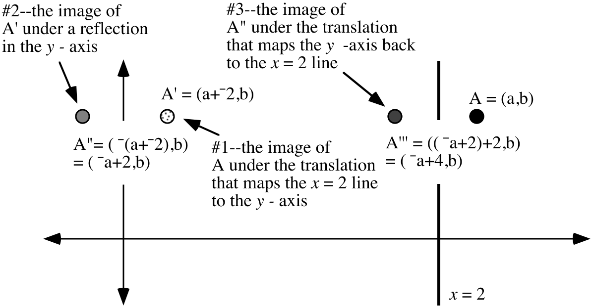

When you compare the coordinates of the final image, $A^{\prime\prime\prime}$=  ( ¯a+4,b), to the coordinates of the “typical” pre-image point, A = (a,b), you can see that the first coordinate of the final image is 4 more than the opposite of the first coordinate of the pre-image while the second coordinate is unchanged.  Thus, if the coordinates of the vertices of a pre-image polygon have been stored in lists #1 and #2, then the commands

$\text{L}_{\text{3}}={}^{_{{}^{-}}}\text{L}_{\text{1}}+\text{4 and L}_{\text{4}}=\text{L}_{\text{2}}$

can be used to generate into lists #3 and #4 the coordinates of the vertices of the image of that polygon.

A. Give image formulas for three transformations whose triple composite would equal a reflection in the line described by $x=5$.

B. Give a representation of the coordinates of the image of the “typical” point (a,b) under a reflection in the line described by $x=5$.

C. Get on your calculator a connected scatter plot representation of the triangle whose vertices are (7,5), (14,18) and (19,-7).  Push \[WINDOW\] and set Xmin = 4. Then go to the home screen and push \[2nd\], \[PRGM\] (to get the DRAW menu), select 4:Vertical and push \[5\].  You should now see a representation of the vertical line described by $x=5$ on the screen to the left of the triangle.

D.  The goal now is to generate the reflection of the triangle displayed on your calculator in the line <em>x</em> = 5 displayed on your calculator.  The coordinates of the vertices of the image triangle should end up in lists #3 and #4. Write calculator commands that generate these coordinates on your homework paper.  Check your work by viewing a connected scatter plot of the list #3, list #4 points. When you do this, the representation of the line of reflection will have disappeared, but it will reappear with the scatter plots of the pre-image and image triangles if you go to the home screen and push \[2nd\] and \[ENTER\] and \[ENTER\] again.

### II.

<strong>Roots Beyond Square Roots</strong>

Any solution of the equation $x^{3}=1$ is called a cube root of 1:

Any solution of the equation $x^{4}=1$ is called a fourth root of 1.

Any solution of the equation $x^{5}=1$ is called a fifth root of 1, etc.

You have already seen that 1 has three cube roots.  You have also seen that 1 has four fourth roots.  Furthermore you have seen that the cube roots of 1 are points on the unit circle that are the vertices of an equilateral triangle.  You have also seen that the fourth roots of 1 are points on the unit circle that are the vertices of a square.  Only one of the three cube roots is on the $x-\text{axis}$ and only two of the four fourth roots of 1 are on the x-axis.  It is the richness of the complex number system that in these cases provided a number of roots equal to the exponent of the variable in the equation $x^{3}=1$ and $x^{4}=1$.  In this and later assignments you will explore whether the complex number system continues to provide the number of roots that this pattern leads you to expect.

A. The equation $x^{5}=1$ has only one real number solution.  Give that solution in both rectangular and polar notation.

B. With your calculator in parametric mode, set X1T = cos(T) and Y1T = sin(T) . Then give settings form Tmin, Tmax and TStep so that your calculator will generate a representation of the regular pentagon which has your answer to “A” right above as one of its vertices and has all its other vertices on the unit circle.

C. True or False: \[1,144˚\] is a solution of $x^{5}=1$.

D. Give in polar notation each of the solutions of $x^{5}=1$.

### III.

How many complex number solutions do you think the equation $x^{6}=1$ has?

### IV.

In each case copy and complete the given connection diagram.  Also give an equivalent to each image equation in the form $y=\text{k}\cdot x^{2}$.

A.                                                                      B.

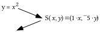                  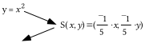

C.

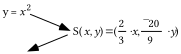

### V.

A. Give the distance from the point (1,¯5) to the $y=\frac{1}{20}$line.

B. Write an equation for the image of the $y=\frac{{}^{-}1}{4}$line when it is mapped with the scale change S with $\text{S}\mathrm{(}x\mathrm{,}y\mathrm{)}=\mathrm{(}\frac{{}^{-}1}{5}\cdot x\mathrm{,}\frac{{}^{-}1}{5}\cdot y\mathrm{)}$.

C. Give the image of $\mathrm{(}0\mathrm{,}\frac{1}{4}\mathrm{)}$when it is mapped by S with $\text{S}\mathrm{(}x\mathrm{,}y\mathrm{)}=\mathrm{(}\frac{{}^{-}1}{5}\cdot x\mathrm{,}\frac{{}^{-}1}{5}\cdot y\mathrm{)}$.

D. Compute the exact distance from (1,¯5) to your answer to “C” right above.

### VI.

Use lists #1 and #2 to generate a connected scatter plot of the pentagon with vertices (0,0), (10,¯15)  (15,¯15), (25,0) and (10,10).

A. Give commands that can be used to generate in lists #3 and #4 the coordinates of the image of the list #1, list #2 pentagon under the origin centered size transformation with image formula $\text{S}\mathrm{(}x\mathrm{,}y\mathrm{)}=\left( \frac{1}{2}\cdot x\mathrm{,}\frac{1}{2}\cdot y \right)$.  Also use these commands.

B. Get a view of a connected scatter plot of the list #3, list #4 points.  Then tell whether or not you agree with the following statement:

“The list #1, list #2 pentagon and the list #3, list #4 pentagon have the same shape.”

C. Give commands that can be used to generate in lists #5 and #6 the coordinates of the image of the list #1, list #2 pentagon under the origin centered size transformation with image formula $\text{S}\mathrm{(}x\mathrm{,}y\mathrm{)}=\left( \frac{{}^{-}1}{2}\cdot x\mathrm{,}\frac{{}^{-}1}{2}\cdot y \right)$.  Also use these commands.

D. Based on your observation of the representations of the three pentagons made from the coordinates stored in the lists, so you agree or disagree with the following statement: “All three pentagons have the same shape.”

### VII.

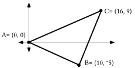

With reference to the figure above:

A. Give an equation for the line of points that are the same distance from point A as they are from point B.

B. Give an equation for the line of points that are the same distance from point B as they are from point C.

C. Create a system of the form $\left\{ \begin{array}{l}\text{a}\cdot x+\text{b}\cdot y=\text{c} \\ \text{d}\cdot x+\text{e}\cdot y=\text{f}\end{array} \right.$ whose solution will be the point of intersection of the lines whose descriptions you wrote as your answers to “A” and “B” right above.

## Assignment #110

### I.

A. Give image formulas for three transformations whose triple composite would equal a reflection in the line described by $y=3$.

B. Give a representation of the coordinates of the image of the “typical” point (a,b) under a reflection in the line described by $y=3$.

C. Get on your calculator a connected scatter plot representation of the triangle whose vertices are (¯4,8), (1,17) and (10,6).  Push \[WINDOW\] and set Ymin = 1. Then go to the home screen and push \[2nd\], \[PRGM\] (to get the DRAW menu), select 3:Horizontal and push \[3\].  You should now see a representation of the horizontal line described by $y=3$ on the screen below the triangle.

D.  The goal is to create lists #3 and #4 so that these lists will contain the coordinates of the images of the vertices of the triangle under a reflection in the $y=3$ line.  Give the commands that can be used to do this.  Check your work by viewing a connected scatter plot of the list #3, list #4 points. When you do this, the representation of the line of reflection will have disappeared, but it will reappear with the scatter plots of the pre-image and image triangles if you go to the home screen and push \[2nd\] and \[ENTER\] and \[ENTER\] again.

### II.

Here is an illustration of triangle ABC and its reflection image in the $x-\text{axis}\mathrm{.}$

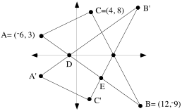

A. Put the coordinates of the vertices A,B,C in lists #1 and #2 on your calculator. Give commands you could use to create lists #3 and #4 so that these lists would contain the coordinates of the image triangle, A'B'C'.

B. Create an equation for the line that contains points A' and C'.

C. Create an equation for the line that contains points C' and B'.

D. Create a system of the form $\left\{ \begin{array}{l}\text{a}\cdot x+\text{b}\cdot y=\text{c} \\ \text{d}\cdot x+\text{e}\cdot y=\text{f}\end{array} \right.$ whose solution will give the coordinates of point C'.  Then calculate the coordinates of point C'.

E. Create an equation for the line that passes through points A and B.

F. Somehow calculate the exact coordinates of point D.

G. Create a system of the form $\left\{ \begin{array}{l}\text{a}\cdot x+\text{b}\cdot y=\text{c} \\ \text{d}\cdot x+\text{e}\cdot y=\text{f}\end{array} \right.$ whose solution will give the coordinates of point E.

H. Give the exact coordinates of point E.

### III.

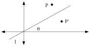

In the illustration above, P' is the image of point P under a reflection in line $\ell$ which passes through the origin.  In addition, $\theta$ represents the measure of the smaller angle formed by line $\ell$ and the $x-\text{axis}$.

A. Give the matrix for the origin centered rotation that would map line $\ell$ onto the $x-\text{axis}$.

B. If the coordinates of point P were known, describe what might be done to compute the coordinates of point P'.

### IV.

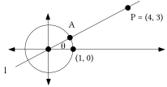

A. Give the exact distance from the origin to point P.

B. With the help of a size transformation, give the exact coordinates of point A.

C. Give a simple fraction equal to $\mathrm{cos(}\theta \mathrm{)}$.

### V.

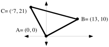

A. Create a system of the form $\left\{ \begin{array}{l}\text{a}\cdot x+\text{b}\cdot y=\text{c} \\ \text{d}\cdot x+\text{e}\cdot y=\text{f}\end{array} \right.$ whose solution is the one point that is the same distance from points A, B and C.

B. Give, accurate to four decimal places, the radius of a circle that will pass through points A, B and C.

### VI.

Put your calculator in parametric MODE and set $2\cdot \mathrm{cos(}\text{T}\mathrm{)}$ as X1T and $2\cdot \mathrm{sin(}\text{T}\mathrm{)}$ as Y1T

A. Give settings for Tmin, Tmax and TStep so that your calculator will generate an image of the equilateral triangle which has one vertex at (2,0) and its other two vertices on the circle with its center at (0,0) and radius 2.  When you check your answer by viewing a graph, use \[ZOOM\] and \[5\] to eliminate distortion.

B. Give polar coordinates for each of the three vertices of the triangle generated from the settings your gave as your answer to “A” right above.

C. Each of the vertices of the triangle you can generate from the settings you gave as your answer to “A” right above is a solution of an equation of the form $x^{3}=\text{a}$.  Give the value of “a.”

### VII.

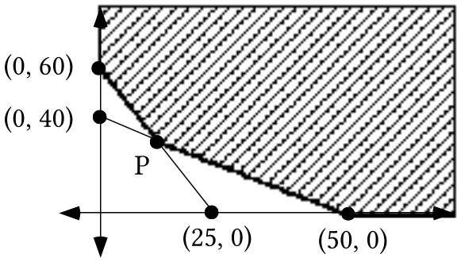

In the illustration above, assume that the shaded region has no boundary on its top or right side.

A. Under that assumption, create a system whose solutions are all the points in the shaded region and on its darkened boundary.

B. Give the exact coordinates of point P.

### VIII.

Each of the pairs (2,a), (3,b) and (5,c) has the form (the length of an object in feet, the length of that same object in inches).

A. Give the values of “a,” “b,” and “c.”

B. Use your answers to “A” right above to create a disconnected scatter plot of the three points.  Then create an equation for the line that passes through all three of the scatter plot points.

C. Would the unit designation for the slope of the line you described with your answer to “B” right above best be given as “feet per inch” or as “inches per foot”?

D. True or False: The length of an object in inches varies directly as its length in feet.

## Assignment #111

### I.

A. Give image formulas for three transformations whose triple composite equals  a reflection in the $y={}^{-}5$line.

B. Give a representation of the coordinates of the image of the “typical” point (a,b) under a reflection in the $y={}^{-}5$line described.

C. Get on your calculator a connected scatter plot representation of the triangle whose vertices are (¯4,8), (1,17) and (10,6).  Push \[WINDOW\] and set Ymin = -5. Then go to the home screen and push \[2nd\], \[PRGM\] (to get the DRAW menu), select 3:Horizontal and push \[(-)\] and \[5\].  You should now see a representation of the horizontal line with equation $y={}^{-}5$ on the screen to the left of the triangle.

D.   Now give on your homework paper commands that will create lists #3 and #4 so that these lists will contain the coordinates of the images of the vertices of the triangle under a reflection in the y = -5 line.  Check your work by viewing a connected scatter plot of the list #3, list #4 points. When you do this, the representation of the line of reflection will have disappeared, but it will reappear with the scatter plots of the pre-image and image triangles if you go to the home screen and push \[2nd\] and \[ENTER\] and \[ENTER\] again.

### II.

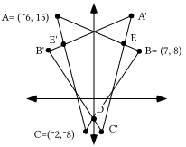

The above illustration shows triangle ABC and its image under a reflection in the $y-\text{axis}$.

A. Enter the coordinates of the vertices A, B, and C into lists #1 and #2.  Give commands that will generate the coordinates of A', B', and C' into lists #3 and #4.

B. Create an equation for the line containing side CB.

C. Create an equation for the line containing side C'B'.

D. Create a system of the form $\left\{ \begin{array}{l}\text{a}\cdot x+\text{b}\cdot y=\text{c} \\ \text{d}\cdot x+\text{e}\cdot y=\text{f}\end{array} \right.$ whose solution will give the coordinates of point D.

E. Give the exact solution of the system you created as your answer to “D.”

F. Use a system of the form $\left\{ \begin{array}{l}\text{a}\cdot x+\text{b}\cdot y=\text{c} \\ \text{d}\cdot x+\text{e}\cdot y=\text{f}\end{array} \right.$  to guide your computation of the exact coordinates of point E.

G. Give the exact coordinates of point E'.

H. In the illustration you see point D and a second point on the $y-\text{axis}$ where sides of the pre-image and image triangles intersect.  Take some steps to find the coordinates of this second point.  You might be able to use an equation you have already written.  You also may need to create a new equation.

I. On the your sketch you should also see a point on side A'C' below point E where a side of the pre-image triangle intersects a side of the image triangle.  Use some of your equations from “B” and “C” above to determine the exact coordinates of this intersection point.

J. On your sketch you should see two points to the left of the $y-\text{axis}$ where a side of the pre-image triangle intersects a side of the image triangle.  Somehow determine the exact coordinates of these two points.

### III.

In the illustration above, points A is on an arc of the unit circle.  Copy the illustration onto your homework paper, and add to it A', the image of point A under a reflection in the $x-\text{axis}$.  Label your representation of A' with its coordinates.

A. True or False: A' is on the unit circle.

B. Give the matrix associated with the origin centered rotation that will map (1,0) onto A'.

C. Give the matrix associated with an origin centered rotation that will map point A onto the $x-\text{axis}$.

### IV.

Use the Matrix Basis Theorem twice and then the Matrix-Transformation Isomorphism Theorem to compute the matrix associated with the composite

$r_{x}\circ \text{R}_{90}$.

### V.

Suppose that (¯5,9), (3,42) and (7,35) are all points on the same parabola described by an equation of the form $y=\text{a}\cdot x^{2}+\text{b}\cdot x+\text{c}$.  Use this fact to create a $3\times 3$ system of equations using “<em>a</em>,” “<em>b</em>,” and “<em>c</em>” as the variables.

### VI.

Use matrix multiplication to compute the solution of the system:

$\left\{\begin{array}{l}25\cdot a+{}^{-}5\cdot b+1\cdot c=11 \\ 9\cdot a+3\cdot b+1\cdot c={}^{-}17 \\ 49\cdot a+7\cdot b+1\cdot c=22\end{array}\right.$

### VII.

<strong>Similar Geometric Figures—Part I</strong>

As part of your work in two recent assignments you have had your calculator generate representations of certain polygons and their images under various size transformations.  It seems appropriate to describe the pre-image and image polygons as having “the same shape.”

If one geometric figure is the image of another under a size

transformation, the figures are said to be <strong>similar</strong> to each other.

Similar figures are said to have the same shape.

<strong>The similarity of two parabolas that have (0,0) as their vertex at the origin and the y-axis as their line of reflection symmetry</strong>

The following connection diagram shows how the parabola with equation $y=x^{2}$ can be connected by a size transformation to a different parabola that shares its vertex and line of reflection symmetry.

According to the definition in the box above, the pre-image parabola described by $y=x^{2}$ and the image parabola described by $y=3\cdot x^{2}$are similar.  This means they are supposed to have the same shape.  You have viewed graphs generated by Y1=X2 and Y2=3.X2 with the viewing window set from ¯2 to 2 horizontally and 0 to 4 vertically and with this view many thought that the two parabolas represented did not have the same shape. However, when the calculator is used to view only that portion of the parabola generated from Y2=3.X2 that stretches from $\left( \frac{{}^{-}2}{3}\mathrm{,}\frac{4}{3} \right)$ to $\left( \frac{2}{3}\mathrm{,}\frac{4}{3} \right)$ we get a different impression.

Looking at these generated graphs, we see that there is a piece of the parabola described by $y=3\cdot x^{2}$ that has exactly the same shape as a piece of the parabola described by $y=x^{2}$.  If the window settings were changed to view a different piece of the $y=x^{2}$ parabola, the size transformation image formula could be used to get settings for Xmin, Xmax, Ymin and Ymax to get a matching view of the $y=3\cdot x^{2}$.  This is the sense in which the two parabolas do have the same shape and deserve to be classified as similar.

A. Give an equation in the form $y=\text{k}\cdot x^{2}$ for the image of the parabola described by $y=x^{2}$ when it is mapped with S with S($x\mathrm{,}y\mathrm{)}=\mathrm{(}\frac{2}{3}\cdot x\mathrm{,}\frac{8}{9}\cdot y\mathrm{)}$.

B.

1\. Give an equation for the image of the line with equation $y=\frac{{}^{-}1}{4}$ when it is mapped by S:S($x\mathrm{,}y\mathrm{)}=\mathrm{(}\frac{2}{3}\cdot x\mathrm{,}\frac{8}{9}\cdot y\mathrm{)}$.

2\. Give the image of $\mathrm{(}0\mathrm{,}\frac{1}{4}\mathrm{)}$when it is mapped by S:S($x\mathrm{,}y\mathrm{)}=\mathrm{(}\frac{2}{3}\cdot x\mathrm{,}\frac{8}{9}\cdot y\mathrm{)}$.

3\. True or False: The point (2,8) is the same distance from your answer to “1” right above as it is from your answer to “2” right above.

C. Give an image formula for the origin centered <strong>size transformation</strong> that maps the parabola with equation $y=x^{2}$ onto the parabola with equation $y=2\cdot x^{2}$

D.

1\. Give an equation for the image of the line with equation $y=\frac{{}^{-}1}{4}$ when it is mapped by the size transformation for which you gave an image formula as your answer to “C” right above.

2\. Give the image of $\mathrm{(}0\mathrm{,}\frac{1}{4}\mathrm{)}$when it is mapped by the size transformation for which you gave an image formula as your answer to “C” right above.

3\. True or False: The point (2,8) is the same distance from your answer to “1” right above as it is from your answer to “2” right above.

### VIII.

In each case give settings for X1T, Y1T, Tmin, Tmax, and Tstep so that your calculator will generate the equilateral triangle whose vertices are the solutions of the given equations:

A. $x^{3}=27$                      B. $x^{3}={}^{-}8$

C. Represent all the cube roots of -8 using polar notation with non-negative second coordinates less than 360˚.

## Assignment #112

### I.

A. Give image formulas for three transformations whose triple composite equals a reflection in the line described by $x={}^{-}6$.

B. Give a representation of the coordinates of the image of the “typical” point (a,b) under a reflection in the line described by $x={}^{-}6$.

C. Get on your calculator a connected scatter plot representation of the triangle whose vertices are (-2,5), (10,18) and (6,-7).  Push \[WINDOW\] and set Xmin = -7. Then go to the home screen and push \[2nd\], \[PRGM\] (to get the DRAW menu), select 4:Vertical and push \[(-)\] and \[6\].  You should now see a representation of the vertical line described by $x={}^{-}6$ on the screen to the left of the triangle.

D.  Now give on your homework paper commands that will create lists #3 and #4 so that these lists will contain the coordinates of the images of the vertices of the triangle under a reflection in the $x={}^{-}6$ line.  Check your work by viewing a connected scatter plot of the list #3, list #4 points. When you do this, the representation of the line of reflection will have disappeared, but it will reappear with the scatter plots of the pre-image and image triangles if you go to the home screen and push \[2nd\] and \[ENTER\] and \[ENTER\] again.

### II.

<strong>A Quick Reminder about the Matrix-Transformation Isomorphism Theorem</strong>

If \[A\] is the matrix associated with transformation S and \[B\] is the matrix associated with transformation T, then

the matrix product \[A\].\[B\] is the matrix associated with the composite $\text{S}\circ \text{T}$.

Note that both matrix \[A\] and the transformation S are on the left while matrix \[B\] and the transformation T are on the right.  <strong>In using the Matrix-Transformation Isomorphism Theorem, in is very important to multiply the associated matrices in the same left to right order as the transformations.</strong>

Point A is collinear with the origin and point P.

A. Give the coordinates of point A.

B. Give the coordinates of point A', the image of point A under a reflection in the $x-\text{axis}$

C. Give the matrix for a rotation that will map (1,0) onto point A'.

D. Give the matrix for a rotation that will map line $\ell$ onto the $x-\text{axis}$.

E. Use the Matrix-Transformation Isomorphism Theorem to compute the matrix for the composite of a reflection in the $x-\text{axis}$ after the rotation that will map line $\ell$ onto the $x-\text{axis}$.

F. Find a way to use your answer to “E” right above and the Matrix-Transformation Isomorphism Theorem to calculate a matrix for a reflection in line $\ell$.

### III.

Suppose the points (¯5,23), (1,14) and (4,¯2) are all points on the same parabola.  That parabola can be described by an equation of the form $y=\text{a}\cdot x^{2}+\text{b}\cdot x+\text{c}$.

A. Create and write on your homework paper a system whose solution will give the values of the coefficients “a,” “b,” and “c.”

B. Enter the coordinates of the three given points into lists #1 and #2 and get a view of a <strong>disconnected</strong> scatter plot of them.  Then give on your homework paper an expression you entered as Y1 from which your calculator was able to generate a parabola graph that passed through all three of the points.

### IV.

In each case use the quadratic formula and your calculator to calculate the solutions of the given equation.  Give the solutions accurate to the nearest thousandth.

A. $\frac{{}^{-}23}{54}\cdot x^{2}+\frac{{}^{-}173}{54}\cdot x+476=120$               B. $\frac{{}^{-}23}{54}\cdot x^{2}+\frac{{}^{-}173}{54}\cdot x+356=0$

### V.

<strong>The Focus and Directrix of a Parabola that has its Vertex at the Origin</strong>

Each point on the parabola described by $y=x^{2}$ is the same distance from the point $\mathrm{(}0\mathrm{,}\frac{1}{4}\mathrm{)}$ as they are from the line described by $y=\frac{{}^{-}1}{4}$.

Mirrors in telescopes and reflectors in flashlights are shaped to have a parabolic profile.  This is because light rays reflect off a parabolic surface in a special way.

As suggested by the illustration above, the point $\mathrm{(}0\mathrm{,}\frac{1}{4}\mathrm{)}$ is called the <strong>focus</strong> of the parabola with equation $y=x^{2}$.  The line with equation $y=\frac{{}^{-}1}{4}$ is called the <strong>directrix</strong> of the parabola described by $y=x^{2}$.

Every parabola that has (0,0) as its vertex and the $y-\text{axis}$ as its line of reflection symmetry is the image of the parabola with equation $y=x^{2}$ under an origin centered size transformation.  The focus and directrix of the image parabola are the images of the focus and directrix of the parabola described by $y=x^{2}$ under the size transformation:

Example:  The parabola with equation $y=3\cdot x^{2}$is the image of the $y=x^{2}$ parabola under the size transformation S:$\text{S}\mathrm{(}x\mathrm{,}y\mathrm{)}=\mathrm{(}\frac{1}{3}\cdot x\mathrm{,}\frac{1}{3}\cdot y\mathrm{)}$.

The focus of the image is $\mathrm{(}\frac{1}{3}\cdot 0\mathrm{,}\frac{1}{3}\cdot \frac{1}{4}\mathrm{)}=\left( 0\mathrm{,}\frac{1}{12} \right)$

The directrix of the image is the line described by $3\cdot y=\frac{{}^{-}1}{4}\text{ or }y=\frac{{}^{-}1}{12}$.

Each point on the parabola with equation $y=3\cdot x^{2}$ is the same distance from the focus point $\left( 0\mathrm{,}\frac{1}{12} \right)$ as it is from the directrix line described by $y=\frac{{}^{-}1}{12}$.

A. In each case give an image formula for the origin centered size transformation that will map the parabola described by $y=x^{2}$ onto the parabola described by the given equation:

1\. $y=7\cdot x^{2}$    2. $y=\frac{2}{3}\cdot x^{2}$    3. $y={}^{-}3\cdot x^{2}$

B. Give the coordinates of the focus and an equation for the directrix of the parabola described by $y=7\cdot x^{2}$.

### VI.

<strong>The Cube Roots of a Real Number other than 1</strong>

The solutions of the equation $x^{3}={}^{-}8$ are the cube roots of ¯8.  It is not hard to see that ¯2 is one of these cube roots.  ¯2 = (¯2,0) = \[2,180˚\] is on the circle centered at the origin with radius 2.  Since the cube roots of 1 were all on the unit circle, whose radius is 1, it should seem reasonable to suggest that any other cube roots of ¯8 should be on the same circle as (¯2,0).

Furthermore, since each cube root of 1 is the image of one of the others under the origin centered rotation with magnitude 120˚, it should seem reasonable to suggest that this might also be true for the cube roots of ¯8.  In polar notation the reasonable suggestions for other cube roots of ¯8 are therefore \[2,300˚\] and \[2,420˚\].  Here is a verification that these are in fact cube roots of ¯8:

$\begin{array}{l}\mathrm{[}2\mathrm{,}300{}^{\circ}\mathrm{]}^{3}=\mathrm{[}2\mathrm{,}300{}^{\circ}\mathrm{]}\cdot \mathrm{([}2\mathrm{,}300{}^{\circ}\mathrm{]}\cdot \mathrm{[}2\mathrm{,}300{}^{\circ}\mathrm{])}=\mathrm{[}2\mathrm{,}300{}^{\circ}\mathrm{]}\cdot \mathrm{[}4\mathrm{,}600{}^{\circ}\mathrm{]} \\ =\mathrm{[}8\mathrm{,}900{}^{\circ}\mathrm{]}=\mathrm{[}8\mathrm{,}180{}^{\circ}\mathrm{]}=\mathrm{(}{}^{-}8\mathrm{,}0\mathrm{)}={}^{-}8\mathrm{.}\end{array}$

and

$\begin{array}{l}\mathrm{[}2\mathrm{,}420{}^{\circ}\mathrm{]}^{3}=\mathrm{[}2\mathrm{,}420{}^{\circ}\mathrm{]}\cdot \mathrm{([}2\mathrm{,}420{}^{\circ}\mathrm{]}\cdot \mathrm{[}2\mathrm{,}420{}^{\circ}\mathrm{])}=\mathrm{[}2\mathrm{,}420{}^{\circ}\mathrm{]}\cdot \mathrm{[}4\mathrm{,}840{}^{\circ}\mathrm{]} \\ =\mathrm{[}8\mathrm{,}1260{}^{\circ}\mathrm{]}=\mathrm{[}8\mathrm{,}180{}^{\circ}\mathrm{]}=\mathrm{(}{}^{-}8\mathrm{,}0\mathrm{)}={}^{-}8\mathrm{.}\end{array}$

The calculator will show us the equilateral triangle whose vertices are these cube roots if we use

X1T = 2.cos(T) and Y1T = 2.sin(T)

with Tmin = 180, Tmax = 540 and Tstep = 120.

In the questions you have about cube roots of real numbers in this course, you should be able to determine one real cube root by just thinking. The other cube roots can then be found by rotating the first cube root by various multiples of 120°. 120˚ about the origin and then also rotating the second cube root 120˚ about the origin.  Representations of the images in polar notation is very handy.

In each case give settings for X1T, Y1T, Tmin, Tmax, and Tstep so that your calculator will generate the regular polygon whose vertices are as described:

A. They are the solutions of $x^{3}={}^{-}27$, and therefore they are the cube roots of ¯27.

B. They  are the solutions of $x^{4}=16$ and therefore they are the fourth roots of 16.

C. They are the cube roots of 64.

D. Give a polar representation of each of the fourth roots of 16.  The second coordinates should be non-negative and less than 360˚.

E. Represent with abbreviated rectangular notation any of the fourth roots of 16 that are real numbers.

### VII.

Sketch the region of solutions for the system below.  Also label the coordinates of any and all vertices of the boundary.

$\left\{ \begin{array}{l}x\geq 0 \\ y\geq 0 \\ x+3\cdot y\geq 180 \\ {}^{-}3\cdot x+2\cdot y\leq 90\end{array} \right.$

### VIII.

A. Give the coordinates of the vertex of the parabola described by $y={}^{-}2\cdot \mathrm{(}x+{}^{-}3\mathrm{.}7\mathrm{)}^{2}+17$.

B. If $y=\text{a}\cdot x^{2}+\text{b}\cdot x+\text{c}$ is used as a description of the form of $y={}^{-}2\cdot x^{2}+14\mathrm{.}8\cdot x+{}^{-}10\mathrm{.}38$, compute the number represented by $\frac{{}^{-}\text{b}}{\text{2}\cdot \text{a}}$.

C. What is the second coordinate of the point on the parabola described by $y={}^{-}2\cdot x^{2}+14\mathrm{.}8\cdot x+{}^{-}10\mathrm{.}38$ whose first coordinate is your answer to “B” right above?

## Assignment #113

### I.

A. Give the exact distance from the origin to point P.

B. If the matrix product \[C\] $\times$ \[B\] $\times$ \[A\] is associated with a reflection in line $\ell$, give these three matrices.

### II.

Create a system of linear inequalities whose solutions are the points in the hatched region in the illustration above.  Hint: your system will need to have more that two linear inequalities.

### III.

The illustration is of a calculator graph of a parabola with three points highlighted.  The coordinates of those points are labeled.

A. Give an equation of the form $y=\text{a}\cdot x^{2}+\text{b}\cdot x+\text{c}$ which describes the parabola in the illustration.  Enter as Y1 an expression based on your equation. Check your answer computationally by computing the second coordinate that goes with each of the first coordinates.  Check your work visually  by making a disconnected scatter plot of the three points and checking to see that the graph generated from your Y1 expression appears to pass through the three points of the scatter plot.

B. Enter 150 as Y2, get a view of the Y1 and Y2 graphs together and then do the following.

1\. Write a quadratic equation whose solutions should be the first coordinates of the points of intersection of the Y1 and Y2 graphs.

2\. Calculate the solutions of your quadratic equation from “1” right above accurate to the nearest thousandth.

3\. At the home screen enter expressions of the form Y1(a) where “a” represents one of your solutions from “2” right above and record what you see after pushing \[ENTER\].  Now take these steps with your other solution.

### IV.

<strong>A Reminder of a Quick Way to Compute the First Coordinate of the Vertex of a Parabola</strong>

Earlier in the course you worked with sequences of equivalent equations like the following:

$\begin{array}{l}\text{y}=\text{a}\cdot x^{\text{2}}+\text{b}\cdot x+\text{c} \\ \text{y}=\text{a}\cdot \text{(}x^{\text{2}}+\frac{\text{b}}{\text{a}}\cdot x\text{)}+\text{c} \\ \text{y}=\text{a}\cdot \text{(}x^{\text{2}}+\frac{\text{b}}{\text{a}}\cdot x+\frac{\text{b}^{\text{2}}}{\text{4}\cdot \text{a}^{\text{2}}}\text{)}+\left( \text{c}+\frac{{}^{-}\text{b}^{\text{2}}}{\text{4}\cdot \text{a}} \right) \\ \text{y}=\text{a}\cdot \text{(}x+\frac{\text{b}}{\text{2}\cdot \text{a}}\text{)}^{\text{2}}+\left( \text{c}+\frac{{}^{-}\text{b}^{\text{2}}}{\text{4a}} \right)\end{array}$

All the equations in the sequence describe the same parabola.  However, the last of the equations is in a form that also reveals how the parabola they describe is related to the parabola described by $y=x^{2}$.  Here is a connection diagram to show the connection:

The image of (0,0) under the size transformation in the diagram is (0,0).  This reminds us that the image of the parabola described by $y=x^{2}$ under an origin centered size transformation has the same vertex, (0,0).

The first coordinate of the image of (0,0) under the translation in the

diagram is $\frac{{}^{-}\text{b}}{\text{2}\cdot \text{a}}$.  This means that the first coordinate of the vertex of the parabola

described by any of the four equations in the sequence above is $\frac{{}^{-}\text{b}}{\text{2}\cdot \text{a}}$.

This is our formula for the first coordinate of the vertex that can be

used when the parabola has an equation of the form

$y=\text{a}\cdot x^{2}+\text{b}\cdot x+\text{c}$.

It is not necessary to memorize a formula for the second coordinate of the vertex, since our calculators can readily compute it for us once we know the first coordinate.

A. Give an image formula for the translation that will map the $y=3\cdot x^{2}$ parabola onto the parabola with equation $y=3\cdot \mathrm{(}x+{}^{-}4\mathrm{)}^{2}+17$.

B. In each case give a representation of the first coordinate of the vertex of the parabola with the given equation.

1\. $y=3\cdot \mathrm{(}x+{}^{-}4\mathrm{)}^{2}+17$              2. $y=\text{a}\cdot \mathrm{(}x+\frac{\text{b}}{\text{2}\cdot \text{a}}\mathrm{)}^{2}+\text{c}+\frac{{}^{-}\text{b}^{\text{2}}}{\text{4}\cdot \text{a}}$

3\. $y=\text{a}\cdot x^{2}+\text{b}\cdot x+\text{c}$

C. Give the second coordinate of the point on the graph of the solutions of $y={}^{-}16\cdot x^{2}+125\cdot x$ whose first coordinate is $\frac{125}{32}$.

### V.

A. Fill in the blanks so that the two fractions and the third expression are all equivalent:

$\frac{{}^{-}16\cdot \mathrm{(}0\mathrm{.}0001\mathrm{)}^{2}+125\cdot \mathrm{(}0\mathrm{.}0001\mathrm{)}}{0\mathrm{.}0001}=\frac{\mathrm{\_\_\_\_}\cdot \mathrm{(}{}^{-}16\cdot \mathrm{(}0\mathrm{.}0001\mathrm{)}+125\mathrm{)}}{\mathrm{\_\_\_\_}}=\mathrm{\_\_\_\_\_}+125$

B. Give an estimate of $\frac{{}^{-}16\cdot \mathrm{(}0\mathrm{.}0001\mathrm{)}^{2}+125\cdot \mathrm{(}0\mathrm{.}0001\mathrm{)}}{0\mathrm{.}0001}$ that is accurate to at least the nearest hundredth.  Try to give this estimate without doing any calculations.

### VI.

A.  Give settings for X1T, Y1T, Tmin, Tmax, and Tstep so that your calculator will generate the regular polygon whose vertices are the fourth roots of 81.

B. Represent each of the fourth roots of 81 using polar notation with non-negative second coordinates less than 360˚.

### VII.

In each case use the quadratic formula and your calculator to give all the solutions of the given equations accurate to the nearest thousandth:

A. ${}^{-}16\cdot x^{2}+125\cdot x=0$     B. ${}^{-}16\cdot x^{2}+125\cdot x=150$     C. ${}^{-}16\cdot x^{2}+125\cdot x=300$

### VIII.

The diagram above represents a journey with two legs together with a return leg from the end of the second leg back to the starting point.  The first leg of the journey was on a heading of 140˚ and the second leg was on a heading of 240˚.

A. Calculate the measure of the smaller angle formed by the arrows for the first and second legs.

B. Give the heading of the return trip from the end of the second leg to the point where the journey began.

### IX.

An object with a weight of 2.2 pounds has a weight of 1 kilogram.

A. True or False: The weight of an object in pounds varies directly as its weight in kilograms.

B. True or False: The weight of an object in kilograms varies directly as its weight in pounds.

C. Give the coordinates of three points on the line of (kilograms, pounds) points and give the slope of that line together with its unit designation.

D. Give the coordinates of three points on the line of (pounds, kilograms) points and give the slope of that line accurate to four decimal places.

### X.

In each case, give the median of the set of numbers:

A. The set: 3, 8, 6.                         B. The set: 3, 8, 6, 11.

## Assignment #114

### I.

A. Give the exact distance from the origin to point P.

B. Compute the matrix for a reflection in line $\ell$.

C. Use lists #1 and #2 to generate a connected scatter plot of the triangle with vertices (3,5), (8,11) and (11,6).  Then give the commands that will generate into lists #3 and #4 the coordinates of the images of these vertices under a reflection in line $\ell$.  Test your answer by doing the following:

#1: Enter an expression for Y1 so that your calculator will generate a graph of line $\ell$.  Give this expression on your homework paper.

#2: Use the commands for lists #3 and #4 to create those lists.  It is important that you take care to isolate any fractions in parentheses.

#3: Get a view of the pre-image and image triangles and the line of reflection by pushing \[ZOOM\] and \[9\] and then \[ZOOM\] and \[5\].

### II.

Create a system of linear inequalities whose solutions are the points in the shaded region in the illustration above.  Assume that the region actually has no horizontal boundary above and no vertical boundary to the right.

### III.

The points on the parabola in the illustration at the top of the next page have coordinates that can be described as (the time in seconds since an object was launched straight up into the air, the position of the object relative to the launch point).  The object hit the ground very near the launching device 8.13 seconds after it was launched.

The parabola that fits the data points very well is described by an equation of the form $y={}^{-}16\cdot x^{2}+\text{b}\cdot x+\text{c}$.

A. Give an equation for the parabola with the coefficients accurate to the nearest hundredth.

B. Use your answer to “A” right above to compute the average velocity of the object during the first 0.0001 second of its flight.

C. Accurate to the nearest hundredth of a second, how long after the launch did the object reach its highest point above the ground?

D. Accurate to the nearest foot, what is the greatest distance the object reached above the launch point?

E. Accurate to the nearest foot, what is the greatest distance the object reached above the ground?

F. Write an equation that will answer the question, “At what time or times was the object 150 feet above the launch point?”

G. Use the solutions of the equation you wrote as your answer to “F” right above to answer the question, “Accurate to the nearest tenth of a second, for how long was the object at least 150 feet above the launch point?”

### IV.

<strong>A Reminder of the Geometry of “Varies Directly as ...”</strong>

When a 3-dimensional solid is mapped with a size transformation

• Any one-dimensional measures, such as the radii of a sphere and its images, or the perimeters (total length of all the edges) of a rectangular solid and its images <strong>vary directly as</strong> the magnitudes of the size transformations.

When size transformation magnitudes are paired with one-dimensional measures of an object and its images, a scatter plot of the pairs shows a set of points collinear with the origin.  This means that the (magnitude, one-dimensional measure) pairs are all solutions of an equation of the form $y=\text{k}\cdot x\mathrm{.}$

• Any two-dimensional measures, such as the total surface areas of a sphere or a rectangular solid and their images <strong>vary directly as the square of</strong> the magnitudes of the size transformations.

When size transformation magnitudes are paired with two-dimensional measures of an object and its images, a scatter plot of the pairs shows a set of points that lie on a parabola with its vertex at the origin.  This means that the (magnitude, two-dimensional measure) pairs are all solutions of an equation of the form $y=\text{k}\cdot x^{2}\mathrm{.}$

• Any three-dimensional measures, such as the volume of a sphere or a rectangular solid and their images <strong>vary directly as the cube of</strong> the magnitudes of the size transformations.

When size transformation magnitudes are paired with three-dimensional measures of an object and its images, a scatter plot of the pairs shows a set of points that lie on a cubic curve that passes through the origin.  This means that the (magnitude, three-dimensional measure) pairs are all solutions of an equation of the form $y=\text{k}\cdot x^{3}\mathrm{.}$

Each of the six faces of the figure in the illustration is a rectangle.  The illustrated figure is a rectangular solid.

A. Give the coordinates of each of the points represented with a letter.  Connect the letters and the coordinates with an equal sign.

B. Compute the perimeter of the rectangular solid.

C. Create an equation whose solutions are pairs described as (the magnitude of a size transformation, the perimeter of the image of the figure under that size transformation).

D. Use your answer to “C” to predict the perimeter of the image of the pictured rectangular solid when it is mapped with a size transformation with magnitude 4.7.

E. Copy this sentence and fill in the blank to make a true statement:

“The perimeters of the images of this rectangular solid vary \_\_\_\_\_\_\_\_\_\_\_\_\_\_\_\_ the magnitudes of the size transformations that map it.”

### V.

In the above illustration the lower case Greek letters alpha ($\alpha$), beta ($\beta$) and gamma ($\gamma$) are used to represent measures of angles.

A. Give an equation based on the Law of Cosines that relates the three side lengths, a, b and c, to angle measure $\alpha$.

B. Give an equation based on the Law of Cosines that relates the three side lengths, a, b and c, to angle measure $\beta$.

C. Give an equation based on the Law of Cosines that relates the three side lengths, a, b and c, to angle measure $\gamma$.

### VI.

A. Solve the equation

$17^{2}=20^{2}+8^{2}+{}^{-}2\cdot 20\cdot 8\cdot \mathrm{cos(}\alpha \mathrm{)}$

for “cos($\alpha$).”

B. If “$\alpha$“ in the equation in “A” right above represents the measure of an angle and therefore is between 0˚ and 180˚, give the measure $\alpha$ accurate to the nearest tenth of a degree.

### VII.

Two different solutions of the equation $y=2\mathrm{.}7\cdot x^{2}$ have second coordinate 81.7.  Give the first coordinates of these solutions accurate to the nearest hundredth.

### VIII.

<strong>A Reminder about the Median of a set of Numbers and the Median-Median Point of a set of Points</strong>

You are about to work again with lines that catch the trend in data points that are only approximately collinear.  One way to get a description of a line that does a good job of expressing the trend in a set of such data points is to create a description of the median-median line.  Your calculator can give you values for the coefficients “a” and “b” to be used to create an equation of the form $y=\text{a}\cdot x+\text{b}$ that described a median-median line for a set of points whose coordinates are in lists.  However, you should know what the calculator does to get these values.  Part of the background knowledge you should have about median-median lines is about the median of a set of numbers and the median-median point of a set of points.

<strong>The median of a set of numbers</strong>

If a set of numbers is listed according to size, either smallest to largest, or largest to smallest, <strong>the median of these numbers is the middle one in the list.</strong>  This is easy if the list contains an odd number of numbers.

The median of the numbers in the list 5, 6.2, 7.9, 10.1, 10.8 is the middle one, 7.9.

However, if the list contains an even number of numbers, there are two numbers that straddle the position of the median.  The median of the numbers in the list

5, 6.2, 7.9, 8.3, 10.1, 10.8

is between the middle two, 7.9 and 8.3.  More precisely, the median of this set of numbers is $\frac{7\mathrm{.}9+8\mathrm{.}3}{2}=\frac{16\mathrm{.}2}{2}=8\mathrm{.}1=$the average of the middle two.

<strong>The median-median point of a set of points</strong>

Here is a set of points arranged by their first coordinates:

(¯4.1,5), (¯2.9,11), (1.1, 6), (3.5, ¯2)

The median-median point of this set of points is (¯0.9, 5.5).  Notice that the first coordinate of this point is the median of the first coordinates of the original four points and the second coordinate of this point is the median of the second coordinates of the original four points.

A. In each case give the median of the given set of numbers:

1\. set 1: 3, 8, 7, 11    2. set 2: 5, 6, 3, 9

B. Give the median-median point for the following set of points:

(3,5), (8,6), (7,3) and (11,9)

### IX.

The length of an object in yards varies directly as the length of that same object in meters.  An object with a length of 1 meter has a length of approximately 1.0936 yards.

A. Use one of the numbers given to create an equation for the (meters, yards) points.

B. How long, in yards, is a 100 meter dash?

### X.

For the next five assignments and the final it will be convenient for you to use PROGRAM DISTANCE.  If it is not still in your calculator, make sure you “link it” during the next lesson.

## Assignment #115

### I.

Sketch a graph of the region of solutions of the following system. Label the coordinates of each vertex.

$\left\{ \begin{array}{l}x\geq 0 \\ y\geq 0 \\ y\leq 3000 \\ x\geq 2y \\ x+y\leq 4000\end{array} \right.$

### II.

Each of the six faces of the figure in the illustration is a rectangle.  The illustrated figure is a rectangular solid.

A. Compute the surface area of the rectangular solid.

B. Create an equation whose solutions are pairs described as (the magnitude of a size transformation, the surface area of the image of the figure under that size transformation).

C. Use your answer to “B” to predict the surface area of the image of the pictured rectangular solid when it is mapped with a size transformation with magnitude 4.7.

D. Copy this sentence and fill in the blank to make a true statement.  It will take more than one word to fill in the blank.

“The surface areas of the images of this rectangular solid vary \_\_\_\_\_\_\_\_\_\_\_\_\_\_\_\_ the magnitudes of the size transformations that map it.”

### III.

A. Solve the equation

$8^{2}=17^{2}+20^{2}+{}^{-}2\cdot 17\cdot 20\cdot \mathrm{cos(}\beta \mathrm{)}$

for “cos($\beta$).”

B. If “$\beta$” in the equation in “A” right above represents the measure of an angle and therefore is between 0˚ and 180˚, give the measure $\beta$ accurate to the nearest tenth of a degree.

### IV.

A. Use PROGRAM DISTANCE to compute the lengths of segments BC, CA and AB and store the computed lengths as “A,” “B,” and “C” respectively.  Then write an equation that relates these three stored values and “$\alpha$,” the measure of angle BAC.

B. Give the measure of angle BAC accurate to the nearest tenth of a degree.

C. Write an equation that relates the three stored values and “$\beta$,” the measure of angle ABC.

D. Give the measure of angle ABC accurate to the nearest tenth of a degree.

E. Give the measure of angle BCA accurate to the nearest tenth of a degree.

### V.

Triangle A'B'C' is the image of triangle ABC under an origin centered size transformation with magnitude 2.4.  Use lists #1 and #2 to get a connected scatter plot of the pre-image triangle, ABC.  Then do the following:

A. Give commands that can be used to get the coordinates of A'B'C' into lists #3 and #4.  Use a connected scatter plot to get a view of the image triangle.

B. Give the area of the pre-image triangle.

C. Give the area of the image triangle.

D. Fill in the blank in this statement:

“The area of the images of triangle ABC under size transformations varies \_\_\_\_\_\_\_\_\_\_\_\_\_\_\_\_\_\_\_\_\_\_\_\_\_  the magnitudes of those size transformations.”

E. Give the magnitudes of two different origin centered size transformations that will map triangle ABC onto triangles with an area of 144 square units.

### VI.

A. Compute the exact distance from point A" to point B".

B. Triangle ABC can be mapped onto triangle A"B"C" by a composite of an origin centered rotation after an origin centered size transformation.

1\. Give the exact magnitude of the size transformation.

2\. Use “cos” and “sin” to give the matrix for the rotation.

### VII.

The volume of a quantity of liquid in quarts varies directly as its measure in liters, and a quantity of liquid with a volume of 2 quarts has a volume of approximately 1.89271 liters.

A. Give a (quarts, liters) direct variation equation.  Use the equivalence given as the basis of an approximation of the constant of variation.

B. Give the slope, including its unit designation, of the line described by the direct variation equation you gave as your answer to “A” right above.

C. Give a (liters, quarts) direct variation equation.  Again, use the equivalence given as the basis of an approximation of the constant of variation.

D. Identify the transformation that will map the lines described by your answers to “A” and “C” above onto each other.

### VIII.

<strong>A Reminder about Median-Median Lines</strong>

In examining the above illustration you should imagine a left cluster of data points, for which point #1 is the median-median point, a middle cluster of data points, for which point #2 is the median-median point, and a right cluster of points for which point #3 is the median-median point.  The median-median line for all the data points is the one that is in a balanced position relative to the three median-median points.

If you are creating an equation for the median-median line yourself you can take the following steps:

Step #1: Begin by writing an equation for the line labeled “$\ell$” that passes through the left and right median-median points–points #1 and #3.

Step #2: Enter an expression from which the calculator can generate a graph of line $\ell$ into the \[Y=\] list.  Point A has the same first coordinate as the middle median-median point–point #2.  Use your calculator to compute from the expression in the \[Y=\] list the second coordinate of point A.

Step #3: By comparing the second coordinates of point A and the middle median-median point, determine the vertical separation between these two points.  In the illustration this distance is represented as “d.”

Step #4: Use a connection diagram to create an equation for the line labeled “$m$.”  The connecting translation should be T with T$\mathrm{(}x\mathrm{,}y\mathrm{)}=\mathrm{(}x\mathrm{,}y+\frac{1}{3}\cdot \text{d}\mathrm{)}$.  Line $m$ is the median-median line for the data points.

You should understand the logic of the balance between the positions of the median-median points that determines the position of the median-median line.  You should also know how to take advantage of your calculator’s ability to give numbers that can be used to create a description of this line very efficiently.  The steps are:

Step #1:  Enter the first and second coordinates of all the data points into a pair of lists.  You will probably find it most convenient to use lists #1 and #2 for this purpose.

Step #2: Push \[STAT\], select CALC and then select  3:Med-Med.. You will now see “Med-Med” on the home screen.  If the data coordinates are in lists #1 and #2, augment the expression on the screen to “Med-Med L1, L2.”  When you push \[ENTER\] your calculator will do the equivalent of all the steps outlined above and show you shortly the equation form “$y=\text{a}\cdot x+\text{b}$” and values for “a” and “b” that you can use to write an equation for the median-median line.

A. Create an equation for the line that passes through points A and C.

B. There is a point on the vertical line through B that is also on the line you described with your answer to “A” right above. Calculate the second coordinate of that point .

C. Give an image formula for the vertical translation that will map the line passing through A and C onto the median-median line for which A, B and C are the median-median points.

D. Enter the coordinates of points A, B and C into lists #1 and #2. Now push \[STAT\] and select CALC.  This time select 3: Med-Med, enter “L1, L2,” and push \[ENTER\].  Use the coefficients given by your calculator rounded to four decimal places to create an equation that described the median-median line for points A, B and C.

## Assignment #116

### I.

A. Use the Matrix Basis Theorem to create the matrix for a reflection in the $y=x$ line.

B. Use lists #1 and #2 to get a connected scatter plot representation of the triangle whose vertices are the points (¯3,¯3), (10,18) and (16,5).  Push \[Y=\] and enter “X” as Y1.  Finally, give on your homework paper commands for generating lists #3 and #4 so that these lists will contain the coordinates of the images of the vertices of the original triangle under a reflection in the $y=x$ line.  Check your work by actually using these commands and getting a view of a connected scatter plot of the list #3, list #4 points.

### II.

Each of the six faces of the figure in the illustration is a rectangle.  The illustrated figure is a rectangular solid.

A. Compute the volume of the rectangular solid.

B. Create an equation whose solutions are pairs described as (the magnitude of a size transformation, the volume of the image of the figure under that size transformation).

C. Use your answer to “B” to predict the volume of the image of the pictured rectangular solid when it is mapped with a size transformation with magnitude 4.7.

D. Copy this sentence and fill in the blank to make a true statement.  It will take more than one word to fill in the blank.

“The volumes of the images of this rectangular solid vary \_\_\_\_\_\_\_\_\_\_\_\_\_\_\_\_ the magnitudes of the size transformations that map it.”

### III.

Suppose an object is projected straight up into the air from a point 5 feet above the ground.  Suppose further that the object struck <strong>the ground</strong>, very near the point from which it was projected, 8.3 seconds after its flight began.

A. Based on the information given, give two ordered pairs that meet the description (the time in seconds since the object was launched, the position at that time of the object relative to the point from which it was launched).

B. Assuming that all the (the time in seconds since the object was launched, the displacement at that time of object relative to the point from which it was launched) are described by an equation of the form $y={}^{-}16\cdot x^{2}+\text{b}\cdot x+\text{c}$, use your answers to “A” right above to help calculate the values of “b” and “c.”

C. Use your answer to “B” right above to create an equation that will help answer the question, “At what time or times after the launch was the object 100 feet above the point from which it was launched?”

D. If the equation you wrote as your answer to “C” right above has one or more real number solutions, give it or them accurate to the nearest hundredth of a second.  If it has non-real complex number solutions, give them exactly.

### IV.

A. Give an image formula for the origin centered size transformation that will map the parabola with equation $y=x^{2}$ onto the parabola with equation $y=6\cdot x^{2}$.

B. Give the coordinates of the focus and an equation for the directrix of the parabola described by $y=6\cdot x^{2}$.

C. Represent the square of the distance from the “typical point” ($\text{a,6}\cdot \text{a}^{\text{2}}\text{)}$ to the directrix of the parabola described by $y=6\cdot x^{2}$ as the sum of three addends.

D. Represent the square of the distance from the “typical point” ($\text{a,6}\cdot \text{a}^{\text{2}}\text{)}$ to the focus of the parabola described by $y=6\cdot x^{2}$ as the sum of four addends.

E. True or False: Your answers to “C” and “D” right above are equivalent.

### V.

<strong>An Extension of the Description of Similar Geometric Figures</strong>

In the illustration above, triangle A'B'C' is the image of triangle ABC under a size transformation centered at point A.  You have already seen that figures that are size transformation images of each other are said to have the same shape, or to be <strong>similar</strong>.

Triangle A"B"C" is the image of triangle A'B'C' under a rotation centered at point A.  Since rotations preserve distance and angle measure, it should seem quite reasonable to say that triangles A"B"C" and A'B'C' have the same shape.  Then, since triangles A'B'C' and ABC are similar (have the same shape) it should seem reasonable to say that triangles A"B"C" and ABC are similar.

Triangle A"B"C" is the image of triangle ABC under a composite of a rotation after a size transformation.  Recall from the beginning of the course that reflections and translations as well as rotations preserve distances and angle measure.  In fact, any composite whose components are rotations, reflections or translations preserve distances and angle measures.  Therefore the following description of similar geometric figures should also seem reasonable.

If one figure is the image of another under a size transformation, a rotation,

a reflection, or a translation, OR under any composite whose components are

some or all of these types of transformations, then the figures are said to be <strong>similar</strong>.

A. Compute the exact distance from point A" to point B".

B. Remember that triangle ABC can be mapped onto triangle A"B"C" by a composite of an origin centered rotation after an origin centered size transformation.

1\. Give commands that will generate lists #3 and #4 so that they contain the coordinates of the image of triangle ABC under the size transformation.

2\. Give commands that will generate lists #5 and #6 from lists #3 and #4 so that a connected scatter plot of the list #5, list #6 points will be a representation of triangle A"B"C".

C. Compute the lengths of the three sides of triangle ABC and store the results in your calculator’s memory.  Store the length of side BC as “A,” the length of side AC as “B,” and the length of side AB as “C.”   Then do the following:

1\. Write an equation based on the Law of Cosines that relates “A,” “B,” “C,” and the measure of angle ACB.

2\. Give the measure of angle ACB accurate to the nearest tenth of a degree.

D. Compute the lengths of the three sides of triangle A"B"C" and store the results in your calculator’s memory as “A” for the length of side B"C", “B” for the length of side A"C" and “C” for the length of side A"B".  Then do the following:

1\. Write an equation based on the Law of Cosines that relates “A,” “B,” “C,” and the measure of angle A"C"B".

2\. Give the measure of angle A"C"B" accurate to the nearest tenth of a degree.

### VI.

Suppose the first leg of a two-legged airplane trip was for a distance of 150 km on a heading of 260˚ and the second leg was for a distance of 220 km. on a heading of 130˚.

A. Make a good sketch of representations of the two legs of the journey using direction indicators with N toward the top of your homework paper.

B. Write an equation based on the Law of Cosines that will help compute the distance from the end of the second leg to the starting point on the first leg.  Then have your calculator compute this distance and store the result in the calculator memory as “D.”  Also give the distance accurate to the nearest tenth of a kilometer on your homework paper.

C. Write an new equation, again based on the Law of Cosines that will help compute the measure of the smaller angle formed by the arrow representing the second leg of the journey and the arrow representing the return leg.

D. Give, accurate to the nearest tenth of a degree, the heading on which the pilot should fly to return to the starting point from the end of the second leg.

### VII.

Trader Pete’s Country Store plans to sell 16 ounce bags of mixed nuts.  An “economy” bag contains 4 ounces of cashews and 12 ounces of peanuts.  A “big-spender” bag contains 8 ounces of cashews and 8 ounces of peanuts. Trader Pete’s has 1200 ounces of cashews and 1920 ounces of peanuts on hand to use in making up the bags.

A. Use “<em>x</em>” as a variable for the number of “economy” bags to be filled and “<em>y</em>” as a variable for the number of “big-spender” bags to be filled.  They write a <em>complete</em> system of constraints for this question.

B. Suppose Trader Pete makes a profit of \$1.25 on each “economy” bag and \$2.10 on each “big-spender” bag.  Classify each of the following (number of economy bags, number of big-spender bags) as either feasible or unfeasible.  For each feasible pair, give the associated profit.

1\. (85,105)   2. (0,160)  3. (150,0)  4. (100,90)

C. Sketch a graph of the feasibility region for this question and label the coordinates of all the vertices of the feasibility region.

D. How many of each should be made to get the maximum possible profit?

### VIII.

Suppose the data points in the following table were collected as a toy car moved in front of a motion sensor:

| time in seconds | distance in meters |
| --- | --- |
| 1 | 4.2 |
| 2 | 3.45 |
| 3 | 2.85 |
| 4 | 2.32 |
| 5 | 1.5 |
| 6 | 0.85 |

A. Suppose the toy car was either moving directly away from the sensor or directly toward the sensor.  Can you tell the direction from the data points?  If so, give the direction.

B. Enter the coordinates of the six data points into lists #1 and #2.  Then use your calculator to write an equation that describes the median-median line for the data points.  Give the coefficients accurate to four decimal places.

C. Compute the average velocity of the car in meters per second for the five seconds covered by the data in the table.

D. Use your answer to “B” as the source for an entry for Y1.  Then calculate an estimate of the distance of the car from the sensor 3.5 seconds after the sensor was turned on.

E. True or False: the distance of the car from the sensor varies directly as the time since the sensor was turned on.

## Assignment #117

### I.

Use your calculator to get on the screen a representation of the triangle with vertices A = (¯2,¯8), B = (3,15) and C=(25,5) together with a representation of its image under a reflection in the $y=x$ line.

A. Copy what you see on the screen of your calculator onto your homework paper and label the coordinates of all six vertices.

B. Create equations for the three lines that contain the three sides of the pre-image triangle.  Identify each equation by giving the letters for the vertices through which the line it describes passes.

C. Now create equations for the three lines that contain the three sides of the image triangle.  Label the line segments A'B', A'C', and B'C'.

D. On your sketch of the pre-image and the image you should see just two points where a side of the pre-image triangle intersects a side of the image triangle.  Use one or more of your equations from “B” and “C” right above to determine the exact coordinates of these two intersection points.

### II.

An object that weighs 1 kilogram weighs 2.2 pounds.

A. What is the weight in pounds of an object that weighs 3 kilograms?

B. Enter into list #1 at least four positive integers.  Then enter into list #2 the associated weight in pounds of each object whose weight in kilograms is in the same row of list #1.

C. Give an expression for Y1 from which your calculator will generate a graph that will cover and connect a scatter plot of the list #1, list #2 points.

D. True or False: The weight of an object in pounds varies directly as the weight of that object in kilograms?

### III.

A. Compute the lengths of the three sides of triangle ABC and store the results in your calculator’s memory as “A” for the length of side BC, “B” for the length of side AC and “C” for the length of side AB.  Then do the following:

1\. Write an equation based on the Law of Cosines that relates “A,” “B,” “C,” and the measure of angle ABC.

2\. Give the measure of angle ABC accurate to the nearest tenth of a degree.

B. Compute the exact distance from point A" to point B".

C. Remember that triangle ABC can be mapped onto triangle A"B"C" by a composite of an origin centered rotation after an origin centered size transformation with a positive magnitude.

1\. Give the matrix for the size transformation.

2\. Use the Matrix-Transformation Isomorphism Theorem to calculate the <em>exact</em> matrix for the composite.  You may have “cos” and “sin” in this matrix, though it is not necessary.

3\. Store the coordinates of triangle ABC in  lists #1 and #2.  Then give commands for generating lists #3 and #4 from lists #1 and #2 so that the coordinates of triangle A"B"C" will appear in these lists.

4\. Give the exact coordinates of C" on your homework paper.

D. Compute the lengths of the three sides of triangle A"B"C" and store the results in your calculator’s memory as “a” for the length of side B"C", “b” for the length of side A"C" and “c” for the length of side A"B".  Then do the following:

1\. Give a, the length of side C"B", accurate to four decimal places.

2\. Write an equation based on the Law of Cosines that relates a, b, c, and the measure of angle A"B"C".

3\. Give the measure of angle A"B"C" accurate to the nearest tenth of a degree.

E. In the previous assignment you computed the measure of angle ACB as 124.5 degrees accurate to the nearest tenth of degree.  Accurate to the nearest tenth of a degree, what is the measure of angle BAC?

F. Accurate to the nearest tenth of a degree, what is the measure of angle B"A"C"?

### IV.

Suppose again that an object is projected straight up into the air from a point 4.2 feet above the ground.  Suppose further that the object struck <em>the ground</em> very near the point from which is was projected 7.4 seconds after its flight began.

A. Assuming that all the (the time in seconds since the object was launched, the disposition at that time of object relative to the point from which it was launched) are described by an equation of the form $y={}^{-}16\cdot x^{2}+\text{b}\cdot x+\text{c}$, give the equation that fits the situation described.

B.

1\. Use your answer to “A” right to give the number of seconds that elapsed since the object was launched until it reached its highest point over the launch point.

2\. At it highest, how far was the object above the launch point?

3\. At its highest, how far was the object above the ground?

C. Compute, accurate to five decimal places, the average velocity of the object during the first 0.0001 second of its flight.

### V.

<strong>Seeking Optimal Solutions for 2-Dimensional Linear Programming Questions</strong>

Here is the question about packaging mixtures of nuts from the last assignment:

Trader Pete’s Country Store plans to sell 16 ounce bags of mixed nuts.  An “economy” bag will contain 4 ounces of cashews and 12 ounces of peanuts.  A “big-spender” bag will contain 8 ounces of cashews and 8 ounces of peanuts. Trader Pete’s has 1200 ounces of cashews and 1920 ounces of peanuts on hand to use in making up the bags.  If Trader Pete makes a profit of \$1.25 on each “economy” bag and \$2.10 on each “big-spender” bag, how many of each type should be made to maximize the potential profit from their sale?

Using “<em>x</em>” as a variable for the number of “economy” bags to be filled and “<em>y</em>” as a variable for the number of “big-spender” bags to be filled, the following is a complete system of constraints for this question:

$\left\{ \begin{array}{l}4\cdot x+8\cdot y\leq 1200\hspace{0.5em}\text{(a constaint about the amount of cashew nuts available)} \\ \text{12}\cdot x+8\cdot y\leq 1920\hspace{0.5em}\text{(a constraint about the amount of peanuts available)} \\ x\geq 0\text{ (one of the ``common sense'' constraints) } \\ y\geq 0\text{ ( the other ``common sense'' constraint) }\end{array} \right.$

Here is a graph highlighting the feasibility region for this question.

Portions of lines containing the edges of the shaded feasibility region were located by computing the <em>x</em> and <em>y</em> intercepts of the boundary lines.  As you sketch the boundary lines, you might find it useful to draw from each line short arrows indicating the side of the boundary where the remainder of the solutions are to be found.  The feasibility region is the region into which there is an arrow pointing from each boundary line.  Remember that the points on the edges of the feasibility are themselves feasible points.

To compute the profit that would arise from any feasible mix of “economy” and “big spender” bags the number of each type can be substituted into the profit expression

$\text{P}=\mathrm{\$}1\mathrm{.}25\cdot x+\mathrm{\$}2\mathrm{.}10\cdot y$

There are an unlimited number of feasible points and at first the task of finding a feasible point associated with the greatest possible profit seems overwhelming.  However, recall from earlier work that the profit at one of the vertices of the feasibility region, V1, V2, V3, or V4 must be as high as any profit could be.  Even if two of the vertices are associated with the same profit, and this is higher that the profit from the other two, no higher profit can be feasibly obtained.  In the interesting case of a tie, all the points of the edge between the two tied vertices will also give the same highest feasible profit.

The language used in mathematical discussions about the best feasible point for a linear programming is that such a point is the “optimal feasible point.”  <em>In every linear programming question at least one of the vertices of the feasibility region is always an optimal feasible point.</em>

Suppose a very large section of swampland is to be filled in so that it can be used for either agriculture or building.  Suppose that at least 4000 acres are needed form agriculture and at least 5000 acres are needed for building.  Suppose further that at least 10000 acres of swamp must be filled to make the project worthwhile.

A. Use “<em>x</em>” as a variable for the number of acres of agricultural land to be created and “<em>y</em>” as a variable for the number of acres of building land to be created.  Then write a complete system of constraints for this question.

B. Sketch a graph of the feasibility region for this question and label the coordinates of each vertex of the feasibility region.

C. Suppose that because of the differences of use, agricultural land costs \$1500 per acre to fill while building land costs \$2000 per acre.  Under these circumstances, how many acres should be prepared for agricultural use and how many for building use so that the cost is as low as possible?

D. Now suppose that because of the differences of use, agricultural land costs \$2000 per acre to fill while building land costs \$1500 per acre.  Under these new circumstances, how many acres should be prepared for agricultural use and how many for building use so that the cost is as low as possible?

### VI.

A. Shown above is an illustration of a triangle, ABC, and its image when it is reflected in line $\ell$.  Write an equation for line $\ell$.

B. Write the matrix for a reflection in line $\ell$.

C. Enter the coordinates of triangle ABC into lists #1 and #2 and get a view of the triangle using a connected scatter plot.  Then give commands that will generate into lists #3 and #4 the coordinates of the vertices of the image triangle, A'B'C'.  Use these commands to get a view of the image triangle.  Also make an entry into the \[Y=\] list to see the line of reflection.  Use \[ZOOM\] and \[5\] <em>after</em> \[ZOOM\] and \[9\] to get an undistorted view.

D. Create a system of the form $\left\{ \begin{array}{l}\text{a}\cdot x+\text{b}\cdot y=\text{c} \\ \text{d}\cdot x+\text{e}\cdot y=\text{f}\end{array} \right.$ whose solution will give the coordinates of point E.  Then give the coordinates of point E.

### VII.

A. Line $\ell$ passes through the origin. Create an equation for line $\ell$.

B. Give the exact distance from the origin to point P.

C. In the illustration the Greek letter $\theta$ represents the measure of the smaller angle formed by line $\ell$ and the $x-\text{axis}\mathrm{.}$ Use an origin centered size transformation to help give the exact values of cos($\theta$ ) and sin($\theta$).

D. Give the matrix for the rotation that will map line $\ell$ onto the $x-\text{axis}$.

### VIII.

Suppose the data in the following table was generated from a computerized motion sensor as an object moved in front of it.  Assume that the object was moving either directly toward the sensor or directly away from it.

| time in seconds | distance in meters |
| --- | --- |
| 1 | 1.95 |
| 2 | 3.17 |
| 3 | 4.31 |
| 4 | 5.22 |
| 5 | 6.4 |
| 6 | 7.64 |

A. Was the object in fact moving directly toward the sensor or directly away from it?

B. Enter the table data into your calculator and use your calculator to create an equation for the median-median line for the data points.  Write your equation with the coefficients rounded to the fourth decimal place.

C. Accurate to the nearest hundredth of a meter per second, what was the approximate average velocity of the object during the five second time interval covered by the table?

D. If the linear trend of the data were to continue, approximately how far from the sensor would the object be 7 seconds after the sensor was activated?

## Assignment #118

### I.

A. Give the exact distance from the origin to point P.

B. Compute the matrix associated with a reflection in line $\ell$.

C. Use lists #1 and #2 to generate a connected scatter plot of the triangle with vertices (3,5), (8,11) and (14,-4).  Then give the commands that will generate into lists #3 and #4 the coordinates of the images of these vertices under a reflection in line $\ell$.  Test your answer by doing the following:

#1: Enter an expression for Y1 so that your calculator will generate a graph of line $\ell$.  Give this expression on your homework paper.

#2: Use the commands for lists #3 and #4 to create those lists.  It is important that you take care to isolate any fractions in parentheses.

#3: Get a view of the pre-image and image triangles and the line of reflection by pushing \[ZOOM\] and \[9\] and then \[ZOOM\] and \[5\].

### II.

The points on the parabola in the illustration below have coordinates that can be described as (the time in seconds since an object was launched straight up into the air, the displacement of the object above relative to the launch point).  The object hit the ground very near the launching device 8.79 seconds after it was launched.

The parabola that fits the data points very well has an equation of the form $y={}^{-}16\cdot x^{2}+\text{b}\cdot x+\text{c}$.

A. Give an equation for the parabola with the coefficients accurate to the nearest hundredth.

B. Without doing any calculations, get from your answer to “A” right above a close estimate of the average velocity of the object during the first 0.0001 second of its flight.

C. Accurate to the nearest hundredth of a second, how long after the launch did the object reach its highest point above the ground?

D. Accurate to the nearest foot, what is the greatest distance the object reached above the launch point?

E. Accurate to the nearest foot, what is the greatest distance the object reached above the ground?

F. Write an equation that will answer the question, “At what time or times was the object 200 feet above the launch point?”

G. Use the solutions of the equation you wrote as your answer to “F” right above to answer the question, “Accurate to the nearest tenth of a second, for how long was the object at least 200 feet above the launch point?”

### III.

A. Recall that an object that weighs one kilogram weighs 2.2 pounds.  Write an equation for the line that passes through the pairs described as (the weight of an object in kilograms, the weight of that same object in pounds).

B. Is the slope of the line described by your answer to “A” right above more accurately described as “kilograms per pound” or “pounds per kilogram”?

C. Write an equation for the line that passes through the pairs described as (the weight of an object in pounds, the weight of that same object in kilograms).

D. Give an image formula for a transformation you think will map the line described by your answer to “A” onto the line described by your answer to “C.”

### IV.

A. Shown at the bottom of the previous page is an illustration of a triangle, ABC, and its image when it is reflected in line $\ell$.  Give the coordinates of points A', B' and C'.

B. Create a system of the form $\left\{ \begin{array}{l}\text{a}\cdot x+\text{b}\cdot y=\text{c} \\ \text{d}\cdot x+\text{e}\cdot y=\text{f}\end{array} \right.$ whose solution will give the coordinates of point D.  Then give the exact coordinates of point D.

C. Create a system of the form $\left\{ \begin{array}{l}\text{a}\cdot x+\text{b}\cdot y=\text{c} \\ \text{d}\cdot x+\text{e}\cdot y=\text{f}\end{array} \right.$ whose solution will give the coordinates of point D'.  Then give the exact coordinates of point D'.

### V.

These questions are about a solid with a surface area of 17.6 square feet.

A. Give the direct variation equation for the (magnitude of a size transformation, surface area of the image) pairs.

B. If the solid is mapped with a size transformation with magnitude 3.7, what is the surface area of the image?

C. Suppose a size transformation with a positive magnitude maps the solid onto another solid with a surface area of 35.2.  What is the exact value of that magnitude?

### VI.

A. Again, write the exact matrix for the rotation that will map line $\ell$ onto the $x-\text{axis}\mathrm{.}$

B. Give three matrices, \[C\], \[B\] and \[A\] whose product, \[C\]$\times$\[B\]$\times$\[A\], will be the matrix for a reflection in line $\ell$.

C. Use lists #1 and #2 to get a connected scatter plot of triangle ABC.  Then give commands that will generate into lists #3 and #4 the coordinates of the vertices of the image of triangle ABC when it is reflected in line $\ell$.  Check your work by using the commands and getting a view of the pre-image and image triangles together with the line of reflection.  Again, be sure to use \[ZOOM\] and \[5\] after \[ZOOM\] and \[9\] to get an undistorted view.

D. Give, accurate to the nearest thousandth, the coordinates of the image of point C when it is reflected in line $\ell$.

### VII.

<strong>A Reminder about Representing Roots of a Real Number</strong>

Earlier in the course you did work with the idea of the “roots” of a real number.  Here is a summary of what was learned from that work:

• If “a” represents a typical non-zero real number, the square roots of “a” are the solutions of the equation $x^{2}=\text{a}$, the cube roots of “a” are the solutions of the equation $x^{3}=\text{a}$, and in general, if “n” represents any positive integer the nth roots of <em>a</em> are the solutions of $x^{\text{n}}=\text{a}$.

• The complex number system is rich in solutions for equations of the form $x^{\text{n}}=\text{a}$.  If “a” is any non-zero complex number, even if it is not real, the equation has exactly n different solutions

• The n solutions of $x^{\text{n}}=\text{a}$ when a is any non-zero real number are the vertices of a regular polygon.  The vertices of that regular polygon lie on a circle centered at the origin.  Because all the sides of a regular polygon are equal in length and all the angle measures are equal, each vertex can be mapped onto one of the others by the rotation which has $\frac{360{}^{\circ}}{\text{n}}$ as one of its magnitudes.

• If any one solution of $x^{\text{n}}=\text{a}$ can be determined, all the others can be represented.  This is especially easy if polar notation is used.  If the known solution is represented as \[$\text{r}\mathrm{,}\theta \mathrm{]}$, the other n-1 solutions, or nth roots of “a”, can be represented by following the pattern in the this list:

$\mathrm{[}\text{r}\mathrm{,}\theta +\frac{360{}^{\circ}}{\text{n}}\mathrm{],}\text{ }\mathrm{[}\text{r}\mathrm{,}\theta +\frac{\text{360}{}^{\circ}}{\text{n}}+\frac{\text{360}{}^{\circ}}{\text{n}}\mathrm{],}\text{ }\mathrm{[}\text{r}\mathrm{,}\theta +\frac{\text{360}{}^{\circ}}{\text{n}}+\frac{\text{360}{}^{\circ}}{\text{n}}+\frac{\text{360}{}^{\circ}}{\text{n}}\mathrm{],}\text{ etc. }$

EXAMPLE:  The fourth roots of 81 are all the complex number solutions of $x^{4}=81$. There are four of these fourth roots.  One solution of $x^{4}=81$ is 3 = \[3, 0˚\].  The other three solutions are then

\[3, 0˚ + $\frac{360{}^{\circ}}{4}$\] = \[3, 90˚\], \[3, 90˚ + $\frac{360{}^{\circ}}{4}$\] = \[3, 180˚\]

and \[3, 180˚ + $\frac{360{}^{\circ}}{4}$\] = \[3, 270˚\]

Your calculator will generate a graph of the square whose vertices are these roots of 81 if X1T = 3.cos(T), Y1T = 3.sin(T), Tmin = 0 , Tmax = 360˚, and Tstep = 90˚.

A. Give settings for X1T, Y1T, Tmin, Tmax, and Tstep so that your calculator will graph the regular polygon whose vertices are the 5th roots of 32.

B. Give polar representations of each of the fifth roots of 32.  In doing this, use second coordinates that are both non-negative and less than 360˚.

C. Represent any real 5th roots of 32 in abbreviated rectangular form.

D. Give settings for X1T, Y1T, Tmin, Tmax, and Tstep so that your calculator will graph the regular polygon whose vertices are the 5th roots of ¯32.

E. Give polar representations of each of the fifth roots of -32.  In doing this, use second coordinates that are both non-negative and less than $360^{\text{o}}$.

F. Represent any real 5th roots of ¯32 in abbreviated rectangular form.

### VIII.

A. Create a connection diagram that begins with “$y=x^{2}$” and ends with an equation of the form $y=\text{k}\cdot x^{2}$ for the parabola, a portion of which is shown in the above illustration.

B. An origin centered size transformation has an image formula of the form S($x\mathrm{,}y\mathrm{)}=\mathrm{(}\text{k}\cdot x\mathrm{,}\text{k}\cdot y\mathrm{)}$.  If the image formula in the connection diagram you created as your answer to “A” does not have the form of a size transformation image formula, create a new connection diagram in which a size transformation image formula is used.

C. True or False: The parabola described by the equations at the end of your connections from “A” and “B” is similar to the parabola described by $y=x^{2}$.

## Assignment #119

### I.

<strong>A Reminder about the Circumcenter of a Triangle</strong>

The circumcenter of a triangle is the one point which is the same distance from all three of its vertices.  The circumcenter of a triangle is the point of intersection of all three of the perpendicular bisectors of its sides.  In fact, since all three perpendicular bisectors intersect at the same point, you can find the point of intersection by creating a system whose solution is the intersection of any two of them.  Here are a couple of helpful facts:

• The midpoint of any side of a triangle represented in the rectangular coordinate system is the point whose first coordinate is the average of the first coordinates of the endpoints of that side and whose second coordinate is the average of the second coordinates of the endpoints of that side.

• The slope of a line perpendicular to any oblique line is the opposite of the reciprocal of the slope of that line.  Thus, for example, if a line has a slope of $\frac{5}{8}$ the slope of any line perpendicular to that line is $\frac{{}^{-}8}{5}$.

Use your calculator to generate an image of the triangle in the illustration above by using the commands for a connected scatter plot.  Put your calculator in parametric MODE and enter “cos(T)” as X1T and “sin(T)” as Y1T.  Then supply expressions for both X2T and Y2T and X3T and Y3T so that your calculator can generate from those expressions first a circle centered at the origin with the same radius as the circumcircle of triangle ABC and then the circumcircle itself.  When you are working with your calculator, it is wise to store calculated values in the memory and use the letter designations of the storage places in writing the equations into the parametric version of the \[Y=\] list.

On your homework paper, give the expressions you enter.  In doing this, use an estimate of the radius of the circumcircle accurate to the nearest thousandth, but use the exact coordinates of the center of the circumcircle.

### II.

Suppose an object is projected straight up from a point 6 feet above the ground.  For the mathematical analysis the first of the (time in seconds since the launch, position of the object relative to the launch point) pairs is (0,0).  Suppose also that the object <strong>strikes the ground</strong> very close to the launch point 8.9 seconds after the launch.

A. Give “the last” of the (time in seconds since the launch, position of the object relative to the launch point) pairs.  Remember that the object strikes the ground below the point from which it was launched.

B. Write an equation of the form $y={}^{-}16\cdot x^{2}+\text{b}\cdot x+\text{c}$ for the parabola you would expect to come very close to passing through all the (time in seconds since the launch, position of the object relative to the launch point) pairs.  Give the coefficients of your equation accurate to the nearest tenth.

C. Use your answer to “B” right above to answer the following questions:

1\. After about how many seconds, accurate to the nearest hundredth, was the object at its highest point above the launch point?

2\. At its highest, how far was the object <strong>above the ground</strong>?

3\. Give a good approximation of the velocity of the object during the first small fraction of a second of its flight.

4\. Compute, accurate to the nearest hundredth of a second, the two different time lapses since the launch when the object was 170 feet above the launch point.

### III.

This question is about a solid with a volume of 25.6 cubic centimeters.

A. Give the direct variation equation for the (size transformation magnitude, volume of the image) pairs.

B. Give the volume of the image of this solid when it is mapped with a size transformation with magnitude 4.5.

### IV.

A. Give settings for X1T, Y1T, Tmin, Tmax, and Tstep so that your calculator will graph the regular polygon whose vertices are the eighth roots of 1.

B. Give polar representations of each of the 8th roots of 1.  In doing this, use second coordinates that are both non-negative and less than 360˚.

C. Represent any real 8th roots of 1 in abbreviated rectangular form.

### V.

A. Give three matrices, \[C\], \[B\] and \[A\] whose product, \[C\] $\times$ \[B\] $\times$ \[A\], will be the matrix associated with a reflection in line $\ell$.

B. Give the exact matrix associated with a reflection in line $\ell$.

C. Multiply the point matrix, $\left[ \begin{matrix}4 \\ {}^{-}3\end{matrix} \right]$, by your answer to “B” right above.  If the answer is not what you anticipated, check over your answers for “A” above.

### VI.

A. Make a sketch of a parabola with its vertex at the origin that can be mapped onto the parabola in the illustration by a translation.  Label the coordinates of one point other than the vertex on that parabola.

B. Write a connection diagram that begins with “$y=x^{2}$” and ends with an equation for the parabola in the illustration above.  This connection diagram should contain image formulas for one two-dimensional scale change and one translation.

C. True or False: The parabola in the illustration is similar to the $y=x^{2}$parabola.  Give a reason for your answer.

### VII.

<strong>The Measures of Angles in Similar Triangles</strong>

In recent work you have used the Law of Cosines to compare the measure of an angle to the measure of its image under a size transformation.  What you have found to be true in specific cases is true in general.  Size transformations preserve angle measure.

Like size transformations, reflections, translations and rotations also preserve angle measures.  Similar figures are images of each other under a transformation of one of these types or a composite of them.  Thus the measures of the angles of similar figures, including similar triangles, will be equal.  Be careful to compare the measures of angles whose vertices are images of each other.

A. Give an image formula for the origin centered size transformation that will map triangle ABC onto triangle A'B'C'.

B. Give the coordinates of point C'.

C. Calculate the exact area of triangle ABC.

D. Give the exact area of triangle A'B'C'.

E. Store the length of side AB as “C” in your calculator’s memory.  Then use PROGRAM DISTANCE  to calculate the lengths of sides AC and CB and store these lengths as “B” and “A” in your calculator memory.  Finally, write a Law of Cosines based equation that relates the measure of angle ACB to the stored side lengths, “A,” “B,” and “C.”

F. Give the measure of angle ACB accurate to the nearest tenth of a degree.

G. Give the measure of angle A'C'B' accurate to the nearest tenth of a degree.

H. Check your work by entering the coordinates of points A, B and C into lists #1 and #2.  Then use your answer to “A” as a basis for commands to generate into lists #3 and #4 the coordinates of A'B'C'.  Give these commands on your homework paper.  Also use the commands and see that the coordinates of B' that appear in lists #3 and #4 are (3.7,0) as they should be.

I. Give commands using “cos” and “sin” that will generate into lists #5 and #6 the coordinates of the vertices of triangle A"B"C", the image of triangle A'B'C' under the origin centered rotation with a magnitude of 225˚.  Then use these commands and record on your homework paper the coordinates of C" as they appear in lists #5 and #6.

J. Give the measure of angle A"C"B" accurate to the nearest tenth of a degree.
