# GAT Assignments 21–40

> Converted from the supplied Word document. [Conversion notes](conversion-report.md) describe the graphics and remaining review items.

[Assignment 21](#assignment-21) | [Assignment 22](#assignment-22) | [Assignment 23](#assignment-23) | [Assignment 24](#assignment-24) | [Assignment 25](#assignment-25) | [Assignment 26](#assignment-26) | [Assignment 27](#assignment-27) | [Assignment 28](#assignment-28) | [Assignment 29](#assignment-29) | [Assignment 30](#assignment-30) | [Assignment 31](#assignment-31) | [Assignment 32](#assignment-32) | [Assignment 33](#assignment-33) | [Assignment 34](#assignment-34) | [Assignment 35](#assignment-35) | [Assignment 36](#assignment-36) | [Assignment 37](#assignment-37) | [Assignment 38](#assignment-38) | [Assignment 39](#assignment-39) | [Assignment 40](#assignment-40)

## Assignment #21

### I.

Using the Matrix Basis Theorem and simple sketches as guides, give the matrices associated with the following transformations:

A. A reflection in the $y-\text{axis}$.

B. The transformation that maps (1,0) to (3,0) and (0,1) to (0,3).

C. The rotation with center (0,0) and magnitude ¯90˚.

### II.

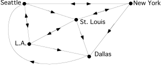

The above network diagram contains information about daily flights by one airline.

A. Copy and fill in the matrix below so that it contains the direct flight information.

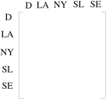

B. With a stop at just one of the other cities in the network, how many ways are there to fly from Seattle to Dallas?

C. True or False: It is possible to fly from any city in the network to any other city in the network either directly or by passing through the airport at just one other city.  Hint: you can look at two matrices to get an answer to this question.

D. How many round trip flights can be made out of, and then back into Saint Louis, that includes exactly three takeoffs and three landings?

### III.

In this question you will begin to learn about a new type of transformation.  Trace the point and segment at the top of the next page onto your homework paper.  Leave a good deal of space around the tracing for additions you will make.

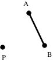

Sketch <strong>two different</strong> images of segment AB each of which meet all three of the following conditions:

#1: P, A, and A' are collinear.  So are P, B, and B'.

#2: The distance from P to A' is twice the distance from P to A. Also, the distance from P to B' is twice the distance from P to B.

#3: The images of the points collinear with A and B are collinear with A' and B'.

### IV.

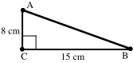

A. Calculate the area of right triangle ACB in the illustration above.

B. Carefully trace triangle ACB onto your homework paper.  Now do the following:

#1. Add to your tracing a sketch of the image of this triangle under a rotation with a magnitude of 90˚ centered at vertex C.

#2. Sketch the image of this first image under the translation that will map the image of point A to point B.  One vertex of this second image will be point B.  Use C" and B" to label the other two vertices.  These labels should coordinate with the pre-images of these points.

C. Give the area of the final image triangle BC"B".

### V.

Each of these matrices is associated with a reflection in a line that passes through the origin.  By thinking about the images of (1,0) and (0,1), which appear in the columns, identify the line of reflection for each:

A. $\left[ \begin{matrix}0 & 1 \\ 1 & 0\end{matrix} \right]$                B. $\left[ \begin{matrix}{}^{-}1 & 0 \\ 0 & 1\end{matrix} \right]$

### VI.

<strong>The Matrix-Transformation Isomorphism Theorem</strong>

The matrix product below is from Question V of assignment #20.  The pairing off of the matrices with their associated transformations, as shown by the arrows, can be confirmed by a use of the Matrix Basis Theorem.

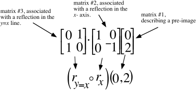

When matrix #1 is multiplied by matrix #2 the result is $\left[ \begin{matrix}0 \\ {}^{-}2\end{matrix} \right]$, the image of $\left[ \begin{matrix}0 \\ 2\end{matrix} \right]$ under a reflection in the $x-\text{axis}$.  When the intermediate image, $\left[ \begin{matrix}0 \\ {}^{-}2\end{matrix} \right]$, is then multiplied by matrix #3 , the final image is $\left[ \begin{matrix}{}^{-}2 \\ 0\end{matrix} \right]$, the image of $\left[ \begin{matrix}0 \\ {}^{-}2\end{matrix} \right]$ under a reflection in the <em>y</em> = <em>x</em> line.

You have had experience with an associative form that says you can begin the computation of the product of the three matrices by computing first the product of matrices #3 and #2.  The result is $\left[ \begin{matrix}0 & {}^{-}1 \\ 1 & 0\end{matrix} \right]$.  When this matrix is multiplied by the pre-image matrix, $\left[ \begin{matrix}0 \\ 2\end{matrix} \right]$, the result is the same final image matrix, $\left[ \begin{matrix}{}^{-}2 \\ 0\end{matrix} \right]$.  Therefore, the product:

<strong>matrix #3</strong> $\times$ <strong>matrix #2</strong>

gives the image of $\left[ \begin{matrix}0 \\ 2\end{matrix} \right]$ under the composite $r_{y=x}\circ r_{x}$.

This means that <strong>matrix #3</strong> $\times$ <strong>matrix #2 =</strong> $\left[ \begin{matrix}0 & {}^{-}1 \\ 1 & 0\end{matrix} \right]$

must be the matrix associated with $r_{y=x}\circ r_{x}$.  $r_{y=x}\circ r_{x}$ is the origin centered rotation with a magnitude of 90˚.”  The Matrix Basis Theorem confirms this.  This example illustrates the useful relationship diagrammed below:

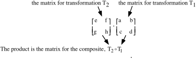

The display above shows how the multiplication of the matrices associated with two transformations echoes the composition of those transformations.

<strong>It is important to take care with the order in which the matrices</strong>

<strong>are written!</strong>  In the representation of the composite, $\text{T}_{\text{2}}\circ \text{T}_{\text{1}}$, the symbol for transformation T1 is on the right.  To ensure that the multiplication of the associated matrices will properly echo the composition, the matrix for T1 must be on the right.

When operations in one mathematical system echo exactly operations in another, the systems are said to have the same form.  The echo of composition of transformations by multiplication in the system of matrices is an example important in this and subsequent courses.  The prefix “iso” means “same” and the root “morphism” means “form” or “structure.”  Therefore, the echoing of composition of transformations by matrix multiplication is called

<strong>“The Matrix-Transformation Isomorphism Theorem.”</strong>

These products describe transformations you should be able to identify by thinking about the images of (1,0) and (0,1).  Therefore, compute the products and then identify the associated transformations.

A. $\left[ \begin{matrix}{}^{-}1 & 0 \\ 0 & 1\end{matrix} \right]\cdot \left[ \begin{matrix}0 & 1 \\ 1 & 0\end{matrix} \right]$                     B. $\left[ \begin{matrix}0 & 1 \\ 1 & 0\end{matrix} \right]\cdot \left[ \begin{matrix}{}^{-}1 & 0 \\ 0 & 1\end{matrix} \right]$

C. Give the composite of two reflections that corresponds to, or echoes, the product in “A” above according to the Matrix-Transformation Isomorphism Theorem.

D. Give the composite of two reflections that corresponds to, or echoes, the product in “B” above according to the Matrix-Transformation Isomorphism Theorem.

### VII.

<strong>The Image of (0,0) Under Any Transformation for which there is an Associated Matrix</strong>

If the matrix $\left[ \begin{matrix}\text{a} & \text{b} \\ \text{c} & \text{d}\end{matrix} \right]$is associated with some transformation T, then T(0,0) must be (0,0) because the product $\left[ \begin{matrix}\text{a} & \text{b} \\ \text{c} & \text{d}\end{matrix} \right]\cdot \left[ \begin{matrix}\text{0} \\ \text{0}\end{matrix} \right]$ computes to $\left[ \begin{matrix}0 \\ 0\end{matrix} \right]$ regardless of the values of “a,” “b,” “c,” and “d.”

This question is about the translation with image formula T(<em>x</em>, <em>y</em>) = (<em>x</em> + 3, <em>y</em> +¯2).

A. Give the image of (1,0) under this translation.

B. Give the image of (0,1) under this translation.

C. If there is a 2$\times$2 matrix associated with this translation, what do you think it would be?

D. Does multiplication by your answer to C right above provide the same image for (0,0) as the image formula given in the introduction to the question?

### VIII.

True or False:  If a transformation maps (0,0) to some other point, that transformation cannot be associated with a 2$\times$2 matrix.

## Assignment #22

### I.

<strong>Size Transformations</strong>

Transformations that produce images that are the same shape as the pre-image, though not necessarily the same size, have many important applications.  In question II of assignment #21 you were introduced to a basic type of such transformations.  Here is a line segment and two different images of it that meet some simple conditions:

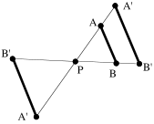

For both images of segment AB:

#1:  P, A, and A' are collinear; so are P, B, and B'.

#2:  The distance from P to A' is 1.5 times the distance from P to A.  Also, the distance from P to B' is 1.5 times the distance from P to B.

#3:  Points collinear with A and B have images collinear with A' and B'.

The transformation that produces the image segment A'B' is called a <strong>size transformation.</strong>  Any size transformation must meet conditions #1 and #3 above.  The special point P is called the center of the size transformation.  Size transformations must also meet a condition like #2, although the number 1.5 can vary.  That number is the absolute value of the magnitude of the size transformation.  The sign of the magnitude of a size transformation tells whether the pre-image and image are on the same side (positive magnitude) or opposite side (negative magnitude) of the center. Now practice sketching images in both possible positions relative to the center.

Trace the figure below onto your homework paper.  You will be adding to the tracing.

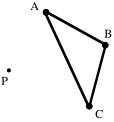

Add to the tracing two <strong>different</strong> images of triangle ABC that meet the following conditions for a size transformation.

#1:  The image of any point on the triangle is collinear with both P and its pre-image.

#2:  The image of any set of collinear points is a set of collinear points.

#3: The distance from P to any image point is one-half the distance from P to that point’s pre-image.

### II.

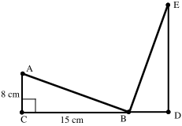

The illustration above is based on question IV from the previous assignment.  Triangle BDE is produced in two steps.  The first step is the 90° rotation centered at C, producing a triangle A'CB' which is not shown.  The second step is the translation which maps A' to B.  The image of A'CB' under this translation is BDE.

A. What is the sum of the measures of angles CAB and CBA?

B. What is the measure of angle ABE?

C. Carefully trace the entire figure in the illustration above onto your homework paper then do the following:

#1:  Add to the illustration the image of triangle BDE under the composite of a rotation with magnitude 90˚ centered at D followed by the translation that will map the rotation image of B onto E.  On the image use “F” to label the vertex collinear with the image of B and E.  Use G to label the remaining vertex.

#2:  Add to the illustration the image of triangle EFG under the composite of a rotation with magnitude 90˚ centered at F followed by the translation that will map the rotation image of E onto G.

### III.

A. If “a” and “b” represent typical real numbers, is the following is a true statement?

$\text{(a}+\text{b)}^{\text{2}}=\text{(a}+\text{b)}\cdot \text{(a}+\text{b)}$

B. This statement below is an instance of which of the following forms?

$\text{(a}+\text{b)}\cdot \text{(a}+\text{b)=(a+b)}\cdot \text{a+(a+b)}\cdot \text{b}$

Form #1: $x\cdot \mathrm{(}y+z\mathrm{)}=x\cdot y+x\cdot z$   or    Form #2:  $\mathrm{(}x+y\mathrm{)}\cdot z=x\cdot z+y\cdot z$

C.

1\. Give an equivalent to $\text{(a}+\text{b)}\cdot \text{a}+\text{(a}+\text{b)}\cdot \text{b}$ that contains no parentheses and exactly three “+” signs.

2\. Give an equivalent to your answer for “C,1” right above that contains exactly two “+” signs.

### IV.

If a certain transformation, N, has an associated 2$\times$2 matrix and N(1,0) = (¯3,0) and N(0,1) = (0,¯3), give this associated matrix.

### V.

A. Give the matrix for each of the following reflections:

1\. A reflection in the $y-\text{axis}$.

2\. A reflection in the $y={}^{-}x$ line.

B. Write the matrices you gave as your answers in A, right above, next to each other so that their product is associated with the given rotations:

1\. A rotation with center (0,0) and magnitude 90˚.

2\. A rotation with center (0,0) and magnitude ¯90˚.

For this question you can check your answer by actually computing the product and thinking about the Matrix Basis Theorem.

### VI.

<strong>Transformations Associated with a</strong> $2\times 2$ <strong>Matrix Must Map (0,0) onto Itself</strong>

If a transformation is associated with a matrix, that matrix can be used as a device to compute images.  But when any 2$\times$2 matrix is used to compute the image of (0,0) the result must be (0,0).  Therefore if a transformation maps (0,0) to any other points besides (0,0) that transformation cannot be associated with a 2$\times$2 matrix.  The only translation that maps (0,0) to itself has the image formula T: T(<em>x</em>,<em>y</em>) = (<em>x</em> + 0, <em>y</em> + 0).  This special translation, which maps each point to itself, is called the identity transformation.

This question is about the translation that maps (0,0) onto itself.

A. Copy and complete this image formula for the translation that maps (0,0) onto itself.

T(<em>x</em>, <em>y</em>) =

B. If this translation has an associated 2$\times$2 matrix, give that matrix.

### VII.

In the illustration below, point A' is collinear with the origin and A.  Also, the distance from the origin to A' is one third of the distance from the origin to A.  Give the coordinates of A'.

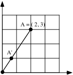

### VIII.

The “absolute value” of a real number is the distance from its point on a number line to 0.  Give the absolute value of each of the following real numbers:

A. 4.2  B. $\frac{1}{2}$  C. $\frac{{}^{-}1}{2}$  D. ${}^{-}\pi$

## Assignment #23

### I.

<strong>The Meaning of Positive and Negative Magnitudes for Size Transformations</strong>

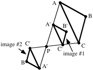

In the illustration above two different images of triangle ABC are shown using prime notation to represent the vertices.  For either of the images, the distance from the center, P, to A' is one half the distance from P to A.  Similarly, the distance from P to B' of either image is half the distance from P to B and the distance from P to C' is half the distance from P to C.  Also, each image point is on the same line as the center, P, and its pre-image point.

Both of the images of triangle ABC are produced by size transformations centered at P.  <strong>When the pre-image triangle and the image triangle are on the same side of the center, P, the size transformation is given a positive magnitude.</strong>  Since the distance from P to an image point is half the distance from P to that point’s pre-image, the magnitude of the size transformation that maps triangle ABC onto image #1 is $\frac{1}{2}\mathrm{.}$

Image #2 is on the opposite side of the center, P, from its pre-image, triangle ABC.  <strong>When the pre-image triangle and the image triangle are on the opposite sides of the center, P, the size transformation is given a negative magnitude.</strong> Since the distance from P to any point on image #2 is one-half the distance from P to that points pre-image on triangle ABC, the magnitude for the size transformation that maps triangle ABC onto image #2 is $\frac{{}^{-}1}{2}$.

Trace segment AB and point P onto your homework paper.

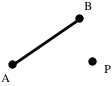

A. Sketch the image of segment AB under a size transformation centered at P with magnitude 1.5.  You may estimate distances as you make your sketch, but try to be reasonably accurate.  Label the endpoints of the image using prime notation.

B. If the distance from P to A is 3, give the following distances:

1\. The distance from A to A'

2\. The distance from P to A'

C. Answer Yes or No: Does it look as if the image of segment AB is parallel to segment AB?

### II.

<strong>Computing the Area of a Right Triangle</strong>

You will probably recall using the formula A=$\frac{1}{2}\cdot \text{b}\cdot \text{h}$ to compute the area of a triangle.  “b” represents the length of a “base” of the triangle and “h” represents the length of the altitude of the triangle drawn to the base side with length “b.”

Any side of a triangle can be designated as the “base” for the purposes of computing area.  An altitude to a particular the “base” is a segment perpendicular to the line containing that base.  An altitude to a base has one end on the vertex of the triangle not on that base and its other end on the line containing the base.

In the right triangle shown below, the legs are segments AC and CB.  If either of the legs is taken to be a base of the triangle, the other leg is the altitude to that base.  This makes the computation of the area of a right triangle particularly easy.  <strong>The area of a right triangle is one-half times the product of the lengths of the legs.</strong>

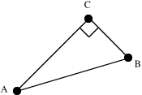

Trace right triangle ABC onto your homework paper.

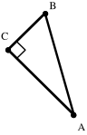

A. Sketch the image of triangle ABC under the size transformation with center C and magnitude ¯1.5.

B. Does the size transformation described in “A” right above preserve or reverse orientation?

C. If leg AC has a length of 5 and leg BC has a length of 2:

1\. What is the area of triangle ABC?

2\. What is the area of triangle A'B'C'?

### III.

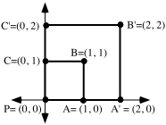

A. True or False: The distance from P to B' is twice the distance from P to B.

B. Square PA'B'C' is the image of square PABC under a size transformation centered at point P.  What is the magnitude of this size transformation?

C. True or False: The area of the image of square PABC is twice the area of the pre-image.

D. Use the Matrix Basis Theorem to create the matrix associated with the size transformation that maps square PABC onto square PA'B'C'.

E. Trace the pre-image square, PABC, and the coordinate axes onto your homework paper. Now sketch the image of that square under the size transformation centered at point P with magnitude ¯2.  Use double prime notation to label the vertices of the image.  Also label the coordinates of the vertices of the image.

F. Use the Matrix Basis Theorem to give the matrix associated with the size transformation centered at P with magnitude ¯2.

### IV.

A. Give the image of (1,0) when it is mapped with an origin centered size transformation with magnitude 2.7.

B. Give the matrix associated with the origin centered size transformation with magnitude 2.7.

C. Give the image of (1,0) when it is mapped with the origin centered size transformation with magnitude ¯5.2.

D. Give the matrix associated with the origin centered size transformation with magnitude ¯5.2.

### V.

Transformation S has the image formula S(<em>x</em>,<em>y</em>) = (3.<em>x</em>, 3.<em>y</em>)

A. Calculate the exact distance between (¯1,4) and (2,0).

B. Calculate the following images:

1\. S(¯1,4)  2. S(2,0)

C. Calculate the exact distance between the two images from “B” right above.

### VI.

Give the exact numerical value of each of the following in a simple form:

A. $\left( \sqrt{2} \right)^{2}$       B. $\left( {}^{-}3\cdot \sqrt{2} \right)^{2}$

### VII.

<strong>Notation for Origin-Centered Rotations</strong>

It is convenient to have a special notation to represent origin-centered rotations.  We will use a capital “R” to designate an origin-centered rotation and we will include a subscript to give one of the magnitudes of the rotation.  Thus “R45” will be used to represent the origin centered rotation, one of whose magnitudes is 45 degrees.  Note that the degree symbol is not used in the subscript.

For each of the composites given below, do the following:

#1: Write side by side, in the proper order, the two matrices whose product is associated with the composite.  The Matrix Basis Theorem may be useful here.

#2: Compute the product.

#3: Identify the transformation associated with the product.  If the composite is an origin-centered rotation, use the new notation described above.

A. $r_{y=x}\circ r_{x}$      B. $r_{x}\circ r_{y=x}$      C. $r_{y={}^{-}x}\circ r_{y={}^{-}x}$

### VIII.

The figure in the illustration below should resemble the illustration you made when you did question II of Assignment #22.  The angles with vertices D, F, and H are all right angles.  Triangles BDE, EFG, and HGA are all images of right triangle ABC under composites of rotations and translations.

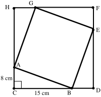

A. Compute the area of the quadrilateral CDFH.

B. Compute the area of the quadrilateral ABEG.

C. Give an expression for the exact length of side AB of right triangle ACB.

D. Give an equivalent to $\text{(a}+\text{b)}^{\text{2}}=\text{(a}+\text{b)}\cdot \text{(a}+\text{b)}$ that contains no parentheses and exactly two “+” signs.

### IX.

Give the absolute value of each of the following numbers:

A. 5 + 2  B. $\frac{{}^{-}7}{8}$  C. 0  D. ${}^{-}\mathrm{(}{}^{-}2\mathrm{)}$

## Assignment #24

### I.

<strong>The Size Transformation Parallelism Assumption</strong>

As you look back over sketches you have made showing segments and their images under size transformations, the following assumption should strike you as reasonable.

<strong>The size transformation-parallelism assumption:</strong>

Part 1: If a segment is mapped with a size transformation, the

image is parallel to the pre-image.

Part 2: If one segment is parallel to another, they can be mapped

onto one another with size transformations.

Trace parallel segments AB and CD onto your homework paper.  The lengths of the segments are shown.

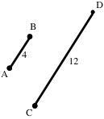

A. There are two different size transformations, one with a positive magnitude and one with a negative magnitude, that will map segment AB onto segment CD.  Add to your sketch to locate precisely the two different centers for these size transformations.  Label the center of the size transformation with a positive magnitude “P” and the center of the size transformation with a negative magnitude “Q.”

B. Give the positive magnitude for a size transformation that maps segment AB onto segment CD.

C. Give the negative magnitude for a size transformation that maps segment AB onto segment DC.

### II.

<strong>A Special Notation and Image Formulas for Size Transformations centered at the Origin</strong>

Just as it is convenient to have a special notation for rotations centered at the origin, it is convenient to have a special notation for size transformations centered at the origin.  A capital “S” will be used to represent origin centered size transformations.  A subscript will be used to give the magnitude.  For example, “S2.5” represents the origin centered size transformation with magnitude 2.5

Sk must map (1,0) onto a point collinear with (0,0) and (1,0).  If k &gt; 0, then he distance to the image must be “k” times the distance from (0,0) to (1,0).  These conditions mean that the image of (1,0) must be (k,0).  Similarly, the image of (0,1) must be (0,k).  Therefore, the matrix associated with Sk is $\left[ \begin{matrix}\text{k} & \text{0} \\ \text{0} & \text{k}\end{matrix} \right]$.  From the product $\left[ \begin{matrix}\text{k} & \text{0} \\ \text{0} & \text{k}\end{matrix} \right]\left[ \begin{matrix}x \\ y\end{matrix} \right]=\left[ \begin{matrix}\text{k}\cdot x \\ \text{k}\cdot y\end{matrix} \right]$ we can get

Sk(<em>x</em>, <em>y</em>) = (k · <em>x</em>, k . <em>y</em>)

as an image formula for Sk

A. Give the matrix for $\text{S}_{\frac{1}{2}}$.     B. Give the matrix for S$_{{}^{-}2}$.

### III.

<strong>The Effect of Positive Magnitude Size Transformations on Distance</strong>

In question V of assignment #23 you were asked to give the images of (¯1,4) and (2,0) when they are mapped with transformation S with image formula S(<em>x</em>, <em>y</em>) = (3·<em>x</em>, 3·<em>y</em>).  You should recognize that S is the origin centered size transformation with magnitude 3.

The distance between the pre-images is exactly 5.

The distance between the images, (¯3, 12) and (6, 0) is exactly 15.

Notice that the distance between the two image points is equal to the magnitude times the distance between the pre-image points.  This is an instance of the following fact about size transformations with positive magnitudes:

<strong>The effect of positive magnitude size transformations on distance</strong>

If points P and Q are any two points mapped with a size transformation

with <strong>positive</strong> magnitude k, the distance between the images of P and Q

is k times the distance from P to Q.

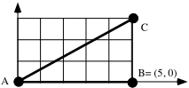

A. With reference to the illustration above, give the area of triangle ABC expressed as a fraction.

B. Give the coordinates of A', B' and C', the vertices of the image of triangle ABC when it is mapped with $\text{S}_{\frac{1}{2}}$.  Also sketch the image.

C. Give the area of triangle A'B'C' expressed as a fraction.

D. Give the coordinates of A", B" and C", the vertices of the image of triangle ABC when it is mapped with S-2.  Again, sketch the image.

E. Give the length of segment BC.

F. Give the length of segment B"C".

G. True or False: The length of segment B"C" is the magnitude of S-2 times the length of segment BC.

H. True or False: The length of segment B"C" is the absolute value of the magnitude of S-2 times the length of segment BC.

I. Give the area of triangle A"B"C".

J. True or False: S-2 reverses orientation.

### IV.

Transformation T has image formula T(<em>x</em>, <em>y</em>) = (<em>x</em> + 2, <em>y</em> + ¯5)

A. Give T(1,0).    B. Give T(0,1).

C. True or False: $\left[ \begin{matrix}3 & 2 \\ {}^{-}5 & {}^{-}4\end{matrix} \right]$ is the matrix for T.

### V.

For each of the composites given below, do the following:

#1:  Write side by side, in the proper order, the two matrices whose product is associated with the composite.  The Matrix Basis Theorem may be useful.

#2:  Compute the product.

#3:  Identify the transformation associated with the product.

A. $\text{R}_{90}\circ r_{x}$                          B. $r_{x}\circ \text{R}_{90}$                        C. $r_{y=x}\circ r_{y=x}$

### VI.

In the illustration at the top of the next page, each lower case letter is the length of the line segment nearest it.  The quadrilateral CDFH is a square.

A. True or False: Triangle ACB can be mapped onto each of the other triangles with a composite of a rotation and a translation.

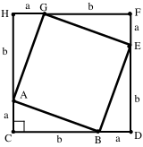

B. Give an expression for the area of square CDFH that contains exactly two “+” signs but no parentheses (see question III of Assignment #22).

C. Give an expression for the total of the areas of the four triangles.

D. Give an expression for the area of square ABEG.

E. Give an expression for the length of side AB of right triangle ACB.

### VII.

A.

1\. Give the image of (1,0) when it is reflected in the $x=1$ line.

2\. Give the image of (0,1) when it is reflected in the $x=1$ line.

B. True or False: $\left[ \begin{matrix}1 & 2 \\ 0 & 1\end{matrix} \right]$ is the matrix for a reflection in the $x=1$ line.  Hint: what is the product of this matrix and $\left[ \begin{matrix}0 \\ 0\end{matrix} \right]$?

### VIII.

A. Give any and all numbers that have an absolute value of $\frac{9}{4}$.

B. Give any and all numbers that have an absolute value of 0.

C. Give any and all numbers that have an absolute value of ¯3.

### IX.

Give in a simple form the exact numerical value of each of the following:

A. $\sqrt{\left( \sqrt{2} \right)^{2}+\left( \sqrt{2} \right)^{2}}$          B. $\sqrt{\left( {}^{-}3\cdot \sqrt{2} \right)^{2}+\left( {}^{-}3\cdot \sqrt{2} \right)^{2}}$

## Assignment #25

### I.

Trace the square below onto your paper and then sketch next to it a second square “twice as large” as the one you traced.  Give the length of one side of the square you sketched

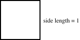

### II.

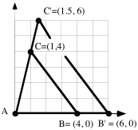

In the sketch above, triangle AB'C' is the image of triangle ABC under a size transformation centered at the origin.

A. Give the magnitude of the size transformation.

B. Give the matrix for the transformation.

C. Give the length of segment BC accurate to four decimal places.

D. Give the length of segment B'C' accurate to four decimal places.

E. True or False: the length of segment B'C' is equal to the magnitude (your answer to A) times the length of BC.

F. Give the area of triangle ABC.

G. Give the area of triangle A'B'C'.

H. True or False: The area of triangle A'B'C' is the square of the magnitude of the size transformation times the area of triangle ABC.

I. True or False: The area of triangle A'B'C' is the square of the absolute value of the magnitude of the size transformation times the area of triangle ABC.

### III.

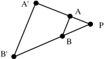

In the above figure, segment AB is parallel to segment A'B'.  Therefore triangle A'B'P is the image of triangle ABP under a size transformation.

A. What is the center of this size transformation?

B. Segment PB has length 3 and segment BB' has length 6.  What is the magnitude of the size transformation?

C. Segment PA has length 2.  What is the length of segment PA'?

D. What is the length of segment AA'?

### IV.

For each of the composites given below, do the following:

#1:  Write side by side, in the proper order, the two matrices whose product is associated with the composite.  The Matrix Basis Theorem may be useful here.

#2:  Compute the product.

#3:  Identify the transformation associated with the product.

A. $\text{S}_{\text{2}}\circ \text{S}_{3}$              B. $\text{S}_{\frac{\text{4}}{\text{3}}}\circ \text{S}_{\frac{3}{4}}$

### V.

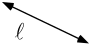

Would you describe line $\ell$ as “rising” or “falling”?

### VI.

In each case, copy and complete an image formula for the size transformation centered at the origin that will map point P to point P'.

A. When P = (5,3) and P' = (1,$\frac{3}{5}$), S(<em>x</em>, <em>y</em>) =

B. When P = $\left( \frac{1}{3}\mathrm{,}{}^{-}2 \right)$ and P' = (1,-6), S(<em>x</em>, <em>y</em>) =

C. When P = $\left( {}^{-}\pi \mathrm{,}3 \right)$ and P'= (1,$\frac{{}^{-}3}{\pi }$), S(<em>x</em>, <em>y</em>) =

### VII.

<strong>The Effect of Size Transformations with Negative Magnitudes on Length</strong>

When a segment of length 2 is mapped with a size transformation with magnitude 3 the length if its image is 3.2 = 6.  However, in most mathematics courses lengths are not measured with negative numbers.  We will follow the common practice in this course.  Therefore if that same segment is mapped with a size transformation with magnitude ¯3, the length of the image <strong>will not</strong> be represented as ¯3.2 = ¯6.

Here is an example in a coordinate system:

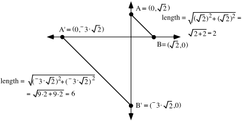

The segment has been mapped with the size transformation with magnitude ¯3 centered at the origin.  That size transformation has image formula $\text{S}_{{}^{-}3}\mathrm{(}x\mathrm{,}y\mathrm{)}=\mathrm{(}{}^{-}3\cdot x\mathrm{,}{}^{-}3\cdot y\mathrm{)}$.  As you can see from the computations based on the Pythagorean Theorem, the image segment, A'B' is three times the length of the pre-image segment.   3 is the absolute value of the magnitude, ¯3.  Therefore <strong>the length of the image is the absolute value of the magnitude times the length of the pre-image.</strong>

The effect on length in the example above would occur with any negative magnitude.  Furthermore, since the absolute value of a positive number is itself, the following is true of any size transformation, regardless of the magnitude.

When a pre-image figure with a length is mapped with a size transformation, the length of the image is the absolute value of the magnitude times the length of the pre-image.

A square with sides of length 3 is mapped with a size transformation with a magnitude of ¯2.3:

A. How long are the sides of the image?

B. What is the area of the pre-image?

C. What is the area of the image?

## Assignment #26

### I.

<strong>Size Transformations Affect Length and Area Differently</strong>

In question I of Assignment #25 you were asked to sketch a square “twice as large” as a square with sides of length 1.

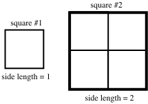

The direction was ambiguous.  One of the software tools being used to write this book was instructed to draw a square “twice as large” as square #1.  It drew square #2.  Since 2 copies of square #1 fit across the bottom of square #2, its sides have length 2.  In fact, square #2 could be the image of square #1 under a size transformation of either magnitude 2 or magnitude -2.  However, 4 copies of square #1 can be used to “tile” the entire interior of square #2.  Thus the image square has an area of 4.

This example illustrates that size transformations affect lengths and areas differently.  They in fact have a more dramatic effect on area.  In this and later assignments you will be asked to think carefully about how to describe the effect of size transformations on area.

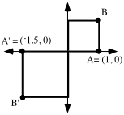

A' is the image of A under an origin centered size transformation.  B' is the image of B under that size transformation.  Similarly one square is the image of the other under that size transformation.

A. What is the magnitude of that size transformation?

B. What is the exact distance from the origin to B? (Do not give a decimal approximation.)

C. What is the exact distance from the origin to B'?  (Again, do not give a decimal approximation.)

D. True or False: The distance from the origin to B' is the absolute value of the magnitude times the distance from the origin to B.

E. What is the area of the pre-image square?

F. What is the area of the image square?

G. Give a word or phrase that can fill the blank to create a true statement:

“The area of the image square is \_\_\_\_\_\_\_\_\_\_\_\_\_\_\_\_ the magnitude times the area of the pre-image square.”

### II.

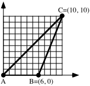

A. Compute the area of triangle ABC.

B. Triangle ABC is mapped with an origin centered size transformation.  C and C' are on opposite sides of A.  Segment AC' has length $1\mathrm{.}3\cdot \sqrt{200}$.  What is the magnitude of this size transformation?

### III.

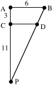

Refer to the figure above.  Segment PC has length 11, segment CA has length 3 and segment AB has length 6.

A. Give the magnitude of the size transformation centered at P that will map segment PA onto segment PC.

B. Give the exact length of segment CD.

### IV.

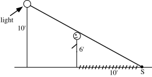

A six foot tall person is standing near a light on a post and casting a shadow that is ten feet long.  How far is that person from the base of the light pole?  Hint-- think about a size transformation centered at S.

### V.

This question is about the matrix product:

$\left[ \begin{matrix}\frac{{}^{-}2}{7} & 0 \\ 0 & \frac{{}^{-}2}{7}\end{matrix} \right]\cdot \left[ \begin{matrix}\frac{{}^{-}3}{2} & 0 \\ 0 & \frac{{}^{-}3}{2}\end{matrix} \right]$

A. Calculate the product.

B. Give the values of “c” and “d” so that the composite of size transformations, $\text{S}_{\text{d}}\circ \text{S}_{\text{c}}$ corresponds to the matrix product.

### VI.

<strong>An Agreement About How to “Scan” a Line to Determine Whether it Rises or Falls</strong>

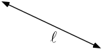

Above is a copy of the line from question V of assignment #25.  If asked whether the line appears to be “rising” or “falling,” it perhaps seems more natural to “scan” the line from left to right and describe it as “falling.”  However, if the line is “scanned” from right to left, it would be described as “rising.”

In this and later mathematics courses, lines are will be used to help describe how things change.  The difference between “rising” and “falling” will often be quite significant.  It is therefore important that we be consistent with each other and with other users of mathematics in describing the direction of a line.

There is an established way lines are scanned.  <strong>They are scanned from left to right to determine whether they will be described as “rising” or “falling.”</strong>  Line $\ell$ in the illustration above would therefore be described as “falling.”

<strong>“Taking the Temperature” of a Line</strong>

All lines passing through the origin, except the $y-\text{axis}$, will pass through the vertical line described by <em>x</em> = 1.  In this course the <em>x</em> = 1 line will be called the “thermometer” for lines through the origin.  We will “read” the “temperature” of a line with the “thermometer” by determining <strong>the second coordinate</strong> of the point where the line intersects the thermometer.

The following facts help explain the usefulness of reading the “temperature” of line out of the origin by getting the number that indicates their vertical position of their intersection with the “thermometer”:

#1: Lines that “rise” to the right out of the origin have positive temperatures and those that “fall” have negative temperatures.

#2: The greater the absolute value of the temperature of a line, the greater is its “steepness” relative to the $x-\text{axis}\mathrm{.}$

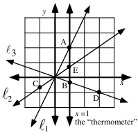

A. The coordinates of point A are (1, 2).  What is the “temperature” of $\ell _{1}$?

B. The coordinates of point D are (3,¯1).

1\. Use the size transformation centered at the origin that maps point D to point B to get the coordinates of point B.  Give these coordinates.

2\. What is the “temperature” of $\ell _{3}$?

3\. The coordinates of point C are $\left( {}^{-}1\mathrm{,}\frac{{}^{-}\sqrt{2}}{2} \right)$.  Give $\ell _{2}$’s “temperature.”

4\. What is the “temperature” of the $x-\text{axis}\mathrm{.}$?

### VII.

True or False: The square of a negative number is equal to the square of the absolute value of that number.

### VIII.

<strong>A Way to Think About Variables in Open Sentences</strong>

Here is an open sentence:

$x+2\cdot y=10$.

This open sentence contains the variables “<em>x</em>” and “<em>y</em>.”  Variables play a key role in mathematics. Therefore it will be useful to you to have a way to think about variables which makes it clear how to interpret and use them.  Here is the same open sentence written with the variables in a different form:

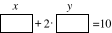

In this new version, the “variables” are shown as rectangles with “tags” over them.  Think of these “variables” as mailboxes with identifying names over them.  Numbers can be put in the mailboxes.  Here is an example of what can be created when this is done:

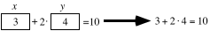.

“3” has been put in the “<em>x</em>” mailbox and “4” has been put in the “<em>y</em>” mailbox.  Another way to describe what has been done is to say that the pair (3,4) has been used to convert the open sentence

  to the statement 

“3+2.4=10.”

In this case the statement created by filling the mailboxes is false.  (3,4) <strong>is not</strong> a solution of the open sentence.

However, when the numbers in the pair (4,3) are used in the variables as shown below, the open sentence is converted to a different statement as shown below:

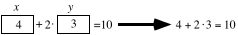

In this case, the created statement is true.  (4,3) <strong>is</strong> therefore a solution of the open sentence

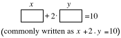

A.  Give any two different pairs, neither of which is a solution of the open sentence

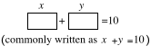

B.  Give any two different pairs, each of which is a solution of the open sentence

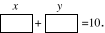

## Assignment #27

### I.

<strong>Effects of Size Transformations on Area</strong>

In question I of assignment #26 you worked with the two squares in the following illustration:

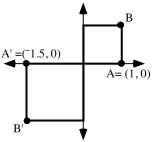

The square whose interior is in the first quadrant has an area of 1.  The square whose interior is in the third quadrant is the image of the first quadrant square under a size transformation with magnitude ¯1.5.  The sides of the image square are 1.5 times as long as the sides of the pre-image square, but the area of the image square, 2.25, is more than 1.5 times the area of the pre-image square.  A careful look at a computation of the area of the image square can help identify the relationship between the area of the image, the area of the pre-image and the magnitude of the size transformation:

<strong>the area of the image = 1.5.1.5 = (1.5</strong> $\times$ <strong>1).(1.5</strong> $\times$ <strong>1);</strong>

<strong>= ((the absolute value of the magnitude).(the length of a side of the pre-image)) . ((the absolute value of the magnitude).(the length of a side of the pre-image));</strong>

<strong>= (the absolute value of the magnitude)2.(the length of the side of the pre-image)2</strong>

<strong>= (the square of the absolute value of the magnitude).(the area of the pre-image)</strong>

This example illustrates the way any size transformation affects area:

The area of the image of a figure after a size transformation is equal to  
the square of the absolute value of the magnitude of the size transformation, times  
the area of the pre-image.

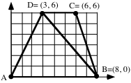

A. Give the area of triangle ABD.    B. Give the area of triangle BCD.

C. The four-sided figure (called a quadrilateral) made by joining triangles ABD and BCD is mapped by the size transformation centered at A which produces (¯4,¯8) as the image of point D.

1\. What is the magnitude of this size transformation?

2\. What is the length of the image of segment DC?

3\. What is the area of the image of triangle ABD?

4\. What is the exact area of the image of the quadrilateral ABCD?

### II.

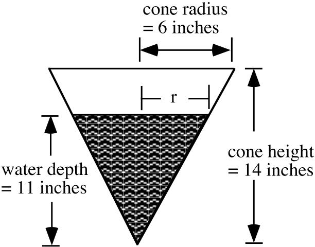

Shown above is a cross section of a container in the shape of a cone that is partially filled with water.  Give the exact value of r, the radius of the surface of the water.  Hint: see question III of assignment #26.

### III.

A. If the matrix for the composite $\text{S}_{\text{k}}\circ \text{S}_{\frac{{}^{-}2}{3}}$ is $\left[ \begin{matrix}1 & 0 \\ 0 & 1\end{matrix} \right]$, what is the value of k?

B. If the matrix for the composite $\text{S}_{\text{2}}\circ \text{S}_{\text{k}}$ is $\left[ \begin{matrix}5 & 0 \\ 0 & 5\end{matrix} \right]$, what is the value of k?

### IV.

A. Compute the exact value of each of the following:

1\. The square of ¯7.    2. The square of the absolute value of ¯7.

B. Answer True or False:  When a figure with an area is mapped with a size transformation with a negative magnitude, the area of the image is equal to the square of the magnitude of that size transformation times the area of the pre-image.

### V.

A.  A figure with area 8 is mapped with a size transformation with magnitude ¯3. What is the area of the image?

B. A square with area 5 is mapped onto a square with area 10 by a size transformation with a positive magnitude.  What is that magnitude?

### VI.

<strong>The Use of a Size Transformation to Help Determine the Temperature of a Line Through the Origin</strong>

If a line passes through the origin its “temperature” is read as the second coordinate of the intersection of that line with the thermometer line described by <em>x</em> = 1.  The illustration below shows line $\ell$ through the origin.  The second coordinate of point A, the point where $\ell$ intersects the thermometer, is not shown.  However, if both coordinates of another point, B, are known, a size transformation can be used to determine the temperature of $\ell$.

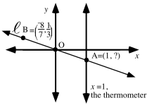

Since B, the origin O, and A are all on $\ell$, B can be mapped onto A with a size transformation centered at O.  The size transformation will have an image formula of the form S(<em>x</em>, <em>y</em>) = (k · <em>x</em>, k · <em>y</em>).  If, for example, the coordinates of point B are $\left( \frac{{}^{-}8}{7}\mathrm{,}\frac{1}{3} \right)$, “k” must be chosen so that k.$\frac{{}^{-}8}{7}$ = 1, since 1 is the first coordinate of the thermometer point, A.  Here the value of “k” is $\frac{{}^{-}7}{8}$, and the size transformation image formula indicates that

the second coordinate of the image point A is $\frac{{}^{-}7}{8}\cdot \frac{1}{3}=\frac{{}^{-}7}{24}$.  $\frac{{}^{-}7}{24}$ is therefore the temperature of line $\ell$.

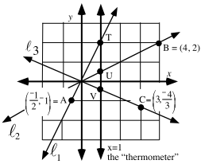

In the above illustration, point A is on line $\ell _{1}$, point B is on line $\ell _{2}$, and point C is on line $\ell _{3}$.

A. What is the first coordinate of each of the thermometer points, T, U, and V?

B. Use size transformations to determine the second coordinates of the thermometer points.  The “temperature” of a line is more commonly called its <strong>slope</strong>.

1\. Give the slope of $\ell _{1}$.             2. Give the slope of $\ell _{2}$.

3\. Give the slope of $\ell _{3}$.             4. Give the slope of the $y-\text{axis}$.

### VII.

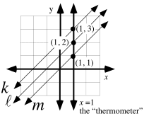

In the illustration above lines $k$, $\ell$ and $m$ are all parallel.

A. What is the slope of line $m$?

B. What do you think is a reasonable number to give as the slope of line $\ell$?

C. What do you think is a reasonable number to give as the slope of line $k$?

### VIII.

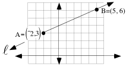

The questions below are about mapping line $\ell$ in the illustration above with the translation that maps point A = (¯2,3) to the origin.

A. Give the image of point B under that translation.

B. Give the slope of the <strong>image</strong> of line $\ell$.

C. What do you think is a reasonable number to give as the slope of line $\ell$?

### IX.

A. Give any three different pairs that <strong>are not</strong> solutions of this open sentence:

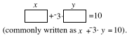

B. Give any three different pairs which are solutions of the open sentence.  Use a negative first coordinate in at least one of these pairs.

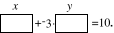

### X.

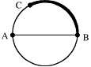

In the illustration above the segment AB is a diameter of the circle and the shaded arc from point B to point C has the same length as diameter AB.  Give the best answer you can to the following question--How many arcs with the same length as arc BC can be fit end to end to cover the entire circle?  Your answer need not be an integer.

## Assignment #28

### I.

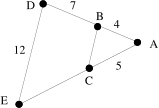

In the figure above, segments CB and DE are parallel.

A. Give the magnitude of the size transformation centered at A that will map triangle ABC onto triangle ADE.

B. Give the length of segment AE.

C. Give the length of segment CE.

D. Give the magnitude of the size transformation centered at A that will map triangle ADE onto triangle ABC.

E. Give the length of segment CB.

### II.

A. If $\left[ \begin{matrix}1 & 0 \\ 0 & 1\end{matrix} \right]$ is the matrix for the composite $\text{S}_{\frac{{}^{-}\text{3}}{\text{4}}}\circ \text{S}_{\text{k}}$, what is the value of k?

B. If $\text{S}_{{}^{-}\text{3}}\circ \text{S}_{\text{k}}=\text{S}_{\text{7}}$, what is the value of k?

### III.

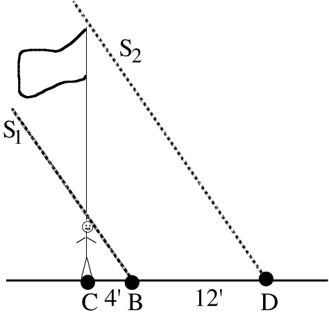

Beth is standing in front of a flagpole and casting a 4 foot shadow.  The shadow cast by the pole is 12 feet longer than the shadow cast by Beth.

A. Give the magnitude of the size transformation centered at C that will map Beth’s shadow onto the shadow of the flagpole.

B. If Beth is 5' 6" tall, how tall is the flagpole?  Hint: assume that sun rays S1 and S2 are parallel.  In reality this is very, very close to true.

### IV.

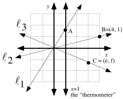

A. The slope of line $\ell _{1}$ is $\sqrt{3}$.  Give both coordinates of point A.

B. Give the slope of line $\ell _{2}$.

C. Give a representation of the slope of line $\ell _{3}$.

D. Which coordinate axis has no slope?

### V.

<strong>Using Transformations to Compute the Slope (Temperature) of an Oblique Line that does not Pass Through the Origin</strong>

Line $\ell$ in the illustration at the top of the next page can be assigned a slope that helps describe its direction.  However, <strong>the slope of line</strong> $\ell$ <strong>is not the second coordinate of its intersection with the thermometer line</strong>, <em>x</em> = 1, because line $\ell$ does not pass through the origin.

The illustration shows line $m$, which is the image of line $\ell$ under the translation that maps point A to the origin.  The Translation-Parallelism Assumption states that line <em>m</em> is parallel to line $\ell$.  Furthermore we have agreed that parallel lines should be assigned the same slope.  Therefore, line $\ell$ will be assigned the same slope as line $m$.

The slope of line $m$ can be determined by using a size transformation centered at (0,0) to map point B' onto the thermometer.  The diagram on the next page shows the following steps in a determination of the slope of line $\ell$.

Step #1: Point A is translated to the origin and point B is mapped with the same translation.  Vertical arrows are used to point to the image points.

Step #2: A size transformation is used to map the image of B onto the thermometer. A horizontal arrow points to the image of B under the size transformation.

Step #3: The slope (temperature) of line <em>m</em> is read as the second coordinate of its intersection with the thermometer and this same number is used for the slope of parallel line $\ell$.

To compute the slope of line $\ell$, it was not necessary to use the translation that maps point A to the origin.  The diagram below shows what happens if the translation that maps point B to the origin is used instead.

You are urged to use diagrams like those above as you determine the slopes of lines passing through two given points but not the origin.

This question is about the translation that maps point A to the origin:

A. Give the image of B under the translation that maps point A to the origin.

B. Give the slope of the image of line $\ell$ under that translation.

C. Give the slope of line $\ell$.

### VI.

Use transformations and a diagram like those in question V of this assignment to compute the slope of the line passing through (1,6) and (14,¯2).

### VII.

Give any four solutions of the open sentence 3 · <em>x</em> + <em>y</em>  = ¯10.  It might help to think of the variables in this open sentence as open boxes.  The coordinates of the solutions are numbers that fill the boxes to make true statements.

### VIII.

A. Copy the following table and as you do, fill in all the missing numbers.

| The diameter of a circle | The circumference of the same circle |
| --- | --- |
| 1 | $\pi$ |
| 3 |  |
|  | $\sqrt{14}\cdot\pi$ |
| 4.5 |  |
|  | 10 |

B. The point $\mathrm{(}1\mathrm{,}\pi \mathrm{)}$ can be mapped onto a point with first coordinate 4.5 under an origin centered size transformation.  Give the magnitude of that size transformation.

### IX.

See if you can use the fact that (4,9.2) is a solution of $y=2\mathrm{.}3\cdot x$ to help give a solution of $y=2\mathrm{.}3\cdot \mathrm{(}x+3\mathrm{)}$ which has the same second coordinate, 9.2.

## Assignment #29

### I.

The data in the following table is based on the time of the Olympic Games winner in the 200-meter run for women.  In a sentence or two, describe any trend you see.

| Year | Winning time |
| --- | --- |
| 1948 | 24.4 |
| 1952 | 23.7 |
| 1956 | 23.4 |
| 1960 | 24.0 |
| 1964 | 23.0 |
| 1968 | 22.5 |
| 1972 | 22.4 |
| 1976 | 22.37 |
| 1980 | 22.03 |
| 1984 | 21.81 |
| 1988 | 21.34 |
| 1992 | 21.81 |

### II.

Copy the following table and fill in the second column.  The center for all of the size transformations is (0,0).

| Size transformation magnitude | Image of $(1,\sqrt{2})$ |
| --- | --- |
| ${}^{-}3$ |  |
| ${}^{-}1$ |  |
| 2 |  |
| 4 |  |
| 7 |  |

### III.

This question is about pairs that meet the description: “the second coordinate is 2 times the first coordinate.”

A. Give five such pairs.

B. Give one two-variable open sentence that has all five of your pairs from A right above as solutions.

### IV.

<strong>Another Example of the Computation of the Slope of a Line Through Two Points</strong>

Here is a diagram for how a size transformation after a translation can be used to compute the slope of the line passing through (2,8) and (11,¯5).  The translation used is the one that maps (2,8) to the origin.  The same slope can be computed if the process is begun by using the translation that maps (11,¯5) to (0,0).

A. Give the slope of the line passing through the origin and the point (¯11,11).

B. Use a translation to help compute the slope of the line passing through the points (¯3,5) and (8,¯6).

### V.

Use your calculator to determine which of the following pairs is a solution of the open sentence below.  Give the letter of any pair that is a solution.

<em>y</em>  = 2.3.<em>x</em>

A. (18,41.4)      B. (13,27.9)

C. (¯27, ¯62.1)      D. (¯1.8,¯4.14)

### VI.

(5,¯7) is one of the solutions of the open sentence

.

If the solution (5,-7) is modified to $\mathrm{(}5+{}^{-}3\mathrm{,}{}^{-}7\mathrm{)}$, it is converted into a solution of the open sentence

$\mathrm{(}5+{}^{-}3\mathrm{,}{}^{-}7\mathrm{)}$ is called the solution of $y={}^{-}1\mathrm{.}4\cdot \mathrm{(}x+3\mathrm{)}$<strong>related to</strong> (5,-7).  Notice that when the coordinates of these solutions are used in the variables in the correct way, the following  statements are formed:

using (5, -7), we get -7 = -1.4.5    from $y={}^{-}1\mathrm{.}4\cdot x$

and

using (5+-3, -7), we get -7 = -1.4.((5+-3) + 3) from <em>y</em> = -1.4.(<em>x</em> + 3).

Notice also that the statements formed by replacing the variables with the coordinates of the solutions are both true sentences about alternative ways to represent -7<em>.</em>

A.

1\.  “Modify” $\mathrm{(}5\mathrm{,}{}^{-}7\mathrm{)}$to create a related solution of

2\. True or False:  When the coordinates of your related solution are used in the variables of the open sentence from “A” right above, a true statement is formed about two different ways to express -7.

B. Again “modify” $\mathrm{(}5\mathrm{,}{}^{-}7\mathrm{)}$ to create a related solution of

.

### VII.

Trace these parallel lines $\ell$ and $m$ onto your homework paper.  Then add arrows to your tracing, all beginning at point P, for three different translations that will map line $\ell$ onto line $m$.

### VIII.

Use the Matrix Basis Theorem to write the 2$\times$2 matrix for the rotation with center (0,0) and magnitude 90˚.

### IX.

Give approximations of each of the following numbers accurate to four decimal places:

A. ¯0.0588636  B. ¯0.05902777

## Assignment #30

### I.

<strong>Generating Points on a Line Through the Origin from a Thermometer Point</strong>

We are setting about discovering how to write useful mathematical descriptions of lines that will “catch the trend” of data points such as those from question I of assignment #29 about

the Olympic 200 meter run for women.  Our first step will be to learn how to write descriptions of lines passing through the origin.  Points on such lines can be “generated” from a thermometer point and origin centered size transformations.  The table below pairs magnitudes for some size transformations with images of the thermometer point, (1,$\sqrt{0\mathrm{.}9}$).

| Size transformation magnitude | Image of $(1,\sqrt{0.9})$ |
| --- | --- |
| ${}^{-}3$ | $({}^{-}3,{}^{-}3\cdot\sqrt{0.9})$ |
| ${}^{-}1$ | $({}^{-}1,{}^{-}1\cdot\sqrt{0.9})$ |
| 2 | $(2,2\cdot\sqrt{0.9})$ |
| 4 | $(4,4\cdot\sqrt{0.9})$ |
| 7 | $(7,7\cdot\sqrt{0.9})$ |

The table of images above is similar to the one you made for Question II of assignment #29.  If the parentheses are disregarded, the numbers can be seen as occurring in three columns.  There is a column of size transformation magnitudes, a column of the first coordinates of the images and a column of the second coordinates of the images.  These three columns can be duplicated in the first three lists in of a calculator.

For list #1: First push \[STAT\] and select 1:Edit by pushing \[ENTER\].  Then place the cursor at the top of list #1 and enter the size transformation magnitudes one by one.

For list #2: The first coordinates of the images are equal to the size transformation magnitudes times 1, the first coordinate of the thermometer point.  Since the size transformation magnitudes have already been entered into list #1, it is not necessary to enter them again to create list #2.  Instead, place the cursor on the “L2” over the horizontal line at the top of the lists. Type the command “<strong>L1\*1</strong>” and push \[ENTER\]. This causes the first coordinates of the images of $\mathrm{(}1\mathrm{,}\sqrt{0\mathrm{.}9}\mathrm{)}$ to appear in list #2.

For list #3: When working with size transformations centered at the origin, both the first and second coordinates of an image are computed by multiplying each of the coordinates of any pre-image by the magnitude.  Therefore, when the cursor is placed on the “L3” over the horizontal line and when the command “<strong>L1\*</strong>$\sqrt{0\mathrm{.}9}$” is keyed in, the second coordinates of the images of the thermometer point will in list #3 after \[ENTER\] is pushed.

After the coordinates of the images are in lists #2 and #3, we push \[2nd\] and \[Y=\].  Then we turn on plot 1 and set it to use list #2 as the Xlist and list #3 as the Ylist.  After pushing \[ZOOM\] and selecting 9:ZoomStat we will see a plot of the images made from the thermometer point.

The images of $\mathrm{(}1\mathrm{,}\sqrt{0\mathrm{.}9}\mathrm{)}$appear to be collinear with the origin, as they should because when a point is mapped with a size transformation its image and the center are collinear with the pre-image.  The five images in the table were “generated” from $\mathrm{(}1\mathrm{,}\sqrt{0\mathrm{.}9}\mathrm{)}$ by origin centered size transformations.  If we found more images of $\mathrm{(}1\mathrm{,}\sqrt{0\mathrm{.}9}\mathrm{)}$ by using more origin centered size transformations we would fill in more and more points of a line through the origin.  The slope of the line being generated is $\sqrt{0\mathrm{.}9}$.

To generate points on a different oblique line through the origin, only the thermometer point need be changed.  To get the coordinates of some of these new points into lists #2 and #3, it would only be necessary to change the command used to generate list #3.  Just multiply the magnitudes in list #1 by the new slope.

A. Enter the following magnitudes for size transformations centered at the origin into list #1 on your calculator:

¯3, ¯2, ¯1.5, 1.7, 2.6, 3.8

B. Using the numbers you have now in list #1 and (1,1.4) as a thermometer point:

1\. Give the calculator command that will generate in list #2 the first coordinates of the points generated from the given thermometer point by the origin centered size transformations whose magnitudes are in list #1.

2\. The magnitudes of some origin centered size transformations are in list #1.  Give the calculator command that will generate in list #3 the second coordinates of the images of the thermometer point.

C. Use the commands you gave in your answers to B right above to actually generate lists #2 and #3.  Then view a scatter plot of those points and give a brief description of any trend or pattern you see in the six points.

### II.

A. Give any five ordered pairs that meet the description “the second coordinate is 1.4 times the first coordinate.”

B. Give one open sentence containing two variables that has all of the points you gave in your answer to “A” as solutions.

### III.

A. Copy and complete the table at the top of the next page by filling in the top number in the right column and the bottom number in the left column:

| The measure of a length in meters | The measure of the same length in inches |
| --- | --- |
| 1 |  |
| 2 | 78.74 |
| 3 | 118.11 |
| 5 | 196.85 |
|  | 393.70 |

B. Enter the data from the table into lists #1 and #2 of your calculator.  Then make a scatter plot of the six data points and answer the following question:

True or False:  The six points appear to be collinear with each other and with the origin.

C. For every pair in the table, each second coordinate can be computed from the first coordinate to its left by multiplying that first coordinate by some constant.

1\. What is that constant?

2\. If a unit designation were to be given to the constant you gave as your answer for “1” right above, would it be more appropriate to use “meters per inch” or “inches per meter”?

D. For every pair in the table, each first coordinate can be computed from the second coordinate to its right by multiplying that second coordinate by some constant.   Give the exact value of that constant expressed as a fraction.

### IV.

(15,78) is a solution of the open sentence

<em>y</em>  = 5.2.<em>x</em>

In each case modify (15,78) to create “related” solution of each of the following open sentences.  If you do not remember what is meant by a “related solution” re-read the introduction to question VI of assignment #29.  It may help to think of the variables as “tagged mail boxes.”

A. <em>y</em>  = 5.2.(<em>x</em> + 11)    B. <em>y</em>  = 5.2.(<em>x</em> + ¯5)     C. (<em>y</em> + 23) = 5.2.<em>x</em>

### V.

Use a translation to help calculate the slope of the line passing through (1948,24.4) and (1992, 21.81) accurate to four decimal places.

### VI.

Line $m$ passes through (0,4) and (3,9). Line $\ell$ is parallel to $m$ and passing through the origin.  Copy and complete these two image formulas for different translations that will map line $\ell$ onto line $m$.

$\text{T}_{1}\mathrm{(}x\mathrm{,}y\mathrm{)}=$       $\text{T}_{2}\mathrm{(}x\mathrm{,}y\mathrm{)}=$

### VII.

A. Give the slope of the line, $\ell$, that passes through the origin and (5,2).

B. Give the matrix for the origin centered rotation with magnitude 90˚, $\text{R}_{90}$.

C. Give the image of (5,2) when it is mapped with $\text{R}_{90}$.

D. Give the slope of the line through the origin that is perpendicular to line $\ell$ described in A right above.

### VIII.

A. Give the magnitude of the size transformation centered at point A which will map right triangle ABE onto right triangle ACD.

B. Give the magnitude of the size transformation centered at point A which will map right triangle ACD onto right triangle ABE.

C. Compute the exact length of side EB.

D. Compute the area of triangle ACD.

E. Compute the area of triangle ABE.

## Assignment #31

### I.

<strong>Writing an Equation that Describes a Line Through the Origin</strong>

In the figure below (1,m) is used to represent the thermometer point on a “typical” line through the origin.  Also shown are three images of the thermometer point, T, under  origin centered size transformations.  The size transformations are represented with subscripted “S’s.”  The subscripts give the magnitudes of the size transformations, which are also the first coordinates of the images of T.

The important thing to notice is that the second coordinate of each image point is the first coordinate of that point times “m,” the slope of line $\ell$.  This is not only true for the four points highlighted with dots, but it is true for all the other points on line $\ell$ as well.  This is because any of these other points is the image of T under a size transformation centered at the origin.

Furthermore, if any point has a second coordinate that is equal to “m” times its first coordinate, that point is the image of (1,m) under a size transformation.  This means that any such point is collinear with (0,0) and (1,m) and that point must be on line $\ell$.

In summary, all points with second coordinates equal to their first coordinates times “m” are unique to the line through the origin with slope “m.”  But these points also are all solutions of the open sentence

$y=\text{m}\cdot x$.

In other words, if a point is on line $\ell$, then it is a solution of this open sentence.  On the other hand, if a point is a solution of this open sentence it must be on line $\ell$.  For these two reasons, the open sentence “$y=\text{m}\cdot x$” is said to “describe” line $\ell$.

If a line through the origin has slope “m,” the open sentence

$y=\text{m}\cdot x$

describes that line.

A. Point T is on the “thermometer” and line $\ell$ has slope $\sqrt{0\mathrm{.}63}$.  Give the coordinates of point T.

B. Give the magnitude of the origin centered size transformation that will map point T onto:

1\.  Point A        2.  Point B

C. If point “C” is also on line $\ell$ and its first coordinate is 5.2, what is its second coordinate?

D. Give one open sentence that has as its solutions all the points on line $\ell$.

### II.

A. Enter any four non-zero real numbers into list #1.

B. Generate into lists #2 and #3 the coordinates of the images of the thermometer point (1,¯2.1) under the origin centered size transformations whose magnitudes are in list #1.  Give both the commands you used to do this.

C. Get a view of the scatter plot of the points whose coordinates are in lists #2 and #3.  Then push the \[Y=\] key and make an entry for Y1 that describes the line that passes through all the points on the scatter plot.  On your homework paper, write an equation for that line.

### III.

A. With reference to the illustration above, compute each of the following distances rounded to the eighth decimal place:

1\. AB, the distance from point A to point B.

2\. BC, the distance from point B to point C.

3\. AC, the distance from point A to point C.

B.  True or False: AB + BC = AC, that is, the distance from A to B plus the distance from B to C is equal to the distance from A to C.

C. True or False: Points A, B, and C are collinear.

### IV.

A.  An object with a length of one inch would have a length of 2.54 centimeters.  Based on this fact, copy this table and provide the four missing numbers in the right column.

| The length of an object in inches | The length of the same object in centimeters |
| --- | --- |
| 0 |  |
| 1 |  |
| 2 |  |
| 10 |  |

B. Each number in the right column of the table from “A” above is the product of its partner number in the left column and some constant.   Give that constant and give its units.

C. Each number in the left column of the table from “B” above is the product of its partner number in the right column and some constant.   Give the exact value of that constant expressed as a fraction and give its units.

### V.

A. Tell whether each of the following statements is True or False:

1\. The translation image of a line is always parallel to that line.

2\. If a line has a slope, then the translation image of that line has the same slope.

B. Give an example of a line that has no slope.

### VI.

This question is about the line, $m$, passing through (¯3,7) and (5,¯2)  and the line, $\ell$, parallel to $m$ and passing through the origin.

A. What is the slope of line $\ell$?

B. What is the slope of line $m$?

C. Copy and complete these two image formulas for different translations that will map line $\ell$ onto line $m$.  Hint: remember that line $\ell$ passes through the origin.

$\text{T}_{1}\mathrm{(}x\mathrm{,}y\mathrm{)}=$       $\text{T}_{2}\mathrm{(}x\mathrm{,}y\mathrm{)}=$

D. Tell whether each of the following statements is True or False:

1\. Both (¯3,7) and (5,¯2) are solutions of $\mathrm{(}y+{}^{-}7\mathrm{)}=\frac{{}^{-}9}{8}\cdot \mathrm{(}x+3\mathrm{)}$.

2\. Both (¯3,7) and (5,¯2) are solutions of $\mathrm{(}y+2\mathrm{)}=\frac{{}^{-}9}{8}\cdot \mathrm{(}x+{}^{-}5\mathrm{)}$.

### VII.

In the left column below you are given three different solutions of equation A.

A:  $y={}^{-}11\mathrm{.}5\cdot x$                             B:   $\mathrm{(}y+10\mathrm{)}={}^{-}11\mathrm{.}5\cdot \mathrm{(}x+{}^{-}9\mathrm{)}$

solution of equation A  related solution of equation B

(12,¯138)

(¯26,299)

(¯4,46)

A. Copy the table above and as you do, fill in the second column with modifications of the solutions for equation A.  The modifications should be made so that the solutions you create are related to the solutions for equation A in the sense that these new solutions create the same true statement when used in equation B as the original solutions created when used in equation A.   For example, your first solution for equation B should create the statement that -138 is equal to -11.5 times 12 when it is used in equation B.  It is not necessary to “simplify” the coordinates of the related solutions you create.   In fact, if the modifications are clearly shown, it will be easier to answer “B” right below.

B. Is there just one translation which will map all the solutions in the first column to their related solutions in the second column?  If so, give an image formula for that translation.

### VIII.

Give the slope of the line through the origin that is perpendicular to the line that passes through the origin and (¯3,2).

### IX.

“Solve” each of the following equations for $y$.  You can do this by adding the same number to each side.

A. $\mathrm{(}y+{}^{-}2\mathrm{)}=1\mathrm{.}4\cdot \mathrm{(}x+7\mathrm{)}$   B. $\mathrm{(}y+13\mathrm{)}=1\mathrm{.}4\cdot x+9\mathrm{.}8$    C. $\mathrm{(}y+\pi \mathrm{)}=1\mathrm{.}4\cdot x+9\mathrm{.}8$

### X.

Give an equivalent to $y=2\cdot \mathrm{(}x+{}^{-}3\mathrm{)}+8$ which has the form $y=\mathrm{a}\cdot x+\text{b}\mathrm{.}$  You might find it useful to begin your work with the use of a distributive form.

### XI.

Calculate the slope of the line passing through (1952,23.7) and (1988, 21.575) accurate to four decimal places.

## Assignment #32

### I.

<strong>The Challenge of Writing Equations for Lines That do not Pass Through the Origin</strong>

One of the most commonly used mathematical skills is that of writing an equation whose solutions are all the points on a line.  The result is commonly referred to as an equation for the line.  In the illustration below line $\ell$ is parallel to line $m$.

The slope of line $\ell$ is the second coordinate of the image of (5,1) under the origin centered size transformation that maps that point onto the thermometer line.  The magnitude of that size transformation is $\frac{1}{5}$, the second coordinate of the image is $\frac{1}{5}$ and therefore the slope of line $\ell$ is $\frac{1}{5}$.  Since line $\ell$ passes thorough the origin, it can be described by the equation $y=\frac{1}{5}\cdot x$ whose solutions are all those points whose second coordinates are $\frac{1}{5}$ times their first coordinates.

In general, it is rather easy to write an equation for a line that passes through the origin as long as the coordinates of at least one other point on the line is known.  But line <em>m</em> in the illustration does not pass through the origin.  However, since line <em>m</em> is parallel to line $\ell$, its slope is $\frac{1}{5}$, the same as the slope of line $\ell$.  However, $y=\frac{1}{5}\cdot x$ is not an equation for line <em>m</em> since neither (¯5,3) nor (5,5) from line <em>m</em> are solutions of $y=\frac{1}{5}\cdot x$.

The bold arrows in the illustration represent two of the unlimited number of translations that will map line $\ell$ onto line <em>m</em>.  Since the arrows begin at the origin, the translations they represent are easy to describe.  Their image formulas are:

T1$\mathrm{(}x\mathrm{,}y\mathrm{)}=\mathrm{(}x+{}^{-}5\mathrm{,}y+3\mathrm{)}$

and

T2$\mathrm{(}x\mathrm{,}y\mathrm{)}=\mathrm{(}x+5\mathrm{,}y+5\mathrm{)}$

When either of these translations are used in this context, line $\ell$ is the pre-image, and $y=\frac{1}{5}\cdot x$ is called <strong>a pre-image equation</strong>.  The work you have been doing with related solutions will lead to a discovery of how to create an <strong>image equation</strong> that will have as its solutions all the points that are translated from line $\ell$ to line <em>m</em>.  You will learn to create this image equation by modifying the pre-image equation in coordination with an image formula for the translation you choose to translate line $\ell$ onto line <em>m</em>.

With reference to the illustration on the previous page, which of the following equations have the two points shown on line <em>m</em> as solutions?  Give the number of all correct choices, if there are any.

#1:  $\mathrm{(}y+{}^{-}5\mathrm{)}=\frac{1}{5}\cdot \mathrm{(}x+{}^{-}5\mathrm{)}$    #2:  $\mathrm{(}y+{}^{-}3\mathrm{)}=\frac{1}{5}\cdot \mathrm{(}x+5\mathrm{)}$    #3:  $\mathrm{(}y+{}^{-}5\mathrm{)}=\frac{1}{5}\cdot \mathrm{(}x+3\mathrm{)}$

### II.

Enter any 4 non-zero real numbers into list #1.  Then use your calculator to get in list #2 and #3 the coordinates of the images of (1,1.6) under the origin centered size transformations whose magnitudes are in list #1.

A. Give the commands you used to generate lists #2 and #3.

B. Give an equation for the line that passes through the image points whose coordinates are in lists #2 and #3.  Remember, you can check this answer by making an entry in the \[Y=\] list based on your answer and seeing whether the graph it generates passes through a scatter plot of the points whose coordinates are in lists #2 and #3.

### III.

On July 16, 2000 the government of Mexico posted an announcement that one United States dollar would buy 9.25 Mexican pesos.

A.  Write three pairs which meet the following description:

“The first coordinate is a number of dollars and the second coordinate is the number of pesos you could purchase for that many dollars on July 16, 2000.”

B. Write an equation for the line which would pass through your three points from part “A.”

C. Which of these phrases do you think best describes the slope of line passing through the pairs you wrote as your answer for “A”?

#1:  Dollars per peso      #2: pesos per dollar

### IV.

The following questions are about the line, $\ell$, that passes through the origin and the “typical” point (a,b) not on the <em>y</em>-axis.

A. Give the slope of line $\ell$.

B. Give the image of the point (a,b) under $\text{R}_{90}$.

C. Give an equation that describes the line through the origin that is perpendicular to line $\ell$.  This equation will contain the letters “a” and “b” as well as the variables “<em>x</em>” and “<em>y</em>.”

### V.

A. Give the number described as “the opposite of the reciprocal of $\frac{7}{5}$.”

B. Give the number described as “the reciprocal of the opposite of $\frac{7}{5}$.”

C. Give the number described as “the opposite of the reciprocal of $\frac{{}^{-}5}{7}$.”

### VI.

In the left column below you are given three different solutions of equation A:

A:   $y=1\mathrm{.}6\cdot x$    B:   $\mathrm{(}y+{}^{-}5\mathrm{)}=1\mathrm{.}6\cdot \mathrm{(}x+8\mathrm{)}$

solution of equation A  related solution of equation B

(¯5,¯8)

(15,24)

(¯35,¯56)

A.  Copy the table above and as you do, write in modifications of the solutions of equation A that are the related solutions of equation B.  These modified solutions should make the same true statements when used in equation B as their counterparts in the left list make when used in equation A.

B.  There is just one translation which will map each solution shown in the first column to its related solution in the second column.  Give an image formula for that translation.

### VII.

Line $m$ passes through (¯5,¯2) and (3,5). Line $\ell$ is parallel to $m$ and passes through the origin.

A. What is the slope of line $m$?

B. Write an equation that describes line $\ell$.

C. Copy and complete these two image formulas for different translations that will map line $\ell$ onto line $m$.

$\text{T}_{1}\mathrm{(}x\mathrm{,}y\mathrm{)}=$       $\text{T}_{2}\mathrm{(}x\mathrm{,}y\mathrm{)}=$

D. Tell whether each of the following statements is True or False:

1\. Both (¯5,¯2) and (3,5) are solutions of $\mathrm{(}y+2\mathrm{)}=\frac{7}{8}\cdot \mathrm{(}x+5\mathrm{)}$

2\. Both (¯5,¯2) and (3,5) are solutions of $\mathrm{(}y+{}^{-}5\mathrm{)}=\frac{7}{8}\cdot \mathrm{(}x+{}^{-}3\mathrm{)}$

3\. Both (¯5,¯2) and (3,5) are solutions of $\mathrm{(}y+9\mathrm{)}=\frac{7}{8}\cdot \mathrm{(}x+13\mathrm{)}$

### VIII.

Solve each of the following equations for $y$ and give the result in the form $y=\text{a}\cdot x+\text{b}$:

A. $\mathrm{(}y+2\mathrm{)}=\frac{7}{8}\cdot \mathrm{(}x+5\mathrm{)}$     B. $\mathrm{(}y+{}^{-}5\mathrm{)}=\frac{7}{8}\cdot \mathrm{(}x+{}^{-}3\mathrm{)}$  C. $\mathrm{(}y+9\mathrm{)}=\frac{7}{8}\cdot \mathrm{(}x+13\mathrm{)}$

### IX.

Calculate the slope of the line through (1955, 24.1) and (1990, 21.5) accurate to four decimal places.

### X.

A. Give the solution of this equation as a fraction:

$x\cdot \frac{18}{11}=35$

B. In the figure below, segment DB is parallel to segment EC, and AE has length 35.  What is the length of segment AD?

## Assignment #33

### I.

In the left column below, you are given three different solutions of equation A:

A: $y={}^{-}2\mathrm{.}8\cdot x$            B: ?

solution of equation A  related solution of equation B

(¯3,8.4)  (¯3+2,8.4+-3)

(10,¯28)  (12,¯31)

(25,¯70)  (27,¯73)

A. Give an image formula for a translation that will map each solution in the left column to the related solution in the same row in the right column.

B. Create equation B that has all three of the points in the right column as solutions.

### II.

A. Give an equation for line $\ell$ in the above illustration.

B. Three bold arrows are shown for one of the many, many translations that will map line $\ell$ onto line $m$.  Give an image formula for that translation.

C. Create an equation which will have among its solutions the three image points at the tips of the translation arrows in the illustration.

### III.

Calculate the “average” for each of these pairs of numbers:

A. ¯6 and 11    B. 13.4 and 9.2

### IV.

Give the “middle” number in each of the following lists of numbers:

A. 0, ¯5, 10    B. ¯2, 3, 7, 14

### V.

These questions are about the line, $m$, that passes through the points (¯2,7) and (11,3).

A. Give the exact slope of line $m$.

B. Give an equation for the line, $\ell$, that passes through the origin and is parallel to line $m$.

C. Give image formulas for two different translations that will map line $\ell$ onto line $m$.

D. True or False: (¯2,7) and (11,3) are both solutions of $y+{}^{-}7=\frac{{}^{-}4}{13}\cdot \mathrm{(}x+2\mathrm{)}$.

E. True or False: (¯2,7) and (11,3) are both solutions of $y+7=\frac{{}^{-}4}{13}\cdot \mathrm{(}x+{}^{-}2\mathrm{)}$.

F. True or False: (¯2,7) and (11,3) are both solutions of $y+{}^{-}3=\frac{{}^{-}4}{13}\cdot \mathrm{(}x+{}^{-}11\mathrm{)}$.

G. True or False: (¯2,7) and (11,3) are both solutions of $y+3=\frac{{}^{-}4}{13}\cdot \mathrm{(}x+11\mathrm{)}$.

### VI.

Solve each of these equations for $y$.  Give the final equation in the form $y=\text{a}\cdot x+\text{b}$.

A. $y+{}^{-}7=\frac{{}^{-}4}{13}\cdot \mathrm{(}x+2\mathrm{)}$    B. $y+{}^{-}3=\frac{{}^{-}4}{13}\cdot \mathrm{(}x+{}^{-}11\mathrm{)}$

### VII.

<strong>Writing an Equation for an Oblique Line Through the Origin Perpendicular to Another Line Through the Origin</strong>

All lines through the origin other than the $x-\text{axis}$ and the $y-\text{axis}$ are called “oblique lines through the origin.”  The illustration shows a “typical” oblique line, $\ell$, that passes through the origin and the point represented by (a,b).

The image of P under $\text{S}_{\frac{\text{1}}{\text{a}}}$is the thermometer point, $\left( 1\mathrm{,}\frac{\text{a}}{\text{b}} \right)$, whose second coordinate was used to write an equation for line $\ell$.

The origin centered rotation with a magnitude of 90˚ maps line $\ell$ onto the line through the origin perpendicular to line $\ell$.  That line will pass through point P', (¯b,a), which comes from the matrix product

$\left[ \begin{matrix}\text{0} & {}^{-}\text{1} \\ \text{1} & \text{0}\end{matrix} \right]\cdot \left[ \begin{matrix}\text{a} \\ \text{b}\end{matrix} \right]=\left[ \begin{matrix}{}^{-}\text{b} \\ \text{a}\end{matrix} \right]$.

P' can be mapped onto the thermometer point, $\left( 1\mathrm{,}\frac{{}^{-}\text{a}}{\text{b}} \right)$, by $\text{S}_{\frac{{}^{-}1}{\text{b}}}$.  The second coordinate gives the slope needed to write an equation for the line that passes through the origin and is perpendicular to line $\ell$.

The slopes of the perpendicular lines in the illustration are $\frac{\text{b}}{\text{a}}$ and $\frac{{}^{-}\text{a}}{\text{b}}$.  <strong>Each of these fractions is the opposite of the reciprocal of the other.</strong>  It is convenient to remember this relationship, but if forgotten, transformations can be used to rediscover it.

Line $\ell$ passes through the origin and (2,¯5).

A. Give the slope of line $\ell$.

B. Write an equation for line $\ell$.

C. Give the slope of the image of line $\ell$ under R90.

D. Write an equation for the line through the origin that is perpendicular to line $\ell$.

E. Give the slope of any line perpendicular to line $\ell$.

### VIII.

In the figure above, point P is one-third of the way from point A to point B.

A. Give the exact coordinates of point P.

B. Give an image formula for the translation that will map point A to point P.

### IX.

A. Enter the expression “3(X+5)+11” as Y1 in your calculator.  Then push \[2nd\] and \[MODE\] to quit the \[Y=\] list and return to the home screen.  Now push \[VARS\], the right arrow key to select the Y-VARS sub menu, \[ENTER\] to select 1:Function and \[ENTER\] again to get “Y1” on the home screen.  Extend the “Y1” expression to “Y1(3)” and push \[ENTER\].  Record the result.

B. On the graph of the line described by $y=3\cdot \mathrm{(}x+5\mathrm{)}+11$, what is the second coordinate of the point whose first coordinate is 3?

## Assignment #34

### I.

<strong>Writing an Equation for the Translation Image of a Line Through the Origin</strong>

By this time, you should be finding it easy to write equations for oblique lines through the origin.  Line $m$ in the illustration above does not pass through the origin.  However, line $m$ is the image of line $\ell$ under the translation T that maps the origin to the point  (¯2,3) on it.

The three arrows in the illustration go from pre-image points on line $\ell$ to image points on line $m$.  The coordinates of the image points show a use of the image formula T$\mathrm{(}x\mathrm{,}y\mathrm{)}=\mathrm{(}x+{}^{-}2\mathrm{,}y+3\mathrm{)}$.  Now consider this equation

<strong>(</strong><em><strong>y</strong></em> <strong>+ -3)</strong> = $\frac{1}{3}$<strong>. (</strong><em><strong>x</strong></em> <strong>+ 2)</strong>.

Do you see that each of the highlighted points on line m is a solution of this equation?.   The bold equation above has every point on line $m$ as a solution and every one of its solutions is a point on line $m$.  The equation <strong>describes</strong> line $m$.

It is useful and important to see a connection between the equation that describes line $\ell$, an image formula for the translation that maps line $\ell$ onto line $m$, and the equation that describes line $m$.  The <strong>connection diagram</strong>  shows the equations describing pre-image and image lines on the left and an image formula for mapping the pre-image to the image on the right.  As this course progresses, you should develop a deeper and deeper understanding of such connection diagrams.  For now, you should get clear in your mind the ways to create a new equation from a pre-image equation so that the new equation will have as its solutions the translation images of the points on the pre-image.

<strong>Notice that the image equation can be created from the pre-image equation by making replacements for “</strong><em><strong>x</strong></em><strong>” and “</strong><em><strong>y</strong></em><strong>.”</strong>  Specifically “<em>x</em>” in the pre-image equation has been replaced by “<em>x</em> + 2” while “<em>y</em>” in the pre-image equation has been replaced by “<em>y</em> + -3.”

<strong>Notice also that the expressions used to replace “</strong><em><strong>x</strong></em><strong>” and “</strong><em><strong>y</strong></em><strong>” in the pre-image equation are related to the expressions that are separated by the comma on the right side of the equal sign in the translation image formula.</strong>  The expressions used to create the image equation are chosen to offset the effect the translation has on the coordinates of solutions of the pre-image equation.

In the left column below, you are given three different solutions of equation A:

A:   $y=3\mathrm{.}4\cdot x$               B: ?

solution of equation A  related solution of equation B

(¯35,¯119)  (¯35+-6,¯119+9)

(12,40.8)  (6,49.8)

(4.1,13.94)  (¯1.9,22.94)

A. Give an image formula for the one translation that will map each solution in the left column to the corresponding solution in the same row in the right column.

B. Create equation B, which has all three of the points in the right column as solutions.

### II.

This question is about the incomplete connection diagram shown below:

A. Copy and complete this connection diagram by writing in the missing image equation.

B. Give any two solutions of the pre-image equation.

C. Give the images of your answers to B right above under the translation whose image formula is given in the incomplete connection diagram.

D. Check whether or not your answers are solutions to the image equation you wrote at the end of the connection diagram.  If they are not, check your work in parts A, B, and C above.  Do not give up until your connection diagram correctly relates solutions of the pre-image equation to solutions of the image equation.

### III.

This question is about the incomplete connection diagram shown below:

A. Copy and complete this connection diagram by writing in the missing translation image formula.

B. Give any two solutions of the pre-image equation.

C. Give the images of your answers to B right above under the translation whose image formula you gave to complete the connection diagram.

D. Check whether or not your answers are solutions to the image equation you wrote at the end of the connection diagram.  If they are not, check your work in parts A, B, and C above.

### IV.

This question is about the line, $\ell$, that passes through (¯4,8) and (5,¯2).

A. Enter the coordinates of the two given points into lists #1 and #2.

B. Enter into lists #3 and #4 the coordinates of these two points.

#1:  the origin

#2:  the image of (5,¯2) under the translation that maps (¯4,8) to the origin.

C. Write an equation for the line that passes through the points whose coordinates are in lists #3 and #4. Test your answer by making an entry for Y1 that corresponds to that equation and then seeing whether the line generated from that equation passes through a scatter plot of the points in lists #3 and #4.

D. Write a connection diagram that starts with your answer to C right above and ends with an equation for the line that passes through the points whose coordinates are in lists #1 and #2.  Test your answer by making an entry for Y2 that corresponds to that equation and then seeing whether the line generated from that equation passes through a scatter plot of the points in lists #1 and #2.

<strong>This is a very important question.  Keep at it until you succeed.</strong>

### V.

Ensure that lists #1 through #4 are clear.  Then enter into lists #1 and #2 the first and second coordinates of the data points given in the following table:

**800-meter run for women**

| Year in which world record was set | Record in seconds |
| --- | --- |
| 1953 | 127.3 |
| 1960 | 124.1 |
| 1964 | 121.5 |
| 1968 | 120.5 |
| 1971 | 118.3 |
| 1983 | 113.28 |

You will be working with the data in these lists during the next lesson.

### VI.

Calculate the average or “mean” for each of these pairs of numbers:

A. ¯1 and 5          B. 22.3 and 21.75

### VII.

The middle number in a list written in order of size is called the <strong>median</strong> of the numbers in that list.  When there is no middle number, the median is the average of the two numbers nearest the middle.  Give the median for each of these lists of numbers:

A. ¯5, 6, ¯2, ¯1, 8        B. 5, 6, 11, 17

### VIII.

A. Given the points (1953,127.3) and (1960,124.1), give the point whose first coordinate is the median of the first coordinates of these points and whose second coordinate is the median of the second coordinates of these points.

B. Given the points (1971,118.3) and (1983,113.28), give the point whose first coordinate is the median of the first coordinates of these points and whose second coordinate is the median of the second coordinates of these points.

C. Give the slope of the line that passes through your answers for A and B.

D. Give an equation for the line through the origin parallel to the line through your answers to A and B.

### IX.

A. Enter the expression “¯4(X+2)+¯8” as Y1 in your calculator.  Then push \[2nd\] and \[MODE\] to quit the \[Y=\] list and return to the home screen.  Now push VARS, select the YVARS sub menu, push \[ENTER\] and push \[ENTER\] again to get  “Y1” on the home screen.  Extend the “Y1” expression to “Y1(7)” and push \[ENTER\].  Record the result.

B. On the graph of the line described by $y={}^{-}4\cdot \mathrm{(}x+2\mathrm{)}+{}^{-}8$, what is the second coordinate of the point whose first coordinate is 7?

### X.

In the figure above, point P is one-third of the way from point A to point B.

A. Give the exact coordinates of point P.

B. Give an image formula for the translation that will map point A to point P.

### XI.

Give the slope of any line perpendicular to the line described by $y={}^{-}3\cdot x$.

## Assignment #35

### I.

The median-median point of a set of points is a new point whose first coordinate is the median of the first coordinates of the original point and whose second coordinate is the median of the second coordinates of the original point.  In each give the median-median point of each of the given sets of points:

A. (1948, 109.2) and (1956, 107.7)

B.(1948, 24.4), (1952, 23.7), and (1956, 23.4)

C. (1984, 21.81), (1988, 21.34), and (1992, 21.81)

### II.

This question is about the incomplete connection diagram shown below:

A. Copy and complete this connection diagram by writing in the missing image equation.

B. Give any two solutions of the pre-image equation.

C. Give the images of your answers to B right above under the translation whose image formula is given in the incomplete connection diagram.

D. Check whether or not your answers are solutions to the image equation you wrote at the end of the connection diagram.  If they are not, check your work in parts A, B, and C above.  Do not give up until your connection diagram correctly relates solutions of the pre-image equation to solutions of the image equation.

### III.

This question is about the incomplete connection diagram shown below:

A. Copy and complete this connection diagram by writing in the missing translation image formula.

B. Give any two solutions of the pre-image equation.

C. Give the images of your answers to B right above under the translation whose image formula you gave to complete the connection diagram.

D. Check whether or not your answers are solutions to the image equation at the end of the connection diagram.  If they are not, check your work in parts A, B and C above.  Do not give up until your connection diagram correctly relates solutions of the pre-image equation to solutions of the image equation.

### IV.

<strong>An Example of How to Write an Equation for a Line Passing Through Two Points not Collinear with the Origin</strong>

The following is about writing an equation that describes line $m$ in the above illustration. Line $m$ passes through (¯2,3) and (6,¯2).  Line $m$ will be referred to as the “target” line.

PHASE #1: Determine the slope of the helper and target lines:

Either of the points given on line $m$ can be translated to the origin.  The other point will map to a point on a second line passing through the origin and parallel to line $m$.  In the illustration above, this second line is named $\ell$.  Line $\ell$ is referred to as the “helper” line.  The slope of line $\ell$ is computed by using an origin centered size transformation after the translation.  The diagrams below give two paths leading to the slope of line $\ell$:

PHASE #2: Write an equation for the line through the origin parallel to the target line.

Line $\ell$, the helper line, passes through the origin and its slope is known.  Therefore it is easy to create the equation

$y=\frac{{}^{-}5}{8}\cdot x$

to describe line $\ell$.

PHASE #3: Create a connection diagram leading to an equation for the target line.

There are many ways to map the helper line, line $\ell$, back onto line the target line, line $m$.  Each of the connection diagrams below begins with an equation for line $\ell$ and ends with an equation that describes line $m$.

The final equations in the connection diagram are different.  However, by adding the same number to each side, they can be transformed into the equivalents

$y=\frac{{}^{-}5}{8}\cdot \mathrm{(}x+2\mathrm{)}+3$       and      $y=\frac{{}^{-}5}{8}\cdot \mathrm{(}x+{}^{-}6\mathrm{)}+{}^{-}2$.

Expressions in the \[Y=\] list can be based on either of these equations.  You should enter the points on line $m$ into lists #3 and #4.  Then enter the expressions into the \[Y=\] list one at a time and you should see the lines that pass through a scatter plot of the two points.

Both of the calculator compatible equations can be transformed into

$y=\frac{{}^{-}5}{8}\cdot x+\frac{14}{8}$.

You will have many opportunities to practice the above procedure.  You can check your progress by using your calculator to make scatter plots and line graphs.  At this stage, you should aim for perfect accuracy.  As you gain experience, you will discover short cuts that will lead you to a correct equation for the target line with less writing.  You each will be encouraged to develop such shortcuts at your own pace.  The key thing is to completely master the important skill of describing a line that passes through two given points.

This question is about the line, $\ell$, that passes through  (¯3,¯7) and (10,5).

A. Enter the coordinates of the two given points into lists #1 and #2.

B. Enter into lists #3 and #4 the coordinates of these two points:

#1:  the origin

#2:  the image of (10,5) under the same translation that maps (¯3,¯7) to the origin.

C. Write an equation for the helper line that passes through the points whose coordinates are in lists #3 and #4.  Test your answer by making an entry for Y1 based on that equation and then seeing whether the line generated from that equation passes through a scatter plot of the points in lists #3 and #4.

D. Write a connection diagram that starts with your answer to C right above and concludes with an equation for the target line that passes through the points whose coordinates are in lists #1 and #2.  Test your answer by making an entry for Y2 that corresponds to that equation and then seeing whether the line generated from that equation passes through a scatter plot of the points in lists #1 and #2.

<strong>Do not quit until the calculator shows you that you have succeeded!</strong>

### V.

This question is about the line, $\ell$, that passes through  (2.6,5) and (11.3,7.8).

A. Enter the coordinates of the two given points into lists #1 and #2.

B. Enter into lists #3 and #4 the coordinates of these two points:

#1:  the origin

#2:  the image of (11.3,7.8) under the same translation that maps (2.6,5) to the origin.

C. Write an equation for the helper line that passes through the points whose coordinates are in lists #3 and #4.  Test your answer by making an entry for Y1 that corresponds to that equation and then seeing whether the line generated from that equation passes through a scatter plot of the points in lists #3 and #4.

D. Write a connection diagram that begins with your answer to C right above and ends with an equation for the target line that passes through the points whose coordinates are in lists #1 and #2.  Test your answer by making an entry for Y2 that corresponds to ending equation and then seeing whether the line generated from the Y2 passes through a scatter plot of the points in lists #1 and #2.

<strong>Do not quit until the calculator shows you that you have succeeded!</strong>

### VI.

A. Enter the expression “3(X+¯4)+17” as Y1 in your calculator.  Then push \[2nd\] and \[MODE\] quit the \[Y=\] list and return to the home screen.  Now push \[VARS\], , use the right arrow key to select the \[Y-VARS\] submenu, then push ENTER\] and \[ENTER\] again to get  “Y1”  on the home screen.  Extend the “Y1” expression to “Y1(6)” and push \[ENTER\].  Record the result on the home screen.

B. If the point (6,a) is on the graph of the line described by $y=3\cdot \mathrm{(}x+{}^{-}4\mathrm{)}+17$, what is the value of “a”?

C. Give the coordinates of the point one third of the way from (6, 23) to (6, 21.5).

D. Give an image formula for the translation that will map (6, 23) onto your answer to C right above.

## Assignment #36

### I.

<strong>The Significance of Median-Median Points</strong>

**800-meter run for women**

| Year in which world record was set | Record in seconds |
| --- | --- |
| 1953 | 127.3 |
| 1960 | 124.1 |
| 1964 | 121.5 |
| 1968 | 120.5 |
| 1971 | 118.3 |
| 1983 | 113.28 |

The data points in the table can be separated into three pairs of two, working from the top.  The median-points for these pairs are:

For the first pair, (1953, 127.3) and (1960,124.1): the median-median point is (1956.5,125.7)

For the second pair, (1964,121.5) and (1968,120.5): the median-median point is (1966,121)

For the third pair, (1971,118.3) and (1983,113.28): the median-median point is (1977,115.79)

Here is a copy of a scatter plot made from the six data points (represented with six dots) and the three median-median points (represented with three small squares).

Notice that the three median-median points appear to line up closely with the six data points.  You should agree that if a description of a line that comes close to passing through the three median-median points is created, that line will also come close to passing through at least most of the original data points.

| L1 | L2 |
| --- | --- |
| 1 | 7 |
| 2 | 13 |
| 6 | 26 |
| 7 | 30 |
| 10 | 35 |
| 11 | 33 |

A. Give median-median point  for (1,7) and (2,13).

B. Give median-median point  for (10,35) and (11,33).

C. Give the slope of the line that passes through your answers for A and B right above.

D. Give an equation for the line which passes through your answers to A and B.

E. Give median-median point  for (6,26) and (7,30).

F. Enter the coordinates of the three median-median points into lists #3 and #4.  Then enter the data in the table above into lists #1 and #2.  Push \[2nd\] and \[Y=\] and turn on Plot 1 to show a scatter plot of the data in lists #1 and #2.  Then push \[2nd\] and \[Y=\] again to turn on Plot 2 to show a scatter plot of the median-median points in lists #3 and #4.  NOTE--<strong>When you set up the plots, it is a good idea to select different marks for the data points and the median-median points.</strong>

G. Enter an expression for Y1 that describes the line for which you wrote an equation as your answer to D above.  Then push \[ZOOM\] and \[9\] to get a view of the data and the line that should pass through the first and third median points.  If the line does not pass through the first and third median-median points, re-do parts C and D above.  Keep at it until the line generated from your Y1 equation does pass through the first and third median-median points.

H. When you did part G right above, you probably noticed that the line through the first and third median-median points did not pass through the second median-median point.  Write a few sentences suggesting how the position of the line might be adjusted to take into account the middle two data points represented by the second median-median point.

### II.

If the point (6.5, a) is on the line described by $y=\frac{24}{9}\cdot \mathrm{(}x+{}^{-}1\mathrm{.}5\mathrm{)}+10$, give the value of “a.”

### III.

A. Copy and complete the connection diagram at the top of the next page:

B. Give an expression for entry in the \[Y=\] list of your calculator for making a graph of the line described by your image equation in “A.”

### IV.

Tell whether each of the following statements is true or false:

A. 2.5=10 and $\sqrt{9}$ = 3.

B. $6^{2}=36$ and $5^{2}=10$.

C. 0.2.(0.2)=0.4 and $\frac{1}{6}\div 2=\frac{1}{12}$.

### V.

A. The ordered pair, (3,7) is one of many solutions of the 2-variable open sentence $x+y=10$.  Give four other solutions including at least one that has a negative coordinate.

B. The ordered pair (2,7) is one of many solutions of the 2-variable open sentence $x+2\cdot y=16$.  Give four other solutions, again including at least one that has a negative coordinate.

### VI.

Copy these equations, filling in the blanks as you go, so that they are all equivalent:

$\begin{array}{l}\mathrm{(\#}1\mathrm{)}\hspace{0.5em}\mathrm{(}y+{}^{-}7\mathrm{)}={}^{-}2\cdot \mathrm{(}x+{}^{-}4\mathrm{);}\hspace{2.25em}\text{(\#2)}\hspace{0.75em}y+{}^{-}7={}^{-}2\cdot x+\mathrm{\_\_\_\_} \\ \mathrm{(\#}3\mathrm{)}\hspace{0.5em}y={}^{-}2\cdot x+\mathrm{\_\_\_;}\hspace{4.0em}\text{(\#4)}\hspace{0.5em}\mathrm{\_\_\_}+1\cdot y=15\end{array}$

### VII.

A geometric figure is described by the equation: $2x+{}^{-}3y=11$:

A. What type of figure is described by this equation?

B. Give an equivalent to this equation in the form “$y=$(an expression in which ‘$x$’ is the only variable.)”

### VIII.

A. Identify any lines of reflection that can be used to reflect the square at the bottom of the previous page onto itself.

B. Give a positive magnitude less than or equal to 360˚ for each different origin centered rotation that will map the square onto itself.

### IX.

A. Give the coordinates of the point one-third of the way from (6.5,$\frac{70}{3}$) to        (6.5, 28).

B. Copy the following sequence of equations and supply the numbers that belong in the blanks so that the equations are equivalent:

$y=\frac{24}{9}\cdot \mathrm{(}x-1\mathrm{.}5\mathrm{)}+10+\frac{14}{9}$

$y=\frac{24}{9}\cdot x+\mathrm{\_\_\_}+10+\frac{14}{9}$

$y=\frac{24}{9}\cdot x+\mathrm{\_\_\_}$  (fill in this blank with a fraction made from two integers)

## Assignment #37

### I.

<strong>Median-Median Lines and the Tool Built into Your Calculator for Creating Equations for Median-Median Lines</strong>

| L1 | L2 |
| --- | --- |
| 1 | 7 |
| 2 | 13 |
| 6 | 26 |
| 7 | 30 |
| 10 | 35 |
| 11 | 33 |

Above is a table of coordinates from question I of assignment #36.  In the scatter plot below, the six points are shown with the small dots.  The three larger markers represent the median-median points, (1.5,10), (6.5,28) and (10.5,34), for the three pairs of points taken from the table in top to bottom order.

The line through the first and third median-median points “catches” the linear trend in the six small dots pretty well. Working with (1.5,10) and (10.5,34) and transformations, the equation $y=\frac{24}{9}\cdot \mathrm{(}x+{}^{-}1\mathrm{.}5\mathrm{)}+10$ can be created to describe this line. However, the two small dots in the middle of the scatter plot, and their median-median point, have had no influence on the position of the “trend” line.

It should seem reasonable to suggest that the line through the first and third median-median points could be shifted up to give some influence to the middle points.  Here is a close-up of the line described by $y=\frac{24}{9}\cdot \mathrm{(}x+{}^{-}1\mathrm{.}5\mathrm{)}+10$ and the middle points.

Point P has been added to the illustration.  Point P is on the line through the first and third median-median points.  It is also on the same vertical line as the middle median-median point.  The second coordinate of point P was computed by replacing the “<em>x</em>” with 6.5 in

$y=\frac{24}{9}\cdot \mathrm{(}x+{}^{-}1\mathrm{.}5\mathrm{)}+10$.

The little arrows in the illustration are there to suggest that a vertical translation of the line described by $y=\frac{24}{9}\cdot \mathrm{(}x+{}^{-}1\mathrm{.}5\mathrm{)}+10$ would produce an image line that gives some influence to the middle points.  During class, it was suggested that the magnitude of the translation used to “shift” the trend line toward the middle points could be one-third of the distance from P to the middle median-median point.  Here are the relevant calculations in this case:

The distance from $\mathrm{(}6\mathrm{.}5\mathrm{,}\frac{70}{3}\mathrm{)}$ to (6.5,28): $28-\frac{70}{3}=\frac{84}{3}-\frac{70}{3}=\frac{14}{3}$

One third of the distance from $\mathrm{(}6\mathrm{.}5\mathrm{,}\frac{70}{3}\mathrm{)}$ to (6.5,28): $\frac{1}{3}\cdot \frac{14}{3}=\frac{14}{9}$

The translation to do the shifting has image formula T$\mathrm{(}x\mathrm{,}y\mathrm{)}=\mathrm{(}x\mathrm{,}y+\frac{14}{9}\mathrm{)}$.  Here is a connection diagram ending with a description of the adjusted trend line:

The equations at the end of the connection diagram describe what is called the “median-median” line for the original six data points.  During the lesson, we created a very close equivalent to these equations by taking the following two steps:

Step #1: The coordinates from the table were entered into lists #1 and #2.  In fact any two lists could be used to store the coordinates of the data points.

Step #2: The calculator was prepared to work on the coordinates by first pushing \[STAT\], selecting CALC and then pushing \[3\] Med-Med.  At the home screen we saw “Med-Med,” extended it to read “Med-Med L1, L2,” and pushed \[ENTER\].

From the display

the equation <em>y</em>=2.666666667.<em>x</em> + 7.555555556 can be created.  This equation is almost exactly equivalent to

$y=\frac{24}{9}\cdot \mathrm{(}x+{}^{-}1\mathrm{.}5\mathrm{)}+10+\frac{14}{9}\hspace{0.5em}\text{or}\hspace{0.75em}y=\frac{24}{9}\cdot x+\frac{{}^{-}36}{9}+\frac{90}{9}+\frac{14}{9}\hspace{0.5em}\text{or}\hspace{0.5em}y=\frac{24}{9}\cdot x+\frac{68}{9}$.

In this course, you will be encouraged to use the built-in Med-Med command to help create equations for a line to catch the “trend” in data.  You will also be required to show that you understand how the line through the first and third median-median points is translated toward the middle median-median point to create a better indicator of the trend in data.

Suppose the three median-median points for a set of data are (5,11), (15,3) and (23,2).  Enter the coordinates of these points into lists #1 and #2.

A. Give an equation for the line passing through the first and third median-median points. Test your answer by entering a description of the line as Y1 and checking whether its graph passes through the left and right points of a scatter plot made from lists #1 and #2.

B. There is a point on the line whose equation you just wrote that has the same first coordinate as the second median-median point.  Give the second coordinate of that point.

C. Give an image formula for the vertical translation that will map the line through the first and third median-median points onto the median-median line.

D. Sketch a connection diagram that begins with your answer to A and ends with an equation for the median-median line for the data in the table.  Then enter a description of the median-median line as Y1.  Now get a view a graph of this line together with a scatter plot of the three median-median points.  The median-median line should pass under the first and third points and over the middle point.

### II.

**800-meter run for men**

| Year in which Olympic record was set | Record in seconds |
| --- | --- |
| 1948 | 109.2 |
| 1956 | 107.7 |
| 1960 | 106.3 |
| 1964 | 105.1 |
| 1976 | 103.5 |
| 1984 | 103.0 |

A. Enter the data in the table into lists #1 and #2.  Use the “Med-Med” command built into your calculator to get the coefficients for an equation for the median-median line for this data set. Finally, write on your homework paper an equation for that line with the coefficients accurate to four decimal places.

B. Give the slope of the median-median line accurate to four decimal places.

### III.

**800-meter run for women**

| Year in which world record was set | Record in seconds |
| --- | --- |
| 1953 | 127.3 |
| 1960 | 124.1 |
| 1964 | 121.5 |
| 1968 | 120.5 |
| 1971 | 118.3 |
| 1983 | 113.28 |

A. Enter the data in the table into lists #1 and #2.  Again, use the “Med-Med” command built into your calculator to get the coefficients for an equation for the median-median line for this data set. Finally, write on your homework paper an equation for that line with the coefficients accurate to four decimal places.

B. Give the slope of the median-median line accurate to four decimal places.

### IV.

Answer Yes or No: Do the median-median lines for the data sets in questions II and III above intersect?  Give a reason for your answer.

### V.

In each part of this question you are presented with a statement that could be described as “molecular.”  Each of the molecules is made up of two atomic statements joined with “and.” Tell whether or not each of the following molecular statements is true:

A. $3+2=\sqrt{25}$ and $7>0$.    B. $4\div \frac{1}{4}=1$ and $0\mathrm{.}3=\frac{3}{10}$

C. $\sqrt{3^{2}+4^{2}}=3+4$ and ${}^{-}7^{2}=49$

### VI.

A. Give any and all solutions of the open sentence $x=4$ and $x>3$.

B. Give any and all solutions of the two-variable molecular open sentence $1\cdot x+0\cdot y=4$ and $0\cdot x+1\cdot y=3$.  The atoms of this molecule are $1\cdot x+0\cdot y=4$ and $0\cdot x+1\cdot y=3$.

### VII.

For each of the given open sentences, give an equivalent of the form $\text{a}\cdot x+\text{b}\cdot y=\text{c}$.

A. $\mathrm{(}y+11\mathrm{)}=5\cdot \mathrm{(}x+{}^{-}4\mathrm{)}$    B. $\mathrm{(}y+{}^{-}1\mathrm{.}2\mathrm{)}={}^{-}0\mathrm{.}6\cdot \mathrm{(}x+3\mathrm{.}1\mathrm{)}$

C. $\mathrm{(}y+{}^{-}106\mathrm{.}3\mathrm{)}={}^{-}0\mathrm{.}52\cdot \mathrm{(}x+{}^{-}1956\mathrm{)}$

### VIII.

A. The origin centered rotation with magnitude 270˚ will map the square above onto itself.  Use the Matrix Basis Theorem to give a matrix for that rotation.

B. The square above can also be mapped onto itself by a reflection in the $y={}^{-}x$ line.  Use the Matrix Basis Theorem to give a matrix for that reflection.

C. Use the Matrix-Transformation Isomorphism Theorem to create a matrix for the composite $r_{y={}^{-}x}\circ \text{R}_{270}$.

D. By a reverse use of the Matrix Basis Theorem, identify the transformation associated with your answer to C right above.

## Assignment #38

### I.

Suppose the three median-median points for a set of data are (6,5), (14,11.6) and (22,17).  Enter the coordinates of these points into lists #1 and #2.

A. Give an equation for the line passing through the first and third median-median points. Test your answer by entering a description of the line as Y1 and checking whether its graph passes through the left and right points of a scatter plot made from lists #1 and #2.

B. There is a point on the line for which you gave an equation as your answer to A right above which has the same first coordinate as the second median-median point.  Give the second coordinate of that point.

C. Give an image formula for the vertical translation that will map the line through the first and third median-median points onto the median-median line.

D. Sketch a connection diagram that begins with your answer to A and ends with an equation for the median-median line for the data in the table.  Then enter a description of the median-median line as Y1 and view a graph of this line together with a scatter plot of the three median-median points.  The median-median line should pass over the first and third points and under the middle point.

### II.

For each of the given open sentences, give an equivalent of the form $\text{a}\cdot x+\text{b}\cdot y=\text{c}$.

A. $\mathrm{(}y+{}^{-}9\mathrm{)}={}^{-}4\cdot \mathrm{(}x+7\mathrm{)}$          B. $\mathrm{(}y+2\mathrm{.}7\mathrm{)}={}^{-}1\mathrm{.}3\cdot \mathrm{(}x+{}^{-}5\mathrm{.}7\mathrm{)}$

C. $\mathrm{(}y+{}^{-}115\mathrm{.}3\mathrm{)}={}^{-}1\mathrm{.}31\cdot \mathrm{(}x+{}^{-}1972\mathrm{)}$

### III.

**Number of season wins for six National League teams**

| Team | Wins in 1953 | Wins in 1954 |
| --- | --- | --- |
| Braves | 92 | 89 |
| Dodgers | 105 | 92 |
| Cubs | 65 | 64 |
| Reds | 68 | 74 |
| Giants | 70 | 97 |
| Phillies | 83 | 75 |

Enter the coordinates of the data points in the table above into lists #1 and #2.

A. Then use the “Med-Med” command to write an equation for the median-median line for this data set.  Write your equation with the coefficients accurate to three decimal places.

B. Is there some reason why you might expect the slope of the median-median line for this data set to be near 1?  If so, what do you think this reason is?

### IV.

Give the total of the angle measures represented by letters in the figure below.  Hint, would it help to sketch a segment passing through the interior of the figure and joining one vertex to another?

### V.

A. Calculate the second coordinate of the point on the line described by $y=2\cdot x+3$ if that point has first coordinate 5.  Do this without using your calculator.

B. Push \[Y=\] and enter the expression “2X+3” as Y1. Then push \[2nd\] and \[MODE\] to return to the home screen.  Next, push \[2nd\] and \[VARS\] and push \[ENTER\] to select 1: Function.  Then push \[ENTER\] again to select “Y1” and cause it to appear on the home screen.  Finally, push keys to extend “Y1” to “Y1(5)” and push \[ENTER\].  Now record on your homework paper the number that appears on the lower right of the home screen.

### VI.

Give an equivalent to each of the following in a form that can be entered into the \[Y=\] list of your calculator to produce a graph.

A.${}^{-}12\cdot x+7\cdot y=12$          B. $5\cdot x+\frac{{}^{-}3}{7}\cdot y=4$

### VII.

**200-meter run for women, Olympic gold medal times**

| Year | Name, nation | Time in seconds |
| --- | --- | --- |
| 1948 | Blankers-Koen, Netherlands | 24.4 |
| 1952 | Jackson, Australia | 23.7 |
| 1956 | Cuthbert, Australia | 23.4 |
| 1960 | Rudolph, USA | 24.0 |
| 1964 | McGuire, USA | 23.0 |
| 1968 | Szewinska, Poland | 22.5 |
| 1972 | Stecher, E. Germany | 22.4 |
| 1976 | Eckert, E. Germany | 22.37 |
| 1980 | Wockel, E. Germany | 22.03 |
| 1984 | Brisco-Hooks, USA | 21.81 |
| 1988 | Griffith-Joyner, USA | 21.34 |
| 1992 | Torrence, USA | 21.81 |

Enter the coordinates of the data in the table at the bottom of the previous page into lists #1 and #2.

A. Give an equation for the median-median line for this data with the coefficients accurate to the nearest thousandth.

B. Enter as Y1 an expression based on your answer to “A” right above for the median-median line.

C. At the home screen enter the expression “Y1(2000)” and press \[ENTER\].  Write the result accurate to the nearest hundredth on your homework paper.  What do you think this number might mean?

### VIII.

<strong>Systems and Solutions</strong>

<strong>True conjunctive statements</strong>

Three statements can be extracted from the string of symbols

“$3=\sqrt{9}\text{ and }{}^{-}2^{2}=4$.”

These three statements are:

#1:  $3=\sqrt{9}$       #2:  ${}^{-}2^{2}=4$        #3:  $3=\sqrt{9}\text{ and }{}^{-}2^{2}=4$

Statement #3, formed by placing the word “and” between statements #1 and #2 is called a “conjunctive” statement.  Statement #1 is true and statement #2 is false.  Statement #3 is also false.  It is “contaminated” by the presence of statement #2 within it.

In general, when a conjunctive statement is formed by writing “and” between two other statements, that conjunctive statement is true <strong>only if both of the statements from which it is formed are true</strong><em><strong>.</strong></em>

<strong>Solutions of conjunctive open sentences</strong>

The open sentences “$x^{2}=4$” and “$x<0$” can be used to form the conjunctive open sentence

“$x^{2}=4$ and $x<0$.”

A solution of this conjunctive open sentence is a number that can be used in the “<em>x</em>” position to make a true statement. “2” is not a solution because the statement

“$2^{2}=4$ and 2 &lt; 0”

is not a true statement--it is contaminated by “2 &lt; 0.”

-3 is also not a solution because

“(¯3)2 = 4 and ¯3 &lt; 0”

is not true.  It is contaminated by “(¯3)2 = 4.”

However, ¯2 is a solution because

“(¯2)2 = 4 and ¯2 &lt; 0”

is true.

The conjunctive open sentence

“$x+y=10$ and x &lt; y”

contains two variables.  If it has any solutions, they must be ordered pairs of real numbers.  (4,6) is, in fact a solution because

“4 + 6 = 10 and 4 &lt; 6”

is true.  There are many other solutions as well.

<strong>Systems of open sentences</strong>

A conjunctive open sentence such as

“$x+y=10$ and <em>x</em> &lt; y”

is called a “system.”  Frequently systems are presented without using the word “and.”  When this is done, the open sentences separated by the “and” are stacked vertically and tied together with a brace.

$\left\{ \begin{array}{l}x+y=10 \\ x<y\end{array} \right.$    is an alternative presentation of “$x+y=10$ and <em>x</em> &lt; y.”

<strong>When the system is presented in the form without “and,” a solution still must be an ordered pair of numbers whose coordinates can be used to convert each of the open sentence in the vertical stack into true statements.</strong>

In the next  few assignments, the systems presented are simple enough that you should be able to identify solutions, if there are any, just by thinking.  Shortly you will learn some options you might take to make the solution or solutions of a system more discernible.

In each case tell whether or not (3,¯4) is a solution of the given systems:

A. $\left\{ \begin{array}{l}x>y \\ x+y<0\end{array} \right.$          B. $\left\{ \begin{array}{l}2\cdot x+y=2 \\ x+y={}^{-}1\end{array} \right.$          C.$\left\{ \begin{array}{l}1\cdot x+0\cdot y=3 \\ 0\cdot x+1\cdot y={}^{-}4\end{array} \right.$

### IX.

Give any three solutions of this system:

$\left\{ \begin{array}{l}x+2\cdot y=10 \\ x<y\end{array} \right.$

## Assignment #39

### I.

Give the median-median point for (3,5), (5,10), and (8,9).

### II.

Suppose the three median-median points for a set of data in a table are (3,31), (21,14.8), and (27,11).  Enter the coordinates of these points into lists #1 and #2.

A. Give an equation for the line passing through the first and third median-median points. Test your answer by entering a description of the line as Y1 and checking whether its graph passes through the left and right points of a scatter plot made from lists #1 and #2.

B. There is a point on the line whose equation you just wrote that has the same first coordinate as the second median-median point.  Give the second coordinate of that point.

C. Give an image formula for the vertical translation that will map the line through the first and third median-median points onto the median-median line.

D. Sketch a connection diagram that begins with your answer to A and ends with an equation for the median-median line for the data in the table.  Then enter a description of the median-median line as Y1.  Now view a graph of this line together with a scatter plot of the three median-median points.  The median-median line should pass under the first and third points and over the middle point.

### III.

**Number of season wins for six National League teams**

| Team | Wins in 1954 | Wins in 1955 |
| --- | --- | --- |
| Braves | 89 | 85 |
| Dodgers | 92 | 98 |
| Cubs | 64 | 72 |
| Reds | 74 | 75 |
| Giants | 97 | 80 |
| Phillies | 75 | 77 |

Use your calculator to get an equation for the median-median line for the data points is the above table.  Give the coefficients of your equation accurate to the nearest tenth.

### IV.

For each of the given open sentences, give an equivalent of the form $\text{a}\cdot x+\text{b}\cdot y=\text{c}$.

A. $\mathrm{(}y+{}^{-}8\mathrm{)}={}^{-}11\cdot \mathrm{(}x+15\mathrm{)}$    B. $\mathrm{(}y+2\mathrm{.}7\mathrm{)}=1\mathrm{.}7\cdot \mathrm{(}x+{}^{-}5\mathrm{.}6\mathrm{)}$

C. $\mathrm{(}y+{}^{-}19\mathrm{.}81\mathrm{)}={}^{-}0\mathrm{.}352\cdot \mathrm{(}x+{}^{-}1988\mathrm{)}$

### V.

<strong>Using Your Calculator to Compute the Second Coordinates of Points on a Line</strong>

Line $\ell$ in the illustration above can be described by the equation

$\mathrm{(}y+{}^{-}1\mathrm{)}=\frac{1}{2}\cdot \mathrm{(}x+2\mathrm{)}$.

This equation cannot be entered into the \[Y=\] list of your calculator.  However, if “1” is added to each side, the new equation produced is equivalent to

$y=\frac{1}{2}\cdot \mathrm{(}x+2\mathrm{)}+1$

and the expression “(1/2)(X+2)+1” based on this equation can be entered as Y1.  If you key in the expression “Y1(3)” at the home screen, 3.5 will appear after you push \[ENTER\]. 3.5 is the second coordinate of the point on line $\ell$ that has first coordinate 3.

In general, if the description of a line is entered as “Yn” somewhere in the \[Y=\] list, then keying in “Yn(a)” at the home screen will cause your calculator to compute the second coordinate of the point on the line described whose first coordinate is “a.”

If the line follows the trend in some data points, the number calculated might not be just a second coordinate, it could also be a prediction of a result that would occur if the trend continued.  This happened in the case of question VII of assignment #38.  Turn back to that question now.  The median-median line expresses a trend in the winning time for the women’s 200 meter race in the Olympics.  If a description of that line is entered as Y1, the calculator will compute 20.7908333 from Y1(2000) at the home screen.  20.7908333, or approximately 20.79, is almost the exact second coordinate of that trend line at the point whose first coordinate is 2000.  It is also a prediction, based on the trend, that the winning time in the 200 meter run for women in the Olympic Games of the year 2000 will be 20.79 to the nearest hundredth of a second.

A. Use your calculator to get an equation for the median-median line for the data points whose coordinates are given in the columns of the table at the top of the next page.  Give the coefficients of your equation accurate to the fourth decimal place.

B. At the home screen enter the command “Med-Med L1, L2, Y1” to get a very accurate description of the median-median line for this data into the \[Y=\] list:

Then at the home screen, key in the given expressions, and record the result that appears after you push \[ENTER\].

1\. Y1(1948)      2. Y1(1996)

**200-meter run for men, Olympic gold medal times**

| Year | Name, nation | Time in seconds |
| --- | --- | --- |
| 1948 | Patton, USA | 21.1 |
| 1952 | Stanfield, USA | 20.7 |
| 1956 | Morrow, USA | 20.6 |
| 1960 | Berruti, Italy | 20.5 |
| 1964 | Carr, USA | 20.3 |
| 1968 | Smith, USA | 19.83 |
| 1972 | Borzov, USSR | 20.00 |
| 1976 | Quarrie, Jamaica | 20.23 |
| 1980 | Mennea, Italy | 20.19 |
| 1984 | Lewis, USA | 19.80 |
| 1988 | DeLoach, USA | 19.75 |
| 1992 | Marsh, USA | 20.01 |

Remember, to get “Y1” on the home screen, push \[VARS\] and select Y-VARS.  Then push \[ENTER\] to select “1:Function.”  Push \[ENTER\] one more time to select “1:Y1.”  Automatically you will be at the home screen where you will see “Y1.”  You can then key in the number between the parentheses.

### VI.

Give the total of the five angle measures represented by the letters in the figure below.

### VII.

A. Write an equation for the line that passes through (3,180) and (4,360).

B. Enter a description of the line passing through (3,180) and (4,360) as Y1 and use your calculator to compute the second coordinate of the point on that line which has first coordinate 5.

### VIII.

A. Give any and all solutions of the system:

$\left\{ \begin{array}{l}x^{2}=25 \\ x<{}^{-}2\end{array} \right.$

B. Give any and all solutions of the system:

$\left\{ \begin{array}{l}1\cdot x+0\cdot y=10 \\ 0\cdot x+1\cdot y={}^{-}4\end{array} \right.$

## Assignment #40

### I.

A. Write any two ordered pairs in which the first coordinates are the number of sides of a polygon and the second coordinates are the sums of the measures of the “interior angles” of any polygon with that number of sides.

B. Give an equation for the line containing the two points you gave as your answer to “A” right above.

C. Give an equivalent of the form $y=\text{a}\cdot x+\text{b}$  to your answer to “B” right above.

D. Use your calculator to calculate the total of the measures of the interior angles of a polygon with 13 sides.

### II.

A. Give the magnitude of the size transformation centered at point A that will map triangle ABC onto triangle ADE.

B. If segment BC has length 3, give the exact length of segment DE.

### III.

In the above illustration, A, B, and C are the median-median points for a set of data.  An equation for the line through A and C is given.  Create an equation of the form $y=\text{a}\cdot x+\text{b}$ for the median-median line.

### IV.

Here are three points: (1,4.2), (6, 10.8), and (9,13.8).  Enter the first coordinates of these points in list #1 and the second coordinates in list #2.  Now use the Med-Med command on lists #1 and #2 to get the coefficients for an equation of the form $y=\text{a}\cdot x+\text{b}$ that describes the median-median line for these three points.  Give that equation on your homework paper.

### V.

Give the solution of the system: $\left\{ \begin{array}{l}1\cdot x+1\cdot y={}^{-}7 \\ 0\cdot x+1\cdot y={}^{-}9\end{array} \right.$

### VI.

System #1: $\left\{ \begin{array}{l}1\cdot x+3\cdot y={}^{-}5\hspace{1.75em}\text{A}_{\text{1}} \\ 5\cdot x+{}^{-}2\cdot y=7\hspace{1.5em}\text{B}_{\text{1}}\end{array} \right.$         System #2: $\left\{ \begin{array}{l}1\cdot x+3\cdot y\text{ }={}^{-}5\hspace{1.25em}\text{A}_{\text{2}} \\ 0\cdot x+\hspace{1.25em}\text{=}\hspace{2.25em}\text{B}_{\text{2}}\end{array} \right.$

A. The equation labeled B2 is partially complete.  It is being created by multiplying each term of equation A1 by ¯5 and adding the result to the term of equation B1 directly below it. Thus the “0·<em>x</em>” in equation B2 comes from ¯5·(1·<em>x</em>) + 5·<em>x</em>.  Give the complete B2 equation.

B. The solution of system #1 is $\left( \frac{11}{17}\mathrm{,}\frac{{}^{-}32}{17} \right)$.  Is this also a solution of system #2?

### VII.

In each case tell whether (¯5,4) is a solution of each of the given system:

A. $\left\{ \begin{array}{l}3\cdot x+4\cdot y={}^{-}1 \\ {}^{-}5\cdot x+{}^{-}7\cdot y={}^{-}3\end{array} \right.$   B. $\left\{ \begin{array}{l}14\cdot x+18\cdot y=2 \\ 7\cdot x+9\cdot y=1\end{array} \right.$

C. $\left\{ \begin{array}{l}4\cdot x+6\cdot y=4 \\ 3\cdot x+7\cdot y=13\end{array} \right.$  D. $\left\{ \begin{array}{l}1\cdot x+\frac{6}{4}\cdot y=1 \\ 3\cdot x+7\cdot y=13\end{array} \right.$

E. $\left\{ \begin{array}{l}1\cdot x+\frac{6}{4}\cdot y=1 \\ 0\cdot x+\frac{10}{4}\cdot y=10\end{array} \right.$  F. $\left\{ \begin{array}{l}1\cdot x+\frac{6}{4}\cdot y=1 \\ 0\cdot x+1\cdot y=4\end{array} \right.$

G. $\left\{ \begin{array}{l}1\cdot x+0\cdot y=\frac{{}^{-}20}{4} \\ 0\cdot x+1\cdot y=4\end{array} \right.$

### VIII.

In this open sentence “X” is the variable.  Give any and all solutions:

$\left[ \begin{matrix}{}^{-}1\mathrm{.}7 & 14 \\ 3\mathrm{.}72 & {}^{-}0\mathrm{.}122\end{matrix} \right]\cdot \text{X}=\left[ \begin{matrix}{}^{-}1\mathrm{.}7 & 14 \\ 3\mathrm{.}72 & {}^{-}0\mathrm{.}122\end{matrix} \right]$

### IX.

A. The origin centered rotation with magnitude 90˚ will map the square above onto itself.  Use the Matrix Basis Theorem to give a matrix for that rotation.

B. The square above can also be mapped onto itself by a reflection in the $y=x$ line.  Use the Matrix Basis Theorem to give a matrix for that reflection.

C. Use the Matrix-Transformation Isomorphism Theorem to create a matrix for the composite $\text{R}_{90}\circ r_{y=x}$.

D. By a reverse use of the Matrix Basis Theorem, identify the transformation associated with your answer to C right above.

E. Use the Matrix-Transformation Isomorphism Theorem again to create a matrix for the composite $r_{y=x}\circ \text{R}_{90}$.

F. By another reverse use of the Matrix Basis Theorem, identify the transformation associated with your answer to E right above.
