# GAT Assignments 41–58

> Converted from the supplied Word document. [Conversion notes](conversion-report.md) describe the graphics and remaining review items.

[Assignment 41](#assignment-41) | [Assignment 42](#assignment-42) | [Assignment 43](#assignment-43) | [Assignment 44](#assignment-44) | [Assignment 45](#assignment-45) | [Assignment 46](#assignment-46) | [Assignment 47](#assignment-47) | [Assignment 48](#assignment-48) | [Assignment 49](#assignment-49) | [Assignment 50](#assignment-50) | [Assignment 51](#assignment-51) | [Assignment 52](#assignment-52) | [Assignment 53](#assignment-53) | [Assignment 54](#assignment-54) | [Assignment 55](#assignment-55) | [Assignment 56](#assignment-56) | [Assignment 57](#assignment-57) | [Assignment 58](#assignment-58)

## Assignment #41

### I.

<strong>Gauss Elimination Coding</strong>

#1.  $\left\{ \begin{array}{l}4\cdot x+6\cdot y=4 \\ 3\cdot x+7\cdot y=13\end{array} \right.$  #2.  $\left\{ \begin{array}{l}1\cdot x+\frac{6}{4}\cdot y=1 \\ 3\cdot x+7\cdot y=13\end{array} \right.$

#3.  $\left\{ \begin{array}{l}1\cdot x+\frac{6}{4}\cdot y=1 \\ 0\cdot x+\frac{10}{4}\cdot y=10\end{array} \right.$  #4.  $\left\{ \begin{array}{l}1\cdot x+\frac{6}{4}\cdot y=1 \\ 0\cdot x+1\cdot y=4\end{array} \right.$

The four systems above are from question VII of assignment #40.  Each of these four systems shares the same solution, (¯5,4), and that is no accident.  Procedures developed by the German mathematician, Karl Friedrich Gauss, were used to produce Systems #2, #3, and #4.  If we use the Gauss procedures it is certain that each system has the same solution or solutions as its predecessor.  When the original system has only one solution, following Gauss procedures can lead to a system that makes that solution easy to see.

In question VII, the final system in the sequence was:

$\left\{ \begin{array}{l}1\cdot x+0\cdot y=\frac{{}^{-}20}{4} \\ 0\cdot x+1\cdot y=4\end{array} \right.$

It is not hard to see that this system has (¯5,4) as its one and only solution.  The coefficients of the variables in each of the equations in system #1 have been eliminated and replaced with the “1’s” and “0’s” that make the recognition of the solution so easy.  The process that led from system #1 to the final system is called “Gauss Elimination.”

The creation of system #2 from system #1 is rather easy to understand—each side of the top equation in system #1 was multiplied by $\frac{1}{4}$.  The top equation in system #2 results when a distributive form is used together with some simple arithmetic.  It is convenient to have a notation to describe the relationship between the equations in consecutive systems.  This notation is called <strong>Gauss Elimination coding</strong>.  Here is the coding for the creation of system #2 from system #1:

#1.  $\left\{ \begin{array}{l}4\cdot x+6\cdot y=4\hspace{1.0em}\text{A}_{\text{1}} \\ 3\cdot x+7\cdot y=13\hspace{0.75em}\text{B}_{\text{1}}\end{array} \right.$  #2.  $\left\{ \begin{array}{l}1\cdot x+\frac{6}{4}\cdot y=1\hspace{1.25em}\text{A}_{\text{2}}=\frac{1}{4}\cdot \text{A}_{1} \\ 3\cdot x+7\cdot y=13\hspace{1.0em}\text{B}_{\text{2}}=\text{B}_{1}\end{array} \right.$

The Gauss Elimination process that created system #2 from system #1 is called the “multiplication” process.  There are only two processes used in this course in doing Gauss Elimination, and the second one was used to create system #3 from system #2.  The details are shown in the following illustration:

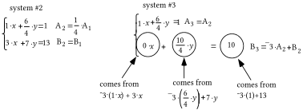

To create the B3 equation, each term in the A2 equation was multiplied by ¯3 and that product was added to the term right below it.  This is called a “multiply and add” process.  Notice how the coding for B3 describes how that equation was created from both the A2 and B2 equations.

A.  Copy the following sequence of systems and supply the missing equations according to the Gauss-Elimination coding:

System #1: $\left\{ \begin{array}{l}2\cdot x+{}^{-}4\cdot y=14\hspace{0.5em}\text{A}_{\text{1}} \\ \text{ }3\cdot x+2\cdot y=5\hspace{1.0em}\text{B}_{\text{1}}\end{array} \right.$

System #2: $\left\{\begin{array}{l}A_2=\frac12\cdot A_1 \\ B_2=B_1\end{array}\right.$

System #3: $\left\{\begin{array}{l}A_3=A_2 \\ B_3={}^{-}3\cdot A_2+B_2\end{array}\right.$

System #4:

System #5: $\left\{\begin{array}{l}A_5=2\cdot B_4+A_4 \\ B_5=B_4\end{array}\right.$

B. Give the solution of System #5.

C. True or False--the solution of system #5 is also a solution of each of the other four systems.

### II.

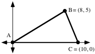

If possible, calculate the exact area of triangle ABC.

### III.

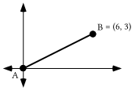

A. Give the slope of the line containing A and B.

B. Give the matrix for R90, the rotation with magnitude 90˚, centered at the origin.

C. Give the image of point B when it is mapped with R90.

D. Give the slope of any line perpendicular to the line containing points A and B.

### IV.

A. Write an equation for the line that has slope 2 and passes through (0,4).

B. Write an equation for the line that has slope ¯1 and passes through (0,4).

### V.

Add opposites to each side to help create an equation of the form $\text{a}\cdot x+\text{b}\cdot y=\text{c}$ equivalent to each given equation:

A. $y+{}^{-}4=2\cdot x$        B. $y+{}^{-}4={}^{-}1\cdot x$

### VI.

The system $\left\{ \begin{array}{l}{}^{-}2\cdot x+1\cdot y=4 \\ \hspace{0.75em}1\cdot x+1\cdot y=4\end{array} \right.$ has only one solution.  By some careful thought and trial and error, find it and record it on your homework paper.

### VII.

A. Push the \[Y=\] button and enter the expression “¯1.2X+30” as Y1.  Then push the \[2nd\] and \[MODE\] keys to return to the home screen.  Push \[CLEAR\]. Next push \[VARS\], select the Y-VARS sub menu, push \[ENTER\], and push \[ENTER\] again to make “Y1” appear on the home screen.  Finally, type in “(14)” and push \[ENTER\] again.  Record the number that now appears on the home screen.

B. There is a point with first coordinate 14 on the line with equation $y={}^{-}1\mathrm{.}2\cdot x+30$.  What is the second coordinate of that point?

### VIII.

Use the translation technique to calculate the <strong>exact</strong> distance between each pair of points:

A. (¯7,12) and (6,¯2).

B. (¯11.2,¯16.8) and (14.1, 23.9).

### IX.

A. Give an equivalent to each of these equations in the form $y=\text{a}\cdot x+\text{b}$:

1\. $1\cdot x+1\cdot y=2$

2\. ${}^{-}1\cdot x+1\cdot y=4$

B.

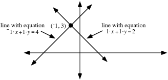

By reference to the illustration, determine the solution of the system

$\left\{ \begin{array}{l}\hspace{0.5em}1\cdot x+1\cdot y=2 \\ {}^{-}1\cdot x+1\cdot y=4\end{array} \right.$

## Assignment #42

### I.

A.  Copy the following sequence of systems and supply the missing equations according to the Gauss-Elimination coding:

System #1: $\left\{ \begin{array}{l}4\cdot x+2\cdot y=\text{ }2\hspace{0.75em}\text{A}_{\text{1}} \\ 4\cdot x+{}^{-}1\cdot y=11\hspace{0.75em}\text{B}_{\text{1}}\end{array} \right.$  System #2: $\left\{\begin{array}{l}A_2=\frac14\cdot A_1 \\ B_2=B_1\end{array}\right.$

System #3: $\left\{\begin{array}{l}A_3=A_2 \\ B_3={}^{-}4\cdot A_2+B_2\end{array}\right.$  System #4: $\left\{ \begin{array}{l}\hspace{5.25em}\text{A}_{\text{4}}=\text{A}_{3} \\ \hspace{5.25em}\text{B}_{\text{4}}=\frac{{}^{-}1}{3}\cdot \text{B}_{\text{3}}\end{array} \right.$

System #5: $\left\{\begin{array}{l}A_5=\frac{{}^{-}1}{2}\cdot B_4+A_4 \\ B_5=B_4\end{array}\right.$

B. Give the solution of system #5.

C. True or False--the solution of system #5 is also a solution of each of the other four systems.

D. Give the exact coordinates of the point of intersection of the line described by $4\cdot x+2\cdot y=2$ and the line described by $4\cdot x+{}^{-}1\cdot y=11$.

### II.

<strong>Solutions of Linear Systems and Intersections of Lines</strong>

Equivalent equations of the form $y=\text{a}\cdot x+\text{b}$ can be written for each equation in the system $\left\{ \begin{array}{l}\hspace{0.5em}1\cdot x+1\cdot y=2 \\ {}^{-}1\cdot x+1\cdot y=4\end{array} \right.$.  These equivalent equations are $y={}^{-}1\cdot x+2$ and $y=1\cdot x+4$.  Based on these two equations, “¯1·X+2” can be entered in the \[Y=\] list as Y1 and “1·X+4” can be entered in that list as Y2.

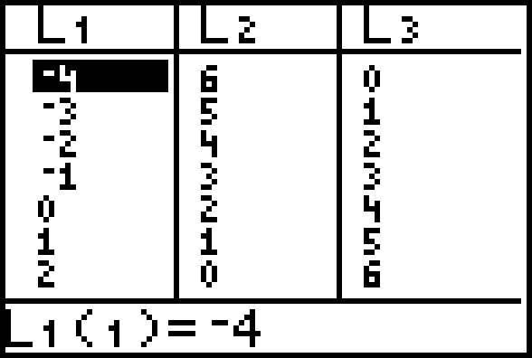

List #2 in the display above was generated by using the command “L2=Y1(L1)” and list #3 in the display was generated by using “L3=Y2(L1).”  The result of this is that the (list #1, list #2) pairs are the coordinates of points on the line described by $y={}^{-}1\cdot x+2$.  Likewise, the (list #1, list #3) pairs are the coordinates of points on the line described by $y=1\cdot x+4$.

Scatter plots of both the list #1, list #2 coordinates and the list #1, list #3 coordinates can be viewed simultaneously with the graphs generated from the Y1 and Y2 expressions.  Here is an enhanced display of the results when \[ZOOM\] and \[5\] are pushed after first pushing \[ZOOM\] and \[9\].

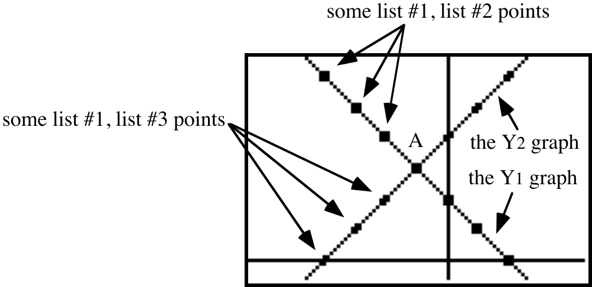

Here are the key facts about the previous two displays:

#1-- All of the list #1, list #2 points are solutions of both $1\cdot x+1\cdot y=2$ and $y={}^{-}1\cdot x+2$.  That is why these points are on the line generated from Y1=¯1·X+2.

#2-- All of the list #1, list #3 points are solutions of both ${}^{-}1\cdot x+1\cdot y=4$ and $y=1\cdot x+4$.  That is why these points are on the line generated from Y2=1·X+4.

#3-- There is just one point that lies on both lines.  This point is (¯1,3).  (¯1,3) is therefore a solution of both $1\cdot x+1\cdot y=2$ and ${}^{-}1\cdot x+1\cdot y=4$.  It is therefore also a solution of the system

$\left\{ \begin{array}{l}\hspace{0.5em}1\cdot x+1\cdot y=2 \\ {}^{-}1\cdot x+1\cdot y=4\end{array} \right.$.

In general, if a system has the form $\left\{ \begin{array}{l}\text{a}\cdot x+\text{b}\cdot y=\text{c} \\ \text{d}\cdot x+\text{e}\cdot y=\text{f}\end{array} \right.$, then each equation in the system describes a line.  <em>Any solution of the system will be a point that lies on each of the described lines.  This means that any solution will be a point where the lines intersect.  At this point in the course the equations in a system will describe different lines with different slopes.  Therefore there will be only one intersection of the lines and one solution of the system.  Later, you will think about what happens when the two equations of the system either describe two different, parallel lines, or they both describe the same line.</em>

A.  Examine the systems below and give the Gauss Elimination coding for systems #2 through #5.  Give the coding that describes how each system is created from the one immediately before it.

System #1: $\left\{ \begin{array}{l}3\cdot x+15\cdot y=7\hspace{0.75em}\text{A}_{\text{1}} \\ 12\cdot x+9\cdot y=12\hspace{0.5em}\text{B}_{\text{1}}\end{array} \right.$  System #2: $\left\{ \begin{array}{l}\text{ 1}\cdot x+5\cdot y\text{ =}\frac{\text{7}}{\text{3}}\hspace{0.75em}\text{A}_{\text{2}}= \\ \text{12}\cdot x+9\cdot y=12\hspace{0.75em}\text{B}_{\text{2}}=\end{array} \right.$

System #3: $\left\{ \begin{array}{l}\hspace{0.5em}1\cdot x+5\cdot y=\frac{7}{3}\hspace{1.5em}\text{A}_{\text{3}}= \\ \hspace{0.5em}0\cdot x+{}^{-}\text{51}\cdot \text{y=}{}^{-}\text{16}\hspace{0.75em}\text{B}_{\text{3}}=\end{array} \right.$  System #4: $\left\{ \begin{array}{l}\hspace{0.5em}1\cdot x+5\cdot y=\frac{7}{3}\hspace{1.25em}\text{A}_{\text{4}}= \\ \hspace{0.5em}0\cdot x+1\cdot y=\frac{16}{51}\hspace{0.75em}\text{B}_{\text{4}}=\end{array} \right.$

System #5: $\left\{ \begin{array}{l}\hspace{0.5em}1\cdot x+0\cdot y=\frac{13}{17}\hspace{0.5em}\text{A}_{\text{5}}= \\ \text{ 0}\cdot x\text{+}1\cdot y\text{=}\frac{\text{16}}{\text{51}}\hspace{0.75em}\text{B}_{\text{5}}=\end{array} \right.$

B. Give the solution of system #5.

C. True or False--the solution of system #5 is also a solution of each of the other four systems.

D. Give the exact coordinates of the point of intersection of the line with equation $3\cdot x+15\cdot y=7$ and the line with equation $12\cdot x+9\cdot y=12$.

### III.

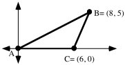

If possible, calculate the area of triangle ABC.

### IV.

Enter as Y1 an expression based on the equation $y={}^{-}0\mathrm{.}73\cdot x+106\mathrm{.}2$.  Then calculate the second coordinate of the point with first coordinate 110.  Give this coordinate accurate to the nearest thousandth.

### V.

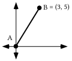

A. Give the slope of the line containing A and B.

B. Give the slope of any line perpendicular to the line containing points A and B.

### VI.

Line $\ell _{1}$ has slope 1.5 and passes through (2,¯2.8) and line $\ell _{2}$ has slope ¯1.7 and passes through (2,3.7).

A. Write an equation for $\ell _{1}$.

B. Write an equation for $\ell _{2}$.

C. Write a system whose solution is the intersection of $\ell _{1}$ and $\ell _{2}$.

### VII.

Give the exact distance between the origin and each of these points:

A. (1,0)  B. $\left( \sqrt{\frac{3}{4}}\mathrm{,}\frac{1}{2} \right)$  C. $\left( \frac{{}^{-}1}{2}\mathrm{,}\sqrt{\frac{3}{4}} \right)$  D. $\left( \sqrt{0\mathrm{.}6}\mathrm{,}{}^{-}\sqrt{0\mathrm{.}4} \right)$

### VIII.

Use the translation technique to compute the exact distance between (1,5) and (12,¯4).

### IX.

Give a 2$\times$1 matrix product for $\left[ \begin{matrix}4 & {}^{-}1 \\ {}^{-}3 & 5\end{matrix} \right]\cdot \left[ \begin{matrix}x \\ y\end{matrix} \right]$

## Assignment #43

### I.

The augmented matrix for a system is

$\left[ \begin{array}{cc|c}2 & 21 & 5 \\ 6 & 8 & 12\end{array} \right]$.

A correct use of four Gauss Elimination steps leads to the augmented matrix:

$\left[ \begin{array}{cc|c}1 & 0 & \frac{106}{55} \\ 0 & 1 & \frac{3}{55}\end{array} \right]$.

A. Copy this symbol and then write to the right of the copied symbol equations for the original system:

$\left\{ \begin{array}{l}\text{ } \\ \text{ } \\ \text{ }\end{array} \right.$

B. Give the solution of the system you gave as your answer to “A” right above.

### II.

For the system, $\left\{ \begin{array}{l}y=2\mathrm{.}3\cdot x+5 \\ y={}^{-}1\mathrm{.}2\cdot x+43\end{array} \right.$, give an equivalent system of the form

$\left\{ \begin{array}{l}\text{a}\cdot x+\text{b}\cdot y=\text{c} \\ \text{d}\cdot x+\text{e}\cdot y=\text{f}\end{array} \right.$

### III.

For the system:  $\left\{ \begin{array}{l}\hspace{0.75em}3\cdot x+1\cdot y=1 \\ {}^{-}2\cdot x+{}^{-}3\cdot y=4\end{array} \right.$

A. Give the matrix of coefficients.

B. Give the matrix of constants.

### IV.

<strong>Gauss Elimination with Matrices Using Your Calculator</strong>

Look back at question II of assignment #42.  All the changes made as the Gauss Elimination process proceeded were in the coefficients of the variables on the left side of the equal signs, or in the constants in on the right side of the equal signs.

$\left[ \begin{array}{cc|c}3 & 15 & 7 \\ 12 & 9 & 12\end{array} \right]$ could have been used as matricized version of $\left\{ \begin{array}{l}3\cdot x+15\cdot y=7\hspace{0.75em} \\ 12\cdot x+9\cdot y=12\text{ }\end{array} \right.$.  Only the symbols that did not change were removed.  A vertical segment marks the position for the equal signs.  Exactly the same Gauss-Elimination steps used in question II to proceed from $\left\{ \begin{array}{l}3\cdot x+15\cdot y=7\hspace{0.75em} \\ 12\cdot x+9\cdot y=12\text{ }\end{array} \right.$to the equivalent, $\left\{ \begin{array}{l}\hspace{0.5em}1\cdot x+0\cdot y=\frac{13}{17}\hspace{0.5em} \\ \text{ 0}\cdot x\text{+1}\cdot y\text{=}\frac{\text{16}}{\text{51}}\hspace{0.5em}\end{array} \right.$, could have been used to proceed from $\left[ \begin{array}{cc|c}3 & 15 & 7 \\ 12 & 9 & 12\end{array} \right]$ to $\left[ \begin{array}{cc|c}1 & 0 & \frac{13}{17} \\ 0 & 1 & \frac{16}{51}\end{array} \right]$.

A modified version of $\left[ \begin{array}{cc|c}3 & 15 & 7 \\ 12 & 9 & 12\end{array} \right]$, the matricized version of $\left\{ \begin{array}{l}3\cdot x+15\cdot y=7\hspace{0.75em} \\ 12\cdot x+9\cdot y=12\text{ }\end{array} \right.$, can be made to appear on the home screen of your calculator by taking the following steps.

#1-- Enter $\left[ \begin{matrix}3 & 15 \\ 12 & 9\end{matrix} \right]$ as matrix \[A\].  This is called the <strong>matrix of coefficients</strong>.

#2-- Enter $\left[ \begin{matrix}7 \\ 12\end{matrix} \right]$ as matrix \[C\].  This is called the <strong>matrix of constants</strong>.

#3-- Return to the home screen and push \[MATRIX\], select MATH and then select “7:augment” to make “augment (” appear.  Then continue by entering the matrix names “\[A\]” and “\[C\]” to create (” to “augment(\[A\],\[C\])” and push \[ENTER\].  You will then see

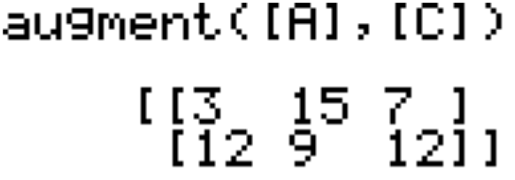.

Your calculator can now be used to proceed with the Gauss-Elimination on this system matrix, which is identified in your calculator’s memory as “Ans.”  In question II of assignment #42, the coding to create system #2 is  $\text{A}_{\text{2}}=\frac{\text{1}}{\text{3}}\cdot \text{A}_{\text{1}}$ and $\text{B}_{\text{2}}=\text{B}_{\text{1}}$.  The coding shows that only the numbers in row 1 of the system matrix are to be changed.  The display below shows the original system matrix, the calculator command that will change the first row by multiplication, and the result:

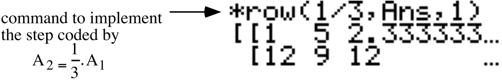.

The “\*row(” command is accessed by pushing \[MATRIX\] selecting MATH and then selecting “\*row(” by pressing ENTER.  The “Ans” is accessed by pushing \[2nd\] and the key labeled in white with the opposite sign.  Do not be concerned about the decimal approximation shown for $\frac{7}{3}$.

In question II of assignment #42, the coding to create system #3 is $\text{A}_{\text{3}}=\text{A}_{\text{2}}$ and $\text{B}_{\text{3}}={}^{-}\text{12}\cdot \text{A}_{\text{2}}+\text{B}_{\text{2}}$.  The display below shows the command used to take this second step in the Gauss-Elimination process with your calculator.

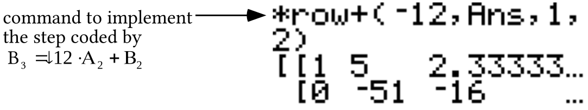

The “\*row+(” command is accessed by pushing \[MATRIX\], selecting MATH and then selecting “:\*row+.”  The home screen will show the following after using the commands “\*row(¯1/51,Ans,2)” and “\*row+(¯5,Ans,2,1)” :

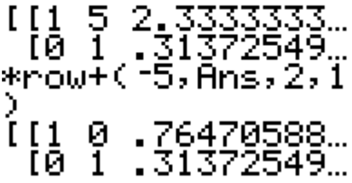

Then by pushing \[MATH\] and selecting “1:Frac” the home screen shows

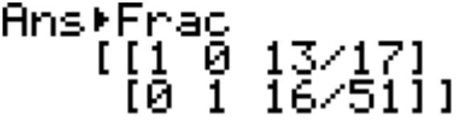.

$\left( \frac{13}{17}\mathrm{,}\frac{16}{51} \right)$ is the solution shared by all five systems.  Notice that the coordinates of this solution appear in column 3 of the final matrix on the screen.

A.  Copy the following sequence of matrices and supply the missing rows according to the Gauss-Elimination coding.  You are encouraged to use some of the Gauss Elimination commands on your calculator to help.  See the introduction to this question for examples. To prepare to do this, first enter the matrix of coefficients and the matrix of constants.  Then augment the matrix of coefficients with the matrix of constants.

Matrix #1: $\left[\begin{array}{cc|c}3 & 1 & 1 \\ {}^{-}2 & {}^{-}3 & 4\end{array}\right]\quad\begin{array}{l}A_1 \\ B_1\end{array}$  Matrix #2: $\left[\begin{array}{cc|c}\phantom{00} & \phantom{00} & \phantom{00} \\ \phantom{00} & \phantom{00} & \phantom{00}\end{array}\right]\quad\begin{array}{l}A_2=\frac13\cdot A_1 \\ B_2=B_1\end{array}$

Matrix #3: $\left[\begin{array}{cc|c}\phantom{00} & \phantom{00} & \phantom{00} \\ \phantom{00} & \phantom{00} & \phantom{00}\end{array}\right]\quad\begin{array}{l}A_3=A_2 \\ B_3=2\cdot A_2+B_2\end{array}$  Matrix #4: $\left[\begin{array}{cc|c}\phantom{00} & \phantom{00} & \phantom{00} \\ \phantom{00} & \phantom{00} & \phantom{00}\end{array}\right]\quad\begin{array}{l}A_4=A_3 \\ B_4=\frac{{}^{-}3}{7}\cdot B_3\end{array}$

Matrix #5: $\left[\begin{array}{cc|c}\phantom{00} & \phantom{00} & \phantom{00} \\ \phantom{00} & \phantom{00} & \phantom{00}\end{array}\right]\quad\begin{array}{l}A_5=\frac{{}^{-}1}{3}\cdot B_4+A_4 \\ B_5=B_4\end{array}$g

B. Give the solution of the system associated with matrix #5.

C. Give the Gauss Elimination commands for your calculator that will create the A2 row, the B3 Row, the B4 row, and the A5 row.

### V.

A.  Examine the systems below and give the Gauss Elimination coding for systems #2 through #5.  The coding should describe how a system is created from the one immediately before it.

System #1: $\left\{ \begin{array}{l}9\cdot x+11\cdot y\hspace{0.5em}=3\hspace{0.75em}\text{A}_{\text{1}} \\ 17\cdot x+11\cdot y=11\hspace{0.5em}\text{B}_{\text{1}}\end{array} \right.$  System #2: $\left\{ \begin{array}{l}\text{ 1}\cdot x+\frac{11}{9}\cdot y\text{ =}\frac{\text{1}}{\text{3}}\hspace{1.25em}\text{A}_{\text{2}}= \\ \text{17}\cdot x+11\cdot y=11\hspace{1.5em}\text{B}_{\text{2}}=\end{array} \right.$

System #3: $\left\{ \begin{array}{l}\hspace{1.5em}1\cdot x+\frac{11}{9}\cdot y=\frac{1}{3}\hspace{0.75em}\text{A}_{\text{3}}= \\ \hspace{0.5em}0\cdot x+\frac{{}^{-}88}{9}\cdot \text{y=}\frac{\text{16}}{\text{3}}\hspace{0.75em}\text{B}_{\text{3}}=\end{array} \right.$  System #4: $\left\{ \begin{array}{l}\hspace{0.5em}1\cdot x+\frac{11}{9}\cdot y=\frac{1}{3}\hspace{0.5em}\text{A}_{\text{4}}= \\ \hspace{0.5em}0\cdot x+1\cdot y=\frac{{}^{-}6}{11}\hspace{0.75em}\text{B}_{\text{4}}=\end{array} \right.$

System #5: $\left\{ \begin{array}{l}\hspace{0.5em}1\cdot x+0\cdot y=1\hspace{1.25em}\text{A}_{\text{5}}= \\ \text{ 0}\cdot x\text{+}1\cdot y\text{=}\frac{{}^{-}6}{\text{11}}\hspace{0.75em}\text{B}_{\text{5}}=\end{array} \right.$

B. Give the solution of System #5.

C. True or False--the solution of system #5 is also a solution of each of the other four systems.

### VI.

Line $\ell _{1}$ has slope 0.6 and passes through (4,¯3.1) and line $\ell _{2}$ has slope ¯0.93 and passes through (4,4.7).

A. Write an equation for $\ell _{1}$.

B. Write an equation for$\ell _{2}$.

C. Write an system of the form $\left\{ \begin{array}{l}\text{a}\cdot x+\text{b}\cdot y=\text{c} \\ \text{d}\cdot x+\text{e}\cdot y=\text{f}\end{array} \right.$ whose solution is the intersection of $\ell _{1}$ and $\ell _{2}$.

### VII.

Enter as Y1 an expression of the line with equation $y={}^{-}0\mathrm{.}51x+121\mathrm{.}2$.  Then at the home screen, calculate the second coordinate of the point with first coordinate 23.  Give this coordinate accurate to the nearest thousandth.

### VIII.

A. Compute the following matrix product:

$\left[ \begin{matrix}1 & 0\mathrm{.}4 \\ 0 & 1\end{matrix} \right]\cdot \left[ \begin{matrix}1 & 0 \\ 0 & 1\end{matrix} \right]$

B. What is the image of (1,0) under the transformation associated with the matrix $\left[ \begin{matrix}1 & 0\mathrm{.}4 \\ 0 & 1\end{matrix} \right]$?

C. What is the image of (0,1) under the transformation associated with the matrix $\left[ \begin{matrix}1 & 0\mathrm{.}4 \\ 0 & 1\end{matrix} \right]$?

### IX.

This question is about the two points represented by (a,b) and (c,d).

A. Represent the image of (c,d) under the same translation that will map (a,b) to the origin.

B. Represent the square of the distance between the origin and your answer to “A” right above.

C. Represent the distance between (a,b) and (c,d).

## Assignment #44

### I.

For the system:  $\left\{ \begin{array}{l}\text{ }1\text{4}\cdot x+21\cdot y={}^{-}17 \\ \hspace{0.5em}20\cdot x+6\cdot y=8\end{array} \right.$

A. Give the matrix of coefficients.

B. Give the matrix of constants.

### II.

A. Copy the following sequence of matrices and supply the missing rows according to the Gauss-Elimination coding.  You are encouraged to use some of the Gauss Elimination commands on your calculator to help.  See the introduction to question IV of the previous assignment for some examples.  To prepare to do this, first enter the matrix of coefficients and the matrix of constants.  Then augment the matrix of coefficients with the matrix of constants.

Matrix #1: $\left[\begin{array}{cc|c}14 & 21 & {}^{-}17 \\ 20 & 6 & 8\end{array}\right]\quad\begin{array}{l}A_1 \\ B_1\end{array}$  Matrix #2: $\left[\begin{array}{cc|c}\phantom{00} & \phantom{00} & \phantom{00} \\ \phantom{00} & \phantom{00} & \phantom{00}\end{array}\right]\quad\begin{array}{l}A_2=\frac1{14}\cdot A_1 \\ B_2=B_1\end{array}$

Matrix #3: $\left[\begin{array}{cc|c}\phantom{00} & \phantom{00} & \phantom{00} \\ \phantom{00} & \phantom{00} & \phantom{00}\end{array}\right]\quad\begin{array}{l}A_3=A_2 \\ B_3={}^{-}20\cdot A_2+B_2\end{array}$  Matrix #4: $\left[\begin{array}{cc|c}\phantom{00} & \phantom{00} & \phantom{00} \\ \phantom{00} & \phantom{00} & \phantom{00}\end{array}\right]\quad\begin{array}{l}A_4=A_3 \\ B_4=\frac{{}^{-}1}{24}\cdot B_3\end{array}$

Matrix #5: $\left[\begin{array}{cc|c}\phantom{00} & \phantom{00} & \phantom{00} \\ \phantom{00} & \phantom{00} & \phantom{00}\end{array}\right]\quad\begin{array}{l}A_5=\frac{{}^{-}3}{2}\cdot B_4+A_4 \\ B_5=B_4\end{array}$

B. Give the solution of the system associated with matrix #5.

C. Give the Gauss Elimination commands for your calculator that will create the A2 row, the B3 Row, the B4 row, and the A5 row (see the “Things for You to Read and Use” section of assignment #43.)

### III.

These questions are about the system:  $\left\{ \begin{array}{l}13x+11y=21 \\ 17x+1y=10\end{array} \right.$

A. Give the matrix of coefficients.

B. Give the matrix of constants.

C. Enter your answers for “A” and “B” above into your calculator as matrix \[A\] and matrix \[C\] respectively.  Then use the “augment” command to join these matrices.  Finally, use the “\*row” and “\*row+” commands to get the augmented matrix for an equivalent system which has as its first two columns are $\begin{array}{l}1 \\ 0\end{array}$ and $\begin{array}{l}0 \\ 1\end{array}$.

D. Give the solution of the system presented at the beginning of this question.

### IV.

<strong>A Reminder About the Matrix Basis Theorem</strong>

All of the transformations we will use in this course preserve collinearity.  If such a transformation also maps (0,0) to itself, there is a matrix for that transformation.  When calculating the images of points using matrix multiplication, each point is represented by a separate column in the pre-image matrix.  Two very important pre-image points are the <strong>basis points</strong>, (1,0) and (0,1).  The pre-image matrix for the basis points is

$\left[ \begin{matrix}1 & 0 \\ 0 & 1\end{matrix} \right]$.

From the description of a transformation, it is often possible to determine the images of (1,0) and (0,1).  This is true when the transformation is a reflection in the <em>x-</em>axis, the        <em>y-</em>axis, the <em>y</em> = <em>x</em>  line, or the <em>y</em> = <em>¯x</em>  line, for example.

Assume that for a certain transformation, the images of (1,0) and (0,1) are (a,b) and (c,d), respectively.  If that same transformation also maps the origin to itself, that transformation has an associated matrix.  Suppose “M” represents that matrix.  Then the relationship expressed by this equation must be true.

$\text{M}\cdot \left[ \begin{matrix}1 & 0 \\ 0 & 1\end{matrix} \right]=\left[ \begin{matrix}\text{a} & \text{c} \\ \text{b} & \text{d}\end{matrix} \right]$

The matrix $\left[ \begin{matrix}1 & 0 \\ 0 & 1\end{matrix} \right]$ is special.  When another 2$\times$2 matrix is multiplied with it, the product is that other matrix.  Thus,  in the case of the product shown above,  matrix M must match

the matrix to the right of the equal sign.  The first column of matrix M, $\left[ \begin{matrix}\text{a} \\ \text{b}\end{matrix} \right]$,  must be the image of (1,0).   The second column,$\left[ \begin{matrix}\text{c} \\ \text{d}\end{matrix} \right]$, must be the image of (0,1).  The preceding statement expresses what is known as the <strong>Matrix Basis Theorem.</strong>

Transformation R is associated with a 2$\times$2 matrix.  The image of (1,0) is $\left( \frac{1}{2}\mathrm{,}\frac{\sqrt{3}}{2} \right)$ and the image of (0,1) is $\left( \frac{{}^{-}\sqrt{3}}{2}\mathrm{,}\frac{1}{2} \right)$.  Use the Matrix Basis Theorem to give the matrix associated with R.

### V.

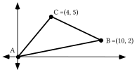

A. If possible, calculate the area of triangle ABC.

B. Give an equation for the line that contains points A and B.

C. Give the slope any line perpendicular to the line for which you wrote an equation as your answer to “B” right above.

D.  Give an equation for the line passing through point C whose slope is your answer to “C” above.

### VI.

Give a system of the form $\left\{ \begin{array}{l}\text{a}\cdot x+\text{b}\cdot y=\text{c} \\ \text{d}\cdot x+\text{e}\cdot y=\text{f}\end{array} \right.$ which is equivalent to the system

$\left\{ \begin{array}{l}y=\frac{1}{5}\cdot x \\ \mathrm{(}y+{}^{-}5\mathrm{)}={}^{-}5\cdot \mathrm{(}x+{}^{-}4\mathrm{)}\end{array} \right.$

### VII.

**800 meter run for men**

| year in which Olympic record was set | record in seconds |
| --- | --- |
| 1948 | 109.2 |
| 1956 | 107.7 |
| 1960 | 106.3 |
| 1964 | 105.1 |
| 1976 | 103.5 |
| 1984 | 103.0 |

A. Enter the data in the table above lists #1 and #2 of your calculator.  Then use the “Med-Med” command to create an equation which “catches the trend” of the data in the table.  Give the coefficients accurate to three decimal places.

B. Enter as Y1 an expression based on the “trend line” equation you gave as your answer to “A” right above. Then calculate, accurate to the nearest hundredth, a prediction of the winning Olympic time in the 800 meter run for men in the year 2020.

### VIII.

**800 meter run for women**

| year in which world record was set | record in seconds |
| --- | --- |
| 1953 | 127.3 |
| 1960 | 124.1 |
| 1964 | 121.5 |
| 1968 | 120.5 |
| 1971 | 118.3 |
| 1983 | 113.28 |

A. Enter the data in the table above into lists #1 and #2 of your calculator.  Then use the “Med-Med” command to create an equation which “catches the trend” of the data in the table.  Give the coefficients accurate to three decimal places.

B. Enter as Y1 an expression describing the “trend line” for which you gave an equation as your answer to “A” right above. Then at the home screen calculate, accurate to the nearest hundredth, a prediction of the world record time in the 800 meter run for women in the year 2020.

### IX.

Use PROGRAM DISTANCE to compute the distance between each pair of points.  Record the complete output on your homework paper:

A. (0,0) and (5,12)    B. (¯4,11.2) and (7,13.45)

### X.

Recall that “Rm” is used to represent the rotation with magnitude “m” centered at (0,0). On your homework make a sketch showing all the following images on one coordinate system:

A. R90(1,0)  B. R180(1,0)  C. R135(1,0)  D. R270(1,0)

E. R-120(1,0)  F. R300(1,0)  G. R-40(1,0)  H. R720(1,0)

## Assignment #45

### I.

<strong>An Outline of an Approach to the Question of Computing the Area of a Triangle and the Use of Calculator Programs to Help with Calculations</strong>

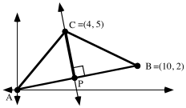

Shown above is the triangle from question V of assignment #44.  The area if this triangle can be computed by using the formula

$\text{Area}=\frac{\text{1}}{\text{2}}\cdot \text{the length of a base}\cdot \text{the length of an altitude to that base.}$

It is convenient to choose side AB as a base because its length is easy to compute.  The altitude to side AB is shown as the segment from point C to point P.  This altitude is part of the line through point C perpendicular to the line containing side AB.

As you read this, you should do the following steps to compute the area of triangle ABC.

Step #1-- compute the length of the chosen base segment, AB.  The exact length is $\sqrt{10^{2}+2^{2}}$.  Since this base length will be used later as a factor, it is a good idea to store if from the home screen by pushing STO, \[ALPHA\] and \[B\].

Step #2-- Write an equation for the line through point C perpendicular to the line containing segment AB.  One equation for this line is:

$\mathrm{(}y+{}^{-}5\mathrm{)}=\frac{{}^{-}10}{2}\cdot \mathrm{(}x+{}^{-}4\mathrm{)}$

Step #3-- Compute the point of intersection, P, of the line containing the altitude with the line containing the base.  This point is the solution of the system

$\left\{ \begin{array}{l}\mathrm{(}y+{}^{-}5\mathrm{)}\text{ }={}^{-}5\cdot \mathrm{(}x+{}^{-}4\mathrm{)} \\ \hspace{2.5em}y=\frac{1}{5}\cdot x\end{array} \right.$

To use PROGRAM SYSTEM to calculate the solution, the equivalent system

$\left\{ \begin{array}{l}5\cdot x+1\cdot y=25 \\ \frac{{}^{-}1}{5}\cdot x+1\cdot y=0\end{array} \right.$

gives$\left[ \begin{matrix}5 & 1 \\ \frac{{}^{-}1}{5} & 1\end{matrix} \right]$as the matrix of coefficients and $\left[ \begin{matrix}25 \\ 0\end{matrix} \right]$ as the matrix of constants.  These matrices should be entered as \[A\] and \[C\].  PROGRAM SYSTEM will give the solution as $\left( \frac{125}{26}\mathrm{,}\frac{25}{26} \right)$.  It is handy to store the first coordinate as “F” and the second coordinate as “S.”

Step #4-- Calculate the length of the altitude segment, CP.  PROGRAM DISTANCE is very handy for doing this.  Enter the coordinates (4,5) and (F,S), the calculator will show

4\.118438838

This is at least a very close approximation of the length of the altitude.  Since it is traditional to represent the length of an altitude with “h,” it is a good idea to store this result as “H.”

Step #5-- At the home screen, calculate the area of the triangle by entering (1/2)\*B\*H and pushing \[ENTER\].  If all goes well you should see “21” as the result.

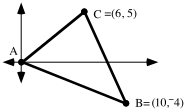

Enter the coordinates of the vertices of the triangle in the illustration above into lists #1 and #2.  Begin <strong>and end</strong> the entries with the coordinates of the origin.  Make a collected scatter plot of the list #1, list #2 points to get a view of the triangle.

A. Write an equation that describes the line that contains the altitude from point C to the line passing through points A and B.  Check your answer by entering an expression for this line as Y1.  Then view a graph to see if the line does in fact go through point C and appears to be perpendicular to the line containing points A and B.  Push \[ZOOM\] and \[5\], to get a more accurate image.  Do not give up until you have succeeded.

B. Write a system in the form $\left\{ \begin{array}{l}\text{a}\cdot x+\text{b}\cdot y=\text{c} \\ \text{d}\cdot x+\text{e}\cdot y=\text{f}\end{array} \right.$ whose solution is the point where the altitude from vertex C meets the line containing points A and B.

C. Use PROGRAM SYSTEM to get the solution you gave as your answer to “C” right above.  Then enter the coordinates of the solution of that system into lists #3 and #4.  Get a view of this point together with the triangle to see if the point with coordinates in list #3 and list #4 lies where it should.  If it does not, check your answer to “B.”  Keep at it until things look right.

### II.

Calculate the distance from (0,0) to each of the following points:

A. $\left( \sqrt{\frac{1}{2}}\mathrm{,}{}^{-}\sqrt{\frac{1}{2}} \right)$  B. $\left( {}^{-}\sqrt{0\mathrm{.}57}\mathrm{,}\sqrt{0\mathrm{.}43} \right)$    C. (cos(132˚), sin(132˚))

### III.

Give the coordinates of one point in each quadrant so that each of these points are exactly one unit from the origin.  Here is a reminder about quadrant numbering:

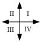

As you give a point, also give the number of its quadrant.  Points that are on either of the coordinates axes are not considered to be in any of the quadrants, so do not use any of these when you give your answers.

### IV.

Give one equation containing two variables which has all four of the points you gave as your answer to III above as solutions.

### V.

<strong>Introducing the Unit Circle--The “Home” of Rotation Images of (1,0)</strong>

The distance from the origin (0,0) to the basis point, (1,0) is 1.  When (1,0) is mapped with any rotation centered at the origin, its image will also be at a distance of 1 from the origin because rotations preserve distance.

This illustration shows several different images of (1,0) under origin centered rotations.  It also shows the circle centered at the origin that contains these images and any other image of (1,0) when mapped with an origin centered rotation. The radius of this circle is 1, or one unit. This circle of rotation images of (1,0) is called “<strong>the unit circle</strong><em><strong>.</strong></em>”

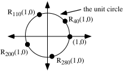

If (1,0) is rotated with the origin centered rotation with magnitude <em>m</em>, then your calculator has the capability of showing at least very close approximations of the coordinates of the image of (1,0), R<em>m</em>(1,0) .  Before using your calculator to view coordinates of rotation images of (1,0), push the \[MODE\] button and make sure that “Degree” in the third line is highlighted. Then to see the first coordinate, push \[COS\] and extend “cos” by keying in the rotation magnitude.  “cos” is an abbreviation of “cosine.”  To see the second coordinate, push \[SIN\] and extend “sin” by keying in the rotation magnitude.  “sin” is an abbreviation for “sine.”

For example, to see very close approximations of the coordinates of R134(1,0),

key in “cos(134)” and the calculator will show “¯.69465483705”

then key in “sin(134)” and the calculator will show “.7193398003”

In summary:

“<strong>cos(m)</strong>” is the first coordinate of the image of (1,0) under the origin centered

rotation, Rm, and “<strong>sin(m)</strong>” is the second coordinate of that image.

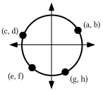

By referring to the illustration above, give the letter that best matches each of the following:

A. cos (155˚)  B. sin (¯70˚)  C. cos (400˚)

D. sin (¯205˚)  E. cos (¯140˚)  F. sin (650˚)

### VI.

A. The equation $x^{2}=4$ has more than one solution, make a list of all the solutions.

B. “Solve” the equation $x^{2}=4$ for “<em>x</em>.”

C. “Solve” the equation $x^{2}+y^{2}=1$ for “<em>y</em>” so that an entry can be found for the \[Y=\] list.

### VII.

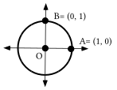

Trace the illustration above onto your homework paper.

A. Add to the tracing a sketch of the image of A under R40.  Label this image “A'.”

B. Also add to the tracing the image of B under R40.  Label this image “B'.”

C. Give the measure of angle AOB.

D. Give the measure of angle A'OB' and give a reason for your answer.

### VIII.

Under transformation R, the image of (1,0) is $\left( \frac{\sqrt{2}}{2}\mathrm{,}\frac{\sqrt{2}}{2} \right)$ and the image of (0,1) is $\left( \frac{{}^{-}\sqrt{2}}{2}\mathrm{,}\frac{\sqrt{2}}{2} \right)$.  Transformation R is associated with a matrix.  Give that matrix.

### IX.

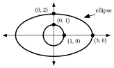

Use the Matrix Basis Theorem to give the matrix associated with the transformation you think will map the unit circle onto the ellipse in the illustration above.

## Assignment #46

### I.

Enter the coordinates of the vertices of the triangle in the illustration below into lists #1 and #2.  Begin <em>and end</em> the entries with the coordinates of the origin.  Get a view of the triangle by making a connected scatter plot of the list #1, list #2 points.

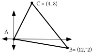

A. Write an equation for the line that contains the altitude from point C to the line containing points A and B.  Check your answer by entering an expression for this line as Y1 and viewing a graph to see if the line does in fact go through point C and appears to be perpendicular to the line containing points A and B. Do not give up until you have succeeded.

B. Write a system in the form $\left\{ \begin{array}{l}\text{a}\cdot x+\text{b}\cdot y=\text{c} \\ \text{d}\cdot x+\text{e}\cdot y=\text{f}\end{array} \right.$ whose solution is the point where the altitude from vertex C meets the line containing points A and B.

C. Use PROGRAM SYSTEM to get the solution you gave as your answer to “B” right above.  Then enter the coordinates of that solution into lists #3 and #4.  Get a view of this point together with the triangle to see if the point with coordinates in list #3 and list #4 lies where it should.  If it does not, check your answer to “B.”   Keep at it until things look right.

### II.

Transformation R maps (1,0) to $\left( \frac{{}^{-}\sqrt{3}}{2}\mathrm{,}\frac{1}{2} \right)$and (0,1) to $\left( \frac{{}^{-}1}{2}\mathrm{,}\frac{{}^{-}\sqrt{3}}{2} \right)$. There is a matrix associated with R.  Give that matrix.

### III.

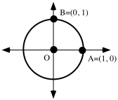

Trace the illustration above onto your homework paper.  Then do each of the following:

A. Add to the tracing a sketch of the image of A under R110.  Label this image “A'.”

B. Also add to the tracing the image of B under R110.  Label this image “B'.”

C. Give the measure of angle AOB.

D. Give the measure of angle A'OB' and give a reason for your answer.

E. Represent the origin centered rotation that will map A' onto B'.

### IV.

<strong>Getting an Image of the Unit Circle on Your Calculator</strong>

$x^{2}+y^{2}=1$, an equation for the unit circle, cannot be entered into the \[Y=\] list of your calculator.  This equation is equivalent to $y^{2}=1-x^{2}$, but this equation also cannot be entered into the \[Y=\] list because there is no way to insert the exponent, “2”, above the “Y.”  However, it is possible to get a fairly good representation of the unit circle by making two separate entries in the \[Y=\] list.  These entries can be:

Y1 = $\sqrt{\text{ }}\mathrm{(}1-\text{X}^{2}\mathrm{)}$ and  Y2 = ${}^{-}\sqrt{\text{ }}\mathrm{(}1-\text{X}^{2}\mathrm{)}$.

On that portion of the unit circle on or above the $x-\text{axis}$, the points have non-negative second coordinates.  A representation of these points comes from the calculator processing the equation Y1 = $\sqrt{\text{ }}\mathrm{(}1-\text{X}^{2}\mathrm{)}$, since the radical symbol, without an opposite sign “¯” to its left, represents only non-negative square roots.  The unit circle points below the $x-\text{axis}$ have negative second coordinates and the representation of these points is created by processing the equation Y2 = ${}^{-}\sqrt{\text{ }}\mathrm{(}1-\text{X}^{2}\mathrm{)}$.  <strong>The need to use two different equations, one for non-negative square roots and one for negative square roots emphasizes the fact that all positive real numbers have both a positive and a negative square root.</strong>

Give expressions for Y1 and Y2 that can be used together to generate a “reasonably good” graph of the unit circle.

### V.

<strong>An Equation for the Unit Circle</strong>

(1,0), $\mathrm{(}{}^{-}\sqrt{0\mathrm{.}7}\mathrm{,}\sqrt{0\mathrm{.}3}\mathrm{)}$, and (cos(¯130˚), sin(¯130˚)) all lie on the circle with radius 1 centered at the origin, the unit circle.  For the second of the three points, this is confirmed by the calculation

.

(1,0) is obviously 1 unit from the origin. When rotating about the origin, the origin is its own image.  Therefore we can be assured that (cos(¯130˚), sin(¯130˚)) is also 1 unit from the origin because it is the image of (1,0) under a rotation centered at the origin and rotations preserve distance.

The following distance calculations that can be made with your calculator confirm what is already known for other reasons:

$\sqrt{1^{2}+0^{2}}=\sqrt{1}=1$

$\sqrt{\mathrm{(cos(}{}^{-}130^{\text{o}}\mathrm{))}^{2}+\mathrm{(sin(}{}^{-}130^{\text{o}}\mathrm{))}^{2}}=1$.

The usefulness of seeing these calculations is to bring out the fact that for the three points, (1,0), $\mathrm{(}{}^{-}\sqrt{0\mathrm{.}7}\mathrm{,}\sqrt{0\mathrm{.}3}\mathrm{)}$, and (cos(¯130˚), sin(¯130˚)), the sum of the squares of the coordinates is 1.  This is also true for all other points on the unit circle.  This means that

$x^{2}+y^{2}=1$

has all the points on the unit circle as solutions.  Furthermore, any solution of this equation is a point 1 unit from the origin and therefore on the unit circle.  Therefore

$x^{2}+y^{2}=1$ <strong>is an equation whose solutions are all points on the unit circle. It is also true that all the points on the unit circle are solutions of this equation.  This is why</strong> $x^{2}+y^{2}=1$<strong>is an equation for the unit circle.</strong>

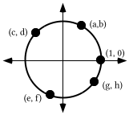

The figure containing the highlighted points is the unit circle.

A. How far is the point, (a,b) from the origin?

B. Give the exact numerical value of each of the following:

1\. $\text{a}^{\text{2}}+\text{b}^{\text{2}}$  2. $\text{e}^{\text{2}}+\text{f }^{\text{2}}$

C. Give one equation with two variables which has as its solutions all four of the highlighted points as well as all the other points on the unit circle.

D. Refer to the illustration above and give the letter that best matches each of the following:

1\. cos (¯380˚)  2. sin (130˚)  3. cos (¯105˚)

4\. sin (¯230˚)  5. cos (700˚)  6. sin (255˚)

### VI.

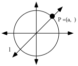

In the illustration above, point P is the image of (1,0) under R45.

A. Give an equation for line $\ell$.

B. What is the distance of point P from the origin?

C. Give a representation of the second coordinate of point P without using “sin.”

D. Give the two solutions of the equation

$\text{a}^{\text{2}}+\text{a}^{\text{2}}=\text{1}$

### VII.

A. Use your calculator to compute approximations of each of the following rounded to the fifth decimal place.

1\. $\sqrt{\frac{1}{2}}$  2. $\frac{1}{\sqrt{2}}$

B. Give an equivalent to $\frac{1}{\sqrt{2}}\cdot \frac{\sqrt{2}}{\sqrt{2}}$ in the form of a fraction without a radical sign, “$\sqrt{\text{ }}$,” in the denominator.

## Assignment #47

### I.

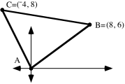

A. Write an equation for line $\ell _{1}$, the line passing through A and C.

B. Write an equation for line $\ell _{2}$, the line through B that is perpendicular to $\ell _{1}$.

C. Write a system of the form $\left\{ \begin{array}{l}\text{a}\cdot x+\text{b}\cdot y=\text{c} \\ \text{d}\cdot x+\text{e}\cdot y=\text{f}\end{array} \right.$ whose solution is the intersection of $\ell _{1}$ and $\ell _{2}$.

D. Use Program SYSTEM to give the exact coordinates of point D, the intersection of $\ell _{1}$ and $\ell _{2}$.

E. Use program DISTANCE to get the distance from point B to point D (see “D” right above) accurate to four decimal places.

F. Somehow determine the exact length of side AC.

G. Compute the area of triangle ABC accurate to four decimal places.

### II.

Transformation R can be represented by a matrix.  The image of (1,0) is $\left( \frac{\sqrt{3}}{2}\mathrm{,}\frac{1}{2} \right)$and the image of (0,1) is $\left( \frac{{}^{-}1}{2}\mathrm{,}\frac{\sqrt{3}}{2} \right)$.  Use the Matrix Basis Theorem to give the matrix for transformation R.

### III.

A. Give the matrix for R90.

B. Use your answer to “A” right above to give an exact representation of the image of (cos (57˚), sin (57˚)) under R90.

C. Your answer to “B” right above is the image of (0,1) under Rm, where m is between 0˚ and 360˚.  Give the value of “m.”

### IV.

<strong>The 45˚ Point</strong>

Your calculator can give you at least very close approximations of the coordinates of the image of (1,0) under any origin-centered rotation.  However, you will be asked to memorize the image of (1,0) under three rotations.  This is because it is possible that you will need to use these images to do questions on College Board Tests.  For certain types of questions it is to your advantage to know the exact coordinates of an image rather than a close approximation coming from your calculator.  One of the three images you should learn is R45(1,0).  This image will be known as the “45 degree point.”

The 45 degree point is shown as point P in the illustration above.  Because point P is on the $y=x$ line, the second coordinate equals the first coordinate.  Therefore point P is represented by (a,a).  Because point P is on the unit circle, it is a distance of 1 from the origin.  This means that

$\text{a}^{\text{2}}+\text{a}^{2}=1^{2}=1$.

The following equations are equivalent

$\begin{array}{l}\text{a}^{\text{2}}+\text{a}^{\text{2}}=\text{1} \\ \hspace{1.25em}\text{2}\cdot \text{a}^{\text{2}}=\text{1} \\ \hspace{1.75em}\text{a}^{\text{2}}=\frac{\text{1}}{\text{2}}\end{array}$.

Each of these equations have the same two solutions, the two square roots of $\frac{1}{2}$.  The relevant solution is the positive square root because point P is in the first quadrant.  Here is a chain of representations of the number which is both the first and second coordinate of point P:

$\sqrt{\frac{1}{2}}=\frac{\sqrt{1}}{\sqrt{2}}=\frac{1}{\sqrt{2}}=\frac{1}{\sqrt{2}}\cdot \frac{\sqrt{2}}{\sqrt{2}}=\frac{\sqrt{2}}{2}$

The last representation in the chain is the one most commonly used.

In summary, you should memorize the fact that

R45(1,0) = (cos (45˚), sin (45˚)) =$\left( \frac{\sqrt{2}}{2}\mathrm{,}\frac{\sqrt{2}}{2} \right)$.

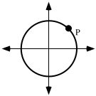

Trace the figure above onto your homework paper.

A. If point P is the image of (1,0) under R45, give the exact coordinates of P without using either “cos” or “sin.”

B. Add to your sketch a point representing the image of (0,1) under R45.  Label this point “Q.”

C. Give the exact coordinates of point Q, again without using either “cos” or “sin.”

D. Give the matrix associated with R45.

### V.

A. With your calculator in “Par” MODE, copy and complete these expressions for X1T and Y1T from which your calculator can generate a complete view of the unit circle.

X1T =       Y1T =

B. Push the \[WINDOW\] key on your calculator and change the TStep setting to 90.  Then push \[GRAPH\] and copy the figure the calculator has graphed.  On your sketch, label the coordinates of the points where the figure intersects the coordinate axes.

### VI.

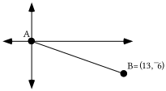

Use a size transformation to get the exact coordinates of the point two-thirds of the way from point A to point B.

### VII.

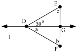

A. In the figure above, triangle DFG is the image of triangle DEG under a reflection in line $\ell$.  Give the angle measures represented by “a,” “b” and “c.”

B. If side DE has a length of 1, what is the length of segment EF?

### VIII.

Use your calculator to compute approximations of each of the following rounded to the fifth decimal place.

A. $\sqrt{\frac{3}{4}}$          B. $\frac{\sqrt{3}}{\sqrt{4}}$

## Assignment #48

### I.

<strong>Matrices for Origin Centered Rotations</strong>

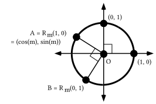

(0,0) is its own image under any rotation centered at the origin.  Therefore any origin centered rotation can be associated with a matrix.  The Matrix Basis Theorem tells us that columns of the matrix are the images of (1,0) and (0,1).  Under an origin centered rotation with magnitude “m” the image of (1,0) is (cos(m),sin(m)).

When cos(m) is entered for the 1,1 address and sin(m) is entered for the 2,1 address of a 2X2 matrix the calculator will show at least very close approximations of the coordinates of the image of (1,0).  The question then becomes what to enter in the 1,2 and 2,2 addresses for the coordinates of the image of (0,1).  The illustration above suggests an answer.  Angle AOB has a measure of 90˚.  This means that point B is the image of point A under R90.   The matrix for R90, $\left[ \begin{matrix}0 & {}^{-}1 \\ 1 & 0\end{matrix} \right]$, is easy to write from the Matrix Basis Theorem.  Therefore, the following matrix product gives a way to represent that image using “cos” and “sin.”

$\left[ \begin{matrix}\text{0} & {}^{-}\text{1} \\ \text{1} & \text{0}\end{matrix} \right]\cdot \left[ \begin{matrix}\text{cos(m)} \\ \text{sin(m)}\end{matrix} \right]=\left[ \begin{matrix}{}^{-}\text{sin(m)} \\ \text{cos(m)}\end{matrix} \right]$.

Point B in the illustration thus has coordinates (¯sin(m), cos(m)).  In summary,

The origin centered rotation with magnitude “m” is associated with the matrix

$\left[ \begin{matrix}\text{cos(m)} & {}^{-}\text{sin(m)} \\ \text{sin(m)} & \text{cos(m)}\end{matrix} \right]$

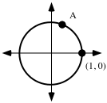

Trace the above illustration onto your homework paper.

A. Point A is the image of (1,0) under R70.  Add to your tracing the image of (0,1) under the same rotation.  Label this image “B.”

B. Use “cos” and “sin” notation to give the exact coordinates of point A.

C. Give the matrix for the rotation that will map point A onto point B.

D. Calculate from your answers to “B” and “C” the exact coordinates of point B.

E. Give the matrix for R70.

F. Write the matrix, $\left[ \begin{matrix}\text{L}\text{1} \\ \text{L}\text{2}\end{matrix} \right]$, to the right of your answer to “E” right above and compute the product.

### II.

Get your calculator to create a connected scatter plot of the segment with endpoints at (3,3) and (5,10).  Copy and complete the commands “L3 =” and “L4 =” that can be used to create lists #3 and #4 so that they contain the image of the segment under R70, the origin centered rotation with magnitude 70˚.

### III.

Make sure your calculator is set to parametric mode and then use your calculator to generate a graph of the TStep 90 square.  Then push the \[Y=\] key and enter expressions for X2T and Y2T so that they are:

X2T = X1T + 3

Y2T = Y1T + 2.

You can get “X1T” by pushing \[VARS\], selecting the YVARS sub menu, then selecting the Parametric sub-sub menu and finally, selecting “1:X1T”  You can get “Y1T” in a similar fashion.  Before generating a graph, push the \[WINDOW\] key and make the following settings:

Xmin = ¯1.1

Xmax = 4.5

Xscl = 0

Ymin = ¯1.1

Ymax = 3.5

Yscl = 0

Now push \[ZOOM\] and select “5:ZSquare.”  There will be some distortion in the graphs because of the characteristics of the calculator.  However, you should be able give an image formula for a transformation that will map the TStep 90 square onto the second figure graphed.  Do this.

### IV.

A. In each case use the Matrix Basis Theorem to give the matrix associated with the given transformation:

1\. R-90    2. $r_{y=x}$

B. In each case use your answers for “A” right above and the Matrix-Transformation Isomorphism Theorem to calculate the matrix associated with the given composite:

1\. $\text{R}_{{}^{-}90}\circ r_{y=x}$          2. $r_{y=x}\circ \text{R}_{{}^{-}90}$

### V.

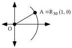

Trace the figure above onto your homework paper.  Add to the tracing A', the image of A under a reflection in the $x-\text{axis}$.  Then sketch the segment from A to A' and label its intersection with the $x-\text{axis}$ “B.”

A. Give the length of OA  B. Give the length of OA'

C. Give the length of AA'  D. Give the length of AB

### VI.

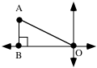

In the figure above, the length of AB is $\frac{1}{2}$ and the length of OA is 1.

A. Give the exact length of OB.

B. Give the coordinates of point A.

### VII.

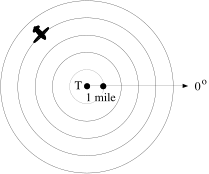

If your were in a control tower at point T and you saw the image of an airplane on your radar screen as shown, how could you describe the location of the plane?

### VIII.

In each case, give the image of (1,0) under the given composite:

A. $\text{R}_{\text{90}}\circ \text{S}_{\text{4}}$          B. $\text{R}_{{}^{-}\text{90}}\circ \text{S}_{{}^{-}\text{4}}$

### IX.

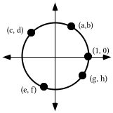

A. (g,h) is a point on the unit circle.  Give the exact numerical value of $\text{g}^{\text{2}}+\text{h}^{\text{2}}$.

B. Give one equation with two variables whose solutions are all the points on the circle in the illustration above.

C. By referring to the illustration above, give the letter that best matches each of the following:

1\. sin (¯380˚)  2. cos (130˚)  3. sin (¯105˚)

4\. cos (¯230˚)  5. sin (700˚)  6. cos (255˚)

7\. the second coordinate of R70(1,0)

8\. the first coordinate of R-230(1,0)

## Assignment #49

### I.

<strong>The 30˚ Point</strong>

You should already have memorized the fact that R45(1,0) =(cos(45˚), sin(45˚)) = $\left( \frac{\sqrt{2}}{2}\mathrm{,}\frac{\sqrt{2}}{2} \right)$.  The illustrations below help determine commonly used expressions for the coordinates of A = R30(1,0) = (cos(30˚), sin(30˚)), the 30 degree point.

In the illustration, point A' is the image of point A under a reflection in the $x-\text{axis}$.  Because reflections preserve angle measure, angle BOA has the same measure as angle BOA, 30˚. Therefore angle AOA' of triangle AOB has a measure of 60˚.  Since the total of the measures of the angles of triangle AOA' is 180˚, the total of the measures of angles OAB and OA'B is 120˚.  But these two angles each have the same measure, again because reflections preserve angle measure.  Therefore all three angles of triangle AOA' have measure 60˚.

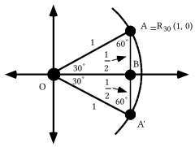

If the three angle measures of a triangle are equal, so are the lengths of the three sides.  Therefore all three sides of triangle AOA' have the length of side OA, 1.  Segments AB and BA' have the same length because reflections preserve distance.  Since segment AA' has length of 1, segments AB and BA' each have length $\frac{1}{2}$.

The next illustration gives an isolated view of triangle AOB.  The calculations under segment OB show how the Pythagorean Theorem can be used to help get a representation of the length of that segment.  Since point A is in the first quadrant, its first coordinate is the length of segment OB and its second coordinate is the length of segment AB.

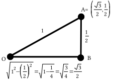

You should now memorize the fact that:

R30(1,0) = (cos(30˚), sin(30˚)) = $\left( \frac{\sqrt{3}}{2}\mathrm{,}\frac{1}{2} \right)$.

Give the exact matrix for R30 without using “cos” or “sin” in your answer.

### II.

Make sure your calculator is in parametric mode and then use your calculator to generate a graph of the TStep 90 square.  Then push the \[Y=\] key and enter expressions for X2T and Y2T so that they are:

X2T = 3.X1T

Y2T = 2.Y1T

Remember, you can get “X1T” by going to the Parametric sub-sub menu of the Y-VARS sub menu after pushing \[VARS\].  You can get “Y1T” in a similar fashion.  Before generating a graph, push the \[WINDOW\] key and make the following settings:

Xmin = ¯3.1

Xmax = 3.1

Xscl = 0

Ymin = ¯3.1

Ymax = 3.1

Yscl = 0

Now push \[ZOOM\] and select “5:ZSquare.”  There will be some distortion in the graphs because of the characteristics of the calculator.  However, you should be able to copy and complete the equation “$\text{S}\mathrm{(}x\mathrm{,}y\mathrm{)}=$” so that it becomes an image formula for a transformation, S,  that will map the TStep 90 square onto the second figure graphed.  Do this.

### III.

Identify a transformation which you think would map the TStep 90 square onto a square with the same center which has two vertical sides and two horizontal sides.

### IV.

Compute the following matrix product:

$\left[ \begin{matrix}\frac{\sqrt{2}}{2} & \frac{{}^{-}\sqrt{2}}{2} \\ \frac{\sqrt{2}}{2} & \frac{\sqrt{2}}{2}\end{matrix} \right]\cdot \left[ \begin{matrix}\text{X}\text{1T} \\ \text{Y}\text{1T}\end{matrix} \right]$

### V.

A. Use “cos” and “sin” to help give the exact matrix for R33.

B. Use “cos” and “sin” to help give the exact matrix for R57.

C. Use your calculator to compute the product of your answers for “A” and “B” above.  Give that product on your homework paper.

D. By a reverse use of the Matrix Basis Theorem, give the transformation associated with your answer to “C” right above.

### VI.

A. Give the exact matrix for R113.

B. Give a matrix of the form $\left[ \begin{matrix}\mathrm{cos(}\alpha \mathrm{)} & {}^{-}\mathrm{sin(}\alpha \mathrm{)} \\ \mathrm{sin(}\alpha \mathrm{)} & \mathrm{cos(}\alpha \mathrm{)}\end{matrix} \right]$ which meets the following two conditions:

#1: When the matrix is entered and then viewed at the home screen it will match the view of your answer to “A” exactly.

#2: The value you use for “$\alpha$ ” is not 113.

### VII.

In each case give the image of (1,0) under the given composite:

A. $\text{R}_{\text{90}}\circ \text{S}_{{}^{-}\text{3}}$

B. $\text{R}_{\text{270}}\circ \text{S}_{\text{3}}$

### VIII.

Trace the illustration at the top of the next page onto your homework paper:

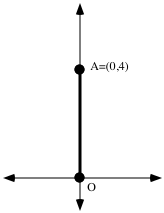

A. Sketch the image of segment OA under the composite $\text{R}_{\text{60}}\circ \text{S}_{\frac{\text{1}}{\text{2}}}$.  Then label the image of A with A'

B. Now add to your sketch the image of segment OA' under the translation    T:T(<em>x</em>, <em>y</em>) = (<em>x</em> + 0, <em>y</em> + 4).  Label the image of A' with  A" = (c,d).

C. Next add to your sketch the image of segment OA' under the composite $\text{R}_{\text{60}}\circ \text{S}_{\frac{\text{1}}{\text{2}}}$.  Label the image of A' with A'''

D. Finally, add to your sketch the image of segment OA''' under the translation T:T($x\mathrm{,}y\mathrm{)}=\mathrm{(}x+\text{c}\mathrm{,}y+\text{d}\mathrm{)}$.  (See “B” right above to see the values represented by “c” and “d.”)

### IX.

In this question you will use the horizontal translation, Th with image formula

Th(<em>x</em>, <em>y</em>) = (<em>x</em> + ¯4, <em>y</em> )

and the vertical translation Tv with image formula

Tv(<em>x</em>, <em>y</em>) = (<em>x</em>, <em>y</em> + 5).

Give the image of (0,0) under the composite $\text{T}_{\text{v}}\circ \text{T}_{\text{h.}}$

## Assignment #50

### I.

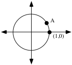

Trace the figure above onto your homework paper.  Point A = R30(1,0).

A. Give the exact coordinates of point A without using either “cos” or “sin.”

B. Add to the tracing a dot representing A', the image of point A under a reflection in the $x-\text{axis}\mathrm{.}$  Also label the coordinates of A'

C. A' is the image of (1,0) under Rm.  Give four different possible values for m.

D. Add to your tracing any other points on the unit circle whose coordinates can be determined because they are the images of point A or each other under “simple” transformations.

### II.

A. On your homework paper make a sketch of the unit circle together with the $y=x$ line.

B. Use the Matrix Basis Theorem to give the matrix for a reflection in the $y=x$ line.

C. Multiply $\left[ \begin{matrix}x \\ y\end{matrix} \right]$ with your answer to “B” on the left to get what you need to copy and complete the following image formula:

$r_{y=x}\mathrm{(}x\mathrm{,}y\mathrm{)}=$

D. Give $r_{y=x}\mathrm{(}\frac{\sqrt{3}}{2}\mathrm{,}\frac{1}{2}\mathrm{)}$ as an ordered pair.

E. Give the smallest positive magnitude for the origin centered rotation that will map (1,0) to $r_{y=x}\mathrm{(}\frac{\sqrt{3}}{2}\mathrm{,}\frac{1}{2}\mathrm{)}$.

### III.

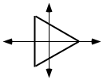

An image like that above can be generated by using X1T = cos(T) and Y1T = sin(T) if the TStep is set correctly.  By trial and error, determine such a Tstep setting and write it on your homework paper.

### IV.

A. Give the exact matrix for R70.

B. Use your answer to “A” right above to calculate entries for X2T and Y2T that can be used to generate a view of the image of the TStep 90 square when it is mapped with R70.

### V.

A. Give the exact matrix for R110.  B. Give the exact matrix for R70.

C. Use your calculator to compute the product of your answers for “A” and “B.”  Write this product on your homework paper.

D. By a reverse use of the Matrix Basis Theorem, give the transformation associated with your answer to “C.”

### VI.

A. Give the matrix for R-20.

B. Give four different values for “$\alpha$ ” so that if your enter $\left[ \begin{matrix}\mathrm{cos(}\alpha \mathrm{)} & {}^{-}\mathrm{sin(}\alpha \mathrm{)} \\ \mathrm{sin(}\alpha \mathrm{)} & \mathrm{cos(}\alpha \mathrm{)}\end{matrix} \right]$, the home screen view of the matrix would match exactly the home screen view of your answer for “A” right above.

### VII.

A. If a point is somewhere on the $x-\text{axis}$, what must its second coordinate be?

B. Give the solution of this equation:  0 + 7 = 5.(<em>x</em> + ¯3)

### VIII.

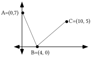

A. Compute the total distance from A to B to C accurate to four decimal places.

B. Give the coordinates of another point, D,  on the $x-\text{axis}$ different from point B.

C. Compute the total distance from A down to point D and back to point C accurate to four decimal places.

### IX.

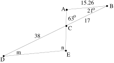

In the above figure, segment AB is parallel to segment DE.

A. Give the angle measure represented by “m.”

B. Give the angle measure represented by “n.”

C. Give the magnitude of the size transformation centered at C that will map triangle ABC onto triangle EDC.

D. Give the magnitude of the size transformation centered at C that will map triangle EDC onto triangle ABC.

E. Calculate the length of segment DE accurate to the nearest hundredth.

### X.

In the illustration below, segments AB and AC are half as long as segment OA.

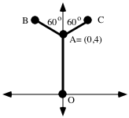

A. Carefully describe how segment OA can be mapped onto segment AB with a sequence of transformations.  Carefully describe each transformation in your sequence

B. Carefully describe how segment OA can be mapped onto segment AC.

### XI.

<strong>Mapping (1,0) to Any Other Point in the Coordinate Plane Other than the Origin</strong>

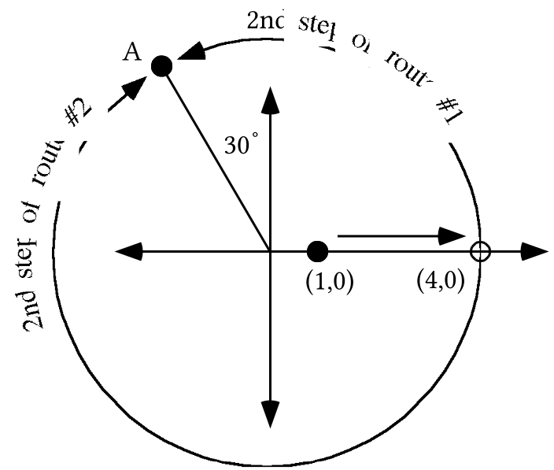

In the illustration above, point A is at a distance of 4 from the origin.  Four routes for mapping (1,0) to point A are shown.  In the illustration, both “routes” taking (1,0) to point A begin with the origin centered size transformation with magnitude 4.  Route #1 is finished with the origin centered rotation with magnitude 120˚, while route #2 is finished with the origin centered rotation with magnitude -240˚.  The following composites create the routes:

Route #1:  $\text{R}_{\text{120}}\circ \text{S}_{\text{4}}$  Route #2:  $\text{R}_{{}^{-}\text{240}}\circ \text{S}_{\text{4}}$

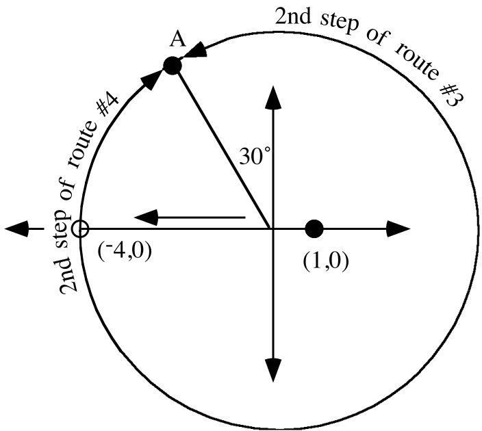

In the illustration above two alternative routes are shown for moving (1,0) to point A.  In these cases (1,0) is first moved to (¯4,0) by the origin centered size transformation with magnitude ¯4.  The second step of route #3 is covered when the first image is rotated with R240 while the second step of route #4 is covered when the first image is rotated with R-120.  The following composites create these routes:

Route #3:  $\text{R}_{\text{300}}\circ \text{S}_{{}^{-}\text{4}}$  Route #4:  $\text{R}_{{}^{-}60}\circ \text{S}_{{}^{-}\text{4}}$

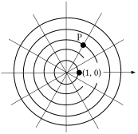

All of the smallest angles shown above with the origin as their vertex have a measure of 30˚.  Use “S” notation and “R” notation to answer the following questions:

A. Give a composite of a rotation after a size transformation that will map (1,0) to point P.

B. Give a second, third and fourth composite of a rotation after a size transformation that will map (1,0) to point P.  Either the size transformations or the rotations, or even both should be different that you used to answer “A.”

### XII.

In this question you will use the horizontal translation, Th with image formula

Th(<em>x</em>,<em>y</em>) = (<em>x</em> +2,<em>y</em>)

and the vertical translation Tv with image formula

Tv(<em>x,y</em>) = (<em>x</em>,<em>y</em> +¯6).

Give the image of (0,0) under the composite $\text{T}_{\text{v}}\circ \text{T}_{\text{h.}}$

## Assignment #51

### I.

<strong>The 60˚ Point</strong>

The third and final first quadrant rotation image of (1,0) that you should memorize is R60(1,0).

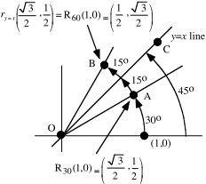

In the above illustration point A is the 30˚ point.  Point B is the image of point A under a reflection in the <em>y = x</em>  line.  Thus the following matrix computation gives the coordinates of point B.

$\left[\begin{array}{cc}0 & 1 \\ 1 & 0\end{array}\right]\cdot\left[\begin{array}{c}\frac{\sqrt3}{2} \\ \frac12\end{array}\right]=\left[\begin{array}{c}\frac12 \\ \frac{\sqrt3}{2}\end{array}\right]=\left(\frac12,\frac{\sqrt3}{2}\right)$

Point B is also the image of (1,0) under a rotation centered at the origin. Here is a way to determine the smallest positive magnitude of that rotation:

(1,0) can be mapped onto the <em>y = x</em>  line by R45, therefore angle AOC has measure 15˚.  But since reflections preserve angle measure, angle COB also has a measure of 15˚.  Thus point B is the image of (1,0) under R60.

Here is a summary of the three rotation images in the first quadrant you should have memorized:

$\text{R}_{30}\mathrm{(}1\mathrm{,}0\mathrm{)}=\left( \frac{\sqrt{3}}{2}\mathrm{,}\frac{1}{2} \right)$     $\text{R}_{45}\mathrm{(}1\mathrm{,}0\mathrm{)}=\left( \frac{\sqrt{2}}{2}\mathrm{,}\frac{\sqrt{2}}{2} \right)$        and      $\text{R}_{60}\mathrm{(}1\mathrm{,}0\mathrm{)}=\left( \frac{1}{2}\mathrm{,}\frac{\sqrt{3}}{2} \right)$

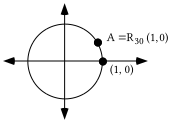

Trace the figure above onto your homework paper.

A. Sketch A' = $r_{y=x}\mathrm{(}\text{A}\mathrm{)}$ and give its coordinates without using “cos” or “sin.”

B. Give the exact matrix for R60 without using “cos” or “sin.”

C. Now add to the tracing A" = $r_{y}$(A') and label its coordinates.

D. Give the exact matrix for R-240 without using “cos” or “sin.”

E. Give the exact matrix for R300 without using “cos” or “sin.”

### II.

The first figure below was generated from both

X1T = cos(T)        Y1T = sin(T)

and

X2T = $\mathrm{(}\sqrt{2}\mathrm{/}2\mathrm{)}\text{X}\text{1T}+\text{(}{}^{-}\sqrt{\text{2}}\text{/2)Y}\text{1T}$     Y2T = $\mathrm{(}\sqrt{2}\mathrm{/}2\mathrm{)}\text{X}\text{1T}+\text{(}\sqrt{\text{2}}\text{/2)Y}\text{1T}$

Give expressions for X3T and Y3T, and for X4T and Y4T from which your calculator can generate the second and third images shown in the figure below.  The point P is (3,2).

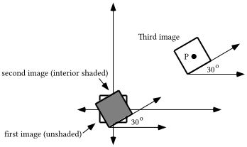

### III.

The unshaded triangle below can be generated from

X1T = cos(T)

Y1T = sin(T)

with TStep = 120.  Give expressions for X2T and Y2T from which your calculator will also generate a graph of the image.

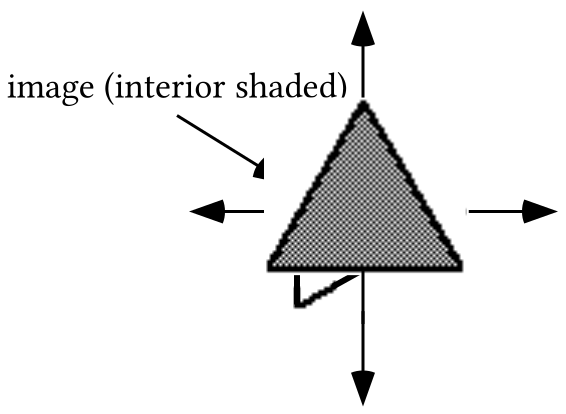

### IV.

A. Give the solution of this equation:

$0+{}^{-}4=\sqrt{3}\cdot \mathrm{(}x+2\mathrm{)}$

B. Give the coordinates of the point where the line with equation $y+{}^{-}4=\sqrt{3}\cdot \mathrm{(}x+2\mathrm{)}$intersects the $x-\text{axis}\mathrm{.}$

### V.

In the illustration above, point C' is the image of point C under a reflection in line $\ell$.  Also, point B is collinear with points A and C. Below you will be asked how two distances compare.  If they are equal say so.  If they are not equal, one will be greater than the other.  If one is greater than the other, say which is the greater in a complete sentence.

A. How does the distance from B to C compare to the distance from B to C'?  Give a reason for your answer.

B. How does the distance from A to B to C compare to the distance from A to B to C'?

C. How does the distance from D to C compare to the distance from D to C'?  Give a reason for your answer.

D. How does the distance from A to D to C compare to the distance from A to D to C'?

E. How does the distance from A to B to C' compare to the distance from A to D to C'?

F. How does the distance from A to B to C compare to the distance from A to D to C?

### VI.

Matrix \[A\] = $\left[ \begin{matrix}\mathrm{cos(}160^{\text{o}}\mathrm{)} & {}^{-}\mathrm{sin(}160^{\text{o}}\mathrm{)} \\ \mathrm{sin(}160^{\text{o}}\mathrm{)} & \mathrm{cos(}160^{\text{o}}\mathrm{)}\end{matrix} \right]$.  Give matrix \[B\] so that \[A\].\[B\] = $\left[ \begin{matrix}1 & 0 \\ 0 & 1\end{matrix} \right]$.

### VII.

Give expressions for X2T and Y2T that will generate an image of the TStep 90 square when it is rotated 20 degrees counter clockwise about the origin.

### VIII.

<strong>Using Polar Coordinates to Represent a Point</strong>

The basis point (1,0) can be mapped onto point P with a composite of a size transformation and a rotation.  R30 will map each of the six lines shown through the origin onto another one of these lines.  This means that the composite

$\text{R}_{150}\circ \text{S}_{5}$

will map (1,0) to P.

The composite $\text{R}_{150}\circ \text{S}_{5}$ is sometimes summarized as \[5, 150˚\].  \[5,150˚\] is useful as a way to locate and identify P as long as it is understood that the left number in the brackets is the magnitude of an origin centered size transformation, the right number is a magnitude for an origin centered rotation and the pre-image to be mapped with these transformations is (1,0).  \[5,150˚\] is called a <strong>polar representation</strong> of point P.  The origin, the common center of the transformations in the composite, is called the pole for this polar coordinate representation.

It may at first seem strange to give the position of a point by giving numbers that identify how another point can be mapped onto it, but in the last two assignments you have seen that the coordinates that you have commonly used can be related to a composite of translations.  Here is a generalization of that fact.  If the horizontal translation, Th, has image formula Th(<em>x</em>,<em>y</em>) = (<em>x</em> + f,<em>y</em>) and the vertical translation, Tv, has image formula Tv(<em>x</em>,<em>y</em>) = (<em>x</em>,<em>y</em>  + s), the “f” and “s” from these image formulas are the coordinates of the image of (0,0) under the composite $\text{T}_{\text{v}}\circ \text{T}_{\text{h}}$<strong>.</strong>  The coordinates of the image, (f,s), are called the <strong>rectangular coordinates</strong> of ($\text{T}_{\text{v}}\circ \text{T}_{\text{h}}$)(0,0).

If (1,0) can be mapped onto point P in the illustration above by  $\text{R}_{150}\circ \text{S}_{5}$, it can also be mapped onto point P with other composites including $\text{R}_{{}^{-}210}\circ \text{S}_{5}$,  and $\text{R}_{{}^{-}30}\circ \text{S}_{{}^{-}5}$.  These three composites yield three additional polar representation of point P.  They are, respectively, \[5,¯210˚\], \[¯5, 330˚\] and \[¯5,¯30˚\].    Even though there is only one rectangular representation of a given point, there is an unlimited number of polar representations of that same point.  In this respect polar coordinate representations differ from rectangular coordinate representations.

In summary

If (1,0) can be mapped onto point P by the composite $\text{R}_{\theta }\circ \text{S}_{\text{r}}$, then

\[r,$\theta$\]

is one of the polar representations of point P.

In the summary the Greek letter “$\theta$,” “theta,” was used to represent the rotation magnitude.

Give four different polar coordinate representations of point P.  At least one should contain a negative first coordinate and at least one should contain a negative second coordinate.

### IX.

Suppose (1,0) is mapped with the composite, $\text{R}_{\text{72}}\circ \text{S}_{\text{3}}$.

A. Give a <strong>polar</strong> coordinate representation of the image using two positive coordinates.

B. Use “cos” and “sin” to give the exact <strong>rectangular</strong> coordinates of the image of (1,0) under $\text{R}_{\text{72}}\circ \text{S}_{\text{3}}$.

C. Use your calculator to give the rectangular coordinates, accurate to three decimal places, of the image of (1,0) under $\text{R}_{\text{72}}\circ \text{S}_{\text{3}}$.

## Assignment #52

### I.

A. Give the matrix for a reflection in the $y-\text{axis}$.

B. Give the product of your answer for “A” right above and the point matrix $\left[ \begin{matrix}\text{X}\text{1T} \\ \text{Y}\text{1T}\end{matrix} \right]$.

### II.

A. Give entries, including the TStep setting, that will cause your calculator to generate the figure above whose interior is unshaded.  Verify your answer by using the entries.

B. Give entries for X2T and Y2T so that your calculator will generate the image figure together with the pre-image figure.  Again, verify your entries by using them.

### III.

With  X1T = cos(T) and Y1T = sin(T) your calculator will generate an image of a regular hexagon as seen below if the TStep entry is correct.  Give such a TStep setting.

### IV.

A. Sketch the image of the square at the bottom of the previous page when it is mapped with the size transformation with magnitude ¯2 centered at (0,0).  Label the coordinates of the image of (1,¯1).

B. Give the area of the pre-image.

C. Give the area of the image.

### V.

A. Give an equation for the line that passes through (3,7) and (8,¯4).

B. Give an equivalent to your answer to “A” in the form $y=\text{a}\cdot x+\text{b}$.

C. Give the exact coordinates of the point where the line you described with your answer to “A” right above intersects the $x-\text{axis}$.

### VI.

Trace the above illustration onto your homework paper.  Then add to the tracing point B on line $\ell$ so that the distance from A to B to C is less than the distance from A to any other point on line $\ell$ to C.  Hint: would it help to also sketch the image of point C under a reflection in line $\ell$?

### VII.

Sketch the unit circle and show the approximate locations of A = R60(1,0), B = R120(1,0) and C = R-120(1,0).

A. Give the exact matrix for R120 without using either “cos” or “sin.”

B. Give the exact matrix for R-120 without using either “cos” or “sin.”

C. Compute the product of your answers to “A” and “B” above.

### VIII.

Give each of the following exactly without using either “cos” or “sin.”  Use a sketch of the unit circle to help relate the points about which you are asked to points in the first quadrant whose coordinates you know.

A. R150(1,0)  B. cos(-120˚)  C. sin(150˚)

D. R-60(1,0)  E. sin(300˚)  F. cos(-420˚)

### IX.

<strong>Calculating the Rectangular Coordinates of a Point Whose Polar Coordinates are Known</strong>

The polar coordinate representation, $\mathrm{[}\text{r}\mathrm{,}\theta \mathrm{]}$, identifies a size transformation and rotation whose composite will map (1, 0) onto that point.  The image of (1, 0) represented by $\mathrm{(}\text{R}_{\theta }\circ \text{S}_{\text{r}}\mathrm{)(}1\mathrm{,}0\mathrm{)}$ can be converted into an new representation not containing “R” or “S” by taking the steps as shown:

$\mathrm{(}\text{R}_{\theta }\circ \text{S}_{\text{r}}\mathrm{)(}1\mathrm{,}0\mathrm{)}=\text{R}_{\theta }\mathrm{(}\text{S}_{\text{r}}\mathrm{(}1\mathrm{,}0\mathrm{))}$

$\text{R}_{\theta }\mathrm{(}\text{S}_{\text{r}}\mathrm{(}1\mathrm{,}0\mathrm{))}=R_{\theta }\mathrm{(}\text{r}\mathrm{,}0\mathrm{)}$

$R_{\theta }\mathrm{(}\text{r}\mathrm{,}0\mathrm{)}=\left[ \begin{matrix}\mathrm{cos(}\theta \mathrm{)} & {}^{-}\mathrm{sin(}\theta \mathrm{)} \\ \mathrm{sin(}\theta \mathrm{)} & \mathrm{cos(}\theta \mathrm{)}\end{matrix} \right]\cdot \left[ \begin{matrix}\text{r} \\ 0\end{matrix} \right]=\left[ \begin{matrix}\text{r}\cdot \mathrm{cos(}\theta \mathrm{)} \\ \text{r}\cdot \mathrm{sin(}\theta \mathrm{)}\end{matrix} \right]=\mathrm{(}\text{r}\cdot \mathrm{cos(}\theta \mathrm{),}\text{r}\cdot \mathrm{sin(}\theta \mathrm{))}$.

“$\mathrm{(}\text{r}\cdot \mathrm{cos(}\theta \mathrm{),}\text{r}\cdot \mathrm{sin(}\theta \mathrm{))}$” actually gives the rectangular coordinate representation of the point with polar representation $\mathrm{[}\text{r}\mathrm{,}\theta \mathrm{]}$.  Note that the rectangular representation is also the image of the unit circle point $\mathrm{(cos(}\theta \mathrm{),sin(}\theta \mathrm{))}$ under the size transformation $\text{S}_{\text{r}}$ with image formula $S_{\text{r}}\mathrm{(}x\mathrm{,}y\mathrm{)}=\mathrm{(}\text{r}\cdot x\mathrm{,}\text{r}\cdot y\mathrm{)}$.

A. Use your calculator to give the rectangular coordinates, accurate to 3 decimal places, of the image of (1,0) when it is mapped by the given composite:

1\. $\text{R}_{\text{110}}\circ \text{S}_{\text{2}}$  2. $\text{R}_{{}^{-}\text{70}}\circ \text{S}_{{}^{-}\text{2}}$  3. $\text{R}_{{}^{-}250}\circ \text{S}_{\text{2}}$

B. Give, accurate to three decimal places, the rectangular coordinates of the point with polar coordinates \[3, 142˚\].

## Assignment #53

### I.

Trace the figure above onto your homework paper. Lines $\ell$ and $m$ are parallel to each other.

A. Add to your tracing the image of segment AB under a reflection in line $\ell$.  Use single prime notation to label this first image.

B. Now add to your tracing the image of segment A'B' under a reflection in line $m$.  Use double prime notation to label this second image.

C. What type of transformation would map segment AB directly to segment A"B"?

### II.

Give entries for X2T and Y2T and also for X3T and Y3T from which your calculator can generate the first and second images of the TStep 120 equilateral triangle already on the screen.  Test your answers by making the entries and generating graphs from them.  Point P is (¯3,3).

### III.

Give an equivalent to (<em>y</em> +4)=¯5.(<em>x</em> +¯3) in the form <em>y</em> = a.<em>x</em> + b.

### IV.

<strong>A Reminder About the Effect of Size Transformations on Area</strong>

In the illustration above is a square whose interior is in the fourth quadrant. The image of the square and its interior under the origin centered size transformation with magnitude -2 is shaded.  Four copies of the pre-image square were used to frame tiles that cover the image.

The <strong>length</strong> of each side of the image square is 2.1, <strong>which is the absolute value of the magnitude times the length of a side of the pre-image</strong><em><strong>.</strong></em>

But the <strong>area</strong> of pre-image is affected more dramatically by the size transformation.  The area of the image is 2.2.1 = 22.1, <strong>which is the square of the absolute value of the magnitude times the area of the pre-image</strong><em><strong>.</strong></em>  The area of the image is also equal to (-2)2.1 <strong>which is the square of the magnitude times the area of the pre-image.</strong>

In general:

If a figure with an area is mapped with a size transformation with magnitude “r,”

then the area of the image is “r2” times the area of the pre-image.

The square shown in the illustration at the bottom of the previous page <strong>is the image</strong> of a second square under a size transformation centered at (0,0) with magnitude ¯3.  Trace the image square above onto your homework paper.

A. Sketch in the appropriate place the pre-image square.  Label the pre-image of (¯3,¯3).

B. Give the area of the image square.

C. Give the area of the pre-image square.

### V.

Give the coordinates of point B on the $x-\text{axis}$ so that the distance from A to B to C is less than the distance from A to any other point on the $x-\text{axis}$ to C.

### VI.

To begin this question, generate a good representation of the unit circle by using  X1T = cos(T) and Y1T = sin(T) with TStep = 2.

A. Use the Matrix Basis Theorem to give a matrix associated with an origin centered transformation that you think will map the unit circle onto the figure labeled “image.”

B. Use your answer for “A” on the left to multiply $\left[ \begin{matrix}\text{X}\text{1T} \\ \text{Y}\text{1T}\end{matrix} \right]$ to get expressions for X2T and Y2T from which your calculator can generate a graph of figure #2.  Give these expressions on you homework paper.  Also enter them after pushing the \[Y=\] button and see if you can see a close duplicate of the illustration above.  Do not forget to make adjustments in the settings for Xmin, Xmax, etc. before pushing \[ZOOM\] and selecting “5:Square.”

### VII.

Make a sketch of the unit circle.  Now give the exact values of each of the following without using “cos” or “sin.”  Do this by making a dot on the unit circle whose coordinates give the value or values sought.  Each of your dots will be related in a simple way to either the 30˚ point,  the 45˚ point, or the 60˚ point.

A. R-300(1,0)  B. cos(30˚)  C. sin(60˚)

D. R-135(1,0)  E. cos(¯225˚)  F. sin(135˚)

### VIII.

Give the rectangular coordinates, accurate to 3 decimal places, of each of the points whose polar coordinates are given .

A. \[4.3,200˚\]         B. \[¯4.3,390˚\]          C. \[4.3,¯160˚\]

## Assignment #54

### I.

Four teams met in a short tournament.  Each team played each other team only once.  The following table summarizes the win-loss records for the four teams:

| Team | Won | Lost |
| --- | --- | --- |
| A | 2 | 1 |
| B | 2 | 1 |
| C | 1 | 2 |
| D | 1 | 2 |

Here is some additional information:

Team A beat teams B and C       Team B beat teams C and D

Team C beat team D                   Team D beat team A

Based on the table and the additional information given, can you think of some fair way to determine which team should be declared the winner of the tournament?  How about 2nd, 3rd, and 4th places?

### II.

A. Give the matrix associated with the diagram above.

B. Calculate a matrix that gives information about the number of ways to move from one point to another point by passing through exactly one other point on the way.

### III.

A. Give the coordinates of point B on the $x-\text{axis}$ so that the distance from A to B to C is less than the distance from A to any other points on the $x-\text{axis}$ to C.

B. Accurate to the nearest thousandth, what is the shortest possible distance from point A to the$x-\text{axis}$ to point C?

### IV.

A. Give an equation for the line passing through (¯7,11) and (4,6).

B. What is the first coordinate of each and every point on the $y-\text{axis}$?

C. What are the coordinates of the point where the line described by your answer to “A” above intersects the $y-\text{axis}$?

### V.

One meter is exactly equal to 39.37 inches.

A. Based on this fact, the ordered pair (1, 39.37) is on a line that could be referred to as the “meters to inches” line.  Give an ordered pair for a second point on the “meters to inches line.”

B. Answer Yes or No: Is (0,0) a point on the “meters to inches line?”

C. Write an equation for the meters to inches line.

### VI.

For this question open sentence M is $y={}^{-}2\cdot x$ and open sentence N is $\mathrm{(}y+5\mathrm{)}={}^{-}2\cdot \mathrm{(}x+{}^{-}3\mathrm{)}$.

A. Copy and complete this connection diagram:

B. Give any three solutions of equation M.

C. Give the three solutions of equation N that are somehow “related to” the three solutions you gave as your answer to “A” right above.

### VII.

Give four different polar coordinate representations of point P.  At least one should contain a negative first coordinate and at least one should contain a negative second coordinate.

### VIII.

<strong>A New Type of Transformation--Two Dimensional Scale Changes</strong>

The unit circle in the illustration above can be mapped onto the surrounding figure, called an ellipse, by the transformation with matrix $\left[ \begin{matrix}2 & 0 \\ 0 & 3\end{matrix} \right]$.  The product $\left[ \begin{matrix}2 & 0 \\ 0 & 3\end{matrix} \right]\cdot \left[ \begin{matrix}x \\ y\end{matrix} \right]=\left[ \begin{matrix}2\cdot x \\ 3\cdot y\end{matrix} \right]$

gives the image formula S(<em>x</em>, <em>y</em> ) = (2 .<em>x</em>, 3 .<em>y</em> ) for the transformation, S, associated with $\left[ \begin{matrix}2 & 0 \\ 0 & 3\end{matrix} \right]$.  The image formula shows that pre-image points are scaled both horizontally and vertically.  S is an example of a two dimensional-scale change.

Transformations with image formulas of the form

S(<em>x</em>, <em>y</em> ) = (a ·<em>x</em>, b ·<em>y</em> )

are called <strong>two dimensional scale changes</strong>.

The same number can be used for both “a” and “b” in an image formula for a two dimensional scale change.  In such a case, the two-dimensional scale change is also called a size transformation.

A. Give the matrix for a two-dimensional scale change that will map the unit circle onto the ellipse shown surrounding it.

B. If the expressions X1T = cos(T) and Y1T = sin(T) with Tstep = 2 are used to generate a good representation of the unit circle, give expressions for X2T and Y2T that will generate from this first representation a representation of the ellipse shown.

### IX.

The illustration above portrays the following:

A pole 2.1 meters high casts a shadow that reaches the tip of the shadow of a tree at point A.  The center of the trunk of the tree at its base is 21.6 meters from the point where the pole touches the ground.  Calculate, accurate to the nearest tenth of a meter, the height of the tree.

### X.

Trace the figure below onto your homework paper.

A. Add to your tracing points A' and B', the images of points A and B under $r_{\ell _{1}}$.

B. Now add to your tracing points A" and B", the images of points A' and B' under $r_{\ell _{2}}$.

C. What type of transformation is the composite $r_{\ell _{2}}\circ r_{\ell _{1}}$?

D. Give two magnitudes, one positive and one negative, for the rotation centered at C that will map both point A to point A" and point B to point B".

### XI.

Give each of the following exactly without using either “cos” or “sin.”

A. R-150(1,0)  B. sin(¯150˚)  C. cos(210˚)

D. R315(1,0)  E. cos(¯45˚)  F. sin(315˚)

## Assignment #55

### I.

<strong>Dominance Diagrams for Teams in a Tournament</strong>

| Team | Won | Lost |
| --- | --- | --- |
| A | 2 | 1 |
| B | 2 | 1 |
| C | 1 | 2 |
| D | 1 | 2 |

Here is some additional information:

Team A beat teams B and C

Team B beat teams C and D

Team C beat team D

Team D beat team A

Previously, an illustration like the one above was used to represent communication links between work-stations or airline routes between cities.  However, if point 1 is associated with team A, point 2 with team B, and so on, the above diagram can also represent the tournament results as presented in the Won-Lost table together with the details about team winnings given below the table as additional information.  If one team beat another, there will be an arrow in the direction from the winner’s point to the loser’s point.  The arrows indicate <strong>direct dominance</strong> of one team over another.

If only direct dominance is considered, there would be a two-way tie for first place and a two-way tie for second place. However, the above diagram shows some indirect domination of one team over another.  For example, team A beat team B which in turn beat both team C and team D.  Team A also beat team C that beat team D. In this situation, team A is said to show <strong>second order dominance</strong> of both team C and team D.  Remember that in the case of communication diagrams or airline flight diagrams, the second power of the matrix representing a diagram gives the number of 2-step connections between points.  In the case of tournaments, the second power of the matrix representing the results will display the second order domination of teams over other teams.  In this and later assignments you will be asked how matrices might be employed to determine the overall dominant team in a tournament even when a table of wins and losses indicates ties.

Five teams met in a short tournament.  Each team played each other team only once.  The following table summarizes the win-loss records for the five teams:

| Team | Won | Lost |
| --- | --- | --- |
| A | 3 | 1 |
| B | 3 | 1 |
| C | 2 | 2 |
| D | 2 | 2 |
| E | 0 | 4 |

Here is some additional information:

Team A beat teams B, C, and E  Team B beat teams C, D, and E

Team C beat teams D and E    Team D beat teams A and E

Team E beat no other team

A. Create a matrix that portrays the win-loss relationships between the five teams.

B. Create a matrix that portrays which teams beat a team that beat another team.

C. Which of the five teams has the greatest number of second order dominances over other teams?

### II.

A. Calculate, accurate to the nearest hundredth, the length of the shortest path from point A to the $x-\text{axis}$ to point B.

B. Calculate, accurate to the nearest hundredth, the length of the shortest path from point A to the $y-\text{axis}$ to point B.

C. Trace the illustration above onto your homework paper and add to the tracing the shortest path from A to the $y-\text{axis}$ to the $x-\text{axis}$ to point B.

D. Calculate the length of the shortest path from point A to the $y-\text{axis}$ to the $x-\text{axis}$ to point B.

### III.

A. Give an equation in the form <em>y =</em> a.<em>x</em> +b that describes the line passing through (0,32) and (100,212).

B. The points given in “A” right above are meaningful in a scientific context.  The first coordinates can be taken to be measures of temperatures on the Celsius scale and the second coordinates can be taken to be measures of the same temperatures on the Fahrenheit scale.  The pair (0,32) are measures of the freezing point of water on the two scales.  Based on this, do you think it would be more accurate to describe the line you described with your answer to “A” as the “Fahrenheit to Celsius line” or the “Celsius to Fahrenheit line”?

### IV.

A. If the point (1, 39.37) is on the “meters to inches line,” give two different points on the “inches to meters line.”

B. Give an equation for the “inches to meters line” which has each coefficient represented exactly.  This means you should not compute a decimal approximation for any coefficient.

C. The points on the “meters to inches line” can be mapped onto the points on the “inches to meters” line with a reflection.  Give an equation for the line of reflection.

### V.

For this question equation M is <em>y</em> = 3.2.<em>x</em> and equation N is (<em>y</em> + ¯7) =  3.2.(<em>x</em> + 4)

A. Give any three solutions of equation M.

B. Give the three solutions of equation N related to the three solutions you gave in your answer to “A.”

C. Give an image formula for the translation, T, that will map your solutions for M onto your solutions for N.

D. Copy and complete this connection diagram:

### VI.

Give, accurate to the nearest hundredth, the rectangular coordinates of the point \[300,70˚\].

### VII.

A. The length of the shorter arc from point S to point A is the same as the length of diameter d.   Which of the following is closest to the number of end to end copies of “d” that could be “wrapped” counterclockwise about the circle from point S back to point S?

1\.  2.0  2.  2.5  3.  3.0  4.  3.5

B. Which is the following is nearest to the value of the important number represented by “π”?

1\.  2.0  2.  2.5  3.  3.0  4.  3.5

C. When rotating point S one full turn counter-clockwise around the center of the circle, the length of the path it takes is called the circumference of the circle.

1\.A circle has a diameter of length 2.  What is the exact circumference of that circle?

2\. A circle has a radius of 13.  What is the exact circumference of that circle?

### VIII.

Suppose the three median-median points for a set of data are (4,5), (6,8.1) and (10,17).

A. Create an equation for the line through the first and third of these points.

B. Give an image formula for a translation which will map the line you described with your answer to “A” onto the median-median line for the data.

### IX.

A. Give the exact matrix for R52.

B. Give the exact matrix for R38.

C. Use your calculator to calculate the product of your answers for “A” and “B” right above.

### X.

Trace the figure below onto your homework paper.

A. Add to your tracing points A' and B', the images of points A and B under $r_{\ell _{2}}$.

B. Now add to your tracing points A" and B", the images of points A' and B' under $r_{\ell _{1}}$.

C. What type of transformation is the composite $r_{\ell _{1}}\circ r_{\ell _{2}}$?

D. Give two magnitudes, one positive and one negative, for the rotation centered at C that will map both point A to point A" and point B to point B".

## Assignment #56

### I.

Here again is some information about the results of a tournament involving five teams.

| Team | Won | Lost |
| --- | --- | --- |
| A | 3 | 1 |
| B | 3 | 1 |
| C | 2 | 2 |
| D | 2 | 2 |
| E | 0 | 4 |

Here is some additional information:

Team A beat teams B, C, and E

Team B beat teams C, D, and E

Team C beat teams D and E

Team D beat teams A and E

Team E beat no other team

A. Give the matrix that shows the first order dominance of the teams in the tournament.  Label the rows and columns in alphabetical order.

B. Give the matrix that shows the second order dominance of the teams in the tournament.

C. Compute a matrix that would reveal the third order dominance of the teams in the tournament.

D. State how you might determine the most dominant team in the tournament.

### II.

A. Give two points on the line that could be described as the “Fahrenheit to Celsius line.”  Enter the coordinates of these points into lists #1 and #2 and turn on Plot 1 to show a scatter plot of these points. Hint, you might find it useful to look back at question III of assignment #54.

B. Give an equation of the form <em>y =</em> a.<em>x</em> +b  that described the “Fahrenheit to Celcius line.”

C. Give two points on the line that could be described as the “Celcius to Fahrenheit line.”  Enter the coordinates of these points into lists #3 and #4 and turn on Plot 2 to show a scatter plot of these points.

D. Give an equation of the form <em>y =</em> a.<em>x</em> +b that describes the “Celcius to Fahrenheit line.”

E. Enter a description of the “Celcius to Fahrenheit line” as Y1 and a description of the “Fahrenheit to Celcius line” as Y2.  Then push \[ZOOM\]  and \[9\] to get a view of both lines.  Now give an image formula for a transformation that will map the lines onto each other.

### III.

Give the Gauss Elimination coding for systems #2, 3, 4 and 5 below.

System #1: $\left\{ \begin{array}{l}4\cdot x+6\cdot y=4\hspace{1.25em}\text{A}_{\text{1}} \\ 3\cdot x+7\cdot y=13\hspace{1.0em}\text{B}_{\text{1}}\end{array} \right.$  System #2: $\left\{ \begin{array}{l}1\cdot x+\frac{6}{4}\cdot y=1\hspace{1.25em}\text{A}_{\text{2}}= \\ 3\cdot x+7\cdot y=13\hspace{0.75em}\text{B}_{\text{2}}=\end{array} \right.$

System #3: $\left\{ \begin{array}{l}1\cdot x+\frac{6}{4}\cdot y=1\hspace{1.5em}\text{A}_{\text{3}}= \\ 0\cdot x+\frac{10}{4}\cdot y=10\hspace{0.5em}\text{B}_{\text{3}}=\end{array} \right.$  System #4: $\left\{ \begin{array}{l}1\cdot x+\frac{6}{4}\cdot y=1\hspace{1.0em}\text{A}_{\text{4}}= \\ 0\cdot x+1\cdot y=4\hspace{1.0em}\text{B}_{\text{4}}=\end{array} \right.$

System #5: $\left\{ \begin{array}{l}1\cdot x+0\cdot y=\frac{{}^{-}20}{4}\hspace{1.25em}\text{A}_{\text{5}}= \\ 0\cdot x+1\cdot y=4\hspace{2.5em}\text{B}_{\text{5}}=\end{array} \right.$

### IV.

<strong>Representing the Exact Circumference of a Circle</strong>

The length of the path around the circle above from point S counterclockwise back to point S is called the <strong>circumference</strong> of the circle.  In mathematics the special number, π, is used to represent the factor that will stretch d, the length of a diameter of a circle, to the circumference.  This means that the circumference of the circle in the illustration above is exactly

π · d

In middle grade texts students are often asked to use either $\frac{22}{7}$ or 3.14 as a value for π when computing a circumference.  However, it is important to keep in mind that $\frac{22}{7}$ and 3.14  <strong>are not equal to each other, and neither is exactly equal to π.</strong>  To represent an exact circumference, use the symbol “π.”  If an approximation will do instead, your calculator can give values that are more accurate than either $\frac{22}{7}$ or 3.14.

A. What is the length of a diameter of the unit circle?

B. What is the exact circumference of the unit circle?

C. If the unit circle is mapped with the transformation associated with $\left[ \begin{matrix}6 & 0 \\ 0 & 6\end{matrix} \right]$, what is the exact circumference of the image?

D. The unit circle is mapped with the transformation associated with $\left[ \begin{matrix}\frac{{}^{-}1}{2} & 0 \\ 0 & \frac{{}^{-}1}{2}\end{matrix} \right]$, What is the exact circumference of the image?

### V.

The area of the region enclosed by a circle is usually referred to as the “area of that circle.” Use the illustration above to determine which of the following is closest to the area of the unit circle.  Hint: What is the area of each of the smaller squares?

#1.    $\frac{1}{2}\cdot \pi$  #2.    $\pi$  #3.    $2\cdot \pi$

### VI.

A. Give the exact matrix for R60 without using either “cos” or “sin.”

B. Give the exact matrix for R210 without using either “cos” or “sin.”

C. Give the exact product of your answers for “A” and “B” right above.

D. Give one positive and one negative magnitude for the transformation associated with your answer to “C” right above.

### VII.

The data in this table is from a pamphlet called <em>Data Analysis</em> published by the National Council of Teachers of Mathematics.  It was originally published in the Journal of Environmental Health for May-June 1965.  For several years the Columbia River in Oregon was contaminated with radioactive waste from a plant manufacturing plutonium.  The “closeness index” numbers indicate the proximity of each of nine regions to the river.  The higher the index number, the closer is the region to the river. The “cancer deaths” numbers are the number of deaths from cancer per 100,000 people over a span of several years in a particular region.

| closeness index | cancer deaths |
| --- | --- |
| 1.3 | 114 |
| 1.6 | 138 |
| 2.5 | 147 |
| 2.6 | 130 |
| 3.4 | 130 |
| 3.8 | 162 |
| 6.4 | 178 |
| 8.3 | 210 |
| 11.6 | 208 |

A. Enter the data into lists #1 and #2 of your calculator and get from the calculator what you need to write an equation for the median-median line for the data.  Write that equation with the coefficients rounded to the nearest hundredth.

B. Enter a description of the median-median line in the \[Y=\] list.  Calculate from it a prediction, accurate to the nearest integer, of the number of cancer deaths per 100,000 for a tenth region with a closeness index of 5.

C. Calculate, accurate to the nearest integer, the second coordinate of the point where the median-median line intersects the vertical coordinate axis.  Do you have an idea why this number is not 0?

### VIII.

Use an altitude from point A to side BC, PROGRAM SYSTEM and PROGRAM DISTANCE to help compute the area of triangle ABC accurate to the nearest hundredth.

## Assignment #57

### I.

Make an educated guess about what this matrix sum might be.

$\left[ \begin{matrix}0 & 0 & 1 & 1 & 1 & 1 \\ 1 & 0 & 0 & 1 & 1 & 1 \\ 0 & 1 & 0 & 1 & 0 & 1 \\ 0 & 0 & 0 & 0 & 1 & 1 \\ 0 & 0 & 1 & 0 & 0 & 1 \\ 0 & 0 & 0 & 0 & 0 & 0\end{matrix} \right]+\left[ \begin{matrix}0 & 1 & 1 & 1 & 1 & 3 \\ 0 & 0 & 2 & 1 & 2 & 3 \\ 1 & 0 & 0 & 1 & 2 & 2 \\ 0 & 0 & 1 & 0 & 0 & 1 \\ 0 & 1 & 0 & 1 & 0 & 1 \\ 0 & 0 & 0 & 0 & 0 & 0\end{matrix} \right]$

### II.

| Team | Won | Lost |
| --- | --- | --- |
| A | 4 | 1 |
| B | 4 | 1 |
| C | 3 | 2 |
| D | 2 | 3 |
| E | 2 | 3 |
| F | 0 | 5 |

Team A beat teams C, D, E, and F  Team B beat teams A, D, E, and F

Team C beat teams B, D and F  Team D beat teams E and F

Team E beat teams C and F  Team F beat no other team

A. Give the matrix showing direct dominance of the teams in the tournament.  Label the rows and columns in alphabetical order.

B. Compute the matrices that display the second and third order dominances of the teams in the tournament. Give these matrices on your homework paper.

C. Based on your answers to “A” and “B” above, what team would you say was most dominant during the tournament?

D. Are there other matrices that are relevant to determining the most dominant team in the tournament?  If so, what are they?

### III.

A. Create once again an equation of the form <em>y =</em> a.<em>x</em> +b for the “Celsius to Fahrenheit line.”

B. Enter a description of the “Celsius to Fahrenheit line” as Y1 and use your   calculator to calculate the Fahrenheit temperature equivalent to a Celsius temperature of ¯40 degrees.

### IV.

<strong>Computing the Area of Any Circle</strong>

As the illustration above suggests, the interior of the unit circle can be more than covered by four 1 by 1 squares.  This means that the area of the unit circle is less than 4.  There are several arguments that can be made, including one that you can study when you take calculus, that confirm that the area of the unit circle is exactly equal to π.

The illustration above shows the unit circle and a second circle with radius “r” and the origin as its center.  The unit circle can be mapped onto the other circle by the transformation associated with the matrix $\left[ \begin{matrix}\text{r} & \text{0} \\ \text{0} & \text{r}\end{matrix} \right]$.  The matrix product $\left[ \begin{matrix}\text{r} & \text{0} \\ \text{0} & \text{r}\end{matrix} \right]\cdot \left[ \begin{matrix}x \\ y\end{matrix} \right]=\left[ \begin{matrix}\text{r}\cdot x \\ \text{r}\cdot y\end{matrix} \right]$ gives the image formula S(<em>x</em>, <em>y</em>) = (r ·<em>x</em>, r ·<em>y</em>) and reveals that the mapping which maps the unit circle onto the circle with radius “r” is a size transformation with magnitude “r.”  Since the area of a pre-image mapped with a size transformation is multiplied by the square of the magnitude to give the area of an image, the area of the circle with radius “r” is “r2 · π,” or as it is more commonly written, “π · r2.”   Any other circle with radius “r” is the image of the circle in the illustration under the translation that will map (0,0) to its center.  Translations preserve all measures, so

The area of a circle with radius “r” is

π · r2.

A. If the unit circle is mapped with a size transformation with a magnitude of ¯3, what is the exact circumference of the image?

B. What is the exact area of the unit circle?

C. If the unit circle is mapped with a size transformation with a magnitude of 6:

1\. What is the length of a radius of the image?

2\. What is the exact area of the image?

### V.

A. Write an equation for the line that passes through (20,12) and has a slope of $\frac{8}{5}$.

B. Write an equation for the line that passes through (12,20) and has a slope of $\frac{5}{8}$.

C. Make equivalents to your answers to “A” and “B” above a system in which the equations are of a form that allows you to read a matrix of coefficients and a matrix of constants.  Write this system on your homework paper.

D. Use PROGRAM SYSTEM to calculate the point where the lines described in “A” and “B” above intersect.

### VI.

Give four different polar coordinate representations of point P.  At least one should contain a negative first coordinate and at least one should contain a negative second coordinate.

### VII.

Give two pairs of parametric equations from which your calculator can generate a representation of the ellipse shown below.  Test your answer and, if it does not work, make any needed changes.

### VIII.

In the figure above, line $\ell$ is parallel to line $m$.  Give the measure of angle ABC.

### IX.

A. Give the equations for X1T and Y1T that can be used to generate on your calculator the Tstep 90 square as shown above.

B. A sequence of two sets of instructions, one set for X2T and Y2T and one set for X3T and Y3T, can be used to generate the rotated image of the Tstep 90 square centered at (2,3) as shown above.  Give equations for X2T and Y2T and X3T and Y3T that can generate the first image shown.

C. A second sequence of three sets of instructions, one set for X4T and Y4T, one set for X5T and Y5T and one set for X6T and Y6T, can be used to generate the second image--the square centered at (¯2,1).  This second square has half the area of the first two.  Give equations for X4T and Y4T, X5T and Y5T and X6T and Y6T that can generate the second image.

You should test all your equations by entering them in Par MODE, setting the window so that all the images can be seen and pushing \[ZOOM\] and \[5\].

### X.

Find the coordinates of point B so that the path from point A to point B to point C is shorter than any other path from point A to a point on the $x-\text{axis}$ to point C.

## Assignment #58

### I.

<strong>Adding Matrices and Measuring the Degree of Dominance of Teams in a Tournament</strong>

Multiplication of matrices involves an interaction of the numbers in one entire row with the numbers in one entire column just to compute the number in one address of the product.  However, you have seen several different examples that show that the multiplication process produces a matrix that gives meaningful information about the production of cutting boards, connections between points, the computation of an image, or most recently, the number of ways a team has shown some degree of dominance over the other teams in a tournament.

In the display below, the first addend shows a portion of a matrix that reveals the direct dominance of each of two teams over each other and the other four teams in a tournament.  The second addend displays the second order dominance of the same two teams.  The “3” in the 1,6 address, for example, indicates that the row 1 team defeated three other teams that all defeated the row 6 team.

The matrix labeled “sum” was formed in a very simple way—the number in any address is the sum of the numbers in the same address in the addends.  But simplicity is not as important as meaningfulness.  The numbers in the sum are meaningful.  The “4” in the 1,6 address gives a measure of the degree of dominance that the row 1 team exhibited over the row 6 team by either defeating them directly, or defeating other teams that defeated them.

If each of six teams in a tournament played each of the other teams once, the direct dominance of teams over others can be displayed in a 6$\times$6 matrix.  If the direct dominance matrix is called D, then D2, D3, D4, and D5 display the indirect dominations of the each team over the other five in the tournament.  The sum

D + D2 + D3 + D4 + D5

would display a summary of the dominance of each team in the tournament.  <strong>The overall most dominant team could then be determined by comparing the sums of the numbers in each team’s row.</strong>

Here is a win-loss table together with some other information given in a question of assignment #57:

| Team | Won | Lost |
| --- | --- | --- |
| A | 4 | 1 |
| B | 4 | 1 |
| C | 3 | 2 |
| D | 2 | 3 |
| E | 2 | 3 |
| F | 0 | 5 |

Team A beat teams C, D, E, and F  Team B beat teams A, D, E, and F

Team C beat teams B, D and F  Team D beat teams E and F

Team E beat teams C and F  Team F beat no other team

A. Let D be the first order dominance matrix for the teams in this tournament. Would the matrix D6 display any meaningful information?

B. Somehow determine the most dominant team in the tournament and explain the basis of your answer.

### II.

A. The unit circle is mapped with a size transformation with magnitude 4:

1\. What is the exact circumference of the image?

2\. What is the exact area of the image?

B. The unit circle is mapped with a size transformation with magnitude ¯8:

1\. What is the exact circumference of the image?

2\. What is the exact area of the image?

C. The unit circle is mapped with a size transformation with a “typical” positive magnitude,  r:

1\. Represent the exact radius of the image.

2\. Represent the exact circumference of the image.

3\. Represent the exact area of the image.

### III.

A. Give the exact matrix associated with R60 without using either “cos” or “sin.”

B. Give the exact matrix associated with R120 without using either “cos” or “sin.”

C. Show how to use matrix multiplication to get the exact matrix for the composite $\text{R}_{\text{120}}\circ \text{R}_{\text{60}}$.

### IV.

Use PROGRAMS SYSTEM and DISTANCE to help compute the area of triangle ABC in the illustration below.  You might find it helpful to use a transformation to produce an image of triangle ABC that is in a more convenient position.  Of course, this transformation should produce an image with the same area:

### V.

Give the coordinates of point B so that the path from A to B to C is shorter than the path from A to any other point on the $y-\text{axis}$ to C.

### VI.

A. Give a positive magnitude for the origin-centered rotation associated with the matrix $\left[ \begin{matrix}\frac{\sqrt{2}}{2} & \frac{{}^{-}\sqrt{2}}{2} \\ \frac{\sqrt{2}}{2} & \frac{\sqrt{2}}{2}\end{matrix} \right]$.

B. Give the exact solution of this matrix equation:

$\text{X}\cdot \left[ \begin{matrix}\frac{\sqrt{2}}{2} & \frac{{}^{-}\sqrt{2}}{2} \\ \frac{\sqrt{2}}{2} & \frac{\sqrt{2}}{2}\end{matrix} \right]=\left[ \begin{matrix}{}^{-}1 & 0 \\ 0 & {}^{-}1\end{matrix} \right]$

### VII.

Use PROGRAM SYSTEM to compute the point of intersection of the lines with equations “$\mathrm{(}y+{}^{-}1\mathrm{.}2\mathrm{)}={}^{-}0\mathrm{.}8\cdot \mathrm{(}x+7\mathrm{)}$“ and “$\mathrm{(}y+1\mathrm{.}7\mathrm{)}=1\mathrm{.}8\cdot \mathrm{(}x+7\mathrm{.}2\mathrm{)}$.”

### VIII.

Give all of the parametric mode equations needed to create the three images shown in the illustration above.  When images are generated from your equations on your calculator there may be as many as three additional images generated.  Remember to use \[ZOOM\] and \[5\] to minimize distortion.
