# GAT Assignments 59–80

> Converted from the supplied Word document. [Conversion notes](conversion-report.md) describe the graphics and remaining review items.

[Assignment 59](#assignment-59) | [Assignment 60](#assignment-60) | [Assignment 61](#assignment-61) | [Assignment 62](#assignment-62) | [Assignment 63](#assignment-63) | [Assignment 64](#assignment-64) | [Assignment 65](#assignment-65) | [Assignment 66](#assignment-66) | [Assignment 67](#assignment-67) | [Assignment 68](#assignment-68) | [Assignment 69](#assignment-69) | [Assignment 70](#assignment-70) | [Assignment 71](#assignment-71) | [Assignment 72](#assignment-72) | [Assignment 73](#assignment-73) | [Assignment 74](#assignment-74) | [Assignment 75](#assignment-75) | [Assignment 76](#assignment-76) | [Assignment 77](#assignment-77) | [Assignment 78](#assignment-78) | [Assignment 79](#assignment-79) | [Assignment 80](#assignment-80)

## Assignment #59

### I.

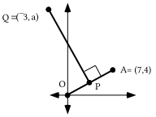

Enter the coordinates of point O and point A into lists #1 and #2.  Then get a connected scatter plot of the segment joining those two points.

A. Point P is midway between the origin and point A. Give the magnitude of an origin centered size transformation that will map point A onto point P.

B. Give the exact coordinates of point P.  Add the coordinates of point P to lists #1 and #2.  Then get a new view of the scatter plot to see if point P appears where you would expect.

C. Give the slope of any line perpendicular to the line that contains points O and A.

D. Segment QP is perpendicular to segment OA.  Write an equation for the line containing segment QP.  Enter an expression based on this equation as Y1 and get a view of the graph to see if it looks as it should.  Use \[ZOOM\] and \[5\] to correct for distortion.

E. Give the value of “a,” the second coordinate of point Q.  This can be done at the home screen by using “Y1.”

F. Use program DISTANCE to compute each of the following:

1\. The distance from Q to A.

2\. The distance from Q to the origin.

### II.

First make these computations without using your calculator.  Then check your results with the calculator.

A. Compute the exact value of $\frac{1}{2}\cdot \frac{1}{2}+\frac{{}^{-}\sqrt{3}}{2}\cdot \frac{{}^{-}\sqrt{3}}{2}$

B. Compute the exact value of $\frac{1}{2}\cdot \frac{\sqrt{3}}{2}+\frac{{}^{-}\sqrt{3}}{2}\cdot \frac{1}{2}$

### III.

| $*$ | a | b | c | d | e | f | g |
| --- | --- | --- | --- | --- | --- | --- | --- |
| a | f | a | e | g | b | d | c |
| b | a | b | c | d | e | f | g |
| c | e | c | d | a | g | b | f |
| d | g | d | a | e | f | c | b |
| e | b | e | g | f | c | a | d |
| f | d | f | b | c | a | g | e |
| g | c | g | f | b | d | e | a |

The above table is to be used like a multiplication table.  Use the table to give a single letter for each of the following:

A.  a \* c  B.  e \* g  C.  (d \* e) \* a  D.  d \* (e \* a)

### IV.

Copy each of the four numbered equations and, as you do, fill in all the blanks so that all five equations are equivalent.

4 + <em>x</em> = 11

#1.    \_\_ + (4 + <em>x</em>) = -4 + 11

#2.   (-4 + \_\_) + <em>x</em> = \_\_

#3.    \_\_ + <em>x</em> = \_\_

#4.            <em>x</em> = \_\_

### V.

A. Give the image of (0,0) under the translation T1 with image formula T1(<em>x</em>, <em>y</em>) = (<em>x</em> +3, <em>y</em> + ¯4)

B. Give the image of your answer to “A” right above under the translation T2 with image formula T2(<em>x</em>, <em>y</em>) = (<em>x</em> + 6, <em>y</em> +¯2).

C. Give the image of (0,0) under the composite, T2 $\circ$ T1.

D. Give an image formula for the translation T that will map the origin directly onto your answer to “C” right above.

### VI.

T(3,-4) is a convenient shorthand notation for the translation T1 with image formula T1(<em>x</em>, <em>y</em>) = (<em>x</em> + 3,<em>y</em> + ¯4). What would a similar representation be for the translation T2 with image formula T2(<em>x</em>, <em>y</em>) = (<em>x</em> + 6, <em>y</em> + ¯2)?

### VII.

A. Give the image of (1,0) under S3, the origin centered size transformation with magnitude 3.

B. Give the image of your answer to “A” right above under S2, the origin centered size transformation with magnitude 2.

C. Give the image of (1,0) under the composite S2 $\circ$ S3.

D. Give a representation of the origin centered size transformation that will map (1,0) directly to your answer to “C.”

### VIII.

A. Use “cos” and “sin” to give the exact matrix associated with R23, the origin centered rotation with magnitude 23 degrees.  Also enter this matrix into your calculator as matrix \[A\].

B. Use “cos” and “sin” to give the exact matrix associated with R44, the origin centered rotation with magnitude 44 degrees.  Also enter this matrix into your calculator as matrix \[B\].

C. Compute the product of your answers for “A” and “B” and give the result on your homework paper with the entries rounded to the fifth decimal place.

D. For certain values of “a”, when “cos” and “sin” are used to enter the matrix for Ra into your calculator as matrix \[C\], the entries in \[C\] will match those in your answer to “C” accurate to at least the fifth decimal place.  Give one such value for “a.”

### IX.

A. Give the solution of $3\cdot 0+2\cdot y=150$.

B. Give the solution of $3\cdot x+2\cdot 0=150$.

C. Give the point where the line described by $3\cdot x+2\cdot y=150$ intersects the $y-\text{axis}\mathrm{.}$

D. Give the point where the line described by $3\cdot x+2\cdot y=150$ intersects the $x-\text{axis}\mathrm{.}$

### X.

A. Give any three pairs that are solutions of $x+y<11$.

B. Give any three pairs that are <strong>not</strong> solutions of $x+y<11$.

## Assignment #60

### I.

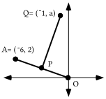

Enter the coordinates of point O and point A into lists #1 and #2.  Then get a connected scatter plot of the segment joining those two points.

A. Point P is midway between the origin and point A.  Give the exact coordinates of point P.   Add the coordinates of point P to lists #1 and #2. Then get a new view of the scatter plot to see if point P appears where you would expect.

B. Segment QP is perpendicular to segment OA.  Write an equation which describes the line containing segment QP.  Enter an expression based on this equation as Y1 and get a view of the graph to see if it looks as it should.  Be sure to use \[ZOOM\] and \[5\].

C. Give the value of “a,” the second coordinate of point Q.

D. Use program DISTANCE to compute each of the following:

1\. The distance from Q to A.

2\. The distance from Q to the origin.

### II.

Trace the sketch below onto your homework paper:

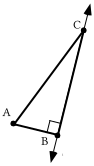

A. Add to your tracing a sketch of the image of triangle ABC under a reflection in line $\ell$.  Use prime notation to label the images of the vertices.

B. How does the length of AB compare to the length of BA'?  Give a reason for your answer.

C. How does the distance from C to A compare to the distance from C to A'?  Give a reason for your answer.

### III.

<strong>Some Mathematical Details Involved in “Solving” a Simple Equation</strong>

4 + <em>x</em> = 11

It is easy to see that its only solution of the above equation is 7.  However, there is a process that can be used to obtain this simple solution.  This same process is also useful in finding the solution of some more complicated equations.  The process is carefully described below.  Each step in this process replaces the previous equation with an equivalent equation.  The final equation in this sequence is even simpler than the original equation.

4 + <em>x</em> = 11

#1.  ¯4 + (4 + <em>x</em>) = ¯4 + 11  (Adding the opposite of 4 to each side)

#2.  (¯4 + 4) + <em>x</em> = 7  (Associating the ¯4 with the 4 on the left side and replacing the sum of two addends on the right side with a more convenient equivalent)

#3.  0 + <em>x</em> = 7  (Replacing the associated sum of opposites with the identity for addition)

#4.  <em>x</em> = 7  (Letting the identity for addition, 0, “fade out” since the solution is not changed when this is done).

The last equation shows the solution, 7, and the variable “<em>x</em>” facing each other across an equal sign.   Writing the sequence leading from “4 + <em>x</em> = 11” to “<em>x</em> = 7” is called “solving” the equation “4 + <em>x</em> = 11.”  In this case, “solving” the equation was of little help in determining the solution, since the solution was so easy to determine from the start.  The mathematical details are presented above to help prepare for dealing with “simple” equations, including those containing matrices, whose solutions will not be so easy to determine.

Copy each of the four numbered equations and as you do, fill in all the blanks so that all five equations are equivalent.  As you fill in the blanks, describe the mathematical details involved.

4 · <em>x</em> = 11

#1.  \_\_ $\cdot \text{ }\mathrm{(}4\cdot x\mathrm{)}=\frac{1}{4}\cdot 11$

#2.   $\mathrm{(}\frac{1}{4}\cdot \mathrm{\_\_)}\cdot x=\mathrm{\_\_}$

#3.  \_\_ · <em>x</em> = \_\_

#4.    <em>x</em> = \_\_

### IV.

<strong>Trials for the Associative Property</strong>

As you saw in the previous question, the associative property has a role in carefully solving a “simple” equation.  In question III of assignment #59 you were presented with the table

| $*$ | a | b | c | d | e | f | g |
| --- | --- | --- | --- | --- | --- | --- | --- |
| a | f | a | e | g | b | d | c |
| b | a | b | c | d | e | f | g |
| c | e | c | d | a | g | b | f |
| d | g | d | a | e | f | c | b |
| e | b | e | g | f | c | a | d |
| f | d | f | b | c | a | g | e |
| g | c | g | f | b | d | e | a |

and you were asked to give a single letter for both

(d \* e) \* a    and    d \* (e \* a).

Unless more is known about the table, expressions in parentheses should be dealt with first.

(d \* e) \* a is equivalent to f \* a

and

d \* (e \* a) is equivalent to d \* b.

Interestingly enough the table reveals that both “f \* a” and “d \* b” represent “d.”  Therefore, (d \* e) \* a and d \* (e \* a) represent the same element in the set S = {a,b,c,d,e,f,g}.  It does not matter whether “e” is associated with “d” or “a.”

Without knowing more about the table, or making many more such trials, you cannot be sure about whether a middle element can be associated with either of two outer elements without effecting the member of set S represented.  At this point you do not know whether or not the operation “\*” as presented in the table is <strong>associative</strong>.

| $*$ | a | b | c | d | e | f | g |
| --- | --- | --- | --- | --- | --- | --- | --- |
| a | f | a | e | g | b | d | c |
| b | a | b | c | d | e | f | g |
| c | e | c | d | a | g | b | f |
| d | g | d | a | e | f | c | b |
| e | b | e | g | f | c | a | d |
| f | d | f | b | c | a | g | e |
| g | c | g | f | b | d | e | a |

A. Use the table to give a single letter for each of the following:

1\. (f \* c)  2. e \* (g \* c)  3. (e \* g) \* c

4\. (e \* a)  5. d \* (d \* g)  6. (d \* d) \* g

B. There is an element in the set S = {a, b, c, d, e, f, g} which behaves when used in the “\*” operation given by the table similar to the way “0” behaves when real numbers are added, “1” behaves when real numbers are multiplied and $\left[ \begin{matrix}1 & 0 \\ 0 & 1\end{matrix} \right]$ behaves when $2\times 2$ matrices are multiplied.  What is that element?

### V.

A. Make a sketch of the unit circle on which you highlight (1,0) and R60(1,0).  Also label both of these points with their exact coordinates.

B. Give the exact matrix for R60 without using “cos” or “sin.”

C. Now add to your sketch the point R-60(1,0) and label it with its exact coordinates.

D. Give the exact matrix for R-60 without using “cos” or “sin.”

E. Compute the exact product of your answer for “B” and your answer for “D.”

### VI.

A. Give the image of (0,0) under the translation represented by T(-5,2).

B. Give the image of your answer to “A” right above under the translation represented by T(-7,4).

C. Give the image of (0,0) under the composite, T(-7,4) $\circ$ T(-5,2).

D. Use notation like that in A, B and C above to represent the translation that will map the origin directly onto your answer to “C” right above.

### VII.

A. Give the image of (1,0) under S-5.

B. Give the image of your answer to “A” right above under S4.

C. Give the image of (1,0) under the composite S4 $\circ$ S-5.

D. Give the single origin centered size transformation that will map (1,0) directly onto your answer to “C” right above.

### VIII.

A. Give the solution of 0 + 2 · <em>y</em> = 12

B. Give the solution of <em>x</em> + 2 · 0 = 12

C. Give the point where the line described by <em>x</em> + 2 · <em>y</em> = 12 intersects the $y-\text{axis}\mathrm{.}$

D. Give the point where the line described by <em>x</em> + 2 · <em>y</em> = 12 intersects the $x-\text{axis}\mathrm{.}$

### IX.

A. Give any six pairs that are solutions of <em>x</em> + 2 · <em>y</em> &gt; 12

B. Give any three pairs that are <strong>not</strong> solutions of <em>x</em> + 2 · <em>y</em> &gt; 12

C. Give any three pairs that <strong>are</strong> solutions of <em>x</em> + 2 · <em>y</em> ≥ 12 but <strong>are not</strong> solutions of <em>x</em> + 2 · <em>y</em> &gt; 12

D. Give an equivalent to <em>x</em> + 2 · <em>y</em> = 12 in the calculator friendly form <em>y</em> = a.<em>x</em> + b.

## Assignment #61

### I.

A. Give an equivalent of the equation $y=\frac{7}{3}\cdot \mathrm{(}x-5\mathrm{)}+3$ in the form $\text{a}\cdot x+\text{b}\cdot y=\text{c}$.  The value of “c” should be given as a ratio of integers.  The MATH “ Frac” command can help with this.

B. Give the slope of any line perpendicular to the line with equation $y=\frac{7}{3}\cdot \mathrm{(}x-5\mathrm{)}+3$.

### II.

<strong>Identity Elements</strong>

| $*$ | a | b | c | d | e | f | g |
| --- | --- | --- | --- | --- | --- | --- | --- |
| a | f | a | e | g | b | d | c |
| b | a | b | c | d | e | f | g |
| c | e | c | d | a | g | b | f |
| d | g | d | a | e | f | c | b |
| e | b | e | g | f | c | a | d |
| f | d | f | b | c | a | g | e |
| g | c | g | f | b | d | e | a |

If “a” represents any real number, a + 0 = a and 0 + a = a.  “0” has a “ghostly” presence in the sums “a + 0” and “0 + a.”  “0” is called the identity element for addition, or the <strong>additive identity</strong>.

If “a” represents any real number, a.1=a and 1.a=a.  “1” has a “ghostly” presence.  The number “1” is called the identity element for multiplication or the <strong>multiplicative identity</strong>.

If $\left[ \begin{matrix}\text{a} & \text{b} \\ \text{c} & \text{d}\end{matrix} \right]$ represents any $2\times 2$ matrix, $\left[ \begin{matrix}\text{a} & \text{b} \\ \text{c} & \text{d}\end{matrix} \right]\cdot \left[ \begin{matrix}\text{1} & \text{0} \\ \text{0} & \text{1}\end{matrix} \right]=\left[ \begin{matrix}\text{a} & \text{b} \\ \text{c} & \text{d}\end{matrix} \right]$ and $\left[ \begin{matrix}\text{1} & \text{0} \\ \text{0} & \text{1}\end{matrix} \right]\cdot \left[ \begin{matrix}\text{a} & \text{b} \\ \text{c} & \text{d}\end{matrix} \right]$ = $\left[ \begin{matrix}\text{a} & \text{b} \\ \text{c} & \text{d}\end{matrix} \right]$.  The matrix $\left[ \begin{matrix}1 & 0 \\ 0 & 1\end{matrix} \right]$ has a “ghostly” presence in the products $\left[ \begin{matrix}\text{1} & \text{0} \\ \text{0} & \text{1}\end{matrix} \right]\cdot \left[ \begin{matrix}\text{a} & \text{b} \\ \text{c} & \text{d}\end{matrix} \right]$ and $\left[ \begin{matrix}\text{a} & \text{b} \\ \text{c} & \text{d}\end{matrix} \right]\cdot \left[ \begin{matrix}\text{1} & \text{0} \\ \text{0} & \text{1}\end{matrix} \right]$.  The matrix $\left[ \begin{matrix}1 & 0 \\ 0 & 1\end{matrix} \right]$ is called the identity for $2\times 2$ matrix multiplication.

A check of the table for the “\*” operation will reveal that “b” has a “ghostly” presence in any expression in which it is “starred” with any element in S={a,b,c,d,e,f,g}.  “b” is called the identity element for the operation “\*.”

| $*$ | a | b | c | d | e | f | g |
| --- | --- | --- | --- | --- | --- | --- | --- |
| a | f | a | e | g | b | d | c |
| b | a | b | c | d | e | f | g |
| c | e | c | d | a | g | b | f |
| d | g | d | a | e | f | c | b |
| e | b | e | g | f | c | a | d |
| f | d | f | b | c | a | g | e |
| g | c | g | f | b | d | e | a |

A. What property of the “\*” operation guarantees that c \* (f \* g) and (c \* f) \* g represent the same element in the set S = {a, b, c, d, e, f, g}?

B. What is the identity element for the operation “\*” presented in the table?

C. There is an element in set S = {a, b, c, d, e, f, g} that behaves when “starred” with “e” the way ¯3 behaves when added to 3.  What is that element?

### III.

<strong>The Kite Theorem</strong>

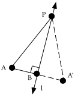

In the illustration above, triangle BA'P is the image of triangle BAP under a reflection in line $\ell$.  The line of reflection is perpendicular to a segment connecting a point to its image.  Therefore line $\ell$ is perpendicular to segment AA'.  Reflections preserve distance.  Therefore segment AB has the same length as segment BA'.  This means that point B is the midpoint of segment  AA'.  In this situation, line $\ell$ is called the <strong>perpendicular bisector</strong> of segment AA'.

Point P represents a “typical” point on the perpendicular bisector of segment AA'.  Because reflections preserve distance, segment PA' has the same length as its pre-image, segment PA.  This illustrates a “typical case” of the Kite Theorem.

<strong>The Kite Theorem</strong>

Any point on the perpendicular bisector of a line segment is the same distance from each end of that segment.

The illustration below might give you some idea why this fact is referred to as the <strong>Kite Theorem</strong>.

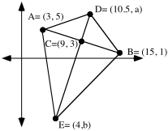

A. Give the slope of the line containing points A, B and C.

B. Segment CE is perpendicular to segment AB.  Give an equation for the line that contains segment CE.  Check this work by making from lists #1 and #2 a connected scatter plot of points A, C and B.  Then enter a calculator friendly version of your equation as Y1 and see if the graph looks as it should after pushing both \[ZOOM\] \[9\] and \[ZOOM\] \[5\].

C. Give the exact values of both “a” and “b.”

D. Calculate the following distances using PROGRAM DISTANCE.  Give each distance accurate to five decimal places.  This means “rounded to the fifth decimal place.”

1\. The distance from D to A.    2. The distance from D to B.

3\. The distance from E to A.    4. The distance from E to B.

E. What theorem is illustrated by the results for “D” right above?

### IV.

A. Make a sketch of the unit circle on which you highlight (1,0), R45(1,0) and R135(1,0).  Also label each of these points with their exact coordinates without using “cos” or “sin.”

B. Give the exact matrix for R135 without using “cos” or “sin.”

C. Now add to your sketch the point R-135(1,0) and label it with its exact coordinates.

D. Give the exact matrix for R-135 without using “cos” or “sin.”

E. Compute the exact product of your answer for “B” and your answer for “D.”

### V.

A. Give the image of (0,0) under the translation represented by T(8,-5).

B. Give the image of your answer to “A” right above under the translation represented by T(-3,7).

C. Give the image of (0,0) under the composite, T(8,-5) $\circ$ T(-3,7).

D. Use notation like that in A, B and C above to represent the translation that will map the origin directly onto your answer to “C” right above.

### VI.

True or False: T(5,-8) $\circ$ T(2,4) = T(7,-4).

### VII.

A. Give the image of (1,0) under S6.

B. Give the image of your answer to “A” right above under S-4.

C. Give the image of (1,0) under the composite S-4 $\circ$ S6.

D. Give the single origin centered size transformation that will map (1,0) directly onto your answer to “C” right above.

### VIII.

True or false: S7 $\circ$ S-4 = S-28.

### IX.

<strong>Graphing the Region of Solutions of a Linear Inequality</strong>

In the illustration below, points which are solutions of <em>x</em> + 2 · <em>y</em> &gt; 12 are represented with “+” signs while points which are not solutions of <em>x</em> + 2 · <em>y</em> &gt; 12 are marked with “ ’s.”  When similar displays were seen in class, it appeared that a line would form a boundary between the solutions and the non-solutions, and this is correct.

The boundary line between the regions containing solutions and the region containing non-solutions is shown.  The boundary line is described by the equation <em>x</em> + 2 · <em>y</em> = 12.  Notice that this equation can be formed from <em>x</em> + 2 ·<em>y</em> &gt; 12 by replacing the verb, “&gt;,” with the verb, “=.”

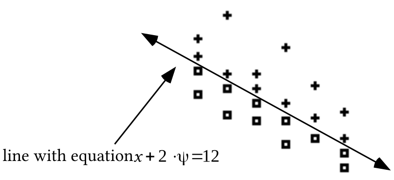

The illustration below shows a shaded representation of the region of all solutions.  Notice that the boundary line has been represented with dashes.  This was done because none of the points on that line are solutions.  If the open sentence had been <em>x</em> + 2 · <em>y</em> ≥ 12 instead of <em>x</em> + 2 · <em>y</em> &gt; 12, the boundary line would have been represented without dashes.

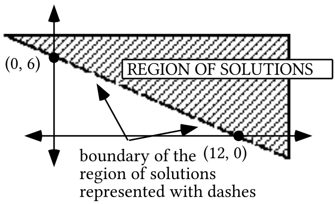

A. Write an equation for the oblique boundary of the shaded region in the illustration below.

B. Give the coordinates of any one point in the shaded region shown below.

C. Write an open sentence whose solutions are those points in the region shaded in the illustration below:

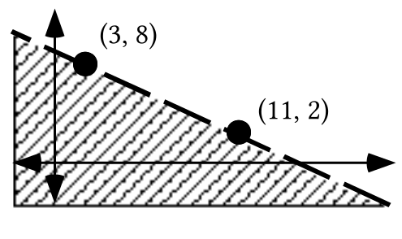

### X.

$\left\{ \begin{array}{l}x+y>10 \\ {}^{-}2\cdot x+y>4\end{array} \right.$

A. For the system above, give equations that for the two boundary lines.

B. Use PROGRAM SYSTEM to give the coordinates of the intersection of the two boundary lines.

C. Give any four solutions of the system.

## Assignment #62

### I.

A. Give an equivalent of the equation $y=\frac{{}^{-}4}{11}\cdot \mathrm{(}x-8\mathrm{)}+{}^{-}5$ in the form $\text{a}\cdot x+\text{b}\cdot y=\text{c}$.  The value of “c” should be given as a ratio of integers.  The MATH “ Frac” command can help with this.

B. Give the slope of any line perpendicular to the line described by $y=\frac{{}^{-}4}{11}\cdot \mathrm{(}x-8\mathrm{)}+{}^{-}5$

### II.

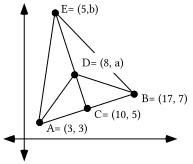

A. Give the slope of the line containing points A, B, and C.

B. Segment CE is perpendicular to segment AB.  Give an equation for the line that contains segment CE.  Check this work by making from lists #1 and #2 a connected scatter plot of points A, C and B.  Then enter a calculator friendly version of your equation as Y1 and see if the graph looks as it should after pushing both \[ZOOM\] \[9\] and \[ZOOM\] \[5\].

C. Give the exact values of both “a” and “b.”

D. Calculate the following distances using PROGRAM DISTANCE.  Give each distance accurate to five decimal places.  This means “rounded to the fifth decimal place.”

1\. The distance from D to A.

2\. The distance from D to B.

3\. The distance from E to A.

4\. The distance from E to B.

E. What theorem is illustrated by the results in “D” right above?

### III.

<strong>Inverses for an Operation</strong>

0 is the identity for addition of real numbers.  Because 3 + –3 = 0 and –3 + 3 = 0, the numbers 3 and –3 are called opposites, or <strong>additive inverses</strong>, of each other.  Each real number has an additive inverse.

1 is the identity for multiplication of real numbers.  Because $5\cdot \frac{1}{5}=1$ and $\frac{1}{5}\cdot 5=1$.  The numbers 5 and $\frac{1}{5}$ are called reciprocals or <strong>multiplicative inverses</strong> of each other.    Each real number <strong>except zero</strong> has a multiplicative inverse.

“b” is the identity for the little mathematical system made of set S={a, b, c, d, e, f, g} and the operation “\*” whose use is determined by the table:

| $*$ | a | b | c | d | e | f | g |
| --- | --- | --- | --- | --- | --- | --- | --- |
| a | f | a | e | g | b | d | c |
| b | a | b | c | d | e | f | g |
| c | e | c | d | a | g | b | f |
| d | g | d | a | e | f | c | b |
| e | b | e | g | f | c | a | d |
| f | d | f | b | c | a | g | e |
| g | c | g | f | b | d | e | a |

e \* a = b and a \* e = b.  Therefore “e” and “a” in this system are called  “<strong>\*-inverses</strong> ” of each other.  Addition and multiplication of real numbers are familiar operations, and it is reasonable to accept the fact that each real number has an additive inverse and each non-zero real number has a multiplicative inverse.  In the case of the {S,\*} system, the table can be used to determine whether there is an inverse for each element.

A. Copy and complete this table of inverses for the {S,\*} operational system:

| element | $*$-inverse of that element |
| --- | --- |
| a |  |
| b |  |
| c |  |
| d |  |
| e |  |
| f |  |
| g |  |

B. Copy and complete the four numbered equations on the right so that they “mimic” the four numbered equations on the left.

4 + <em>x</em> = 11    e \* <em>x</em> = d

#1.  \_\_ + (4 + <em>x</em>) = ¯4 + 11  \_\_ \* (e \* <em>x</em>) = a \* d

#2.  (¯4 + \_\_) + <em>x</em> = \_\_   (a \* \_\_) \* <em>x</em>  = \_\_

#3.    \_\_ + <em>x</em> = \_\_    \_\_ \* <em>x</em> = \_\_

#4.   <em>x</em> = \_\_   <em>x</em> = \_\_

C. Give the solution of the following open sentence:

e \* <em>x</em> = d

### IV.

A. Give the solution of $\text{R}_{\text{50}}\circ \text{R}_{{}^{-}\text{50}}=\text{X}$.  “X” is a transformation variable.

B. Give the exact matrix for R0 without using “cos” or “sin.”

C. Use subscripted “R” notation to identify the rotation which has $\left[ \begin{matrix}\frac{{}^{-}1}{2} & \frac{{}^{-}\sqrt{3}}{2} \\ \frac{\sqrt{3}}{2} & \frac{{}^{-}1}{2}\end{matrix} \right]$ as its associated matrix.

D. In the following equation “X” is a variable for a matrix.  Give the solution:

$\left[ \begin{matrix}\frac{{}^{-}1}{2} & \frac{{}^{-}\sqrt{3}}{2} \\ \frac{\sqrt{3}}{2} & \frac{{}^{-}1}{2}\end{matrix} \right]\cdot \text{X}=\left[ \begin{matrix}1 & 0 \\ 0 & 1\end{matrix} \right]$

### V.

A. “Calculate” the composite T(2,3) $\circ$ T(4,¯7).

B. “Calculate” the composite T(6,¯3) $\circ$ (your answer for “A”).

C. “Calculate” the composite T(6,¯3) $\circ$ T(2,3).

D. “Calculate” the composite (your answer to “C”) $\circ$ T(4,¯7).

E. True or False: T(6,¯3) $\circ$ (T(2,3) $\circ$ T(4,¯7)) = (T(6,¯3) $\circ$ T(2,3)) $\circ$ T(4,¯7)

### VI.

A. If T(¯3,7) $\circ$ T(a,b) = T(¯3,7) and T(a,b) $\circ$ T(¯3,7) = T(¯3,7), give the values of “a” and “b.”

B. If T(5,-8) $\circ$ T(-5,8) = T(a,b), give the values of “a” and “b.”

C. If T(3,7) $\circ$ T(c,d) = T(0,0), give the values of “c” and “d.”

### VII.

A. If $\text{S}_{\frac{1}{3}}\circ \text{S}_{\text{3}}=\text{S}_{\text{a}}$, give the value of “a.”

B. If $\text{S}_{{}^{-}\text{7}}\circ \text{S}_{\text{b}}=\text{S}_{\text{1}}$, give the value of “b.”

### VIII.

A. Write an equation for the oblique boundary of shaded region in the illustration below.

B. Give the coordinates of any one point in the shaded region shown at below.

C. Write an open sentence whose solutions are those points on the boundary and in the shaded region.

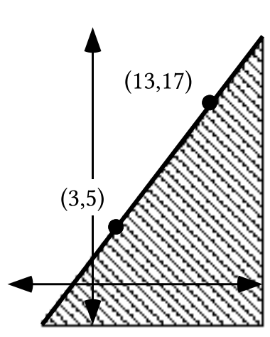

### IX.

A. Write an equation for the oblique boundary of shaded region in the illustration below.

B. Give the coordinates of any one point that is definitely in the shaded region shown below.

C. Write an open sentence whose solutions are those points in the region shaded in the illustration below:

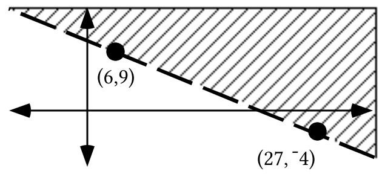

### X.

For the system $\left\{ \begin{array}{l}x+y<12 \\ {}^{-}3\cdot x+y<4\end{array} \right.$:

A. Give equations that describe the boundary lines.

B. Use PROGRAM SYSTEM to give the intersection of the boundaries.

C. Give any five solutions of the system.

## Assignment #63

### I.

Trace the triangle below onto your homework paper.  See if you can add to your tracing one circle that passes through all three vertices.

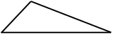

### II.

A. Give an equation for the line with slope $\frac{{}^{-}1}{4}$ that passes through (1,4).

B. Give an equation for the line with slope ¯5 that passes through (5,1).

C. Write a system of the form $\left\{ \begin{array}{l}\text{a}\cdot x+\text{b}\cdot y=\text{c} \\ \text{d}\cdot x+\text{e}\cdot y=\text{f}\end{array} \right.$ whose solution is the intersection of the lines from your answers to “A” and “B” right above.

D. Use PROGRAM SYSTEM to get the point of intersection of the lines described by your answers to “A” and “B.”

### III.

| $*$ | a | b | c | d | e | f | g |
| --- | --- | --- | --- | --- | --- | --- | --- |
| a | f | a | e | g | b | d | c |
| b | a | b | c | d | e | f | g |
| c | e | c | d | a | g | b | f |
| d | g | d | a | e | f | c | b |
| e | b | e | g | f | c | a | d |
| f | d | f | b | c | a | g | e |
| g | c | g | f | b | d | e | a |

A. Copy the numbered equations and fill in the blanks so that all five equations are equivalent:

g \* <em>x</em>  =      d

#1.  \_\_ \* (g \* <em>x</em>) = d \* d

#2.  (d \* \_\_) \* <em>x</em>  = \_\_

#3.    \_\_ \* <em>x</em>  = \_\_

#4.   <em>x</em>  = \_\_

B. “Solve” the following open sentence by writing a sequence of four equivalent open sentences ending with one of the form “<em>x</em> = ‘the solution.’”

d \* <em>x</em> = c

### IV.

A. “Calculate” the composite S¯2 $\circ$ S4.

B. “Calculate” the composite S3 $\circ$ (your answer for “A”).

C. “Calculate” the composite S3 $\circ$ S¯2.

D. “Calculate” the composite (your answer to “C”) $\circ$ S4.

E. True or False: S3 $\circ$ (S¯2 $\circ$ S4) = (S3 $\circ$ S¯2) $\circ$ S4.

### V.

A. If S4 $\circ$ Sa = S4 and Sa $\circ$ S4 = S4, give the value of “a.”

B. If S5 $\circ$ Sb = S1 and Sb $\circ$ S5 = S1, give the value of “b.”

C. What is the identity for composition of origin centered size transformations?

D. What is the composition inverse of $\text{S}_{\frac{2}{3}}$?

### VI.

<strong>Algebraic Properties of Composition of Translations</strong>

In parts A and B of question V in assignment #62 you were asked to compute first

T(2,3) $\circ$ T(4,¯7) to get T(6,¯4)

and then

T(6,¯3) $\circ$ T(6,¯4) to get T(12,¯7).

This gives

Result #1:  T(6,¯3) $\circ$ (T(2,3) $\circ$ T(4,¯7)) = T(12,¯7)

Then in parts C and D of the same question V you were asked to compute first

T(6,¯3) $\circ$ T(2,3) to get T(8,0)

and then

T(8,0) $\circ$ T(4,¯7) to get T(12,¯7).

This gives

Result #2:  (T(6,¯3) $\circ$ T(2,3)) $\circ$ T(4,¯7) = T(12,¯7)

The fact that results #1 and #2 match means that

T(6,¯3) $\circ$ (T(2,3) $\circ$ T(4,¯7)) = (T(6,¯3) $\circ$ T(2,3)) $\circ$ T(4,¯7)

and illustrates the following fact that we will assume in later work:

<strong>Composition of translations is associative.</strong>

In doing question VI of assignment #62 you encountered the following results:

Result #1:  T(¯3,7) $\circ$ T(0,0) = T(0,0) $\circ$ T(¯3,7) = T(¯3,7)

Result #2:  T(5,¯8) $\circ$ T(¯5,8) = T(0,0)

Result #3:  T(3,7) $\circ$ T(¯3,¯7) = T(0,0)

Result #1 illustrates the following fact that you can assume for work that follows:

<strong>T(0,0) is the identity for composition of translations.</strong>

Results #2 and #3 illustrate the following additional fact that you can assume for work that follows:

<strong>The composition inverse of the “typical” translation T(a,b) is T(-a,-b).</strong>

A. Give the identity for composition of translations.

B. Give the composition-inverse of T(¯4,9)

### VII.

In the following open sentences, “X” is a transformation variable. Copy the numbered equations and fill in the blanks so that all five equations are equivalent.

$\left( \text{T}_{\text{(3,}{}^{-}\text{7)}}\circ \text{X} \right)=\hspace{2.5em}\text{T}_{\text{(6,3)}}$

#1.  $\mathrm{\_\_\_}\circ \left( \text{T}_{\text{(3,}{}^{-}\text{7)}}\circ \text{X} \right)=\text{T}_{\text{(}{}^{-}\text{3,7)}}\circ \text{T}_{\text{(6,3)}}$

#2.  $\left( \text{T}_{\text{(}{}^{-}\text{3,7)}}\circ \text{T}_{\text{(3,}{}^{-}\text{7)}} \right)\circ \text{X}=\text{\_\_\_}$

#3.  $\mathrm{\_\_\_}\circ \text{X}=\mathrm{\_\_\_}$

#4.    X = \_\_\_

### VIII.

In the following open sentences, “X” is a transformation variable.  Copy the numbered equations and fill in the blanks:

$\left( \text{S}_{5}\circ \text{X} \right)\text{ }=\hspace{2.5em}\text{S}_{{}^{-}2}$

#1   $\mathrm{\_\_\_}\circ \left( \text{S}_{5}\circ \text{X} \right)\text{ }=\text{ S}_{\frac{1}{5}}\circ \text{S}_{{}^{-}2}$

#2  $\left( \text{S}_{\frac{1}{5}}\circ \text{S}_{5} \right)\circ \text{X}=\text{\_\_\_}$

#3  $\mathrm{\_\_\_}\circ \text{X}=\mathrm{\_\_\_}$

#4    $\text{X}=\mathrm{\_\_\_}$

### IX.

A. Give the solution of the open sentence $\text{R}_{\text{100}}\circ \text{R}_{{}^{-}\text{100}}=\text{X}$.  “X” is a transformation variable.

B. Use subscripted “R” notation to identify the rotation which has $\left[ \begin{matrix}\frac{\sqrt{3}}{2} & \frac{1}{2} \\ \frac{{}^{-}1}{2} & \frac{\sqrt{3}}{2}\end{matrix} \right]$ as its associated matrix.

C. In the following equation “X” is a variable for a matrix.  Give the solution:

$\left[ \begin{matrix}\frac{\sqrt{3}}{2} & \frac{1}{2} \\ \frac{{}^{-}1}{2} & \frac{\sqrt{3}}{2}\end{matrix} \right]\cdot \text{X}=\left[ \begin{matrix}1 & 0 \\ 0 & 1\end{matrix} \right]$

D. Give the inverse of $\left[ \begin{matrix}\frac{\sqrt{3}}{2} & \frac{1}{2} \\ \frac{{}^{-}1}{2} & \frac{\sqrt{3}}{2}\end{matrix} \right]$.

### X.

A. Give the point of intersection of the oblique lines which bound the shaded region in the illustration at the top of the next page:

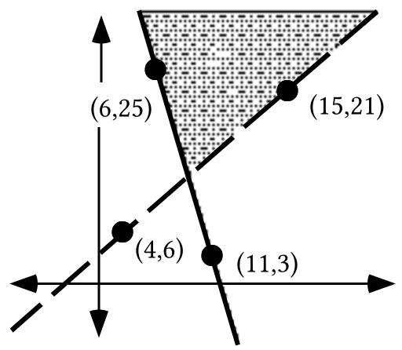

B. Give the coordinates of any two points you know for sure are in the shaded region.

C. Write the system whose solutions are the points in the shaded region.

### XI.

A. The line with equation $3\cdot x+7\cdot y=42$passes through a point (0,b).

1\. Is that point on the $x-\text{axis}$ or the $y-\text{axis}$?

2\. Give the value of “b.”

B. The line described by $3\cdot x+7\cdot y=42$passes through a point (a,0).

1\. Is that point on the $x-\text{axis}$ or the $y-\text{axis}$?

2\. Give the value of “a.”

## Assignment #64

### I.

Trace the triangle below onto your homework paper.  See if you can add to your tracing one circle that passes through all three vertices.

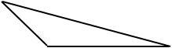

### II.

A. Give an equation for the line with slope $\frac{{}^{-}4}{5}$ that passes through (6,7.5)

B. Give an equation for the line with slope $\frac{8}{3}$ that passes through (¯4,1.5)

C. Write a system of the form $\left\{ \begin{array}{l}\text{a}\cdot x+\text{b}\cdot y=\text{c} \\ \text{d}\cdot x+\text{e}\cdot y=\text{f}\end{array} \right.$ whose solution is the intersection of the lines described by your answers to “A” and “B” right above.

D. Use PROGRAM SYSTEM to get the point of intersection of the lines from parts “A” and “B” of this question.

### III.

A. Identify with subscripted “R” notation the origin centered rotation which has $\left[ \begin{matrix}\frac{{}^{-}\sqrt{2}}{2} & \frac{\sqrt{2}}{2} \\ \frac{{}^{-}\sqrt{2}}{2} & \frac{{}^{-}\sqrt{2}}{2}\end{matrix} \right]$ as its associated matrix.

B.  Give the inverse of $\left[ \begin{matrix}\frac{{}^{-}\sqrt{2}}{2} & \frac{\sqrt{2}}{2} \\ \frac{{}^{-}\sqrt{2}}{2} & \frac{{}^{-}\sqrt{2}}{2}\end{matrix} \right]$.

C. By looking at the matrix in “A” and your answer to “B” make an educated guess about the inverse of the matrix $\left[ \begin{matrix}5 & 2 \\ 7 & 3\end{matrix} \right]$.  Check you answer by multiplying it by $\left[ \begin{matrix}5 & 2 \\ 7 & 3\end{matrix} \right]$ to see if the product is the $2\times 2$ identity matrix.

### IV.

<strong>A Common Pattern in Solving Simple Equations</strong>

In recent assignments you have been asked to write a sequence of equivalent open sentences starting with an open sentence of the form:

(mathematical object)—(operation symbol)—(variable)—(equal sign)—(mathematical object)

Examples from assignment #63 are:

g \* <em>x</em>  =      d

$\left( \text{T}_{\text{(3,}{}^{-}\text{7)}}\circ \text{X} \right)=\hspace{2.25em}\text{T}_{\text{(6,3)}}$

and $\left( \text{S}_{\text{5}}\circ \text{X} \right)=\hspace{2.5em}\text{S}_{{}^{-}2}$.

In the above examples the mathematical objects are either elements from the set S = {a,b,c,d,e,f,g} or transformations.  Later you will see important open sentences of this form in which the mathematical objects are matrices.

To solve open sentences of the form

(mathematical object)—(operation symbol)—(variable)—(equal sign)—(mathematical object),

the first step has been to create a new open sentence by operating on the <strong>left</strong>  of each side with the inverse of the mathematical object to the left of the variable.  In the open sentences above, the placement on the left is emphasized by the gap after the equal sign..

Once the inverse is introduced on the left side, it is associated with the mathematical object already there. This association allows the interacting inverses to be replaced with the identity for the operation.  Then the identity “fades away” to create an open sentence in which the variable and the solution face each other across an equal sign.  Here is a new example in which the mathematical objects are rotations:

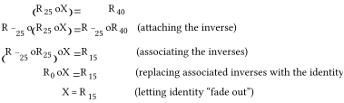

In recent assignments you have been asked to give inverses for matrices associated with certain transformations.  In this assignment you have been asked to “guess” an inverse for a matrix that is not a rotation matrix. The search for matrix inverses is a key step in moving towards being able to solve simple matrix equations in a way similar to that used in the example above.

In the following open sentences, “X” is a transformation variable.  Copy the numbered equations and fill in the blanks:

$\left( \text{T}_{\text{(}{}^{-}\text{4,}1\text{1)}}\circ \text{X} \right)=\hspace{2.5em}\text{T}_{\text{(}{}^{-}\text{5,2)}}$

#1.   $\mathrm{\_\_}\text{\_}\circ \left( \text{T}_{\text{(}{}^{-}\text{4,}1\text{1)}}\circ \text{X} \right)=\text{T}_{\text{(}4\text{,}{}^{-}\text{11)}}\circ \text{T}_{\text{(}{}^{-}\text{5,2)}}$

#2.  $\left( \text{T}_{\text{(}4\text{,}{}^{-}\text{11)}}\circ \text{T}_{\text{(}{}^{-}\text{4,}1\text{1)}} \right)\circ \text{X}=\text{\_\_\_}$

#3.   $\mathrm{\_\_\_}\circ \text{X}=\mathrm{\_\_\_}$

#4.   $\text{X}=\mathrm{\_\_\_}$

### V.

In the following open sentences, “X” is a transformation variable.  Copy the numbered equations and fill in the blanks:

$\left( \text{S}_{\frac{3}{4}}\circ \text{X} \right)\text{ }=\hspace{2.5em}\text{S}_{3}$

#1.  $\mathrm{\_\_\_}\circ \left( \text{S}_{\frac{3}{4}}\circ \text{X} \right)\text{ }=\text{ S}_{\frac{4}{3}}\circ \text{S}_{3}$

#2.  $\left( \text{S}_{\frac{4}{3}}\circ \text{S}_{\frac{3}{4}} \right)\circ \text{X}=\text{\_\_\_}$

#3.  $\mathrm{\_\_\_}\circ \text{X}=\mathrm{\_\_\_}$

#4.    $\text{X}=\mathrm{\_\_\_}$

### VI.

In the following open sentences, “X” is a transformation variable.  Copy the numbered equations and fill in the blanks:

$\left( \text{R}_{35}\circ \text{X} \right)\text{ }=\hspace{2.5em}\text{R}_{106}$

#1.  $\mathrm{\_\_\_}\circ \left( \text{R}_{35}\circ \text{X} \right)\text{ }=\text{ R}_{{}^{-}35}\circ \text{R}_{106}$

#2.  $\left( \text{R}_{{}^{-}35}\circ \text{R}_{35} \right)\circ \text{X}=\text{\_\_\_}$

#3.    $\mathrm{\_\_\_}\circ \text{X}=\mathrm{\_\_\_}$

#4.   $\text{X}=\mathrm{\_\_\_}$

### VII.

A. Use “cos” and “sin” to give the exact matrix for R35.

B. Use “cos” and “sin” to give the exact matrix for R71.

C. Give the product of your answers to “A” and “B” above with the entries rounded to the fifth decimal place.

D. Give the matrix for R106 with the entries rounded to the fifth decimal place.

### VIII.

A. Give the point of intersection of the oblique lines which bound the shaded region in the illustration below:

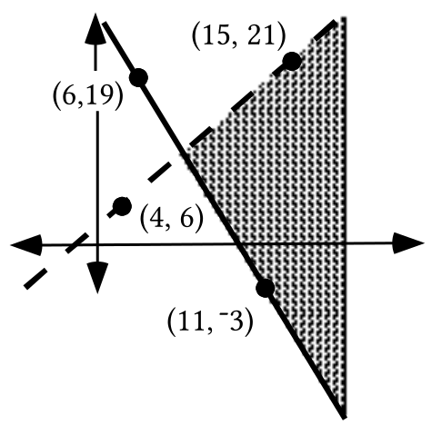

B. Give the coordinates of any two points you know for sure are in the shaded region.

C. Write the system whose solutions are the points in the shaded region.

### IX.

A certain line has equation $2\cdot x+2\cdot y=80$.

A.  Give the coordinates of the <em>x</em>- and <em>y-</em> intercepts of the line.  Enter the coordinates of these points into lists #1 and #2.  Set up plot #1 to show a disconnected scatter plot of these two points.

B.  Give a “calculator friendly” equivalent to the given equation.  Use this equivalent as a basis for an expression to enter as Y1.  Then check your work on this question by seeing if the line generated from this expression passes through the list #1, list #2 points.  Make any needed corrections in your work.

## Assignment #65

### I.

Put your calculator in parametric MODE, set Tmin = 0, Tmax = 360 and TStep = 4.

A. Give expressions for X1T and Y1T from which your calculator can generate a reasonable representation of the unit circle.

B. Your calculator can now make an image of the unit circle under a size transformation with magnitude 3.  Give expressions for X2T and Y2T for doing this.  These expressions should contain “X1T” and “Y1T.”

C. The goal is to now create an image of the X2T, Y2T figure under the translation T(2,3).  Expressions for X3T and Y3T should contain “X2T” and “Y2T.”

### II.

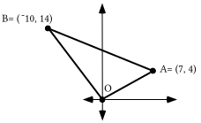

Re-set your calculator to \[Func\]tion MODE.  Now enter the coordinates of points O, A, B, and O again into lists #1 and #2.  Then use a connected scatter plot to get a view of the triangle that has these points as its vertices.

A. Write an equation for the “perpendicular bisector” of segment OA.  Verify your answer visually with a graph made from an expression entered as Y1.  Be sure to use \[ZOOM\] and \[5\] to correct for distortion.

B. Write an equation for the “perpendicular bisector” of segment OB.  Verify your answer visually with a graph made from an expression entered as Y2.

C. Use PROGRAM SYSTEM to get the intersection of the lines described by your answers for “A” and “B” above.  Call this intersection point P.

D. If your answer to “C” right above is represented as “P,” calculate the following distances accurate to the fifth decimal place.  Use PROGRAM DISTANCE if you need:

1\. The distance form P to A.   2. The distance from P to O.

3\. The distance from P to B.

### III.

Solve the following equation for X.  It should take four steps.

$\text{T}_{\text{(5,}{}^{-}\text{3)}}\circ \text{X}=\hspace{2.5em}\text{T}_{\text{(}{}^{-}\text{2,8)}}$

### IV.

Solve the following equation for X.  It should take four steps.

$\text{S}_{\frac{\text{3}}{\text{4}}}\circ \text{X}=\hspace{1.75em}\text{S}_{{}^{-}2}$

### V.

<strong>The Search for Inverses for</strong> $2\times 2$ <strong>Matrices–Part I</strong>

In order to solve simple matrix equations it will be necessary to determine the inverse of a $2\times 2$ matrix.  Matrices for rotations provide a convenient starting point for the study of matrix inverses.  Shown below is a comparison of the matrices for R150 and R-150.  The Matrix-Transformation Isomorphism Theorem guarantees that these matrices are inverses because the transformations associated with them are inverses. The comparison reveals that the entries in the 1,2 and 2,1 addresses are opposites.  Meanwhile, the entries in the 1,1 and 2,2 addresses <strong>appear</strong> to be unchanged.

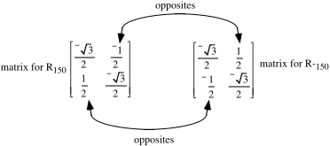

Product:  $\left[ \begin{matrix}\frac{{}^{-}\sqrt{3}}{2} & \frac{{}^{-}1}{2} \\ \frac{1}{2} & \frac{{}^{-}\sqrt{3}}{2}\end{matrix} \right]\cdot \left[ \begin{matrix}\frac{{}^{-}\sqrt{3}}{2} & \frac{1}{2} \\ \frac{{}^{-}1}{2} & \frac{{}^{-}\sqrt{3}}{2}\end{matrix} \right]=\left[ \begin{matrix}1 & 0 \\ 0 & 1\end{matrix} \right]$

The matrices in the illustration below are not rotation matrices, but they are related to each other in the same way that the rotations <strong>appear</strong> to be related.

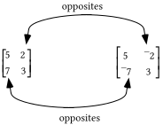

It is perhaps disappointing that the product of these matrices is far from $\left[ \begin{matrix}1 & 0 \\ 0 & 1\end{matrix} \right]$, the identity for $2\times 2$ matrix multiplication.

Product:  $\left[ \begin{matrix}5 & 2 \\ 7 & 3\end{matrix} \right]\cdot \left[ \begin{matrix}5 & {}^{-}2 \\ {}^{-}7 & 3\end{matrix} \right]=\left[ \begin{matrix}11 & {}^{-}4 \\ 14 & {}^{-}5\end{matrix} \right]$

In any rotation matrix, the entries in the 1,1 and 2,2 addresses always match exactly.  This fact would conceal any switch of these entries that might be needed to successfully form the inverse of a $2\times 2$ matrix.  In the following illustration, the right matrix was formed by taking the following two steps:

Step #1: The entries in the 1,2 and 2,1 addresses were replaced with their opposites.

Step #2: The entries in the 1,1 and 2,2 addresses were switched.

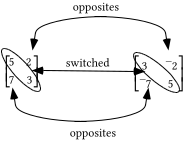

Product:  $\left[ \begin{matrix}5 & 2 \\ 7 & 3\end{matrix} \right]\cdot \left[ \begin{matrix}3 & {}^{-}2 \\ {}^{-}7 & 5\end{matrix} \right]=\left[ \begin{matrix}1 & 0 \\ 0 & 1\end{matrix} \right]$

The computed product reveals that the two matrices related by the two steps are in fact multiplicative inverses of each other.  In this question you can experiment further with this pattern.

A. Give the inverse of $\left[ \begin{matrix}6 & {}^{-}5 \\ 5 & {}^{-}4\end{matrix} \right]$.  Check your answer by multiplying the given matrix by your answer and checking that the product is as it should be.

B. Give the inverse of $\left[ \begin{matrix}2 & 8 \\ 3 & 13\end{matrix} \right]$.  Check your answer by multiplying the given matrix by your answer and checking that the product is as it should be.

### VI.

If the system $\left\{ \begin{array}{l}\hspace{0.75em}18\cdot x+6\cdot y=32 \\ 2\text{1}\cdot x+20\cdot y\text{ }=28\end{array} \right.$ is written in the matrix form $\text{A}\cdot \left[ \begin{matrix}x \\ y\end{matrix} \right]=\text{C}$, give the matrices A and C.

### VII.

A. Calculate the matrix product: $\left[ \begin{matrix}4 & 2 \\ {}^{-}5 & 1\end{matrix} \right]\cdot \left[ \begin{matrix}{}^{-}3 \\ 4\end{matrix} \right]$.

B. Calculate the product of $\left[ \begin{matrix}3 & 4 \\ {}^{-}2 & 6\end{matrix} \right]$ and your answer to “A” right above.

C. Calculate the matrix product: $\left[ \begin{matrix}3 & 4 \\ {}^{-}2 & 6\end{matrix} \right]\cdot \left[ \begin{matrix}4 & 2 \\ {}^{-}5 & 1\end{matrix} \right]$

D. Calculate the product of your answer to “C” right above and $\left[ \begin{matrix}{}^{-}3 \\ 4\end{matrix} \right]$.

E. What property of matrix multiplication is illustrated in the work done for “A,” “B,” “C,” and “D” right above?

### VIII.

A. Use PROGRAM SYSTEM to calculate the solution of $\left\{ \begin{array}{l}\hspace{0.75em}18\cdot x+6\cdot y=32 \\ 2\text{1}\cdot x+20\cdot y\text{ }=28\end{array} \right.$

B. For equations #1 through #4, give the missing matrix or matrices.

$\left[ \begin{matrix}18 & 6 \\ 21 & 20\end{matrix} \right]\cdot \left[ \begin{matrix}x \\ y\end{matrix} \right]=\hspace{2.75em}\left[ \begin{matrix}32 \\ 28\end{matrix} \right]$

#1.  $\left[ \begin{matrix}\phantom{0} & \phantom{0} \\ \phantom{0} & \phantom{0}\end{matrix} \right]\cdot \left( \left[ \begin{matrix}18 & 6 \\ 21 & 20\end{matrix} \right]\cdot \left[ \begin{matrix}x \\ y\end{matrix} \right] \right)=\left[ \begin{matrix}\frac{20}{234} & \frac{{}^{-}6}{234} \\ \frac{{}^{-}21}{234} & \frac{18}{234}\end{matrix} \right]\cdot \left[ \begin{matrix}32 \\ 28\end{matrix} \right]$

#2.  $\left( \left[ \begin{matrix}\frac{20}{234} & \frac{{}^{-}6}{234} \\ \frac{{}^{-}21}{234} & \frac{18}{234}\end{matrix} \right]\cdot \left[ \begin{matrix}18 & 6 \\ 21 & 20\end{matrix} \right] \right)\cdot \left[ \begin{matrix}x \\ y\end{matrix} \right]=\left[ \begin{matrix}\phantom{0} & \phantom{0} \\ \phantom{0} & \phantom{0}\end{matrix} \right]$

#3.  $\left[ \begin{matrix}\phantom{0} & \phantom{0} \\ \phantom{0} & \phantom{0}\end{matrix} \right]\cdot \left[ \begin{matrix}x \\ y\end{matrix} \right]=\left[ \begin{matrix}\phantom{0} & \phantom{0} \\ \phantom{0} & \phantom{0}\end{matrix} \right]$

#4.  $\left[ \begin{matrix}x \\ y\end{matrix} \right]=\left[ \begin{matrix}\phantom{0} & \phantom{0} \\ \phantom{0} & \phantom{0}\end{matrix} \right]$

### IX.

A certain line has the equation $2\cdot x+4\cdot y=120$.

A.  Give the coordinates of the <em>x</em> and <em>y-</em> intercepts of the line with the given equation.  Enter the coordinates of these points into lists #1 and #2.  Set up plot #1 to show a disconnected scatter plot of these two points.

B.  Give a “calculator friendly” equivalent to the given equation.  Use this equivalent as a basis for an expression to enter as Y1.  Then check your work on this question by seeing if the line generated from this expression passes through the list #1, list #2 points.  Make any needed corrections in your work.

### X.

The numbers used in the following statement of a question are unrealistically simple, but this will help you concentrate on the important ideas the question will introduce.

The Mike’s Famous Toy Truck Company question:

Mike’s Famous Toy Trucks manufactures two kinds of toy trucks—a standard model and a deluxe model.  In the manufacturing process, each standard model requires two hours of grinding and two hours of finishing; each deluxe model also requires two hours of grinding but four hours of finishing.  The company employs two grinders and three finishers. Each of these five employees works 40 hours each week.  Each standard model brings the company a profit of \$3.00 and each deluxe model brings a profit of \$4.00.

The workers at the plant share in the profit and they all are invited to suggest a plan for each week’s production.  Worker “A” suggests that the company should make 10 standard trucks and 20 deluxe trucks each week.   Worker “B” suggests a different plan—they should make only deluxe trucks, and they should make 25 of these each week.  Worker “C” has yet a third plan —they should make 100 standard trucks each week.

A. If worker “A’s” plan is followed, how much profit will Mike’s Famous Toy Trucks make each week?  Assume that all the trucks that are made will be sold.

B. Which of the three workers has the best plan for the week’s production?

## Assignment #66

### I.

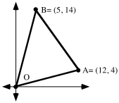

Enter the coordinates of points O, A, B, and O again into lists #1 and #2.  Then get a view of the triangle that has these points as its vertices.

A. Write an equation for the perpendicular bisector of segment OA.  Verify your answer visually with a graph made from an expression entered as Y1.

B. Write an equation for the perpendicular bisector of segment OB.  Verify your answer visually with a graph made from an expression entered as Y2.

C. Use PROGRAM SYSTEM to get the intersection of the lines described by your answers for “A” and “B” above.  Call this intersection point P.  For use in question II, store the first and second coordinates of point P as “F” and “S,” respectively.

D. Calculate the following distances.  PROGRAM DISTANCE will help.  Give the distances accurate to the third decimal place.

1\. The distance form P to A.

2\. The distance from P to O.

3\. The distance from P to B.

### II.

Suppose your calculator is in parametric MODE.

A. Give expressions for X1T and Y1T from which your calculator can generate a reasonable representation of the unit circle.

B. Give expressions for X2T and Y2T from which your calculator can generate a reasonable representation of the image of the figure generated from the X1T and Y1T entries under the origin centered size transformation SR.  Remember that the subscript, “R,” is the magnitude of the size transformation.

C. Give expressions for X3T and Y3T from which your calculator can generate a reasonable representation of the image of the X2T, Y2T figure under the translation T(F,S).

### III.

“Solve” the following equation for the transformation variable, “X,” in four steps making use of one property at a time:

$\text{T}_{\text{(5,}{}^{-}\text{3)}}\circ \text{X}=\hspace{2.5em}\text{T}_{\text{(}0\text{,0)}}$

### IV.

“Solve” the following equation for the transformation variable, “X,” in four steps making use of one group property at a time:

$\text{S}_{\frac{\text{7}}{\text{3}}}\circ \text{X}=\hspace{1.75em}\text{S}_{1}$

### V.

A. Compute this matrix product:

$\left[ \begin{matrix}5 & 4 \\ 2 & 3\end{matrix} \right]\cdot \left[ \begin{matrix}3 & {}^{-}4 \\ {}^{-}2 & 5\end{matrix} \right]$

B. Give the inverse of the matrix $\left[ \begin{matrix}5 & 4 \\ 2 & 3\end{matrix} \right]$.

C. If the form of $\left[ \begin{matrix}5 & 4 \\ 2 & 3\end{matrix} \right]$ is represented as $\left[ \begin{matrix}\text{a} & \text{b} \\ \text{c} & \text{d}\end{matrix} \right]$, compute the number represented by a · d - b · c.

### VI.

If the system $\left\{ \begin{array}{l}20\cdot x+19\cdot y=15 \\ \hspace{0.5em}9\cdot x+4\cdot y\text{ }=23\end{array} \right.$ is written in the matrix form $\text{A}\cdot \left[ \begin{matrix}x \\ y\end{matrix} \right]=\text{C}$, give the matrices A and C.

### VII.

A. Use PROGRAM SYSTEM to calculate the solution of $\left\{ \begin{array}{l}20\cdot x+19\cdot y=15 \\ \hspace{0.5em}9\cdot x+4\cdot y\text{ }=23\end{array} \right.$

B. For equations #1 through #4 give the missing matrix or matrices:

$\left[ \begin{matrix}20 & 19 \\ 9 & 4\end{matrix} \right]\cdot \left[ \begin{matrix}x \\ y\end{matrix} \right]=\hspace{2.75em}\left[ \begin{matrix}15 \\ 23\end{matrix} \right]$

#1.  $\left[ \begin{matrix}\phantom{0} & \phantom{0} \\ \phantom{0} & \phantom{0}\end{matrix} \right]\cdot \left( \left[ \begin{matrix}20 & 19 \\ 9 & 4\end{matrix} \right]\cdot \left[ \begin{matrix}x \\ y\end{matrix} \right] \right)=\left[ \begin{matrix}\frac{{}^{-}4}{91} & \frac{19}{91} \\ \frac{9}{91} & \frac{{}^{-}20}{91}\end{matrix} \right]\cdot \left[ \begin{matrix}15 \\ 23\end{matrix} \right]$

#2.  $\left( \left[ \begin{matrix}\frac{{}^{-}4}{91} & \frac{19}{91} \\ \frac{9}{91} & \frac{{}^{-}20}{91}\end{matrix} \right]\cdot \left[ \begin{matrix}20 & 19 \\ 9 & 4\end{matrix} \right] \right)\cdot \left[ \begin{matrix}x \\ y\end{matrix} \right]=\left[ \begin{matrix}\phantom{0} & \phantom{0} \\ \phantom{0} & \phantom{0}\end{matrix} \right]$

#3.  $\left[ \begin{matrix}\phantom{0} & \phantom{0} \\ \phantom{0} & \phantom{0}\end{matrix} \right]\cdot \left[ \begin{matrix}x \\ y\end{matrix} \right]=\left[ \begin{matrix}\phantom{0} & \phantom{0} \\ \phantom{0} & \phantom{0}\end{matrix} \right]$

#4.  $\left[ \begin{matrix}x \\ y\end{matrix} \right]=\left[ \begin{matrix}\phantom{0} & \phantom{0} \\ \phantom{0} & \phantom{0}\end{matrix} \right]$

### VIII.

<strong>Feasible and Unfeasible Points for the Mike's Toy Truck Question</strong>

Here is a copy of the statement of the Mike’s Famous Toy Truck Company question from assignment #65:

Mike’s Famous Toy Trucks manufactures two kinds of toy trucks-- a standard model and a deluxe model.  In the manufacturing process, each standard model requires two hours of grinding and two hours of finishing; each deluxe model also requires two hours of grinding but four hours of finishing.  The company employs two grinders and three finishers and each of these five employees works 40 hours each week.  Each standard model brings the company a profit of \$3.00 and each deluxe model brings a profit of \$4.00.

The workers at the plant share the profit and they all are invited to suggest a plan for each week’s production.  Worker “A” suggests that the company should make 10 standard trucks and 20 deluxe trucks each week.  Worker “B” suggests a different plan—they should make only deluxe trucks, and they should make 25 of these each week.  Worker “C” has yet a third plan—they should make 100 standard trucks each week.

If the number of standard trucks suggested by each worker is used as a first coordinate and the number of deluxe trucks suggested is used as a second coordinate then

Worker A is suggesting the “point” (10,20)

Worker B is suggesting the “point” (0,25)

and

Worker C is suggesting the “point” (100,0).

Each point has a profit associated with it.

The profit for point A is: $10\cdot \mathrm{\$}3+20\cdot \mathrm{\$}4=\mathrm{\$}110$

The profit for point B is: $0\cdot \mathrm{\$}3+25\cdot \mathrm{\$}4=\mathrm{\$}100$

and

The profit for point C is: $100\cdot \mathrm{\$}3+0\cdot \mathrm{\$}4=\mathrm{\$}300$

Based on the profit calculations, it appears that worker C has the best plan.  However, there is a question.  A careful reading of the question reveals that it would take 100·2 hrs. = 200 hrs. of grinding work to manufacture 100 standard trucks in one week.  But the company employs only 2 grinders who together work a total of only 80 hrs. per week.  The plan suggested by worker C would create the most profit, but it cannot be carried out—<strong>it is unfeasible</strong><em><strong>.</strong></em>

Worker A’s plan of making 10 standard trucks and 20 deluxe trucks each week would require 10·2 hrs + 20·2 hrs = 60 hrs. of grinding each week.  This can be done—the 2 grinders can do that much in a week.  It would also require 10·2 hrs. + 20·4 hrs. = 100 hrs. of finishing work.  This also can be done since the 3 full time finishers can do this much in a week.  With regard to work demands, worker A’s plan is <strong>feasible</strong>.

Worker B’s plan is also feasible because it requires only 25·2 hrs = 50 hrs. of grinding and 25·4 hrs. = 100 hrs. of finishing work.  The challenge of the Mike’s Toy Truck Company question is to find the feasible plan that provides the greatest possible weekly profit.  A systematic approach to solving this question and others like it will be developed in the next several lessons and assignments.

Answer these questions by referring to the statement of the question given above.

A. Classify each of the following suggested weekly production amounts as either “feasible” or “unfeasible.”

1\. Make 35 standard trucks and no deluxe trucks each week.

2\. Make 45 standard trucks and no deluxe trucks each week.

3\. Make 25 deluxe trucks and no standard trucks each week.

4\. Make 35 deluxe trucks and no standard trucks each week.

B. Of the feasible plans from part “A” above, which should yield the greatest profit?

C. Give a number of standard trucks and a number of deluxe trucks to be made each week that make maximum use of the worker time available for either grinding or for finishing or for both.

### IX.

A. Give the <em>x</em> and <em>y</em> intercepts for the line of solutions of the equation $8\cdot x+19\cdot y=70$.  Enter the coordinates of these points into lists #1 and #2 and make a disconnected scatter plot of them.

B. Give an equivalent to $8\cdot x+19\cdot y=70$ in the form $y=\text{a}\cdot x+\text{b}$ and check your work for “A” and this question by using this answer to get an expression for Y1 that should produce the line passing through your answers to “A.”  If this does not happen, make any needed corrections.

C. Give the <em>x</em> and <em>y</em> intercepts for the line of solutions of the equation $20\cdot x+6\cdot y=100$.  Enter the coordinates of these points into lists #1 and #2 and make a disconnected scatter plot of them.

D. Give an equivalent to $20\cdot x+6\cdot y=100$ in the form $y=\text{a}\cdot x+\text{b}$ and check your work for “C” and this question by using this answer to get an expression for Y1 that should describe the line passing through your answers to “C.”  If this does not happen, make any needed corrections.

E. On your homework paper sketch the region which contains the solutions of the

system  $\left\{ \begin{array}{l}8\cdot x+19\cdot y\leq 70 \\ 20\cdot x+6\cdot y\leq 100\end{array} \right.$.

F. Use PROGRAM SYSTEM to calculate the point where the boundary lines for the region of solutions for the system from “E” intersect .  Label the coordinates of that intersection on your sketch.

## Assignment #67

### I.

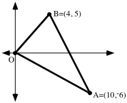

A. Give an equation for the perpendicular bisector of side OB.

B. Give an equation for the perpendicular bisector of side OA.

C. Give a system of the form $\left\{ \begin{array}{l}\text{a}\cdot x+\text{b}\cdot y=\text{c} \\ \text{d}\cdot x+\text{e}\cdot y=\text{f}\end{array} \right.$  whose solution is the circumcenter of triangle OAB.

D. Use PROGRAM SYSTEM to calculate the coordinates of the circumcenter of triangle OAB.  Give the coordinates of the circumcenter on your homework paper.  Also, enter them into your calculator’s memory as “F” and “S.”

E. Use PROGRAM DISTANCE to calculate the radius of the circumcenter of triangle OAB.  Give the distance accurate to the nearest thousandth on your homework paper and store the result from PROGRAM DISTANCE as “R (to remind us that this should be the radius of the circle in the same plane that passes through all three vertices).”

F. Get a view of triangle OAB on your calculator by making a connected scatter plot.  Then use three sets of parametric equations to get a view of the circumcircle of triangle OAB.  Use “F,” “S,” and “R” when you enter these commands.  Your calculator will use the numbers stored in the memory cells with these names.

### II.

<strong>The Search for Matrix Inverses—Part II</strong>

In part A of question V of assignment #66 you were asked to compute the product of matrix A = $\left[ \begin{matrix}5 & 4 \\ 2 & 3\end{matrix} \right]$ and matrix B = $\left[ \begin{matrix}3 & {}^{-}4 \\ {}^{-}2 & 5\end{matrix} \right]$.   The elements in these two matrices are related in a way that might lead you to think that matrix B was made to be the inverse of matrix A.  However, their product is $\left[ \begin{matrix}5 & 4 \\ 2 & 3\end{matrix} \right]\cdot \left[ \begin{matrix}3 & {}^{-}4 \\ {}^{-}2 & 5\end{matrix} \right]=\left[ \begin{matrix}7 & 0 \\ 0 & 7\end{matrix} \right]$.   The 7’s in the result show that

the entries in matrix B can be “scaled down” with a factor of $\frac{1}{7}$ so that the product is the identity:

$\left[ \begin{matrix}5 & 4 \\ 2 & 3\end{matrix} \right]\cdot \left[ \begin{matrix}\frac{3}{7} & \frac{{}^{-}4}{7} \\ \frac{{}^{-}2}{7} & \frac{5}{7}\end{matrix} \right]=\left[ \begin{matrix}5\cdot \frac{3}{7}+4\cdot \frac{{}^{-}2}{7} & 5\cdot \frac{{}^{-}4}{7}+4\cdot \frac{5}{7} \\ 2\cdot \frac{3}{7}+3\cdot \frac{{}^{-}2}{7} & 2\cdot \frac{{}^{-}4}{7}+3\cdot \frac{5}{7}\end{matrix} \right]=\left[ \begin{matrix}1 & 0 \\ 0 & 1\end{matrix} \right]$.

Thus, letting A = $\left[ \begin{matrix}\text{a} & \text{b} \\ \text{c} & \text{d}\end{matrix} \right]$ represent a “typical” $2\times 2$matrix, you can form the inverse of A, if it has one, by following these two steps:

step #1:  Create $\left[ \begin{matrix}\text{d} & {}^{-}\text{b} \\ {}^{-}\text{c} & \text{a}\end{matrix} \right]$ from A.

step #2: Compute $\text{a}\cdot \text{d}+\text{b}\cdot {}^{-}\text{c}$, the number in the 1,1 address of the product $\left[ \begin{matrix}\text{a} & \text{b} \\ \text{c} & \text{d}\end{matrix} \right]\cdot \left[ \begin{matrix}\text{d} & {}^{-}\text{b} \\ {}^{-}\text{c} & \text{a}\end{matrix} \right]$=$\left[ \begin{matrix}\text{a}\cdot \text{d}+\text{b}\cdot ^{-}\text{c} & \text{0} \\ \text{0} & {}^{-}\text{b}\cdot \text{c}+\text{a}\cdot \text{d}\end{matrix} \right]$  If $\text{a}\cdot \text{d}+\text{b}\cdot {}^{-}\text{c}$is equal to 1, then $\left[ \begin{matrix}\text{d} & {}^{-}\text{b} \\ {}^{-}\text{c} & \text{a}\end{matrix} \right]$ is the inverse of matrix A.  If $\text{a}\cdot \text{d}+\text{b}\cdot {}^{-}\text{c}$ is not equal to either 1 or 0, scale each entry in $\left[ \begin{matrix}\text{d} & {}^{-}\text{b} \\ {}^{-}\text{c} & \text{a}\end{matrix} \right]$ with $\frac{\text{1}}{\text{a}\cdot \text{d}+\text{b}\cdot {}^{-}\text{c}}$ to create $\left[ \begin{matrix}\frac{\text{d}}{\text{a}\cdot \text{d}+\text{b }\cdot {}^{-}\text{c}} & \frac{{}^{-}\text{b}}{\text{a}\cdot \text{d}+\text{b }\cdot {}^{-}\text{c}} \\ \frac{{}^{-}\text{c}}{\text{a}\cdot \text{d}+\text{b }\cdot {}^{-}\text{c}} & \frac{\text{a}}{\text{a}\cdot \text{d}+\text{b }\cdot {}^{-}\text{c}}\end{matrix} \right]$.  This is  inverse of A.

If this number, $\text{a}\cdot \text{d}+\text{b}\cdot {}^{-}\text{c}$, is equal to 0, matrix A has no inverse.

The number, $\text{a}\cdot \text{d}+\text{b}\cdot {}^{-}\text{c}$, computed from $\left[ \begin{matrix}\text{a} & \text{b} \\ \text{c} & \text{d}\end{matrix} \right]$ is more commonly represented by $\text{a}\cdot \text{d}-\text{b}\cdot \text{c}$.  $\text{a}\cdot \text{d}-\text{b}\cdot \text{c}$ is called the <strong>determinant</strong> of $\left[ \begin{matrix}\text{a} & \text{b} \\ \text{c} & \text{d}\end{matrix} \right]$.

In summary,

If $\text{a}\cdot \text{d}-\text{b}\cdot \text{c}$$\neq$0, the matrices

$\left[ \begin{matrix}\text{a} & \text{b} \\ \text{c} & \text{d}\end{matrix} \right]$ and $\left[ \begin{matrix}\frac{\text{d}}{\text{a}\cdot \text{d}-\text{b}\cdot \text{c}} & \frac{{}^{-}\text{b}}{\text{a}\cdot \text{d}-\text{b}\cdot \text{c}} \\ \frac{{}^{-}\text{c}}{\text{a}\cdot \text{d}-\text{b}\cdot \text{c}} & \frac{\text{a}}{\text{a}\cdot \text{d}-\text{b}\cdot \text{c}}\end{matrix} \right]$ are inverses of each other.

Later in this course you will explore the geometric implications of having a determinant equal to 0.

A.

1\. Give the determinant of $\left[ \begin{matrix}6 & 4 \\ 4 & 3\end{matrix} \right]$

2\. Give the inverse of $\left[ \begin{matrix}6 & 4 \\ 4 & 3\end{matrix} \right]$.

B. Use your answer for “A,2: right above to compute the exact solution of the matrix equation:

$\left[ \begin{matrix}6 & 4 \\ 4 & 3\end{matrix} \right]\cdot \left[ \begin{matrix}x \\ y\end{matrix} \right]=\hspace{2.75em}\left[ \begin{matrix}17 \\ 23\end{matrix} \right]$

C. Use PROGRAM SYSTEM to give the solution of the system

$\left\{ \begin{array}{l}6\cdot x+4\cdot y=17 \\ 4\cdot x+3\cdot y=23\end{array} \right.$

### III.

A. Give an expression for the entry in the (1,1) address of the product

$\left[ \begin{matrix}\text{a} & \text{b} \\ \text{c} & \text{d}\end{matrix} \right]$.$\left[ \begin{matrix}\frac{\text{d}}{\text{a}\cdot \text{d}-\text{b}\cdot \text{c}} & \frac{{}^{-}\text{b}}{\text{a}\cdot \text{d}-\text{b}\cdot \text{c}} \\ \frac{{}^{-}\text{c}}{\text{a}\cdot \text{d}-\text{b}\cdot \text{c}} & \frac{\text{a}}{\text{a}\cdot \text{d}-\text{b}\cdot \text{c}}\end{matrix} \right]$

B. Give an expression for the entry in the (1,2) address of the same product.

### IV.

If the system $\left\{ \begin{array}{l}5\cdot x+8\cdot y=80 \\ 10\cdot x+4\cdot y=100\end{array} \right.$ is written in the matrix form $\text{A}\cdot \left[ \begin{matrix}x \\ y\end{matrix} \right]=\text{C}$, give on your homework paper the matrices A and C.

### V.

Here again is the Mike’s Famous Toy Truck question:

Mike’s Famous Toy Trucks manufactures two kinds of toy trucks—a standard model and a deluxe model.  In the manufacturing process, each standard model requires two hours of grinding and two hours of finishing; each deluxe model also requires two hours of grinding but four hours of finishing.  The company employs two grinders and three finishers. Each of these five employees works 40 hours each week.  Each standard model brings the company a profit of \$3.00 and each deluxe model brings a profit of \$4.00.

A. Classify each of the following suggested weekly production amounts as either “feasible” or “unfeasible.”

1\. Make 28 standard trucks and 5 deluxe trucks each week.

2\. Make 28 standard trucks and 10 deluxe trucks each week.

3\. Make 15 deluxe trucks and 40 standard trucks each week.

4\. Make 15 deluxe trucks and 31 standard trucks each week.

B. Which of the feasible plans from part “A” should yield the greatest profit?

C.

1\. Give five different pairs that make maximum use of the worker time available either for grinding or for finishing or for both.  In each pair, the first coordinate should be a number of standard trucks to make each week, and the second coordinate should be the number of deluxe trucks to make each week.  Of the five pairs you give, give at least 2 for which all the finishing time is used while not all the grinding time is used.

2\. Enter the coordinates of the pairs you gave as your answer to “C” right above into lists #1 and #2.  Then use a scatter plot to answer this question: Are the (number of standard trucks, number of deluxe trucks) pairs collinear?

### VI.

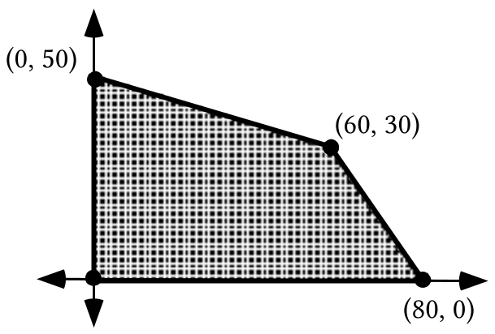

A. The shaded region in the illustration above has two boundary segments that are contained in oblique lines.  Give equations for each of these lines.

B. Write a system of four inequalities whose entire set of solutions is the set of points in the shaded region above, including its four boundary segments.

### VII.

For the system: $\left\{\begin{array}{l}5\cdot x+8\cdot y\geq80\quad A \\ 10\cdot x+4\cdot y\geq100\quad B\end{array}\right.$

A. Give the <em>x</em> and <em>y</em>-intercepts for the boundary line for the A inequality.

B. Give the <em>x</em> and <em>y</em>-intercepts for the boundary line for the B inequality.

C. Calculate the intersection of the boundary lines.

D. Sketch the boundaries and the region of solutions.

## Assignment #68

### I.

In each case, compute the determinant of the given matrix.

A. $\left[ \begin{matrix}7 & 2 \\ 5 & 3\end{matrix} \right]$  B. $\left[ \begin{matrix}5 & 3 \\ 7 & 2\end{matrix} \right]$  C. $\left[ \begin{matrix}20 & 14 \\ 12 & 4\end{matrix} \right]$

### II.

<strong>A New Way to Get the Solution of a</strong> $2\times 2$ <strong>System: Matrix Multiplication</strong>

A $2\times 2$ system of the form $\left\{ \begin{array}{l}\text{a}\cdot x+\text{b}\cdot y=\text{e} \\ \text{c}\cdot x+\text{d}\cdot y=\text{f}\end{array} \right.$ can be represented as the matrix equation

$\left[ \begin{matrix}\text{a} & \text{b} \\ \text{c} & \text{d}\end{matrix} \right]\cdot \left[ \begin{matrix}x \\ y\end{matrix} \right]=\hspace{0.75em}\left[ \begin{matrix}\text{e} \\ \text{f}\end{matrix} \right]$.

The matrix $\left[ \begin{matrix}\text{a} & \text{b} \\ \text{c} & \text{d}\end{matrix} \right]$ is called the <strong>matrix of coefficients</strong> and the matrix $\left[ \begin{matrix}\text{e} \\ \text{f}\end{matrix} \right]$ is called the <strong>matrix of constants</strong>.

If the determinant, $\text{a}\cdot \text{d}-\text{b}\cdot \text{c}$, of the matrix of coefficients is not equal to 0, the matrix equation

$\left[ \begin{matrix}\text{a} & \text{b} \\ \text{c} & \text{d}\end{matrix} \right]\cdot \left[ \begin{matrix}x \\ y\end{matrix} \right]=\hspace{0.75em}\left[ \begin{matrix}\text{c} \\ \text{f}\end{matrix} \right]$

can be “solved” by multiplying each side by the inverse of the matrix of coefficients.

The designers of your calculator built a version of the formula  $\left[ \begin{matrix}\frac{\text{d}}{\text{a}\cdot \text{d}-\text{b}\cdot \text{c}} & \frac{{}^{-}\text{b}}{\text{a}\cdot \text{d}-\text{b}\cdot \text{c}} \\ \frac{{}^{-}\text{c}}{\text{a}\cdot \text{d}-\text{b}\cdot \text{c}} & \frac{\text{a}}{\text{a}\cdot \text{d}-\text{b}\cdot \text{c}}\end{matrix} \right]$

into your calculator.  Therefore, you can use your calculator to obtain the inverse of any $2\times 2$ matrix that has an inverse.

If you enter the matrix of coefficients of a system as \[A\] and the matrix of constants as \[C\] your calculator will compute what is at least a very, very close approximation of the solution if you key in

$\left[ \text{A} \right]^{{}^{-}1}\ast \left[ \text{C} \right]$

and push \[ENTER\].  “$^{{}^{-}1}$,” the symbol for inverse, is accessed by pushing the key directly under the \[MATH\] key on the calculator.

A. Give a matrix equation of the form $\text{A}\cdot \left[ \begin{matrix}x \\ y\end{matrix} \right]=\hspace{2.0em}\text{C}$ whose solution is the solution of the system $\left\{ \begin{array}{l}20\cdot x+14\cdot y=57 \\ 12\cdot x+4\cdot y=30\end{array} \right.$.

B. The solution of the matrix equation in “A” right above can be computed by multiplying matrix C by another matrix.  Give this second matrix.

C. Use matrix multiplication to calculate the solution of the system in “A” above.  Use PROGRAM SYSTEM to check your answer.

### III.

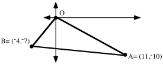

A. Give the exact coordinates of the circumcenter of triangle OBA.

B. Give the radius of the circumcircle of triangle OBA accurate to the nearest thousandth.

C. Give a set of parametric equations from which a representation of the circumcircle can be generated.  Then check your work by seeing if the generated representation actually passes through the vertices of a connected scatter plot image of the triangle.

### IV.

Here again is the Mike’s Famous Toy Truck question:

Mike’s Famous Toy Trucks manufactures two kinds of toy trucks-- a standard model and a deluxe model.  In the manufacturing process, each standard model requires two hours of grinding and two hours of finishing; each deluxe model also requires two hours of grinding but four hours of finishing.  The company employs two grinders and three finishers and each of these five employees works 40 hours each week.  Each standard model brings the company a profit of \$3.00 and each deluxe model brings a profit of \$4.00.  For the questions below, use “<em>x</em>” as the variable for the number of standard trucks to be made each week and “<em>y</em>” as a variable for the number of deluxe trucks to be made each week.

A. The linear inequality $2\cdot x+2\cdot y\leq 80$ expresses a <strong>constraint</strong> about how much grinding can be done each week.  Give a linear inequality that expresses a constraint about how much finishing can be done each week.

B. Give an expression that can be used to compute the profit to be made by manufacturing (and selling) trucks each week.  This expression should contain the variables “<em>x</em>” and “<em>y</em>” used as described above.

### V.

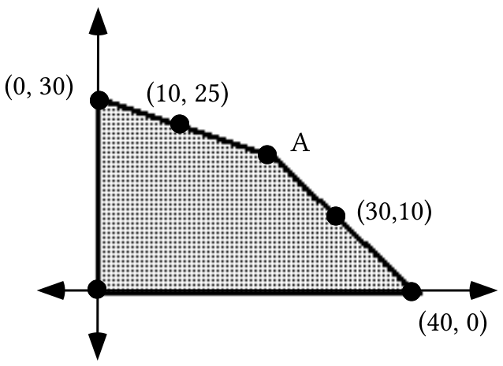

A. The shaded region in the illustration above has two boundary segments that are contained in oblique lines.  Give equations describing each of these lines.

B. Use PROGRAM SYSTEM to calculate the coordinates of point A.

C. Write a system of four inequalities whose entire set of solutions is the set of points in the shaded region above, including its four boundary segments.

D.

1\. Give four points in the shaded region with the same first coordinate as (10,25).

2\. Of your four points and (10,25), which gives the largest value for “P” when the coordinates are used to replace “<em>x</em>” and “<em>y</em>” in P = $3\cdot x+4\cdot y$?

E.

1\. Give four points in the shaded region with the same second coordinate as point A.

2\. Of your four points and point A, which gives the largest value for “P” when the coordinates are used to replace “<em>x</em>” and “<em>y</em>” in P = $3\cdot x+4\cdot y$?

### VI.

For the system $\left\{ \begin{array}{l}5\cdot x+11\cdot y\leq 110 \\ 8\cdot x+4\cdot y\leq 72 \\ x\geq 0 \\ y\geq 0\end{array} \right.$,

A. Give the intersection of the two oblique boundary lines.

B. Sketch the region of solutions and label the <em>x-</em> and <em>y</em>-intercepts of the oblique boundaries with their coordinates.

### VII.

A. Give the slope of the line with equation $y=\frac{{}^{-}7}{9}\cdot x$.

B. $y=\frac{{}^{-}7}{9}\cdot x+\frac{66}{27}$ is an equation for a line.

1\. Give the slope of that line.

2\. Give the coordinates of the intersection of this line with the $y-\text{axis}\mathrm{.}$

C. Solve each of these equations for <em>y</em>.

1\. $43=5\cdot x+3\cdot y$

2\. $\text{P}=5\cdot x+3\cdot y$

### VIII.

Use a translation after a size transformation after a translation to calculate the coordinates of the midpoint of segment AB.

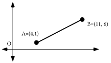

## Assignment #69

### I.

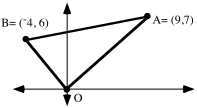

A. Give the exact coordinates of the circumcenter of triangle OBA.

B. Give the radius of the circumcircle of triangle OBA accurate to the nearest thousandth.

C. Give a set of parametric equations from which a representation of the circumcircle can be generated.  Then check your work by seeing if the generated representation actually passes through the vertices of a connected scatter plot image of the triangle.

### II.

<strong>A System of Constraints for the Mike's Toy Truck Question</strong>

Mike’s Famous Toy Trucks manufactures two kinds of toy trucks–a standard model and a deluxe model.  In the manufacturing process, each standard model requires two hours of grinding and two hours of finishing; each deluxe model also requires two hours of grinding but four hours of finishing.  The company employs two grinders and three finishers and each of these five employees works 40 hours each week.  Each standard model brings the company a profit of \$3.00 and each deluxe model brings a profit of \$4.00.

The managers of Mike’s Toy Trucks do not have unrestricted freedom to manufacture each week as many standard trucks and deluxe trucks as they choose.  There are limitations to what they can do that constrain their choices.  If “<em>x</em>” is chosen as the variable for the number of standard trucks made each week and “<em>y</em>” is chosen as the variable for the number of deluxe trucks made each week, the constraining conditions can be expressed by linear inequalities:

Constraint #1: A maximum of 80 hours of grinding can be done each week by the two grinders.  Since each type of truck requires 2 hours, any feasible point must be a solution of:

$2\cdot x+2\cdot y\leq 80$

Constraint #2: A maximum of 120 hours of finishing can be done each week by the three finishers.  Each standard truck requires 2 hours of finishing and each deluxe truck requires 4 hours of finishing.  Therefore any feasible point must also be a solution of:

$2\cdot x+4\cdot y\leq 120$

Since each feasible point must be a solution of two different linear inequalities, it must be a solution of the system made from these inequalities:

$\left\{ \begin{array}{l}2\cdot x+2\cdot y\leq 80 \\ 2\cdot x+4\cdot y\leq 120\end{array} \right.$

Nothing in the statement of the question expressly says the managers cannot choose to make a negative number of either or both types of truck each week, but common sense says this is not feasible.  Therefore the simple inequalities

$x+0\cdot y\geq 0$ and $0\cdot x+y\geq 0$,

conveniently abbreviated as

$x\geq 0$ and $y\geq 0$,

should be added to the system of constraints.  These additional <strong>common sense constraints</strong> make all the points in quadrants II, III, or IV ineligible to be feasible points.

Mike’s Famous Toy Trucks once again:

Mike’s Famous Toy Trucks manufactures two kinds of toy trucks-- a standard model and a deluxe model.  In the manufacturing process, each standard model requires two hours of grinding and two hours of finishing; each deluxe model also requires two hours of grinding but four hours of finishing.  The company employs two grinders and three finishers and each of these five employees works 40 hours each week.  Each standard model brings the company a profit of \$3.00 and each deluxe model brings a profit of \$4.00.  For the questions below, use “<em>x</em>” as the variable for the number of standard trucks to be made each week and “<em>y</em>” as a variable for the number of deluxe trucks to be made each week.

A. Write the entire systems of constraints for this question, including the two implied, common sense constraints.

B. Copy and complete this equation for computing the profit from the number of trucks of each type made during a week:

P =

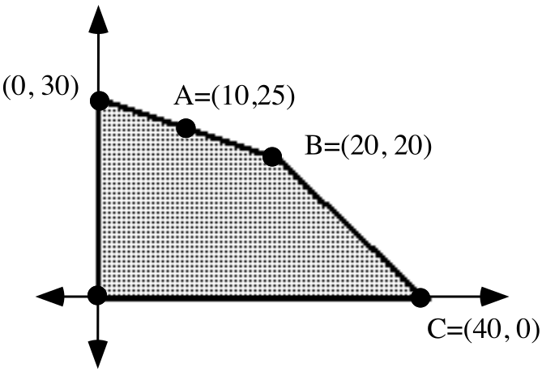

C. The shaded region in the illustration above is the feasibility region for the Mike’s Famous Toy Truck Question. Use your answer to “B” to compute the profit associated with point A.

D. Give the coordinates of any feasible point on the same vertical as point A and give the profit associated with that point.

E. Use your answer to “B” to compute the profit associated with point B.

F. Give the coordinates of any feasible point on the same horizontal line as point B and give the profit associated with that point.

G. Give the coordinates of any point between points B and C and collinear with them.  Then give the profit associated with that point.

### III.

A paper recycling company uses two materials, scrap paper and scrap cloth, to make two different grades of recycled paper.  A single batch of grade A recycled paper is made from 4 tons of cloth and 18 tons of paper, while one batch of grade B paper needs 1 ton of cloth and 15 tons of paper.  The company has 10 tons of scrap cloth and 66 tons of scrap paper on hand.

A. Classify each of the following production plans as either feasible or unfeasible.

1\. They plan to make 10 batches of grade B paper and no grade A paper.

2\. They plan to make 1 batch of grade A paper and 4 batches of grade B paper.

3\. They plan to make 1 batch of grade A paper and 3 batches of grade B paper.

4\. They plan to make 2 batches of grade A paper and 1.5 batches of grade B paper.

5\. They plan to make 3 batches of grade A paper and no grade B paper.

B. The company can make a profit of \$1000 per batch of grade A paper and \$500 per batch of grade B paper.  Of the production plans you classified as feasible from “A” right above, which will bring the company the greatest profit?

### IV.

Sketch a graph of the region of solutions of the following system.  Label the exact coordinates of any intersection of the oblique boundaries with each other or with the coordinate axes.

$\left\{ \begin{array}{l}4\cdot x+1\cdot y\leq 10 \\ 18\cdot x+15\cdot y\leq 66 \\ x\geq 0 \\ y\geq 0\end{array} \right.$

### V.

In each case, compute the determinant of the given matrix:

A. $\left[ \begin{matrix}2 & 0 \\ 0 & 2\end{matrix} \right]$  B.$\left[ \begin{matrix}\mathrm{cos(}23^{\text{o}}\mathrm{)} & {}^{-}\mathrm{sin(}23^{\text{o}}\mathrm{)} \\ \mathrm{sin(}23^{\text{o}}\mathrm{)} & \mathrm{cos(}23^{\text{o}}\mathrm{)}\end{matrix} \right]$  C. $\left[ \begin{matrix}7 & 11 \\ 2 & 7\end{matrix} \right]$

### VI.

A. Give a matrix equation of the form $\text{A}\cdot \left[ \begin{matrix}x \\ y\end{matrix} \right]=\hspace{2.0em}\text{C}$ whose solution is the solution of the system $\left\{ \begin{array}{l}7\cdot x+11\cdot y=80 \\ 2\cdot x+7\cdot y=130\end{array} \right.$.

B. The solution of the matrix equation in “A” right above can be computed by multiplying matrix C by another matrix.  Give this second matrix.

C. Use matrix multiplication to calculate the solution of the system in “A” above.  Use PROGRAM SYSTEM to check your answer.

### VII.

A. $34=6\cdot x+11\cdot y$ is an equation for a line.

1\. Solve this equation for <em>y</em>.

2\. Give the slope of that line.

3\. Give the coordinates of the intersection of this line with the $y-\text{axis}\mathrm{.}$

B. Give the slope and point of intersection with the $y-\text{axis}$ of the line with equation $52=7\cdot x+8\cdot y$.

### VIII.

Use a translation after a size transformation after a translation to determine the coordinates of the midpoint of segment AB.

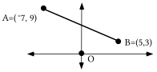

## Assignment #70

### I.

<strong>Locating an Optimal Feasible Point–Part I</strong>

If “<em>x</em>” is used as the variable for the number of standard trucks made each week  and if “<em>y</em>” is used as the variable for the number of deluxe trucks made each week then

$\left\{ \begin{array}{l}2\cdot x+2\cdot y\leq 80 \\ 2\cdot x+4\cdot y\leq 120 \\ x\geq 0 \\ y\geq 0\end{array} \right.$

is a system of constraints for the Mike’s Famous Toy Truck question.  The solution of the system of constraints are all the points either on the darkened boundary or in the hatched interior shown below.

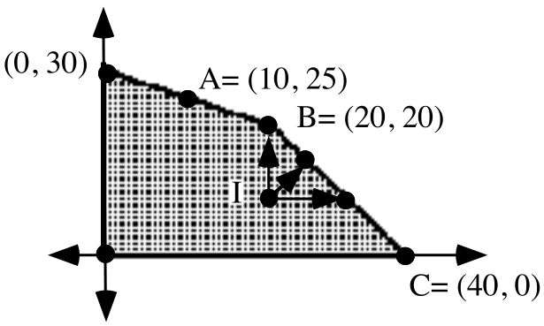

The number of points in the interior of that region or on its boundary is extremely large.  That is, the number of feasible points is extremely large.  This would seem to make the task of finding the feasible point or points that yield the greatest profit extremely tedious, but with a little thought and experiment, the search can be narrowed.

Point I is a “typical” feasible point in the interior of the feasibility region.  If (a,b) represents the coordinates of point I, then the profit associated with it is represented by

a · \$3 + b · \$4

The arrows from point I show that there are feasible points where at least one coordinate is increased and no coordinate is decreased. This means that the profit can feasibly be increased by moving from point I to certain boundary points.

The discussion of point I should suggest that <strong>a movement can be made from any feasible point in the interior to a boundary point associated with a greater profit</strong><em><strong>.</strong></em>  This more profitable boundary point will be above and/or to the right of the interior point.  This narrows the search for the most profitable feasible point–

<strong>The best feasible point or points for a linear programming question are found on the boundary of the feasibility region.</strong>

Even when the search for the best, or optimal, feasible point or points is narrowed to the boundary of the feasibility region, there are still a very large number of candidates among which a choice is to be made.  In this assignment you will do some work that will lead to a significant new narrowing of the search along the boundary of a feasibility region.

Here for the last time is the Mike’s Famous Toy Trucks question:

Mike’s Famous Toy Trucks manufactures two kinds of toy trucks–a standard model and a deluxe model.  In the manufacturing process, each standard model requires two hours of grinding and two hours of finishing; each deluxe model also requires two hours of grinding but four hours of finishing.  The company employs two grinders and three finishers. Each of these five employees works 40 hours each week.  Each standard model brings the company a profit of \$3.00 and each deluxe model brings a profit of \$4.00.  For the questions below, use “<em>x</em>” as the variable for the number of standard trucks to be made each week and “<em>y</em>” as a variable for the number of deluxe trucks to be made each week.

A. Write the entire systems of constraints for this question, including the two implied, common sense constraints.

B. Sketch a graph of the feasibility region for this question and label the exact coordinates of all feasible vertices.

C. Copy and complete this equation for computing the profit from the number of trucks of each type made during a week:

P =

D. Based on your answer to “C,” which of the vertices of the boundary of the feasibility region is associated with the greatest profit?

E. Suppose that instead of making \$3.00 on each standard truck and \$4.00 on each deluxe truck, Mike’s made \$2.00 on each standard truck and \$5.00 on each deluxe truck.  Copy and complete this equation for computing the profit from the number of trucks of each type made during a week under these altered conditions.

P =

F. Based on your answer to “E,” which of the vertices of the boundary of the feasibility region is associated with the greatest profit?

G. Suppose that instead of making \$3.00 on each standard truck and \$4.00 on each deluxe truck, Mike’s made \$5.00 on each standard truck and \$4.00 on each deluxe truck.  Copy and complete this equation for computing the profit from the number of trucks of each type made during a week under these altered conditions.

P =

H. Based on your answer to “G,” how many of each type of truck should be made each week to maximize the company profit?

### II.

Solve each of these equations for <em>y</em>.

A.  P = $3\cdot x+4\cdot y$     B.  P = $2\cdot x+5\cdot y$       C.  P = $5\cdot x+4\cdot y$

### III.

Enter an expression for Y1 based on the equation $y=\frac{{}^{-}3}{4}\cdot x+\frac{120}{4}$.  Then use your calculator to compute the second coordinates of the points on the line with that equation whose first coordinates are given:

A. The first coordinate is 8.

B. The first coordinate is 20.

C. The first coordinate is 32.

### IV.

Here again is the question about manufacturing paper from recycled materials:

A paper recycling company uses two materials, scrap paper and scrap cloth, to make two different grades of recycled paper.  A single batch of grade A recycled paper is made from 4 tons of cloth and 18 tons of paper, while one batch of grade B paper needs 1 ton of cloth and 15 tons of paper.  The company has 10 tons of scrap cloth and 66 tons of scrap paper on hand.

A. If “<em>a</em>” is used as the variable for the number of batches of grade A paper the company will make and the variable “<em>b</em>” is used for the number of batches of grade  B paper the company will make, write a system of constraints for this question, including the implied common sense constraints.

B. Sketch a graph of the feasibility region for this question.  Use the horizontal axis for variable “<em>a</em>” and the vertical axis for variable “<em>b</em>.”    Label the exact coordinates of each of the vertices of this region.

C. If the company can make a profit of \$1000 for each batch of grade A paper it manufactures and \$500 for each batch of grade B paper it makes, what is the best production plan for the company to use the materials it has on hand?

### V.

Here is a question about choices a farmer can make:

The farmer has 400 acres on which she can grow corn or soybeans.  Because of government regulation she cannot plant more than 300 acres of corn or more than 200 acres of soybeans.  A further regulation requires that at least as many acres of corn as acres of soybeans be planted.

A. Classify each of these growing plans as either feasible or unfeasible:

1\. She will grow 200 acres of corn and 100 acres of soybeans.

2\. She will grow 100 acres of corn and 300 acres of soybeans.

3\. She will grow 250 acres of corn and 150 acres of soybeans.

4\. She will grow 150 acres of corn and 250 acres of soybeans.

B. If this farmer can make \$500 profit per acre for the corn and \$1000 profit per acre for the soybeans, which of the feasible plans from “A” right above will be the most profitable?

### VI.

Use matrix multiplication and the MATH “ Frac” command to compute the exact solution of each of the following systems:

A. $\left\{ \begin{array}{l}11\cdot x+31\cdot y=100 \\ 17\cdot x+{}^{-}8\cdot y={}^{-}84\end{array} \right.$                                B.

### VII.

Give the center and exact radius of the circumcircle for the triangle in the illustration below.

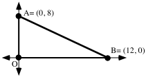

### VIII.

A. Use a translation after a size transformation after a translation to get the coordinates of the point midway from point A to point B.

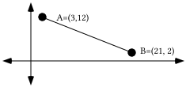

B. Use a translation after a size transformation after a translation to get the coordinates of the point two thirds of the way from point A to point B.

### IX.

A. Give the slope of the line that passes through the origin and the point (17,¯1.5).

B. Give the slope of the line that passes through (7,3) and (20,¯9).

## Assignment #71

### I.

<strong>Locating an Optimal Feasible Point–Part II</strong>

Through experimenting and reasoning you have already seen that the point associated with the greatest profit for the Mike’s Famous Toy Truck Company will be somewhere on the boundary of the feasibility region.  It is still necessary to find a way to narrow the search among the very large number of points on the boundary.

For Mike’s Famous Toy Truck Company the profit on each standard truck is \$3 and the profit on each deluxe truck is \$4.  Therefore the profit, P, associated with any feasible points can be computed from the equation shown below.

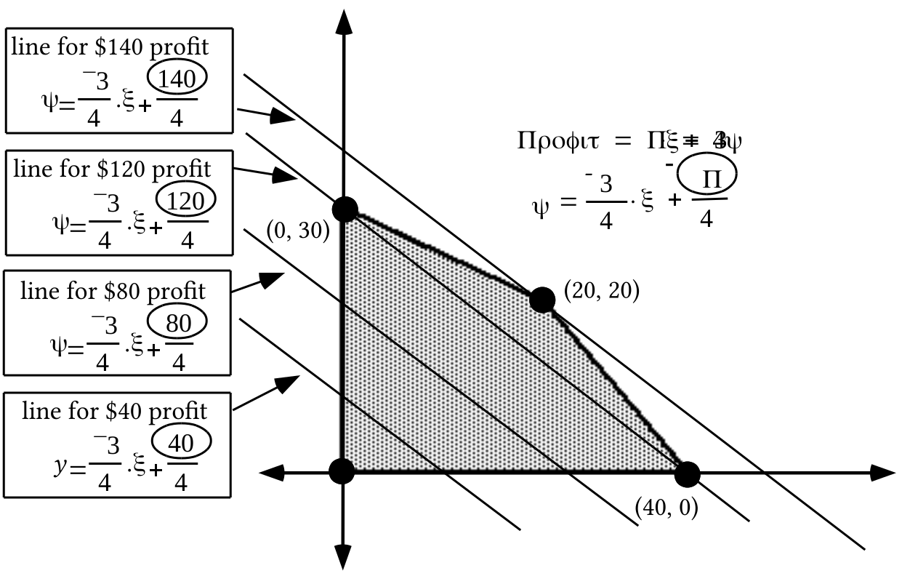

The second equation above, $y=\frac{{}^{-}3}{4}\cdot x+\frac{\text{P}}{4}$, reveals the relationship between the profit and the <em>y</em>-intercepts of a family of lines described by the profit equation. The larger the profit, the larger the <em>y</em>-intercept.  Note that the \$140 profit line touches the boundary of the feasibility region only at the vertex, (20,20).  If the profit number were increased to any amount beyond \$140, the line for that amount would not contain any feasible points.

In the illustration at the top of the next page, three members of a family of lines are shown based on new profit figures.  The new profit equation is based on the assumption that the company makes only \$2 profit on each standard truck but \$5 profit on each deluxe truck.

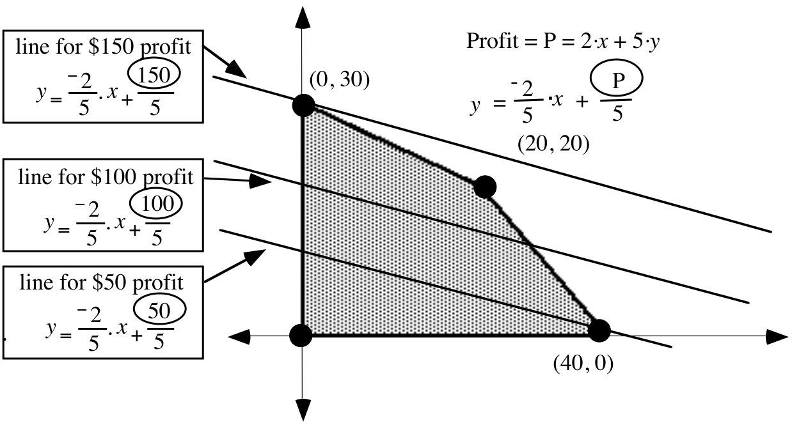

In this new situation, the line for any profit greater than \$150 would not touch any feasible points and the \$150 line touches only at (0,30), a vertex of the boundary.

The above two examples illustrate the following principle:

<strong>A best feasible point for a linear programming question can always be found at a vertex of the boundary of the feasibility region.</strong>

This is very good news, since there are usually just a few feasible vertices for linear programming questions in which only two variables need to be used to express all the constraining conditions.  The phrase “<strong>a</strong> best feasible point” was used instead of “<strong>the</strong> best feasible point” because a profit (or cost) line might be parallel to a boundary segment of the feasibility region.  In such a case the vertices at either end of that boundary segment, as well as all the points between them could all be associated with the same highest profit or lowest cost.  But even in such a case, the highest profit or lowest cost is still associated with a vertex of the boundary of the feasibility region.

Here again is the question about choices a farmer can make:

The farmer has 400 acres on which she can grow corn or soybeans.  Because of government regulation she cannot plant more than 300 acres of corn or more than 200 acres of soybeans.  A further regulation requires that at least as many acres of corn as acres of soybeans be planted.

A. If “<em>c</em>” is used as the variable for the number of acres of corn the farmer plants and “<em>s</em>” is used for the number of acres of soybeans the farmer plants, write a system of constraints for this question, including the implied common sense constraints.

B. Sketch a graph of the feasibility region for this question.  Use the horizontal axis for the “<em>c</em>” variable and the vertical axis for the “s” variable.  Label the exact coordinates of each of the vertices of this region.

C. If the farmer makes a profit of \$500 per acre of corn raised and \$1000 for each acre of soybeans grown:

1\. Copy and complete this equation for computing the profit for various planting plans:

P =

2\. What is the best planting plan for the farmer?

D. If the farmer makes a profit of \$275 per acre of corn raised and \$550 for each acre of soybeans grown:

1\. Copy and complete this equation for computing the profit for various planting plans:

P =

2\. What is the best planting plan for the farmer?

E. If the farmer makes a profit of \$700 per acre of corn raised and \$350 for each acre of soybeans grown:

1\. Copy and complete this equation for computing the profit for various planting plans:

P =

2\. What is the best planting plan for the farmer?

### II.

A patient is on a special diet and is allowed to fill his needs for carbohydrates and protein by eating only rice and steak.  Each serving of rice contains 2 units of carbohydrates and 1 unit of protein.  Each serving of steak contains 1 unit of carbohydrates and 4 units of protein.  The patient requires at least three units of carbohydrates and four units of protein each day.

A. Of the following diet plans, tell which are feasible and which are unfeasible.

1\. The patient will eat 5 units of rice and 2 units of steak each day.

2\. The patient will eat 2 units of rice and 2 units of steak each day.

3\. The patient will eat 2 units of steak each day.

4\. The patient will eat 4 units of rice each day.

B. If rice costs \$0.60 per unit and steak costs \$1.50 per unit, which of the feasible diets from part “A” will cost the least per day?

### III.

A mathematician has been called in to help make some decisions about a vitamin research project.  The researchers have been studying the combined effects of vitamin X and vitamin Y on the human system and have discovered the following:

1–The body can tolerate no more than 600 units per day of vitamin X and no more than 500 units per day of vitamin Y.

2–The total number of units per day of the two vitamins must be between 400 and 1000, inclusive.  (The “inclusive” means that the amount could actually be as low as 400 or as high as 1000.)

3–Due to the way the vitamins interact, the number of units per day of vitamin Y must be more than $\frac{1}{2}$ the number of units per day of vitamin X, but less than or equal to 3 times the number of units per day of vitamin X.

A. Classify each of the following dosages as either feasible or unfeasible.

1\. 300 units of vitamin X and 300 units of vitamin Y.

2\. 300 units of vitamin X and 500 units of vitamin Y.

3\. 300 units of vitamin X and 600 units of vitamin Y.

4\. 100 units of vitamin X and 400 units of vitamin Y.

5\. 500 units of vitamin X and 200 units of vitamin Y.

6\. 400 units of vitamin X and 600 units of vitamin Y.

B. If vitamin X costs 0.05 cent per unit and vitamin Y costs 0.04 cent per unit which of the feasible dosage plans would cost the least to use?

### IV.

A. Use a translation after a size transformation after a translation to get the coordinates of the point midway from point A to point B.

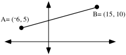

B. Use a translation after a size transformation after a translation to get the coordinates of the point two thirds of the way from point A to point B.

### V.

A. Give the slope of the line that passes through the origin and the point (12,4.5).

B. Give the slope of the line that passes through (¯6,2) and (11,8).

C. Give an equation for the line that passes through the origin and (12,4.5).

D. Give an equation for the line that passes through (¯6,2) and (11,8).

E. Give a system of the form $\left\{ \begin{array}{l}\text{a}\cdot x+\text{b}\cdot y=\text{c} \\ \text{d}\cdot x+\text{e}\cdot y=\text{f}\end{array} \right.$ whose solution is the intersection of the lines for which you gave equations as your answers for “C” and “D” right above.

F. Use matrix multiplication and the MATH “Frac” command to calculate the exact solution of the system you wrote as your answer to “E” right above.

### VI.

Shown below is a representation of a window.  The dark border is the frame and the clear inner portion is the glass.  As is indicated, the overall window is 3 feet by 3 feet and the frame is $\frac{1}{2}$ foot thick all the way around the glass.

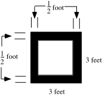

A. Compute the fraction of the entire window that is made up of glass.

B. If a rock is thrown at the window and hits it at a “random” point, what are the chances that the rock hits the glass?

C. What is the magnitude of a size transformation centered at the center of the window that would map the square outer boundary of the window frame onto the square that borders the glass?

### VII.

Copy the following sequence of expressions linked with equal signs and fill in the four sets of open parentheses so that the linked expressions are all equivalent:

$\begin{array}{l}\frac{\text{1}}{\text{2}}\cdot \text{(c}+{}^{-}\text{a)}+\text{a}=\frac{\text{1}}{\text{2}}\cdot \text{c}+\left(  \right)\cdot \text{a}+\text{a}=\frac{\text{1}}{\text{2}}\cdot \text{c}+{}^{-}\frac{\text{1}}{\text{2}}\cdot \text{a}+\frac{\text{2}}{\text{2}}\cdot \text{a} \\ =\frac{\text{1}}{\text{2}}\cdot \text{c}+\left( \frac{{}^{-}\text{1}}{\text{2}}+\left(  \right) \right)\cdot \text{a}=\frac{\text{1}}{\text{2}}\cdot \text{c}+\left(  \right)\cdot \text{a}=\left(  \right)\cdot \text{(a}+\text{c)}\end{array}$

## Assignment #72

### I.

Here again is the question about choosing the least expensive daily diet for a patient while still meeting some basic nutritional needs.

A patient is on a special diet and is allowed to fill his needs for carbohydrates and protein by eating only rice and steak.  Each unit of rice contain 2 units of carbohydrates and 1 unit of protein.  Each unit of steak contains 1 unit of carbohydrates and 4 units of protein.  The patient requires at least 3 units of carbohydrates and 4 units of protein each day.  Rice costs \$0.60 per serving and steak costs \$1.50 per serving.

A. If “<em>r</em>” is used as the variable for the number of units of rice consumed each day and “<em>s</em>” is used for the number of units of steak consumed each day, write a system of constraints for this question, including the implied common sense constraints.

B. If the horizontal axis is used as the “<em>r</em>” variable axis and the vertical axis is used as the “<em>s</em>” variable axis, sketch a graph of the feasibility region for this question.  Label the exact coordinates of each of the vertices of this region.

C. Copy and complete this equation for computing the costs of various diets:

C =

D. How many units of rice and how many units of steak should be given to the patient so that he is fed at minimum cost while still meeting his nutritional needs?

### II.

Here again is the question about the vitamin dosages:  A mathematician has been called in to help make some decisions about a vitamin research project.  The researchers have been studying the combined effects of vitamin X and vitamin Y on the human system and have discovered the following:

1-- The body can tolerate no more than 600 units per day of vitamin X and no more than 500 units per day of vitamin Y.

2-- The total number of units per day of the two vitamins must be between 400 and 1000, inclusive.  (The “inclusive” means that the amount could actually be as low as 400 or as high as 1000.)

3-- Due to the way the vitamins interact, the number of units per day of vitamin Y must be more than $\frac{1}{2}$ the number of units per day of vitamin X, but less than or equal to 3 times the number of units per day of vitamin X.

If “<em>x</em>” is used as the variable for the number of units of vitamin X and “<em>y</em>” is used as the variable for the number of units of vitamin Y, write a system whose solutions are the feasible points for this question.  Hint–such a system will contain <strong>at least 4</strong> inequalities <strong>in addition to</strong> the two common sense constraints.

### III.

<strong>Calculating the Coordinates of the Midpoint of any Segment</strong>

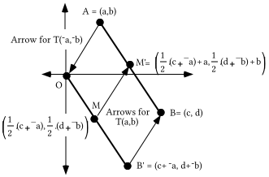

In the above illustration point B' is the image of point B under the same translation, T(¯a,¯b) that maps point A to the origin, O.  Point M is then the image of point B' under the origin centered size transformation with magnitude $\frac{1}{2}$, and point M' is the image of point M under T(a,b).

Point M is the midpoint of segment OB', and since translations preserve distance, point P' is therefore the midpoint of segment AB. The following strings of equivalents lead to more easily remembered representations of the coordinates of point M':

For the first coordinate:

$\frac{\text{1}}{\text{2}}\cdot \text{(c}+{}^{-}\text{a)}+\text{a}=\frac{\text{1}}{\text{2}}\cdot \text{c}+{}^{-}\frac{\text{1}}{\text{2}}\cdot \text{a}+\text{a}=\frac{\text{1}}{\text{2}}\cdot \text{c}+{}^{-}\frac{\text{1}}{\text{2}}\cdot \text{a}+\frac{\text{2}}{\text{2}}\cdot \text{a}=\frac{\text{1}}{\text{2}}\cdot \text{c}+\left( \frac{{}^{-}\text{1}}{\text{2}}+\frac{\text{2}}{\text{2}} \right)\cdot \text{a}=\frac{\text{1}}{\text{2}}\cdot \text{c}+\frac{\text{1}}{\text{2}}\cdot \text{a}=\frac{\text{1}}{\text{2}}\cdot \text{(a}+\text{c)}$

For the second coordinate:

$\frac{\text{1}}{\text{2}}\cdot \text{(d}+{}^{-}\text{b)}+\text{b}=\frac{\text{1}}{\text{2}}\cdot \text{d}+{}^{-}\frac{\text{1}}{\text{2}}\cdot \text{b}+\text{b}=\frac{\text{1}}{\text{2}}\cdot \text{d}+{}^{-}\frac{\text{1}}{\text{2}}\cdot \text{b}+\frac{\text{2}}{\text{2}}\cdot \text{b}=\frac{\text{1}}{\text{2}}\cdot \text{d}+\left( \frac{{}^{-}\text{1}}{\text{2}}+\frac{\text{2}}{\text{2}} \right)\cdot \text{b}=\frac{\text{1}}{\text{2}}\cdot \text{d}+\frac{\text{1}}{\text{2}}\cdot \text{b}=\frac{\text{1}}{\text{2}}\cdot \text{(d}+\text{b)}$

The coordinates of the midpoint of the segment joining points (a,b) and (c,d) are therefore

$\left( \frac{\text{1}}{\text{2}}\cdot \text{(a}+\text{c),}\frac{\text{1}}{\text{2}}\text{(b}+\text{d)} \right)$.

Notice that the first coordinate of the midpoint is the average of the first coordinates of the endpoints and the second coordinate of the midpoint is the average of the second coordinates of the endpoints.  This relationship is easily remembered and it will save time in doing future questions in which midpoints are needed.

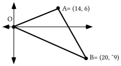

A. Somehow, get the coordinates of the point midway between points A and B.  This can by done with a translation following a size transformation following a translation.  On your tracing, represent this midpoint with a dot and label it “M.”

B. Give an equation for the line that passes through points O and M.

C. Give the coordinates of the point two-thirds of the way from O to M.

You can visually check all of your work by making a connected scatter plot of the vertices of the triangle from entries in list #1 and list #2.  Then you can enter your answers for “A” and “C” into lists #3 and #4 and make a disconnected scatter plot from these lists.  You can also enter as Y1 a description of the line you described with your answer to “B.”  If you see a question, make any needed corrections.

### IV.

A. Write an equation for the line that passes through (¯1,3) and (13,¯4).

B. Write an equation for the line that passes through (0,¯5) and (8,3).

C. Give the exact coordinates of the point of intersection of the lines which have as equations your answers to “A” and “B” right above.

### V.

Clear the home screen of your calculator and key in the expression “randInt (0,9).”  You get “randInt” by pushing \[MATH\], selecting PRB and pushing \[5\].  Now push \[ENTER\] over and over again until you think you can accurately describe the effect of using the “randInt(0,9)” instruction.

### VI.

Here is the statement of a question:

Each of two office workers has about 10 minutes of Xeroxing to do each day.  They both go to the same copy room, where two machines are available for them to use between 3:00 and 4:00 PM each day.   Each worker tries to allow enough time to get the copy work done each time.  Each of them arrives at the copy machine at a time after 3:00 that “varies randomly” from day to day.  The question is to determine the chances that one of the workers will be using the copy machine when the other arrives.

Copy the coordinate system at the top of the next page onto your homework paper and add to your copy any boundaries needed to enclose the region that contains the pairs associated with the times when the workers might arrive at the copy machine.  Also label the coordinates of any intersections of boundaries.

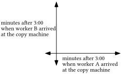

### VII.

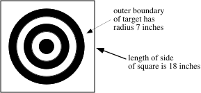

A. The illustration above is of a darts target made by printing concentric circles on a square piece of cork.

1\. Calculate the exact area of the circular target region.

2\. Calculate the area of the square piece of cork.

B. If a dart player is good enough to hit the cork each time but not good enough to always hit the target, what would you say are the chances that he will hit the target?

## Assignment #73

### I.

Here for the third time is the question about vitamin dosages:

A mathematician has been called in to help make some decisions about a vitamin research project.  The researchers have been studying the combined effects of vitamin X and vitamin Y on the human system and have discovered the following:

1-- The body can tolerate no more than 600 units per day of vitamin X and no more than 500 units per day of vitamin Y.

2-- The total number of units per day of the two vitamins must be between 400 and 1000, inclusive.  (The “inclusive” means that the amount could actually be as low as 400 or as high as 1000.)

3-- Due to the way the vitamins interact, the number of units per day of vitamin Y must be more than $\frac{1}{2}$ the number of units per day of vitamin X, but less than or equal to 3 times the number of units per day of vitamin X.

A. If “<em>x</em>” is used as the variable for the number of units of vitamin X and “<em>y</em>” is used as the variable for the number of units of vitamin Y, write a system whose solutions are the feasible points for this question.

B. If the horizontal axis is used as the “<em>x</em>” variable axis and the vertical axis is used as the “<em>y</em>” variable axis, sketch a graph of the feasibility region for this question.  Label the exact coordinates of each of the vertices of this region.

C. If vitamin X costs 0.05 cent per unit and vitamin Y costs 0.04 cent per unit, copy and complete this equation for the costs of various dosages:

C =

D. What is the dosage that will meet all the conditions and cost the least?

### II.

Trace the triangle below onto your homework paper.

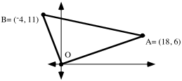

A. Get the coordinates of the point midway between points A and B. On your tracing, represent this midpoint with a dot and label it “M.”

B. Give an equation for the line that passes through points O and M.

C. Get the coordinates of the point midway between points O and B.  On your tracing, represent this midpoint with a dot and label it “N.”

D. Give an equation for the line that passes through points A and N.

E. Use PROGRAM SYSTEM to help get the coordinates of the intersection of the lines described by your answers to “B” and “D.”

You can visually check all of your work by making a connected scatter plot of the vertices of the triangle from entries in list #1 and list #2.  Then you can enter your answers for “A” and “C” into lists #3 and #4 and make a disconnected scatter plot from these lists.  You can also enter as Y1 an expression for the line you described with your answer to “B” and as Y2 an expression for the line you described with your answer to “D.”  If you see a question, make any needed corrections.

### III.

Here again is a statement of a question about the possibility of a chance meeting of two office workers at a copy machine they both use:

Each of two office workers has about 10 minutes of Xeroxing to do each day.  They both go to the same copy room where at least two machines are available for them to use between 3:00 and 4:00 PM each day.  Each worker tries to allow enough time to get the copy work done each time.  Each of them arrives at the copy machine at a time after 3:00 that “varies randomly” from day to day.  The question is to determine the chances that one of the workers will be using the copy machine when the other arrives.

Trace the coordinate system below onto your homework paper and add to it any boundaries needed to enclose the points associated with pairs of times when the workers might arrive at the copy machine.

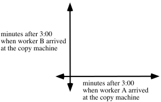

A. Now enter the expression “randInt(0,50)” at the home screen of your calculator and push \[ENTER\] twice.  Consider the pair of numbers as the numbers of minutes after 3:00 that each of the workers arrives at the copy machine.  If these numbers indicate that the workers would encounter each other at the machine, graph the pair on the coordinate system with an “+” marker.  Also record the coordinates on your homework paper.  On the other hand, if these numbers indicate that the workers would not be at the machine together graph the pair on the coordinate system with a “$^{\text{o}}$” marker.  Again, record the coordinates on your homework paper.

B. By pushing \[ENTER\] collect nine other pairs and graph them with a “+” or a “$^{\text{o}}$” marker and record the pairs on your homework paper.

C. What fraction of the ten marks you made are “+’s”?

### IV.

In each case give the solution of the given system.  You should not need your calculator to do this.

A. $\left\{ \begin{array}{l}y=500 \\ x+y=700\end{array} \right.$  B. $\left\{ \begin{array}{l}x=400 \\ x+y=800\end{array} \right.$  C. $\left\{ \begin{array}{l}y=100 \\ x-y=700\end{array} \right.$

### V.

Sketch the solutions of the given system and label the coordinates of all the vertices of the boundary of the region of solutions.

$\left\{ \begin{array}{l}y\leq 1200 \\ x\leq 1000 \\ x+y\leq 1500 \\ y\geq \frac{1}{4}\cdot x \\ x\geq 0 \\ y\geq 0\end{array} \right.$

### VI.

The “double” inequality ${}^{-}10\leq x-y\leq 10$ is equivalent to a system of two linear inequalities.  Give this system.

### VII.

Compute the exact area of the hexagon whose interior is shaded in the illustration below

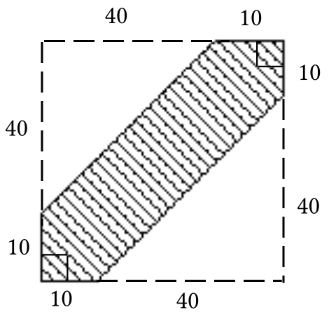

### VIII.

<strong>A Question that Introduces Geometric Probabilities</strong>

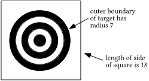

The ability to hit a dart target like the one illustrated above near its center varies from individual to individual.  If one dart player is observed throwing darts at the target over a long period of time, one would be able to give numbers based on that observation which express the chances of that player hitting particular regions of the dart board.

If, on the other hand, one knew nothing about the skill of the player about to throw some darts, one could compute numbers that might predict at least fairly well the proportion of time that player might hit some particular region of the board.  In the absence of any experience with a particular player, one could base a computation of chances on the areas of various regions of the board.  For example,

The area of the region within the outer boundary circle of the target rings is$\pi \cdot 7^{2}$  and the area of the entire square dart board is $18^{2}$.  A ratio of these areas, that is, the fraction $\frac{\pi \cdot 7^{2}}{18^{2}}\approx 0\mathrm{.}475$, gives the “geometric probability” that a dart thrown “at random” will hit somewhere within the circle of rings.

The phrase “at random” indicates that this computation is not based on observations of the skill of a particular dart thrower.  Instead, it expresses the assumption that if there are two regions of the board with equal areas the same chance should be assigned to the dart striking either of them.  This is the assumption even if one of these two regions of equal area is very near the center while the other is near the outer edge of the board.

Geometric probabilities are computed from ratios of areas of regions.  They are based on the assumption that any two regions of the same area should be assigned the same chance.

In the figure at the top of the next page, triangle AB'C' is the image of triangle ABC under a size transformation centered at A with magnitude 2.  If a point is chosen “at random” within triangle AB'C', what are the chances that it will be in the shaded region?

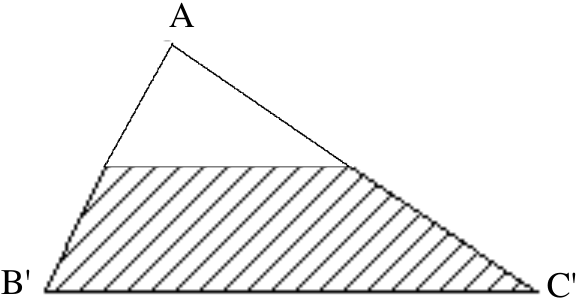

### IX.

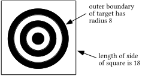

If it is assumed that a dart thrower will hit randomly in the square piece of cork on which the circular target is drawn, what are the chances that he will actually hit a point in the target?

## Assignment #74

### I.

<strong>The Medians of a Triangle</strong>

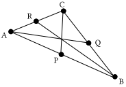

In the illustration above point P is the midpoint of side AB, point Q is the midpoint of side BC and point R is the midpoint of side AC.  The segments AQ, BR and CP, each of which joins a vertex to the midpoint of the side across from that vertex are called the <strong>medians</strong> of the triangle.  It appears from the illustration that the medians might all intersect in the same point.  You are going to use coordinates and PROGRAM SYSTEM to explore that possibility as you do question I below.

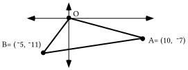

A. Give an equation for the line that contains the median from vertex A to side OB.

B. Give an equation for the line that contains the median from vertex B to side OA.  Before proceeding, get a visual check of this answer and your answer for “A” right above by using a connected scatter plot and graphs made from Y1 and Y2.

C. Give the exact coordinates of the intersection of the medians mentioned in “A” and “B” above.

D. Give an equation for the line that contains the median from vertex O to side AB.

E. Use PROGRAM SYSTEM again to compute the intersection of the median mentioned in “D” right above with the median mentioned in “A.”

F. Give the exact coordinates of the point two-thirds of the way from the origin to the midpoint of segment AB.

G. Use PROGRAM DISTANCE to compute the distance from your answer to “C” to each of the vertices of the triangle. Give the distances accurate to five decimal places.

### II.

Here is a new linear programming question for you to think about.  This question is adapted from “Optimality Pays: An Introduction to Linear Programming” by Jeganathan Sriskandarajah and published by COMAP, the Consortium for Mathematics and Its Applications.

An aquarium is used to grow fish for sale to restaurants and markets.  The aquarium is stocked with two species of fish, species A and species B, whose average weights are 3 and 2 lbs., respectively.  These fish are fed with two types of food--type P and type Q.  The average daily requirements for a species A fish is 2 units of type P food and 2 units of type Q food.  For a species B fish the requirement is 1 unit of type P food and 3 units of type Q food.  There is a daily supply of at most 400 units of type P food and 600 units of type Q food.  How many fish of each species should be kept in the aquarium so that the total weight of the fish in it is as great as possible?

A. The first coordinates in the following pairs are the numbers of species A fish and the second coordinates are the numbers of species B fish.  Classify each pair as either “feasible” or “not feasible.”

1\. (50,50)  2. (100,100)  3. (150,150)

4\. (200, 100)  5. (100,200)

B. Select a pair of letters to be used as variables for formulating a system of constraints for this question and tell clearly the use for each variable.

C. Use your variables from “B” right above to write an expression for computing the amount to be maximized.

D. Now use your variables from “B” to write a system of constraints relevant to this question.  Hint: there are more than two.

### III.

Here again is the question about the two workers who do their Xeroxing between 3:00 and 4:00 each afternoon:

Each of two office workers has about 10 minutes of copying to do each day.  They both use the same copy machine, and that machine is available for their use between 3:00 and 4:00 PM each day.   Each worker tries to allow himself or herself enough time to get the copy work done each time.  Each of them arrives at the copy machine at a time after 3:00 that “varies randomly” from day to day.  The question is to determine the chances that one of the workers will be using the copy machine when the other arrives.

A. In the following incomplete system of constraints, “<em>x</em>” is the variable for the number of minutes after 3:00 that worker A arrives at the Xerox machine and “<em>y</em>” is the variable for the number of minutes after 3:00 that worker B arrives at the Xerox machine.  Copy the list of constraints and add to the list one or more  that correspond to the condition that one of the workers would arrive while the other is still there.

$\left\{ \begin{array}{l}0\leq x\leq 50 \\ 0\leq y\leq 50 \\ \end{array} \right.$

B. Trace the coordinate system below onto your homework paper and add to it any boundaries needed to enclose the associated pairs of times when one of the workers would arrive while the other is at the copy machine.   Label the boundaries of all the vertices of this region.

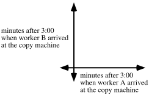

C. Calculate the area of the region containing the points associated with the chance of the workers meeting in the room with the copy machine.

D. Calculate, accurate to the nearest hundredth, the chances that on any given day the two workers will meet at the copy machine.

### IV.

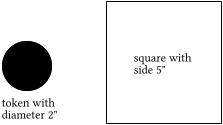

Suppose that each time the token above is tossed it will land so that <strong>its center</strong> somewhere inside the square.  Compute a prediction of how frequently you would expect the entire token will land inside the square.

### V.

Give the single translation equal to the composite T(3,¯6)$\circ$T(¯4,1).

### VI.

A. Give the single size transformation equal to the composite $S_{{}^{-}3}\circ S_{4}$.

B. Give the single rotation equal to the composite R21$\circ$R44.

### VII.

In the above illustration, each line through the origin will be mapped onto another of the lines through the origin by R30.  Give four different polar representations of point P.  Use at least one negative coordinate in two of the four.

### VIII.

A. Use PROGRAM DISTANCE to calculate the distance from point A to point B accurate to the nearest hundredth.

B. Give the distance from point A to point C accurate to the nearest hundredth.

C. There are points on line $\ell$ closer to point A than either point B or point C. Give the shortest distance from point A to a point on line $\ell$.

D. Give an equation for line $\ell$.

### IX.

Without the aid of your calculator, give the solution of each of the given systems:

A. $\left\{ \begin{array}{l}x+y=1200 \\ y=700\end{array} \right.$  B. $\left\{ \begin{array}{l}x+y=1600 \\ x=1000\end{array} \right.$  C. $\left\{ \begin{array}{l}x-y\text{ }={}^{-}15 \\ y=60\end{array} \right.$

## Assignment #75

<strong>A Goal to be Achieved Over the Next Several Lessons</strong>

In class you saw a demonstration of the use of a motion detector to generate data.  The motion detector was placed on the floor and a ball was tossed straight up into the air over it and caught.  As the ball moved, the motion detector emitted sonic signals.  The speed of sound relates the distance between the ball and the sensor to the time it took for signals to reach the ball and return.  The motion sensor can thus compute a close estimate of the distance to the ball at various times.  A computer paired a measure of time from when the sensor was activated with the computed approximate distance of the ball from the sensor.

Below is a copy of a calculator scatter plot of some of the (time, distance) pairs generated in response to signals from the motion sensor.  Our goal over the next several assignments and lessons will be to create an equation that describes a graph that “fits” the pattern in this data.  The graph we seek to describe should come very close to passing through all the points on the scatter plot.

### I.

Trace the triangle above onto your homework paper.

A. The point in which the medians of a triangle intersect is called the <strong>centroid</strong> of the triangle.  Describe steps you can take to calculate the centroid of the triangle shown above.  Then give the exact coordinates of that point.

B. Add to your tracing the centroid, D, and the midpoint of side AB.  Label this midpoint M1.  Then do the following:

1\. Compute the distance from O to D and store it in your calculator’s memory.

2\. Compute the distance from D to M1 and store it in another memory cell in your calculator.

3\. Use the stored distances from “1” and “2” right above to determine the answer to this question:  “The distance from O to D is what fraction of the distance from O to M1?”

C. Tell how the coordinates of point D could be determined using a size transformation.

D. The intersection of the perpendicular bisectors of a triangle is significant because it is the center of the circumscribed circle, the circle that passes through each of the vertices.  The centroid of a triangle is also significant.  Make a guess as to what this significance might be.

### II.

Here again is the commercial fish aquarium question:

An aquarium is used to grow fish for sale to restaurants and markets.  The aquarium is stocked with two species of fish, species A and species B, whose average weights are 3 and 2 lbs., respectively.  These fish are fed with two types of food–type P and type Q.  The average daily requirements for a species A fish is 2 units of type P food and 2 units of type Q food.  For a species B fish the requirement is 1 unit of type P food and 3 units of type Q food.  There is a daily supply of at most 400 units of type P food and 600 units of type Q food.  How many fish of each species should be kept in the aquarium so that the total weight of the fish in it is as great as possible?

A. Use “<em>a</em>” as the variable for the number of species A fish to be kept in the tank and “<em>b</em>” as the variable for the number of species B fish to be kept in the tank.

1\. Write an expression for computing the number to be maximized.

2\. Write a complete system of constraints for this question.

B. Sketch a graph of the feasibility region for this question and label the coordinates of all of its vertices.

C. Give the number of each species of fish to be kept in the tank so that the total weight of the fish in it is as great as possible.

### III.

This question is from a pamphlet called “Applications of High School Mathematics in Geometrical Probability” by Richard Dahlke and Robert Fakler published by COMAP.

“A husband and a wife on a shopping expedition agree to meet at a specified street corner between 4:00 and 5:00 P.M. The one who arrives first agrees to wait 15 minutes for the other, after which that person will leave to continue shopping.  What is the probability that the couple will meet, assuming that their arrival times are random within the hour?”

A. Write a system of inequalities whose solutions will be those pairs of arrival times for which the couple would meet.  You should include a phrase indicating the significance of the numbers for each variable you use.

B. Sketch a coordinate system and on it show the boundaries of the region that contains the points for the pairs associated with the couple meeting.  Include on this sketch the coordinates of all the boundary points of this region.

C. What is the area of the region whose boundary you sketched as your answer to “B” right above?

D. Accurate to the nearest hundredth, what are the chances that the couple will actually meet at the corner to which they each agreed to go?

### IV.

In the above illustration, each line through the origin will be mapped onto another of the lines through the origin by R30.   Give four different polar representations of point P.  Use at least one negative coordinate in two of the four.

### V.

<strong>What is the Distance from a Point to a Line?</strong>

Shown in the illustration above are three line segments from point P to line $\ell$.  The length of any one of these paths measures a straight-line distance from point P to line $\ell$.  The straight line distance from P to A is the length of the hypotenuse of right triangle PBA. This distance is greater than the length of the leg, segment PB.  The straight-line distance from P to C is the length of the hypotenuse of right triangle PBC and it is also greater than the length of segment PB.

In mathematics, when there is a reference to <strong>the</strong> distance from a point to a line, the distance referred to is the shortest straight-line distance.  The shortest straight-line distance from a point to a line not containing it is measured along the line perpendicular through that point to that line.  In the illustration above <strong>the</strong> distance from point P to line $\ell$ is the length of segment PB.

A. Use PROGRAM DISTANCE to calculate the distance from point A to point B accurate to the nearest hundredth.

B. Give the distance from point A to point C accurate to the nearest hundredth.

C. There are points on line $\ell$ closer to point A than either point B or point C. Give the shortest distance from point A to a point on line $\ell$.

D. Give an equation for line $\ell$.

### VI.

Without the aid of your calculator, give the solution of each of the given systems:

A. $\left\{ \begin{array}{l}x+y=1000 \\ y=1200\end{array} \right.$  B. $\left\{ \begin{array}{l}x+y=1500 \\ x=850\end{array} \right.$  C. $\left\{ \begin{array}{l}x-y=15 \\ y=60\end{array} \right.$

### VII.

Give the single translation equal to the composite T(¯5,¯3)$\circ$T(7,¯2).

### VIII.

A. Give the single size transformation equal to the composite $S_{5}\circ S_{{}^{-}2}$.

B. Give the single rotation equal to the composite R52$\circ$R¯52.

## Assignment #76

### I.

<strong>The Significance of the Centroid of a Triangle</strong>

The illustration above is of a triangular slab.  The slab has the same thickness at every point.  If any two pieces of the slab material with the same volume have the same mass, the material is said to have uniform density.  For a triangular slab with uniform thickness and uniform density, the centroid is the balance point.  That is, the slab can be balanced on a pointed object if the tip of that pointed object is placed precisely under the centroid of the slab.

Trace the triangle above onto your homework paper.

A. If the triangle in the above illustration were on the surface of a sheet of material of uniform thickness and density, give the exact coordinates of the points on which the triangle could be balanced.

B. Add to your tracing point D, the centroid of the triangle and point M2, the midpoint of side AC.  Then do the following:

1\. Compute the distance from B to D and store the result in your calculator. Also give an approximation on your homework paper accurate to the nearest thousandth.

2\. Compute the distance from point D to point M2 and store that result in another memory cell of your calculator.  Also give an approximation on your homework paper accurate to the nearest thousandth.

3\. Based on your answers to “1” and “2” above, what fraction of the distance from B to M2 is the distance from B to D?

C. Now add to your tracing point M1, the midpoint of side BC.  Use a translation after a size transformation after a translation to calculate the exact coordinates of the point two-thirds of the way from A to M1.

### II.

This question is adapted from “Optimality Pays: An Introduction to Linear Programming” by Jeganathan Sriskandarajah published by COMAP.

“A quart of paint type A costs \$6 and contains 3 oz. of oil.  A quart of paint type B costs \$8 and contains 5 oz. of oil.  A mixture of at most 5 quarts and having a minimum of 15 oz. of oil is to be made.  Find the mix so that the cost is minimum.”

Present an organized solution of this question complete with a sketch of a graph of a feasibility region with the coordinates of the vertices of the boundary labeled.

### III.

Copy all the following and fill in all the blanks so that all the expressions separated by equal signs are equivalent to each other.

$\begin{array}{l}(3\cdot x+5)(4\cdot x+{}^{-}3)=3\cdot x(4\cdot x+{}^{-}3)+5\cdot\underline{\qquad}= \\ 3\cdot x\cdot\underline{\quad}+3\cdot x\cdot{}^{-}3+5\cdot4\cdot x+5\cdot\underline{\quad}= \\ 12\cdot\underline{\quad}+\underline{\quad}\cdot x+20\cdot\underline{\quad}+\underline{\quad}= \\ \underline{\quad}\cdot x^2+(\underline{\quad}+\underline{\quad})\cdot x+\underline{\quad}= \\ \underline{\qquad}+\underline{\qquad}+\underline{\qquad}\end{array}$

### IV.

What is the image of (1,a) under the same translation that maps (0,$\frac{1}{4}$) to the origin?

### V.

In the following equation, “<em>a</em>” is used as a variable.  “Solve” the equation and then give the solution.  When giving the solution, do not attach it to the variable and an equal sign.

$1+a^{2}+\frac{{}^{-}1}{2}\cdot a+\frac{1}{16}=a^{2}+\frac{1}{2}\cdot a+\frac{1}{16}$

### VI.

<strong>A Reminder about Solutions Related by a Translation and an Example of Solutions related by a Two-Dimensional Scale Change</strong>

(5,10) is a solution of $y=2\cdot x$ and $\mathrm{(}5+3\mathrm{,}10+{}^{-}2\mathrm{)}$ is the <strong>related solution</strong> of $\left( y+2 \right)=2\cdot \left( x+{}^{-}3 \right)$<strong>.</strong>  $\mathrm{(}5+3\mathrm{,}10+{}^{-}2\mathrm{)}$ is the image of (5,10) under the translation T with $\text{T}\mathrm{(}x\mathrm{,}y\mathrm{)}=\mathrm{(}x+3\mathrm{,}y+{}^{-}2\mathrm{)}$<strong>.</strong>  Similarly, (4,16) is a solution of $y=x^{2}$ and $\mathrm{(}3\cdot 4\mathrm{,}5\cdot 16\mathrm{)}$is the <strong>related solution</strong> of $\left( \frac{1}{5}\cdot y \right)=\left( \frac{1}{3}\cdot x \right)^{2}$<strong>.</strong>  $\mathrm{(}3\cdot 4\mathrm{,}5\cdot 16\mathrm{)}$ is the image of (4,16) under the two-dimensional scale change S with $\text{S}\mathrm{(}x\mathrm{,}y\mathrm{)}=\mathrm{(}3\cdot x\mathrm{,}5\cdot y\mathrm{)}$<strong>.</strong>

A. (2,4) is a solution of $y=x^{2}$.  Give the “related” solution of $\left( \frac{1}{2}\cdot y \right)=\left( \frac{1}{3}\cdot x \right)^{2}$

B. (3,9) is also a solution of $y=x^{2}$.  Give the “related” solution of $\left( \frac{1}{2}\cdot y \right)=\left( \frac{1}{3}\cdot x \right)^{2}$

### VII.

A. Give the single translation equal to the composite $\text{T}_{\text{(}{}^{-}\text{7,2)}}\circ \text{T}_{\text{(9,5)}}$.

B. Give the single size transformation equal to the composite $S_{\sqrt{2}}\circ S_{\sqrt{8}}$.

C. Give the single rotation equal to the composite $\text{R}_{{}^{-}\text{31}}\circ \text{R}_{\text{52}}$.

### VIII.

A. True or False: the square of ¯76 is equal to the square of 76.

B. Use your calculator to compute the square of ¯76.

## Assignment #77

### I.

A. Give the single translation equal to the composite T(5,¯2)$\circ$T(¯6,3).

B. Use “A” right above as a guide for making an educated guess about giving a point equal to the sum of points represented by (5,¯2) + (¯6,3).

### II.

A. Give the single size transformation equal to the composite $S_{2}\circ S_{{}^{-}5}$.

B. Give the single rotation equal to the composite R103$\circ$R-42.

C. Use “A” and “B” right above as a guide for making an educated guess about giving a point equal to the product of points represented by \[2,103˚\] · \[¯5,¯42˚\].

### III.

A. Use two positive polar coordinates to represent the point whose rectangular coordinates are (¯5,0).

B. Give the rectangular coordinates of the point whose polar coordinates are:

1\. \[2,90˚\].      2. \[2,180˚\].

### IV.

What is the image of (3,a) under the same translation that maps (0,$\frac{1}{4}$) to the origin?

### V.

In the following equation “<em>a</em>” is used as the variable.  Solve the equation and then give the solution.  When giving the solution, do not attach it to the variable and an equal sign.

$9+a^{2}+\frac{{}^{-}1}{2}\cdot a+\frac{1}{16}=a^{2}+\frac{1}{2}\cdot a+\frac{1}{16}$.

### VI.

<strong>The “FOIL” Pattern</strong>

An expression of the form $\text{(a}+\text{b)}\cdot \text{(c}+\text{d)}$ can be described as the product of two sums.  Each of the sums has two addends.  In such a case the product of two sums can be transformed into an equivalent sum of four products by three uses of distributive forms:

Since you will find it convenient to replace a product of two sums with a sum of four products several times, it would be useful to learn (or re-learn) a mnemonic that will guide the writing of each of the four products.  The <strong>FOIL</strong> mnemonic helps you remember to form

a product from the <strong>F</strong>irst addends of each sum,

a product from the two <strong>O</strong>utside addends in the string of four

a product from the two <strong>I</strong>nside addends in the string of four

and a product from the <strong>L</strong>ast (or second) addends of each sum.

Here is an example a use of the <strong>FOIL</strong> pattern:

$\text{(a}+{}^{-}\left( \frac{\text{1}}{\text{2}} \right)\text{)}\cdot \text{(a}+{}^{-}\left( \frac{\text{1}}{\text{2}} \right)\text{)}=\text{a}\cdot \text{a}+\text{a}\cdot {}^{-}\left( \frac{\text{1}}{\text{2}} \right)+{}^{-}\left( \frac{\text{1}}{\text{2}} \right)\cdot \text{a}+{}^{-}\left( \frac{\text{1}}{\text{2}} \right)\cdot {}^{-}\left( \frac{\text{1}}{\text{2}} \right)$

With the use of an exponent, a distributive form and some simple arithmetic, the expression arising from the use of FOIL can be replaced with the following equivalents:

$\text{a}^{\text{2}}+\left( {}^{-}\left( \frac{\text{1}}{\text{2}} \right)+{}^{-}\left( \frac{\text{1}}{\text{2}} \right) \right)\cdot \text{a}+\frac{\text{1}}{\text{4}}=\text{a}^{\text{2}}+{}^{-}\text{1}\cdot \text{a}+\frac{\text{1}}{\text{4}}$

A. Use the <strong>FOIL</strong> pattern and some simple arithmetic to give each of the following as the sum of <strong>four</strong> addends.

1\. $\mathrm{(}2\cdot x+5\mathrm{)}\cdot \mathrm{(}3x+{}^{-}4\mathrm{)}$    2. $\left( \text{a}+{}^{-}\left( \frac{\text{1}}{\text{4}} \right) \right)\cdot \left( \text{a}+{}^{-}\left( \frac{\text{1}}{\text{4}} \right) \right)$   3. $\left( \text{a}+\frac{1}{4} \right)^{2}$

B. Based on another use of a distributive form, replace each of your answers for “A” right above with an equivalent sum of three addends.

### VII.

Give the distance from point A to the line shown in the illustration below.

### VIII.

A. Calculate the exact distance from point A to line $\ell$.

B. Calculate the exact distance from point A to point F.

### IX.

In the illustration below, point A is the same distance from point F as it is from line $\ell$.  Trace the illustration onto your homework paper.  Add to your tracing five other points that are located in the following special way–for each point, the distance from it to line $\ell$ is the same as the distance from it to point F.  Three of your points should be to the left of the vertical line through point F and two of them should be to the right of that line.

### X.

Give any two solutions of $y=x^{2}$ besides (0,0).  Then for each of them give the related solution of $\left( \frac{1}{5}\cdot y \right)=\left( \frac{1}{3}\cdot x \right)^{2}$

### XI.

Give <strong>any and all</strong> solutions of the following open sentences:

A. $x^{2}=4$        B. $x^{2}={}^{-}4$

## Assignment #78

### I.

<strong>Points in the Coordinate Plane as “Complex Numbers”</strong>

It may have seemed strange to meet points with a “+” or “·” sign between them in the last assignment. However, with some guidance from the way translations, size transformations, and rotations are composed, you will soon see that there is an easy and natural way to add and multiply points.  You are about to learn something about a number system called <strong>the complex number system</strong>.  The numbers will be points in the coordinate plane.  The complex number system is important in mathematics because it supplies solutions to some open sentences that have no real number solutions.  An example of such an open sentence is

$x^{2}={}^{-}4$

from the last assignment.

<strong>Adding Complex Numbers in Rectangular Notation</strong>

The statement $\text{T}_{\text{(3,}{}^{-}\text{5)}}\circ \text{T}_{\text{(5,4)}}=\text{T}_{\text{(8,}{}^{-}\text{1)}}$ suggests that (8,¯1) might be the sum of the points (3,¯5) and (5,4).  In other words, the composite of translations statement suggests

$\mathrm{(}3\mathrm{,}{}^{-}5\mathrm{)}+\mathrm{(}5\mathrm{,}4\mathrm{)}=\mathrm{(}8\mathrm{,}{}^{-}1\mathrm{)}$.

When two points are treated as (complex) numbers and when they are represented with rectangular coordinates, their sum is the point whose first coordinate is the sum of the first coordinates of the addends and whose second coordinate is the sum of the second coordinates of the addends.  This addition rule is nicely summarized as

The definition of addition of complex numbers in rectangular notation.

$\text{(a, b)}+\text{(c, d)}=\text{(a}+\text{c, b}+\text{d)}$

<strong>Multiplying Complex Numbers in Polar Notation</strong>

The pair of composition statements $\text{S}_{{}^{-}\text{2}}\circ \text{S}_{\text{4}}=\text{S}_{{}^{-}\text{8}}$ and $\text{R}_{\text{22}}\circ \text{R}_{\text{14}}=\text{R}_{\text{36}}$ suggest that \[¯8,36\] might be the product of \[¯2,22˚\] and \[4,14˚\].  In other words the combined composites of origin centered size transformations and rotations suggests

\[¯2,22˚\] · \[4,14˚\] = \[¯8,36˚\].

When two points are treated as (complex) numbers and when they are represented with polar coordinates, their product is the point whose first polar coordinate is the product of the first coordinates and whose second polar coordinate is the sum of the second polar coordinates.  This multiplication rule is nicely summarized as

The definition of multiplication of complex numbers in polar notation.

$\mathrm{[}\text{r}_{1}\mathrm{,}\theta _{1}\mathrm{]}\cdot \mathrm{[}\text{r}_{\text{2}}\mathrm{,}\theta _{2}\mathrm{]}=\mathrm{[}\text{r}_{\text{1}}\cdot \text{r}_{\text{2}}\mathrm{,}\theta _{1}+\theta _{2}\mathrm{]}$

In some of the questions below you are presented with a sum with the addends represented in polar notation or with a product with the factors represented in rectangular notation.  However, because of the location of the points, it should be easy for you to re-represent the complex numbers in the notation used in the definitions given above.  Eventually you will learn to deal with any sum or any product in either notation.

A. Compute the given sums:

1\.  $\frac{1}{2}+\frac{1}{4}$    2.  0.5 + 0.25

B. Compute the given sums:

1\. (3,¯7) + (5,¯2).  2.  (2, 0) + (¯5, 0)      3. \[2, 0˚\] + \[5, 180˚\]

C. Compute the given products:

1\. \[3,52˚\] · \[4,38˚\]      2. \[4,0˚\] · \[3,0˚\]      3. (4,0) · (0,3)

### II.

Give solutions of these open sentences.  The variable, X, is used as a complex number, or “point” variable.

A. (5,-6) + X = (5,¯6)     B. \[3,50˚\] · X=\[3, 50˚\]

C. (3,- 7) + X = (0, 0)     D. $\mathrm{[}\frac{1}{2}\mathrm{,}50^{\text{o}}\mathrm{]}$. X = \[1, 0˚\]

### III.

By referring to your results for question II above give the following:

A. The identity for adding complex numbers in rectangular notation.

B. The addition inverse of the complex number (¯7,5).

C. The identity for multiplying complex numbers in polar notation.

D. The multiplication inverse of the complex number \[5,¯20˚\].

### IV.

In column #1 are solutions of $y=x^{2}$.  The points in column #2 should be the related solutions of $\left( \frac{1}{5}\cdot y \right)=\left( \frac{1}{2}\cdot x \right)^{2}$.

A. Copy column #1 and fill in column #2 so that related solutions are in the same row.

Column #1  Column #2

(1,1)

(¯2,4)

($\sqrt{3}\mathrm{,}3$)

B. Give an image formula for a two-dimensional scale change that will map each solution in column #1 onto its related solution in column #2.

An illustration for questions V, VI, and VIII.

### V.

A. What is the image of (¯3,a) under the same translation that maps (0,$\frac{1}{4}$) to the origin?

B. Represent the square of the distance from the origin to your answer to “A” right above as the sum of two squares.  One of the squares should itself be the square of a sum of two addends.

C. Use the FOIL pattern on a portion of your answer to “B” right above to get an equivalent in the form of the sum of <strong>five</strong> addends.

D. Give an equivalent to your answer to “C” right above in the form of the sum of four addends.

### VI.

A. Represent the distance from point A to line $\ell$ as the sum of two addends.

B. Use the FOIL pattern to represent the square of your answer to “A” right above as the sum of four addends.

C. Give an equivalent to your answer to “B” right above as the sum of three addends.

### VII.

In the following equation, “<em>a</em>” is used as a variable.  “Solve” the equation, then give the solution.  When giving the solution, do not attach it to the variable and an equal sign.

$9+a^{2}+\frac{{}^{-}1}{2}\cdot a+\frac{1}{16}=a^{2}+\frac{1}{2}\cdot a+\frac{1}{16}$.

### VIII.

Based on your work in questions V, VI and VII above, can you give the second coordinate of the point with first coordinate ¯3 which is the same distance from the line described by $y=\frac{{}^{-}1}{4}$ as it is from the point F = $\left( 0\mathrm{,}\frac{1}{4} \right)$?

### IX.

A. Trace the diagram above, including the labels, onto your homework paper.  The distance from point A to line $\ell$ is $\frac{13}{16}$ = 0.8125–the same as the distance from point A to point F.  Now add to your tracing the one other point whose distance from both line $\ell$ and point F is also $\frac{13}{16}$.  Label that point with its coordinates.

B. There are two points whose distance to line $\ell$ and point F is $\frac{1}{2}$.  Add these points to your tracing and label them with their coordinates.

C. Finally, add to your tracing at least one other point whose distance to line $\ell$ is the same as its distance to point F.

### X.

A. Represent $\left( \text{a}^{2}+\frac{{}^{-}1}{4} \right)^{2}$ as the sum of three addends.

B. Represent $\text{a}^{2}+\left( \text{a}^{2}+\frac{{}^{-}1}{4} \right)^{2}$ as the sum of three addends.

C. Represent $\left( \text{a}^{2}+\frac{1}{4} \right)^{2}$ as the sum of three addends.

## Assignment #79

### I.

<strong>Addition and Multiplication Inverses for Complex Numbers</strong>

The double composite equation $\text{T}_{\text{(a,b)}}\circ \text{T}_{\text{(0,0)}}=\text{T}_{\text{(a,b)}}=\text{T}_{\text{(0,0)}}\circ \text{T}_{\text{(a,b)}}$ suggests the echoing complex number equation:

$\text{(a,b)}+\text{(0,0)}=\text{(a,b)}=\text{(0,0)}+\text{(a,b)}$.

This dual equation reveals that:

(0,0) is the identity for addition of complex numbers.

The double equation:

$\text{(a,b)}+\text{(}{}^{-}\text{a,}{}^{-}\text{b)}=\text{(0,0)}=\text{(}{}^{-}\text{a,}{}^{-}\text{b)}+\text{(a,b)}$

reveals that:

(¯a, ¯b ) represents the addition inverse of the complex number (a, b ).

The double composite equations $\text{S}_{\text{a}}\circ \text{S}_{\text{1}}=\text{S}_{\text{a}}=\text{S}_{\text{1}}\circ \text{S}_{\text{a}}$ and $\text{R}_{\text{b}}\circ \text{R}_{\text{0}}=\text{R}_{\text{b}}=\text{R}_{\text{0}}\circ \text{R}_{\text{b}}$suggest the echoing complex number equation:

$\mathrm{[}\text{a,b}^{\text{o}}\mathrm{]}\cdot \mathrm{[}1\mathrm{,}0^{\text{o}}\mathrm{]}=\mathrm{[}\text{a,b}^{\text{o}}\mathrm{]}=\mathrm{[}1\mathrm{,}0^{\text{o}}\mathrm{]}\cdot \mathrm{[}\text{a,b}^{\text{o}}\mathrm{]}$.

This double equation reveals that:

\[1,0˚\] is the identity for multiplication of complex numbers.

The double equation:

$\mathrm{[}\text{a,b}^{\text{o}}\mathrm{]}\cdot \mathrm{[}\frac{\text{1}}{\text{a}}\text{,}{}^{-}\text{b}^{\text{o}}\mathrm{]}=\mathrm{[}1\mathrm{,}0^{\text{o}}\mathrm{]}=\mathrm{[}\frac{\text{1}}{\text{a}}\text{,}{}^{-}\text{b}^{\text{o}}\mathrm{]}\cdot \mathrm{[}\text{a,b}^{\text{o}}\mathrm{]}$

reveals that:

$\text{[}\frac{\text{1}}{\text{a}}\text{,}{}^{-}\text{b}^{\text{o}}\mathrm{]}$ represents the multiplication inverse of $\text{[a,b].}$

Give polar coordinate representations of the points whose rectangular coordinates are:

A. (1,0)  B. $\left( \frac{\sqrt{2}}{2}\mathrm{,}\frac{\sqrt{2}}{2} \right)$  C. (1,1)  D. (0,1)

### II.

A. Compute the given sums:

1\. $\frac{3}{8}+\frac{1}{4}$  2. 0.375 + 0.25

B. Compute the given sums:

1\. (¯5,3) + (¯1,0)  2. (1,1) + (0,3)  3. \[$\sqrt{\text{ }2}\mathrm{,}45^{\circ }$\] + \[3,90˚\].

C. Compute the given products:

1\. \[3,47˚\].\[$\frac{1}{3}$,¯47˚\]  2. \[2,90˚\].\[3,180˚\]  3. (0,2).(¯3,0)

### III.

Use the appropriate type of inverse to “solve” the given equations:

A. $\frac{3}{7}\cdot x=\frac{2}{3}$    B. (4,¯6) + X = (3,4)    C. \[3,18˚\].X=\[2,¯10˚\]

### IV.

For the following equation, give an equivalent in the calculator friendly form $y=\text{s}\cdot x^{2}$.

$\left( \frac{1}{2}\cdot y \right)=\left( \frac{1}{3}\cdot x \right)^{2}$

### V.

A. In the table below, column #1 holds solutions of $y=x^{2}$.  The points in column #2 should the related solutions of $\left( \frac{1}{4}\cdot y \right)=\left( \frac{1}{3}\cdot x \right)^{2}$.  Copy column #1 and fill in column #2 so that related solutions are in the same row.

Column #1  Column #2

(¯1,1)

(¯$\sqrt{5}\mathrm{,}5$)

(3,9)

B. Each of the points in column #1 in the table on the previous page can be mapped onto its related solution in column #2 by a transformation with an image formula of the form S($x\mathrm{,}y\mathrm{)}=\mathrm{(}\text{k}\cdot x\mathrm{,}\text{m}\cdot y\mathrm{)}$.  Give this image formula with the correct numbers in place of “k” and “m.”

An illustration for questions VI, VII and IX.

### VI.

A. What is the image of (5,a) under the same translation that maps (0,$\frac{1}{4}$) to the origin?

B. Represent the square of the distance from the origin to your answer to “A” right above as the sum of two squares .  One of the squares should be itself the square of a sum of two addends.

C. Use the FOIL pattern on a portion of your answer to “B” right above to get an equivalent  in the form of the sum of <strong>five</strong> addends.

D. Give an equivalent to your answer to “C” right above in the form of a sum of four addends.

### VII.

A. Represent the distance from point A to line $\ell$ as the sum of two addends.

B. Use the FOIL pattern to represent the square of your answer to “A” right above as the sum of four addends.

C. Give an equivalent to your answer to “B” right above as a sum of three addends.

### VIII.

In the following equation, “<em>a</em>” is used as a variable.  “Solve” the equation, then give the solution.  When giving the solution, do not attach it to the variable and an equal sign.

$25+a^{2}+\frac{{}^{-}1}{2}\cdot a+\frac{1}{16}=a^{2}+\frac{1}{2}\cdot a+\frac{1}{16}$.

### IX.

A. Based on your work in questions VI, VII and VIII above, give the second coordinate of the point with first coordinate 5 which is the same distance from the line described by $y=\frac{{}^{-}1}{4}$ as it is from the point F = $\left( 0\mathrm{,}\frac{1}{4} \right)$.

B. The point referred to in part “A” above is $5\frac{1}{4}$ units from point F.  There is a second point whose distance from line $\ell$ and the point F = $\left( 0\mathrm{,}\frac{1}{4} \right)$ is $5\frac{1}{4}$.  Give the coordinates of that second point.

### X.

Use the work in questions VI through IX above as a guide to do the following:

A. Give the second coordinate of the point with first coordinate 7 which is the same distance from the point (0,$\frac{1}{4}$) as it is from the line described by $y=\frac{{}^{-}1}{4}$.

B. Give both coordinates of a second point whose distance to both the point (0,$\frac{1}{4}$) and the line described by $y=\frac{{}^{-}1}{4}$ is the same as that common distance for the point from “A” right above.

### XI.

Tell whether each of these statements is true or false:

A. If two numbers have equal squares, they <strong>must</strong> be equal.

B. If two distances have equal squares, they <strong>must</strong> be equal.

## Assignment #80

### I.

A. Compute the given sums:

1\. (3,0) + (¯5,0)  2. (2.5,0) + (1.5,0)  3. (-4,0) + (¯2,0)

B. Compute the following products and give the results both in polar notation with second coordinate 0˚ and in rectangular notation:

1\. \[2,0˚\].\[3,0˚\]      2. (2,0).(3,0)        3. \[3,180˚\].\[4,0˚\]

4\. (¯3,0).(4,0)        5. \[4,180˚\].\[2,180˚\]         6. (¯4,0).(¯2,0)

### II.

Represent each of the following in polar notation using a second coordinate of 0˚.

A. \[5,360˚\]  B. \[5,180˚\]  C. \[a,360˚\]

D. \[a,180˚\]  E. \[¯a · b,180˚\]  F. \[a · b,180˚\]

### III.

Use the appropriate type of inverse to “solve” the given equations:

A. (¯3,7) + X = (¯2,4)                       B. \[4,¯21˚\].X=\[5,20˚\]

### IV.

Make a list of any and all solutions of the following open sentences:

A. $x^{2}=9$  B. $x^{2}=0$  C. $x^{2}={}^{-}9$

### V.

A. Compute the product \[2,90˚\].\[2,90˚\] and then represent the product in rectangular notation.

B. Compute the product \[2,270˚\].\[2,270˚\] and then do the following:

1\. Give an alternative polar representation of the product with the second coordinate in the interval from 0˚ to 360˚.

2\. Represent the product using rectangular coordinates.

### VI.

Compute the following products and then represent each product in rectangular notation:

A. \[4,0˚\] · \[1,90˚\]                  B. (4,0) · (0,1)

### VII.

<strong>Progress Toward Describing the Pattern in Data Arising from the Toss of a Ball</strong>

You have seen that when a ball is tossed into the air over a motion sensor, the points of a scatter plot of the generated data can take a shape like that of the scatter below.

In recent assignments you have been answering questions about points that are the same distance from a fixed point and a fixed line.  Here is an illustration of such points in which lengths of segments are represented with lower case letters:

The dots in the illustration are in a “smile” pattern while those of the scatter plot from the motion sensor experiment are in a “frown” pattern.  However, the two patterns can be more closely connected by making use of a reflection in a horizontal line.

When each of a set of points is the same distance from a fixed point and a fixed line, that set of points is part of a geometric figure called a parabola.  In this question you will be asked to create an equation that describes one particular parabola.

A. By reference to questions VIII on assignment #77, V through IX of assignment #78,  and VI through X of assignment #79, give the coordinates of at least seven points that are the same distance from the line described by $y=\frac{{}^{-}1}{4}$ as they are from the point  F = $\left( 0\mathrm{,}\frac{1}{4} \right)$.

B. Create one equation with two variables which has among all its solutions the points you gave as your answers to “A” right above.

### VIII.

A. Represent the square of the distance from the point with coordinates (a,a2) to the line described by $y=\frac{{}^{-}1}{4}$ as the sum of three addends.

B. Represent the square of the distance from the origin to $\text{(a,a}^{\text{2}}+\frac{{}^{-}\text{1}}{\text{4}}\text{)}$ as the sum of two squares.

C. Re-represent your answer to “B” right above as the sum of three addends.

### IX.

For the following equations, give an equivalent of the form $y=\text{s}\cdot x^{2}$.

A. $\left( \frac{1}{5}\cdot y \right)=\left( \frac{1}{2}\cdot x \right)^{2}$        B. $\mathrm{(}2\cdot y\mathrm{)}=\left( \frac{1}{3}\cdot x \right)^{2}$       C. $\left( \frac{3}{7}\cdot y \right)=\left( \frac{2}{3}\cdot x \right)^{2}$

### X.

A. Give an image formula for the origin centered two dimensional scale change, S1, that will map (1,1) onto (2,3).

B. Which of the following scale changes will map (2,4) onto (2,3)?

S2 with image formula $\text{S}_{\text{2}}\mathrm{(}x\mathrm{,}y\mathrm{)}=\left( x\mathrm{,}\frac{4}{3}\cdot y \right)$

or

S3 with image formula $\text{S}_{\text{3}}\mathrm{(}x\mathrm{,}y\mathrm{)}=\left( x\mathrm{,}\frac{3}{4}\cdot y \right)$

### XI.

Copy and complete each connection diagram:

A.

B.

