# GAT Assignments 81–100

> Converted from the supplied Word document. [Conversion notes](conversion-report.md) describe the graphics and remaining review items.

[Assignment 81](#assignment-81) | [Assignment 82](#assignment-82) | [Assignment 83](#assignment-83) | [Assignment 84](#assignment-84) | [Assignment 85](#assignment-85) | [Assignment 86](#assignment-86) | [Assignment 87](#assignment-87) | [Assignment 88](#assignment-88) | [Assignment 89](#assignment-89) | [Assignment 90](#assignment-90) | [Assignment 91](#assignment-91) | [Assignment 92](#assignment-92) | [Assignment 93](#assignment-93) | [Assignment 94](#assignment-94) | [Assignment 95](#assignment-95) | [Assignment 96](#assignment-96) | [Assignment 97](#assignment-97) | [Assignment 98](#assignment-98) | [Assignment 99](#assignment-99) | [Assignment 100](#assignment-100)

## Assignment #81

### I.

<strong>Abbreviated Rectangular Notation for Certain Complex Numbers</strong>

There is a special simplicity about adding or multiplying complex numbers on the $x-\text{axis}$. The rectangular representation of such numbers has second coordinate 0.

The following represents a “typical” sum:

$\text{(a,0)}+\text{(b,0)}=\text{(a}+\text{b,0)}$.

The above representation implies that when the addends are on the $x-\text{axis}$ the sum will also be on the $x-\text{axis}$.

The following represent typical products under four different conditions:

#1: $\text{If a>0 and b>0 then (a,0)}\cdot \text{(b,0)}=\text{ [a,0}^{\text{o}}\text{]}\cdot \text{[b,0}^{\text{o}}\text{]}=\text{[a}\cdot \text{b,0}^{\text{o}}\text{]}=\text{(a}\cdot \text{b,0)}$

or $\text{(a,0)}\cdot \text{(b,0)}=\text{(a}\cdot \text{b,0)}$

#2: $\text{If a>0 and b<0 then (a,0)}\cdot \text{(b,0)}=\text{ [a,0}^{\text{o}}\text{]}\cdot \text{[}{}^{-}\text{b,180}^{\text{o}}\text{]}=\text{[}{}^{-}\text{a}\cdot \text{b,180}^{\text{o}}\text{]}=\text{[a}\cdot \text{b,0}^{\text{o}}\text{]}=\text{(a}\cdot \text{b,0)}$

or $\text{(a,0)}\cdot \text{(b,0)}=\text{(a}\cdot \text{b,0)}$

#3:

$\text{If a<0 and b>0 then (a,0)}\cdot \text{(b,0)}=\text{ [}{}^{-}\text{a,180}^{\text{o}}\text{]}\cdot \text{[b,0}^{\text{o}}\text{]}=\text{[}{}^{-}\text{a}\cdot \text{b,180}^{\text{o}}\text{]}=\text{[a}\cdot \text{b,0}^{\text{o}}\text{]}=\text{(a}\cdot \text{b,0)}$

or $\text{(a,0)}\cdot \text{(b,0)}=\text{(a}\cdot \text{b,0)}$

#4: $\text{If a<0 and b<0 then (a,0)}\cdot \text{(b,0)}=\text{ [}{}^{-}\text{a,180}^{\text{o}}\text{]}\cdot \text{[}{}^{-}\text{b,180}^{\text{o}}\text{]}=\text{[a}\cdot \text{b,360}^{\text{o}}\text{]}=\text{[a}\cdot \text{b,0}^{\text{o}}\text{]}=\text{(a}\cdot \text{b,0)}$

or $\text{(a,0)}\cdot \text{(b,0)}=\text{(a}\cdot \text{b,0)}$

Notice that both sums and products of complex numbers on the $x-\text{axis}$ are complex numbers on the $x-\text{axis}$.  Notice also that both sums and products of complex numbers on the $x-\text{axis}$ can be computed in rectangular notation by doing ordinary real number addition and multiplication with the first coordinates.

Complex numbers of the form (a,0) behave when they are added or multiplied very much like the real number “a.”  The behavior is in fact so similar that the complex numbers on the $x-\text{axis}$ are considered real numbers.

<strong>The system of real numbers is thought of as that part of the complex number system that is represented by the points on the</strong> $x-\text{axis}$<strong>.</strong>

The following will be convenient in later work with complex numbers on the $x-\text{axis}$<strong>.</strong>

<strong>The complex number represented by (a,0) will be considered to be</strong>

<strong>the real number represented by “a.”  The representation, “a,” is</strong>

<strong>referred to as the  abbreviated rectangular notation for (a,0).</strong>

For each of the following products, give three representations: a polar representation, a rectangular representation, and an “abbreviated” rectangular representation:

A. \[5,90˚\] · \[5,90˚\]                                 B. \[5,270˚\] · \[5,270˚\]

### II.

Give a list of any and all solutions of the following equations.  Use any convenient notation.

A. $x^{2}=25$                              B. $x^{2}={}^{-}25$  (Hint: see question I right above.)

### III.

A. Represent ¯11 in each of the ways described:

1\. In rectangular notation.

2\. In polar notation with second coordinate 0˚.

B. Represent \[11,540˚\] in each of the ways described:

1\. In polar notation with a smaller, but still positive second coordinate.

2\. In rectangular notation.

### IV.

Represent each of the following products in rectangular notation:

A. \[3,0˚\] · \[1,90˚\]                                      B. (3,0) · (0,1)

C. \[3,180˚\] · \[1,90˚\]                                  D. (¯3,0) · (0,1)

### V.

Identify the transformation that will map the any complex number of the form $\left[ \text{r}\mathrm{,}\text{ }\theta ^{\text{o}} \right]$ onto $\left[ \text{r}\mathrm{,}\text{ }\theta +90^{\text{o}} \right]$.

### VI.

In each case, give an image formula for the appropriate origin centered scale change.

A. Sa that maps (1,1) onto (2,3).

B. Sb that maps (-2,4) onto (2,3).

C. Sc that maps (3,9) onto (2,3).

### VII.

A. Copy and complete the connection diagram at the top of the next page.

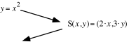

B. Give an equivalent of the form $y=\text{s}\cdot x^{2}$to your image equation in your answer to “A” right above.

C. Use the image formula given in the connection diagram in “A” right above to compute the images of (¯1,1), (0,0) and (1,1).  Enter the coordinates of these images into lists #1 and #2 and get a view of a <strong>disconnected</strong> scatter plot of them.  Then use your answer to “B” right above to get an entry for Y1 from which your calculator can generate a representation of the parabola described by your image equation.  After pushing \[ZOOM\] and \[9\] you should see a parabola graph generated that passes through the image points whose coordinates were stored in lists #1 and #2.  If this does not happen, check your work and make any needed corrections.

### VIII.

A. Copy and complete this connection diagram:

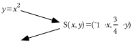

B. Give an equivalent of the form $y=\text{s}\cdot x^{2}$to your image equation in your answer to “A” right above.

C. Use the image formula given in the connection diagram in “A” right above to compute the images of (¯1,1), (0,0) and (1,1).  Enter the coordinates of these images into lists #1 and #2 and get a view of a <strong>disconnected</strong> scatter plot of them.  Then use your answer to “B” right above to get an entry for Y1 from which your calculator can generate a representation of the parabola described by your image equation.  After pushing \[ZOOM\] and \[9\] you should see a parabola graph generated that passes through the image points whose coordinates were stored in lists #1 and #2.  If this does not happen, check your work and make any needed corrections.

### IX.

A. Copy and complete this connection diagram:

B. Give an equivalent of the form $y=\text{s}\cdot x^{2}$to your image equation in your answer to “A” right above.

C. Use the image formula given in the connection diagram in “A” right above to compute the images of (¯1,1), (0,0) and (1,1).   Enter the coordinates of these images into lists #1 and #2 and get a view of a <strong>disconnected</strong> scatter plot of them.  Then use your answer to “B” right above to get an entry for Y1 from which your calculator can generate a representation of the parabola described by your image equation.  After pushing \[ZOOM\] and \[9\] you should see a parabola graph generated that passes through the image points whose coordinates were stored in lists #1 and #2.  If this does not happen, check your work and make any needed corrections.

### X.

<strong>Introducing the</strong> $y=x^{2}$ <strong>Parabola</strong>

If there is a fixed line, $\ell$, and a fixed point, F, then the collection of all the points that are the same distance from $\ell$ as they are from F for a figure called a parabola.  We have accumulated a collection of coordinates of points on the parabola when $\ell$ is the line described by $y=\frac{{}^{-}1}{4}$ and F is the point $\mathrm{(}0\mathrm{,}\frac{1}{4}\mathrm{)}$.  This collection includes (0,0), $\left( \frac{{}^{-}1}{2}\mathrm{,}\frac{1}{4} \right)$,$\left( \frac{1}{2}\mathrm{,}\frac{1}{4} \right)$, $\left( \frac{{}^{-}3}{4}\mathrm{,}\frac{9}{16} \right)$, $\left( \frac{3}{4}\mathrm{,}\frac{9}{16} \right)$, $\mathrm{(}{}^{-}3\mathrm{,}9\mathrm{)}$, $\mathrm{(}3\mathrm{,}9\mathrm{)}$, $\mathrm{(}{}^{-}5\mathrm{,}25\mathrm{)}$, $\mathrm{(}5\mathrm{,}25\mathrm{)}$, $\mathrm{(}{}^{-}7\mathrm{,}49\mathrm{)}$, and $\mathrm{(}7\mathrm{,}49\mathrm{)}$.  It appears from this collection that the parabola of points equidistant from both $\mathrm{(}0\mathrm{,}\frac{1}{4}\mathrm{)}$ and the line described by $y=\frac{{}^{-}1}{4}$ are just those points whose second coordinates are the square of their first coordinates.  This conjecture is confirmed by the following:

If “a” represents a typical real number, the distance from the point (a,a2) to the line described by $y=\frac{{}^{-}1}{4}$ is represented by $\text{a}^{2}+\frac{1}{4}$ and the square of this distance is represented by

$\left( \text{a}^{\text{2}}+\frac{\text{1}}{\text{4}} \right)^{\text{2}}=\text{a}^{\text{4}}+\frac{\text{1}}{\text{4}}\cdot \text{a}^{\text{2}}+\frac{\text{1}}{\text{4}}\cdot \text{a}^{\text{2}}+\frac{\text{1}}{\text{16}}=\text{a}^{\text{4}}+\frac{\text{1}}{\text{2}}\cdot \text{a}^{\text{2}}+\frac{\text{1}}{\text{16}}$.

Meanwhile, the square of the distance from the point (a,a2) to the point $\mathrm{(}0\mathrm{,}\frac{1}{4}\mathrm{)}$ is represented by

$\text{a}^{\text{2}}+\left( \text{a}^{\text{2}}+\frac{{}^{-}\text{1}}{\text{4}} \right)^{\text{2}}=\text{a}^{\text{2}}+\text{a}^{\text{4}}+\frac{{}^{-}\text{1}}{\text{4}}\cdot \text{a}^{\text{2}}+\frac{{}^{-}\text{1}}{\text{4}}\cdot \text{a}^{\text{2}}+\frac{\text{1}}{\text{16}}=\text{a}^{\text{4}}+\text{1}\cdot \text{a}^{\text{2}}+\frac{{}^{-}\text{1}}{\text{2}}\cdot \text{a}^{\text{2}}+\frac{\text{1}}{\text{16}}=\text{a}^{\text{4}}+\frac{\text{1}}{\text{2}}\cdot \text{a}^{\text{2}}+\frac{\text{1}}{\text{16}}$

Since the squares of two distances are equal only if the distances are equal, the “typical” point (a,a2) is the same distance from the line described by $y=\frac{{}^{-}1}{4}$ as it is from the point  $\mathrm{(}0\mathrm{,}\frac{1}{4}\mathrm{)}$.

We will use the equation $y=x^{2}$ for the parabola of points that are the same

distance from the $y=\frac{{}^{-}1}{4}$ line as they are from the point $\mathrm{(}0\mathrm{,}\frac{1}{4}\mathrm{)}$.

There are other parabolas besides the$y=x^{2}$ parabola.

If all the points on a geometric figure are the same distance from a fixed

line as they are from a fixed point, that figure is a parabola.

Here is an assumption we will make for the present and verify in the future:

The image of the$y=x^{2}$ parabola under any two-dimensional scale change

is also a parabola.

You will be learning how the “$y=x^{2}$” parabola can be mapped onto any other parabola we might need to describe using transformations you have already studied.

A. Represent the <strong>square</strong> of the distance from $\left( \text{a,}\frac{\text{3}}{\text{4}}\cdot \text{a}^{\text{2}} \right)$ to the line with equation $y=\frac{{}^{-}1}{3}$ as the sum of three addends.

B. Represent the <strong>square</strong> of the distance from $\left( \text{a,}\frac{\text{3}}{\text{4}}\cdot \text{a}^{\text{2}} \right)$ to the point $\left( 0\mathrm{,}\frac{1}{3} \right)$ as the sum of <strong>four</strong> addends.

C. Give an equivalent to your answer to “B” right above in the form of the sum of <strong>three</strong> addends.

D. True or False:  Each of the solutions of the equation $y=\frac{3}{4}\cdot x^{2}$ is the same for that line and the coordinates of that point.

## Assignment #82

### I.

A. How many intersections are there of the line with equation $y=16$ and the $y=x^{2}$parabola?

B. How many intersections are there of the line with equation $y={}^{-}16$ and the $y=x^{2}$parabola ?

### II.

<strong>Complex Number Solutions of Equations with a Special Form</strong>

Equations of the form

$x^{2}=\text{a}$

have two solutions when a &gt; 0.  One is positive and the other is its opposite. These solutions are the square roots of “a.”  When “$\sqrt{\text{a}}$” is entered at the home screen and \[ENTER\] is pushed, at least a very close approximation of the positive solution, or positive square root of a, appears.

If a &lt; 0,

$x^{2}=\text{a}$

also has two solutions.  These solutions are also called the square roots of a, but they are complex numbers not on the $x-\text{axis}\mathrm{.}$ In other words, if a &lt; 0, the square roots of a are not real numbers.  However, they are not difficult to discern if polar notation is used.

Here is an example that will give a clue as to the general idea:

To find solutions of $x^{2}={}^{-}9$, express ¯9 in polar notation as \[9,180˚\].

Then, since

$\begin{array}{l}\left[ 3\mathrm{,}90^{\text{o}} \right]^{2}=\left[ 3\mathrm{,}90^{\text{o}} \right]\cdot \left[ 3\mathrm{,}90^{\text{o}} \right]=\left[ 9\mathrm{,}180^{\text{o}} \right]={}^{-}9 \\ \text{and} \\ \left[ \text{3,270}^{\text{o}} \right]^{2}=\left[ 3\mathrm{,}270^{\text{o}} \right]\cdot \left[ 3\mathrm{,}270^{\text{o}} \right]=\left[ 9\mathrm{,}540^{\text{o}} \right]=\left[ 9\mathrm{,}180^{\text{o}} \right]={}^{-}9\end{array}$,

both \[3,90˚\] and \[3,270˚\] are solutions of $x^{2}={}^{-}9$.  They are, in fact, the only solutions.  They are called the square roots of ¯9.

Notice that either of these square roots can be mapped onto the other with the origin centered rotation with magnitude 180˚.  They are thus on exactly opposite sides of the origin from each other.  Furthermore, \[3,90˚\] = (0,3) and \[3,270˚\] = (0,¯3), so that

\[3,90˚\] + \[3,270˚\] = (0,3) + (0,-3) = (0,0).

Thus \[3,90˚\] and \[3,270˚\] are also addition inverses of each other.  Since addition inverses are also called “opposites,” the use of that phrase expresses both a geometric and algebraic relationship.

This dual geometric and algebraic relationship also holds between 3 and ¯3, the square roots of 9.  If they are represented as (3,0) and (¯3,0), it is easy to see that they are on exactly opposite each other across the origin.  Also, since (3,0) + (¯3,0) = (0,0), they are also addition inverses, or opposites in the language of algebra.

In general, when ¯a  is real and less than 0 it can be represented as \[a,180˚\].  Since -a is negative, a is positive,  and $\sqrt{\text{a}}$ represents the real, positive square root of the <strong>positive</strong> number represented by “a.”  Thus each of the following are true:

$\left[ \sqrt{\text{a}}\text{,90}^{\text{o}} \right]^{\text{2}}=\left[ \sqrt{\text{a}}\text{,90}^{\text{o}} \right]\cdot \left[ \sqrt{\text{a}}\text{,90}^{\text{o}} \right]=\left[ \text{a,180}^{\text{o}} \right]={}^{-}\text{a}$

and

$\left[ \sqrt{\text{a}}\text{,270}^{\text{o}} \right]^{\text{2}}=\left[ \sqrt{\text{a}}\text{,270}^{\text{o}} \right]\cdot \left[ \sqrt{\text{a}}\text{,270}^{\text{o}} \right]=\left[ \text{a,540}^{\text{o}} \right]=\left[ \text{a,180}^{\text{o}} \right]={}^{-}\text{a}$.

Thus $\left[ \sqrt{\text{a}}\text{,90}^{\text{o}} \right]=\left( \text{0,}\sqrt{\text{a}} \right)$ and $\left[ \sqrt{\text{a}}\text{,270}^{\text{o}} \right]=\left( \text{0,}{}^{-}\sqrt{\text{a}} \right)$ are both solutions of $\text{x}^{\text{2}}={}^{-}\text{a}$.  They are called the square roots of the negative real number, -a.

Give a list of any and all solutions of the following equations.  If any of the solutions are not real numbers, give them in both polar and rectangular notation.

A. $x^{2}=16$           B. $x^{2}={}^{-}16$              C. $x^{2}=17$             D. $x^{2}={}^{-}17$

### III.

<strong>A Special Abbreviation for an Important Complex Number</strong>

Recall that when a transformation has an associated matrix, the columns of that matrix are the images of the basis points, (1,0) and (0,1).  The points (1,0) and (0,1) are also important as complex numbers.  (1,0) is the identity for multiplication.  (0,1) is important because of the effect it has on points when they are multiplied by it:

If \[$\text{r}\mathrm{,}\theta ^{\text{o}}\mathrm{]}$ represents a “typical” complex number, then

$\left[ \text{r,}\theta ^{o} \right]\cdot \text{(}0\text{,}1\text{)}=\left[ \text{r,}\theta ^{o} \right]\cdot \left[ 1\text{,}90^{o} \right]=\left[ \text{r,}\theta ^{o}+90^{o} \right]$.

Since $\left[ \text{r}\mathrm{,}\theta ^{\text{o}}+90^{\text{o}} \right]$ is the image of $\left[ \text{r}\mathrm{,}\theta ^{\text{o}} \right]$ under, R90, the origin centered rotation with magnitude 90˚:

(0,1)=\[1,90˚\] will be referred to as <strong>the 90˚ rotator</strong>.

The symbol, “<strong>i</strong>”  is something used as an abbreviated name (0,1).

Give the new, abbreviated notation for \[1,90˚\] = (0,1), the 90˚ rotator.

### IV.

Give each of the following in rectangular notation:

A. $\sqrt{5}\cdot$<strong>i</strong>      B. ${}^{-}\sqrt{5}\cdot$<strong>i</strong>

### V.

A. Use the FOIL pattern to help replace each of the following with a sum of four addends:

1\. $\mathrm{(}x+3\mathrm{)}\cdot \mathrm{(}x+3\mathrm{)}$     2. $\mathrm{(}x+{}^{-}5\mathrm{)}\cdot \mathrm{(}x+{}^{-}5\mathrm{)}$               3. $\mathrm{(}x+2\mathrm{)}^{2}$

B. Replace each of your three answers for “A” right above with an equivalent in the form of a sum of three addends.

### VI.

In each case, give an image formula for the appropriate origin centered scale change.

A. Sa which maps (1,1) onto (1,2).

B. Sb which maps (2,4) onto (1,2).

C. Sc which maps (3,9) onto (1,2).

### VII.

A. Copy and complete the following connection diagram:

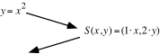

B. Give an equivalent of the form $y=\text{s}\cdot x^{2}$to your image equation in your answer to “A” right above.

C. Use the image formula given in the connection diagram in “A” right above to compute the images of (¯1,1), (0,0) and (1,1).  Enter the coordinates of these images into lists #1 and #2 and get a view of a <strong>disconnected</strong> scatter plot of them.  Then use your answer to “B” right above to get an entry for Y1 from which your calculator can generate a representation of the parabola described by your image equation.  After pushing \[ZOOM\] and \[9\] you should see a parabola graph generated that passes through the image points whose coordinates were stored in lists #1 and #2.  If this does not happen, check your work and make any needed corrections.

D. Do the parabolas described by $y=x^{2}$ and your answer to “B” right above have any lines of reflection symmetry?  If so, describe them.

### VIII.

A. Copy and complete this connection diagram:

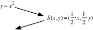

B. Give an equivalent of the form $y=\text{s}\cdot x^{2}$to your image equation in your answer to “A” right above.

C. Use the image formula given in the connection diagram in “A” right above to compute the images of (¯1,1), (0,0) and (1,1).  Enter the coordinates of these images into lists #1 and #2 and get a view of a <strong>disconnected</strong> scatter plot of them.  Then use your answer to “B” right above to get an entry for Y1 from which your calculator can generate a representation of the parabola described by your image equation.  After pushing \[ZOOM\] and \[9\] you should see a parabola graph generated that passes through the image points whose coordinates were stored in lists #1 and #2.  If this does not happen, check your work and make any needed corrections.

### IX.

A. Copy and complete this connection diagram:

B. Give an equivalent of the form $y=\text{s}\cdot x^{2}$to your image equation in your answer to “A” right above.

C. Use the image formula given in the connection diagram in “A” right above to compute the images of (¯1,1), (0,0) and (1,1).  Enter the coordinates of these images into lists #1 and #2 and get a view of a <strong>disconnected</strong> scatter plot of them.  Then use your answer to “B” right above to get an entry for Y1 from which your calculator can generate a representation of the parabola described by your image equation.  After pushing \[ZOOM\] and \[9\] you should see a parabola graph generated that passes through the image points whose coordinates were stored in lists #1 and #2.  If this does not happen, check your work and make any needed corrections.

### X.

A. Copy and complete this connection diagram:

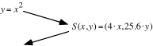

B. Give an equivalent of the form $y=\text{s}\cdot x^{2}$to your image equation in your answer to “A.”

### XI.

A. Represent the square of the distance from $\text{(a,2}\cdot \text{a}^{\text{2}}\text{)}$to the line with equation $y=\frac{{}^{-}1}{8}$ as the sum of three addends.

B. Represent the square of the distance from $\text{(a,2}\cdot \text{a}^{\text{2}}\text{)}$ to the point $\left( 0\mathrm{,}\frac{1}{8} \right)$as the sum of four addends.

C. True or False: Each point on the graph of solutions of $y=2\cdot x^{2}$is the same distance from some line as it is from some other point.  If this is true, give an equation for the line and the coordinates of the point.

## Assignment #83

### I.

Re-express each of the following in rectangular notation:

A. $\left[ \sqrt{6}\mathrm{,}90^{\text{o}} \right]$  B. $\left[ \sqrt{6}\mathrm{,}270^{\text{o}} \right]$

### II.

Give two other ways of expressing the “90˚ rotator,” \[1,90˚\] without using polar notation.

### III.

<strong>Special Notation to Represent Complex Numbers on the</strong> <em><strong>y</strong></em><strong>-axis</strong>

All complex numbers on the $y-\text{axis}$ have rectangular representations with first coordinate 0.  The arrows in the illustration below point to two “typical” complex numbers on the $y-\text{axis}$.  This illustration should suggest that any of the $y-\text{axis}$ complex numbers is the image of an $x-\text{axis}$ real number under the origin centered rotation with magnitude 90˚.

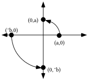

Since multiplying a point by <strong>i</strong> rotates it 90˚, the following are true:

(a,0) · <strong>i =</strong> (0,a) and (¯b,0) · <strong>i</strong> = (0,¯b).

Representing the real numbers in abbreviated rectangular notation gives a . i = (0,a) and

-b . i = (0,-b). The above can be summarized as:

The complex number (0,c) on the$y-\text{axis}$ can also be represented by “ <strong>c</strong> <em><strong>·</strong></em> <strong>i</strong> .”

Re-express each of the following in the form “a.<strong>i</strong>,” where “a” is a real number.

A. (0,3)  B. (0,¯3)  C. (0,$\sqrt{6}$)  D.  $\mathrm{(}0\mathrm{,}{}^{-}\sqrt{6}\mathrm{)}$

### IV.

<strong>The Common Notation for the Square Roots of Negative Real Numbers</strong>

Any solution of an equation of the form

$x^{2}={}^{-}\text{a}$

is a square root of ¯a.  <strong>Unless a = 0, there will always be exactly two solutions of the equation and therefore exactly two square roots of “a.”</strong>

If “¯a ” represents a negative real number then it can be represented by \[a,180˚\].  Using this representation makes it easier to see that the two square roots of ¯a, which are the solutions of

$x^{2}={}^{-}\text{a}$  or $x^{2}=\mathrm{[}\text{a}\mathrm{,}180^{\text{o}}\mathrm{]}$

are

$\mathrm{[}\sqrt{\text{a}}\mathrm{,}90^{\text{o}}\mathrm{]}$  and $\mathrm{[}\sqrt{\text{a}}\mathrm{,}270^{\text{o}}\mathrm{]}$.

Notice that these two square roots of -a are on the $y-\text{axis}$.

Their rectangular representations are $\left( 0\mathrm{,}\sqrt{\text{a}} \right)$ and $\left( 0\mathrm{,}{}^{-}\sqrt{\text{a}} \right)$.

In the special notation for complex numbers on the$y-\text{axis}$,

the square roots of the negative real number represented by “${}^{-}\text{a}$”

are$\sqrt{\text{a}}\cdot$<strong>i</strong> and ${}^{-}\sqrt{\text{a}}\cdot$<strong>i</strong><em><strong>.</strong></em>

EXAMPLE: The square roots of ¯11 are the two solutions of $x^{2}={}^{-}11$.  They are $\left[ \sqrt{11}\mathrm{,}90^{\text{o}} \right]=\left( 0\mathrm{,}\sqrt{11} \right)=\sqrt{11}\cdot$<strong>i</strong>  and  $\left[ \sqrt{11}\mathrm{,}270^{\text{o}} \right]=\left( 0\mathrm{,}{}^{-}\sqrt{11} \right)={}^{-}\sqrt{11}\cdot$<strong>i</strong>.

A. Give a list of any and all solutions of $x^{2}=6$.

B.

1\. Use polar notation to give any and all the solutions of $x^{2}={}^{-}6$.

2\. Use rectangular notation to give the solutions of $x^{2}={}^{-}6$.

3\. Use “a · <strong>i</strong>” notation to give the solutions of $x^{2}={}^{-}6$.

C. True or False: The solutions of $x^{2}={}^{-}6$ are the images of the solutions of $x^{2}=6$ under R90.

D. True or False: The square roots of ¯6 are the images of the square roots of 6 under R90.

### V.

Give each of the following in rectangular notation:

A. $\mathrm{(}\sqrt{6}\mathrm{,}0\mathrm{)}\cdot$(0,1)  B. $\mathrm{(}\sqrt{6}\mathrm{,}0\mathrm{)}\cdot$<strong>i</strong>

C. $\mathrm{(}{}^{-}\sqrt{6}\mathrm{,}0\mathrm{)}\cdot \mathrm{(}0\mathrm{,}1\mathrm{)}$  D. $\mathrm{(}{}^{-}\sqrt{6}\mathrm{,}0\mathrm{)}\cdot$<strong>i</strong>

### VI.

A. Use the FOIL pattern to help replace each of the following with a sum of four addends:

1\. $\mathrm{(}x+4\mathrm{)}\cdot \mathrm{(}x+4\mathrm{)}$  2. $\mathrm{(}x+{}^{-}9\mathrm{)}^{2}$  3. $\mathrm{(}x+\frac{1}{2}\mathrm{)}^{2}$

B. Replace each of your three answers for “A” right above with an equivalent in the form of a sum of three addends.

### VII.

A. Give an image formula for the origin centered scale change, S1, that will map (1,1) onto (3,7).

B. Write a connection diagram that begins with $y=x^{2}$ as the pre-image equation and used scale change S1 from “A” right above as the transformation.

C. Write an equivalent to your image equation from “B” right above in the form $y=\text{s}\cdot x^{2}$.

### VIII.

A. Give an image formula for the origin centered scale change, S2, that will map (2,4) onto (3,7).

B. Write a connection diagram that begins with $y=x^{2}$ as the pre-image equation and used scale change S2 from “A” right above as the transformation.

C. Write an equivalent to your image equation from “B” right above in the form $y=\text{s}\cdot x^{2}$.

### IX.

<strong>Mapping the</strong>$y=x^{2}$ <strong>Parabola onto Another Parabola with its Vertex at the Origin and the</strong> <em><strong>y</strong></em><strong>-axis as its Line of Reflection Symmetry–Part I</strong>

In questions VIII, IX, and X of assignment #82 you were asked to create an equation for the image of the $y=x^{2}$ parabola under three different two-dimensional scale changes.

For Sa$\mathrm{(}x\mathrm{,}y\mathrm{)}=\mathrm{(}1\cdot x\mathrm{,}2\cdot y\mathrm{)}$ the image equation is $\left( \frac{1}{2}\cdot y \right)=x^{2}$– equivalent to $y=2\cdot x^{2}$.

For Sb$\mathrm{(}x\mathrm{,}y\mathrm{)}=\mathrm{(}\frac{1}{2}\cdot x\mathrm{,}\frac{1}{2}\cdot y\mathrm{)}$ the image equation is $\left( 2\cdot y \right)=\left( 2\cdot x \right)^{2}$-- equivalent to both $2\cdot y=4\cdot x^{2}$, and once again, $y=2\cdot x^{2}$.

For Sc$\mathrm{(}x\mathrm{,}y\mathrm{)}=\mathrm{(}\frac{1}{3}\cdot x\mathrm{,}\frac{2}{9}\cdot y\mathrm{)}$ the image equation is $\left( \frac{9}{2}\cdot y \right)=\left( 3\cdot x \right)^{2}$-- equivalent to both $\frac{9}{2}\cdot y=9\cdot x^{2}$ and yet again, $y=2\cdot x^{2}$.

Each of the three scale changes above maps a point on the $y=x^{2}$ parabola onto (1,2).  For Sa this point is (1,1), for Sb this point is (2,4) and for Sc this point is (3,9).  Remember the assumption presented in assignment #81–the image of the $y=x^{2}$ parabola under any two-dimensional scale change is another parabola.  This suggests the following:

To map the$y=x^{2}$ parabola onto any other parabola with the same vertex, (0,0),

and the same line of symmetry (the <em>y</em>-axis), use any two-dimensional scale

change that maps a point other than (0,0) on the$y=x^{2}$ parabola onto any

point other than (0,0) on the image parabola.

You will have a chance to explore the effectiveness of this suggestion as you do this question.  By using your calculator's \[TRACE\] key on the scatter plot generated by the program you can see the coordinates of many potential “target” points to which your choice of a point on the $y=x^{2}$ parabola can be mapped.

A. Run PROGRAM QUADA and use the TRACE function on your calculator to obtain the coordinates of some points.  then create a connection diagram that begins with $y=x^{2}$ and ends with an equation that describes the parabola that passes through the points on that scatter plot.

B. Give an equivalent to your image equation from “A” in the form $y=\text{k}\cdot x^{2}$.  Then push \[ENTER\] and key in your value for “k” at the “K=?” prompt.  Then push \[ENTER\] and see if the parabola generated passes through the points of the scatter plot.  If it does not, push \[ENTER\] again and make any needed corrections in your connection diagram push \[ENTER\] again and enter your new value for “k.”  Do not go on until the parabola generated with your value of “k” passes through all the points of the scatter plot.

C. Now you should try working with a new scatter plot.  To do this, push \[ENTER\] and then push \[ON\] and \[2\].  Then when you push \[ENTER\] again, a new scatter plot will appear.  On your homework paper, create a new connection diagram between the $y=x^{2}$ parabola and the parabola that contains the points on the scatter plot.  Do not quit until the graph generated from your value of “k” passes through all the points of the scatter plot.

### X.

A. Copy and complete this connection diagram:

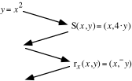

B. Give an equivalent to your final image equation from “A” in the calculator friendly form, $y=\text{k}\cdot x^{2}$

C. Copy and complete this connection diagram:

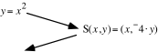

D. Give an equivalent to your final image equation from “A” in the calculator friendly form, $y=\text{k}\cdot x^{2}$

## Assignment #84

### I.

A. Give each of the following in rectangular notation:

1\. $\mathrm{(}\sqrt{11}\mathrm{,}0\mathrm{)}\cdot$<strong>i</strong>      2. $\mathrm{(}{}^{-}\sqrt{11}\mathrm{,}0\mathrm{)}\cdot$<strong>i</strong>

B. Give each of the following in “a·<strong>i</strong>” form where “a” is a real number in abbreviated notation.

1\. ($0\mathrm{,}\sqrt{5}\mathrm{)}$      2. (0,${}^{-}\sqrt{5}$)

### II.

A. Give in any convenient form, the square roots of 7.

B. Give in any convenient form, the square roots of ¯7.

### III.

For each of the following, give an equivalent in the form of a sum of three addends:

A. $\mathrm{(}x+{}^{-}3\mathrm{)}^{2}$      B. $\mathrm{(}x+\frac{1}{3}\mathrm{)}^{2}$

### IV.

A. Give a list of any and all solutions of $x^{2}=6$.

B. Give a list of any and all solutions of $\mathrm{(}x+{}^{-}2\mathrm{)}^{2}=6$.  Hint: The solutions of the equation in “A” can be modified to become “related” solutions of this equation.

### V.

A. Use “a·<strong>i</strong>” notation to give a list of any and all solutions of $x^{2}={}^{-}6$.

B. Use any convenient notation to give a list of any and all solutions of $\mathrm{(}x+{}^{-}2\mathrm{)}^{2}={}^{-}6$.

### VI.

Copy each of the following and, as you do so, fill in every blank so that the three expressions separated by equal signs are equivalent:

A. $\mathrm{(}x+\mathrm{\_\_\_\_)}^{2}=x^{2}+{}^{-}4\cdot x+{}^{-}4\cdot x+\mathrm{\_\_\_\_}=x^{2}+\mathrm{\_\_\_\_}+\mathrm{\_\_\_\_}$

B. $\mathrm{(}x+\mathrm{\_\_\_\_)}^{2}=x^{2}+3\cdot x+3\cdot x+\mathrm{\_\_\_\_}=x^{2}+\mathrm{\_\_\_\_}+\mathrm{\_\_\_\_}$

C. $\mathrm{(}x+\mathrm{\_\_\_\_)}^{2}=x^{2}+4\cdot x+\mathrm{\_\_\_\_}$

### VII.

A. Give an image formula for the origin centered scale change, S1, that will map (1,1) onto (5,¯11).

B. Write a connection diagram that begins with $y=x^{2}$ as the pre-image equation and used scale change Sa from “A” right above as the transformation.

C. Write an equivalent to your image equation from “B” right above in the form $y=\text{k}\cdot x^{2}$.

### VIII.

A. Give an image formula for the origin centered scale change, Sb, that will map (2,4) onto (5,¯11).

B. Write a connection diagram that begins with $y=x^{2}$ as the pre-image equation and used scale change Sb from “A” right above as the transformation.

C. Write an equivalent to your image equation from “B” right above in the form $y=\text{k}\cdot x^{2}$

### IX.

Use PROGRAM QUADA to practice with two different scatter plots.  In each case, create on your homework paper a connection diagram that begins with $y=x^{2}$ and ends with an equation that correctly describes the parabola that passes through the points of the scatter plot.

### X.

<strong>Mapping the</strong>$y=x^{2}$ <strong>Parabola onto Other Parabolas–Part II</strong>

Here is a reminder of the type of pattern made by data collected when a ball is tossed into the air and caught over a motion sensor.

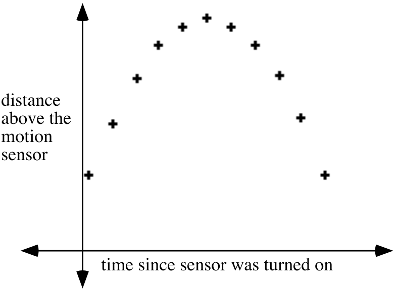

The pattern of the points in the scatter plot could be described as a “frowning” parabola.  The graph of the $y=x^{2}$ parabola can be mapped on to a “frowning” parabola which shares (0,0) as its vertex by using a two-dimensional scale change in which the scale factor for the second coordinate is negative.  S:S($x\mathrm{,}y\mathrm{)}=\mathrm{(}x\mathrm{,}{}^{-}2y\mathrm{)}$ is an example of such a scale change.  When the $y=x^{2}$ parabola is mapped with S, an image equation is $\left( \frac{{}^{-}1}{2}\cdot y \right)=x^{2}$ which is equivalent to the calculator friendly $y={}^{-}2\cdot x^{2}$.

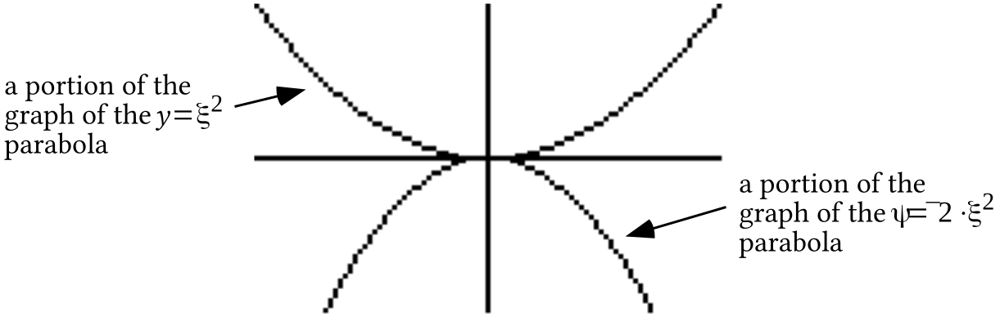

The graphs above were made by a calculator.  The image graph has the general “frowning” shape needed to capture data like that in the scatter plot.  Later you will have experience using translations after scale changes to re-locate vertices from the origin.

Use PROGRAM QUADB to practice with two different scatter plots.  In each case, create on your homework paper a connection diagram that begins with $y=x^{2}$ and ends with an equation that correctly describes the parabola that passes through the points of the scatter plot.

## Assignment #85

### I.

<strong>Relating Solutions of Open Sentences</strong>

In question IV of assignment #84 you were presented with the open sentences

$x^{2}=6$  and $\mathrm{(}x+{}^{-}2\mathrm{)}^{2}=6$.

The solutions of $x^{2}=6$ are ${}^{-}\sqrt{6}$ and $\sqrt{6}$, the square roots of 6.  It might be tempting to use the FOIL pattern to replace the open sentence $\mathrm{(}x+{}^{-}2\mathrm{)}^{2}=6$ with its equivalent, $x^{2}+{}^{-}4\cdot x+4=6$.  It is more efficient to relate the solutions of the solutions of $\mathrm{(}x+{}^{-}2\mathrm{)}^{2}=6$to the solutions of $x^{2}=6$. Earlier work with related solutions might suggest that the open sentences and their solutions might be connected by the one-dimensional translation T with T($x\mathrm{)}=x+2$.  Here is a confirmation:

T(${}^{-}\sqrt{6}\mathrm{)}={}^{-}\sqrt{6}+2$ and $\mathrm{((}{}^{-}\sqrt{6}+2\mathrm{)}+{}^{-}2\mathrm{)}^{2}=\mathrm{(}{}^{-}\sqrt{6}+\mathrm{(}2+{}^{-}2\mathrm{))}^{2}=\mathrm{(}{}^{-}\sqrt{6}\mathrm{)}^{2}=6$.  Therefore, T(${}^{-}\sqrt{6}\mathrm{)}={}^{-}\sqrt{6}+2$ is a solution of $\mathrm{(}x+{}^{-}2\mathrm{)}^{2}=6$.

T($\sqrt{6}\mathrm{)}=\sqrt{6}+2$ and $\mathrm{((}\sqrt{6}+2\mathrm{)}+{}^{-}2\mathrm{)}^{2}=\mathrm{(}\sqrt{6}+\mathrm{(}2+{}^{-}2\mathrm{))}^{2}=\mathrm{(}\sqrt{6}\mathrm{)}^{2}=6$.  Therefore, T($\sqrt{6}\mathrm{)}=\sqrt{6}+2$ is also a solution of $\mathrm{(}x+{}^{-}2\mathrm{)}^{2}=6$.

Previously, we have used transformations to make it easier to compute the distance between pairs of points and the slope of the oblique line containing a pair of points.  This is another instance where transformations can answer a question more easily.

In each case, give a list of any and all solutions of the following equations.  Use “a·<strong>i</strong>” notation in giving any non-real solutions.

A. $x^{2}=7$  B. $\mathrm{(}x+3\mathrm{)}^{2}=7$  C. $\mathrm{(}x+{}^{-}7\mathrm{)}^{2}=7$

D. $x^{2}={}^{-}11$  E. $\mathrm{(}x+{}^{-}5\mathrm{)}^{2}={}^{-}11$  F. $\mathrm{(}x+\frac{1}{2}\mathrm{)}^{2}={}^{-}11$

### II.

Copy each of the following, and as you do so, fill in the blanks so that the expressions separated by the equal signs are equivalent:

A. $\mathrm{(}x+\mathrm{\_\_\_)}^{2}=x^{2}+6\cdot x+\mathrm{\_\_\_\_}$

B. $\mathrm{(}x+\mathrm{\_\_\_)}^{2}=x^{2}+{}^{-}10\cdot x+\mathrm{\_\_\_\_}$

C. $\mathrm{(}x+\mathrm{\_\_\_)}^{2}=x^{2}+3\cdot x+\mathrm{\_\_\_\_}$

### III.

A. Copy each of the following, and as you do so, fill in every blank so that all these equations are equivalent. You might find it easiest to fill in the blanks in alphabetical order.

$x^{2}+6\cdot x=8$

$\begin{array}{l}x^2+6x+\underset{\mathrm{B}}{\underline{\qquad}}=8+\underset{\mathrm{C}}{\underline{\qquad}} \\ (x+\underset{\mathrm{A}}{\underline{\qquad}})^2=\underset{\mathrm{D}}{\underline{\qquad}}\end{array}$

B. Copy each of the following, and as you do so, fill in every blank so that the two equations are equivalent to each other and to $x^{2}+{}^{-}10\cdot x={}^{-}11$.

$\begin{array}{l}x^2+{}^{-}10x+\underset{\mathrm{B}}{\underline{\qquad}}={}^{-}11+\underset{\mathrm{C}}{\underline{\qquad}} \\ (x+\underset{\mathrm{A}}{\underline{\qquad}})^2=\underset{\mathrm{D}}{\underline{\qquad}}\end{array}$

### IV.

Use PROGRAM QUADA to practice with two different scatter plots.  In each case, create on your homework paper a connection diagram that begins with $y=x^{2}$ and ends with an equation that correctly describes the parabola that passes through the points of the scatter plot.

### V.

A. Give an image formula for a two-dimensional scale change that will map (1,1) onto (1.25,¯4.2).

B. Create on your homework paper a connection diagram that begins with $y=x^{2}$ and ends with an equation that describes the parabola which has its vertex at the origin and passes through (1.25, ¯4.2).

### VI.

Use PROGRAM QUADB to practice with two different scatter plots.  In each case, create on your homework paper a connection diagram that begins with $y=x^{2}$ and ends with an equation that correctly describes the parabola that passes through the points of the scatter plot.

### VII.

Copy and complete each of these connection diagrams:

A.

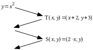

B.

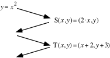

### VIII.

A. The parabola in the graph above is the image of a parabola with its vertex at the origin under the translation T$\mathrm{(}x\mathrm{,}y\mathrm{)}=\mathrm{(}x+{}^{-}2\mathrm{,}y+1\mathrm{)}$.  On your homework, sketch the pre-image parabola and label the coordinates of two different points that are on it.

B. Give an image formula for a two-dimensional scale change that will map the $y=x^{2}$ parabola onto the parabola you sketched as your answer to “A” right above.

C. Create a connection diagram that begins with $y=x^{2}$ and ends with an equation that describes the parabola in the illustration for this question shown right above part A.

## Assignment #86

### I.

In each case, make a list of all the solutions of the given open sentence.  Use “a·<strong>i</strong>” notation in giving any non-real solutions.

A.   $x^{2}=25$                 B.    $\mathrm{(}x+6\mathrm{)}^{2}=25$     C.         $x^{2}=\frac{{}^{-}3}{4}$

D.  $\mathrm{(}x+\frac{7}{2}\mathrm{)}^{2}=\frac{{}^{-}3}{4}$       E.    $x^{2}=\frac{3}{2}$            F.       $\mathrm{(}x+\frac{\sqrt{5}}{2}\mathrm{)}^{2}=\frac{3}{2}$

### II.

Copy each of the following, and as you do so, fill in every blank so that the two equations are equivalent.  You might find it easiest to fill in the blanks in alphabetical order.

A.                     B.

$\begin{array}{l}x^2+12x+\underset{\mathrm{B}}{\underline{\qquad}}={}^{-}11+\underset{\mathrm{C}}{\underline{\qquad}} \\ (x+\underset{\mathrm{A}}{\underline{\qquad}})^2=\underset{\mathrm{D}}{\underline{\qquad}}\end{array}$              $\begin{array}{l}x^2+7x+\underset{\mathrm{B}}{\underline{\qquad}}={}^{-}13+\underset{\mathrm{C}}{\underline{\qquad}} \\ (x+\underset{\mathrm{A}}{\underline{\qquad}})^2=\underset{\mathrm{D}}{\underline{\qquad}}\end{array}$

C.

$\begin{array}{l}x^2+\sqrt5x+\underset{\mathrm{B}}{\underline{\qquad}}={}^{-}1+\underset{\mathrm{C}}{\underline{\qquad}} \\ (x+\underset{\mathrm{A}}{\underline{\qquad}})^2=\underset{\mathrm{D}}{\underline{\qquad}}\end{array}$

### III.

A. Give a single fraction equivalent to $\frac{{}^{-}\text{b}}{\text{2a}}+\frac{\sqrt{\text{b}^{\text{2}}+{}^{-}\text{4ac}}}{\text{2a}}$

B. Here is some arithmetic showing how to create a single fraction equivalent to a sum of two fractions with unequal denominators:

$\frac{2}{5}+\frac{3}{10}=\frac{2}{2}\cdot \frac{2}{5}+\frac{3}{10}=\frac{4}{10}+\frac{3}{10}=\frac{4+3}{10}$

Use this arithmetic as a pattern to guide you in creating an expression in the form of a single fraction equivalent to each of the following:

1\. $\frac{4}{7}+\frac{3}{7\cdot \sqrt{5}}$      2. $\frac{{}^{-}\text{c}}{\text{a}}+\frac{\text{b}^{\text{2}}}{\text{a}^{\text{2}}}$

### IV.

Push \[2nd\] and \[WINDOW\] to set TblStart = -3 and $\Delta \text{Tbl=1}$.  Then enter as Y1 the expression $\sqrt{4\cdot \text{X}^{2}}$.  Now enter as Y2 an expression that does not contain a radical sign which you think is equivalent to the Y1 expression.  Push \[2nd\] and \[GRAPH\] to see tables made from the two expressions.  On your homework paper, give your Y2 expression and then tell whether or not the tables indicate that your Y2 expression is equivalent to the Y1 expression.

### V.

Use PROGRAM QUADA to practice with one scatter plot.  Create on your homework paper a connection diagram that begins with $y=x^{2}$ and ends with an equation that correctly describes the parabola that passes through the points of the scatter plot.

### VI.

Use PROGRAM QUADB to practice with two different scatter plots.  In each case, create on your homework paper a connection diagram that begins with $y=x^{2}$ and ends with an equation that correctly describes the parabola that passes through the points of the scatter plot.

### VII.

<strong>Mapping the</strong>$y=x^{2}$ <strong>Parabola onto other Parabolas–Part III</strong>

The $y=x^{2}$ parabola can be mapped onto the parabola in this illustration from question VIII of assignment #85.

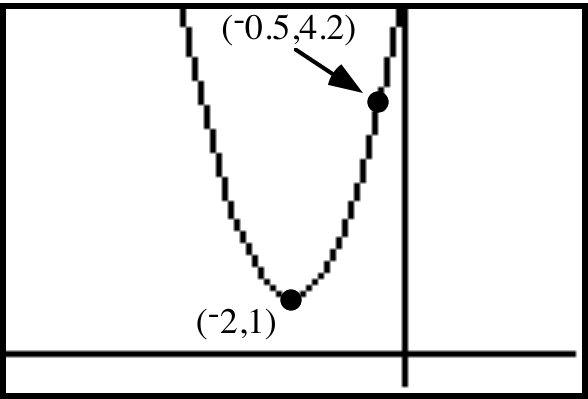

Since the pre-image $y=x^{2}$ parabola has its lowest point, or vertex, at (0,0) a translation must be included in a composite of mappings that produce the image in the illustration.  The translation that maps (0,0) to (¯2,1) is T with T($x\mathrm{,}y\mathrm{)}=\mathrm{(}x+{}^{-}2\mathrm{,}y+1\mathrm{)}$.  If that translation is used <strong>after</strong> a two-dimensional scale change, the intermediate image, that is, the image <strong>after</strong> the scale change but <strong>before</strong> the translation, will have the graph shown below:

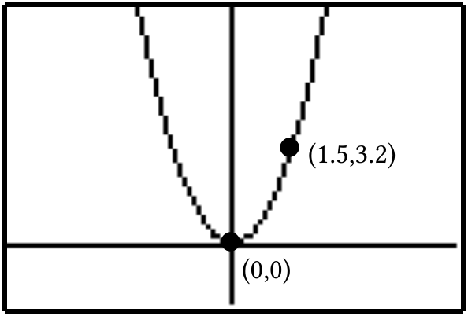

The $y=x^{2}$ parabola can be mapped onto the intermediate image in the illustration right above with many different two-dimensional scale changes.  It is only necessary to choose one that will map some point of your choice on the $y=x^{2}$ parabola to (1.5,3.2).

If you choose (1,1) from the $y=x^{2}$ parabola the scale change that will produce the image (1.5,3.2) is especially easy to describe.  It is the one with image formula S($x\mathrm{,}y\mathrm{)}=\mathrm{(}1\mathrm{.}5\cdot x\mathrm{,}3\mathrm{.}2\cdot y\mathrm{)}$.  The connection diagram from $y=x^{2}$ to the intermediate image is:

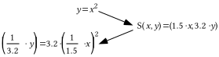

The image equation in the diagram above is equivalent to $y=3\mathrm{.}2\cdot \text{ }\left( \frac{1}{1\mathrm{.}5}\cdot x \right)^{2}$.  It is convenient to use this equivalent before incorporating the translation T with T$\mathrm{(}x\mathrm{,}y\mathrm{)}=\mathrm{(}x+{}^{-}2\mathrm{,}y+1\mathrm{)}$ into a complete connection diagram.  A complete connection diagram is then:

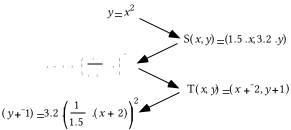

A procedure for connecting the $y=x^{2}$ parabola to another parabola which has a vertical line of reflection symmetry and a vertex away from the origin can be based on this example and stated as follows:

Step #1: Sketch an intermediate image.  The intermediate image is the image of y = x2 after a scale change but before the translation.  To produce the intermediate image, you can “un-translate” the target parabola so that its vertex is at the origin.  Label the coordinates of one point other than (0,0) in the sketch of this intermediate image.

Step #2: Use the coordinates you just labeled to produce the image formula of a scale change.  Then begin a connection diagram with y = x2 and create a calculator friendly version of an equation for the intermediate image parabola.

Step #3: Finish the connection diagram by incorporating into it the translation that will map (0,0) to the vertex of the target parabola.

<strong>The above procedure can be used whenever the coordinates of the vertex and one other point on the target parabola are known</strong>.  In later work, you will learn techniques for writing equations that describe a parabola when the coordinates of any three points on it are known, even if none of these three is the vertex.

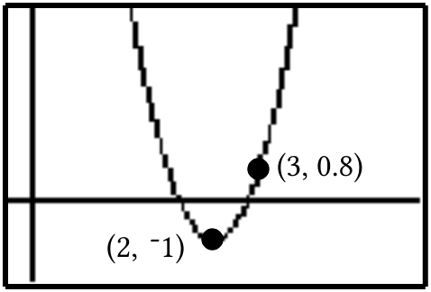

A. The parabola in the graph above is the image of a parabola with its vertex at the origin under the translation T$\mathrm{(}x\mathrm{,}y\mathrm{)}=\mathrm{(}x+2\mathrm{,}y+{}^{-}1\mathrm{)}$.  On your homework sketch the pre-image parabola and label the coordinates of two different points that are on it.

B. Give an image formula for a two-dimensional scale change that will map the $y=x^{2}$ parabola onto the parabola you sketched as your answer to “A” right above.

C. Create a connection diagram that begins with $y=x^{2}$ and ends with an equation for the parabola in the illustration for this question shown right above part A.

### VIII.

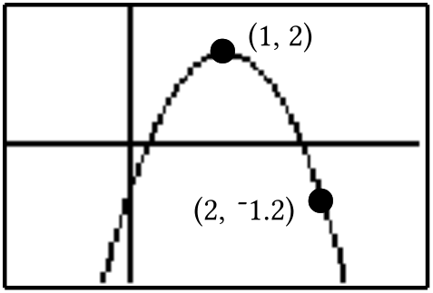

A. The parabola in the graph above is the image of a parabola with its vertex at the origin under the translation T$\mathrm{(}x\mathrm{,}y\mathrm{)}=\mathrm{(}x+1\mathrm{,}y+2\mathrm{)}$.  On your homework sketch the pre-image parabola and label the coordinates of two different points that are on it.

B. Give an image formula for a two-dimensional scale change that will map the $y=x^{2}$ parabola onto the parabola you sketched as your answer to “A” right above.

C. Create a connection diagram that begins with $y=x^{2}$ and ends with an equation for the parabola in the illustration for this question shown right above part A.

## Assignment #87

### I.

In each case, give an expression in the form of a single fraction equivalent to the given expression:

A. $\frac{1}{3}+\frac{2}{3\cdot \sqrt{7}}$  B. $\frac{{}^{-}\text{c}}{\text{a}}+\frac{\text{b}^{\text{2}}}{\text{a}^{\text{2}}}$

C. $\frac{{}^{-}\text{c}}{\text{a}}+\frac{\text{b}^{\text{2}}}{\text{4a}^{\text{2}}}$  D. $\frac{{}^{-}\text{b}}{\text{2a}}+\frac{\sqrt{\text{b}^{\text{2}}+{}^{-}\text{4ac}}}{\text{2a}}$

### II.

<strong>Writing an Expression Equivalent to</strong> $\sqrt{4\cdot \text{X}^{2}}$<strong>in the \[Y=\] List</strong>

One might think that the expression $2\cdot \text{X}$ is equivalent to the expression $\sqrt{\left( 4\cdot \text{X}^{2} \right)}$ regardless of what numbers are used in the variable “X.”  However, the table below shows that this is not the case.  The numbers in the column headed with Y1 were calculated from the numbers in the column headed with “X” by using the expression “$\sqrt{\left( 4\cdot \text{X}^{2} \right)}$” which had been entered as Y1.  The numbers in the third column were calculated from the numbers in the column headed with “X” by using the expression “2.X” that had been entered as Y2.  Since the Y1 and Y2 columns <strong>do not match exactly in every row</strong>, the expressions “$\sqrt{\left( 4\text{X}^{2} \right)}$” and “2X” <strong>are not equivalent</strong>.

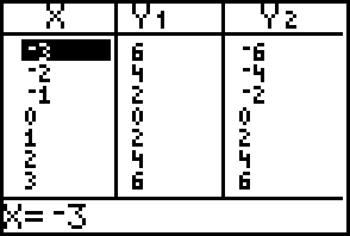

When there is a negative number in the “X” column, the two “Y” columns do not match.   This is because the square root “radical”" symbol represents only the positive square root of the number under the radical. Thus when the calculator deals with $\sqrt{4\cdot \left( {}^{-}3 \right)^{2}}=\sqrt{4\cdot 9}=\sqrt{36}$ after using ¯3 for “X” in “$\sqrt{\left( 4\cdot \text{X}^{2} \right)}$,” it calculates “6” and not “¯6.”

A. Push \[2nd\] and \[WINDOW\] to set TblStart = ¯6 and $\Delta \text{Tbl=1}$.  Then enter as Y1 the expression $\sqrt{\mathrm{(}4\cdot \text{X}^{2}\mathrm{)}}$.  Now enter as Y2 an expression that does not contain a radical sign that your think is equivalent to the Y1 expression.  Push \[2nd\] and \[GRAPH\]  see tables made from the two expressions.  If necessary, make an adjustment in your Y2 expression until the table indicates that it is equivalent to the Y1 expression for non-positive numbers.  Give your Y2 expression on your homework paper.

B. Push \[2nd\] and \[WINDOW\] to set TblStart = 0 and $\Delta \text{Tbl=1}$.  Then enter as Y1 the expression $\sqrt{\mathrm{(}4\cdot \text{X}^{2}\mathrm{)}}$.  Now enter as Y2 an expression that does not contain a radical sign which your think is equivalent to the Y1 expression.  Push \[2nd\] and \[GRAPH\]  see tables made from the two expressions.  If necessary, make an adjustment in your Y2 expression until the table indicates that it is equivalent to the Y1 expression for non-negative numbers.  Give your Y2 expression on your homework paper.

### III.

A. Give an expression without a radical sign that is equivalent to $\sqrt{\text{4}\cdot \text{a}^{\text{2}}}$ whenever non-positive numbers are used for “a.”

B. Give an expression without a radical sign that is equivalent to $\sqrt{\text{4}\cdot \text{a}^{\text{2}}}$ whenever non-negative numbers are used for “a.”

### IV.

Give the number of any of the following expressions which is equivalent to $\frac{\sqrt{\text{b}^{\text{2}}+{}^{-}\text{4ac}}}{{}^{-}\text{2a}}$:

#1:  $\frac{{}^{-}\text{1}}{{}^{-}\text{1}}\cdot \frac{\sqrt{\text{b}^{\text{2}}+{}^{-}\text{4ac}}}{{}^{-}\text{2a}}$  #2: $\frac{{}^{-}\sqrt{\text{b}^{\text{2}}+{}^{-}\text{4ac}}}{\text{2a}}$

### V.

A. In each case, make a list of all the solutions of the given open sentence.

1\.  $x^{2}=5$  2.  $\mathrm{(}x+\frac{\sqrt{11}}{2}\mathrm{)}^{2}=5$

3\.  $x^{\text{2}}=\frac{\text{b}^{\text{2}}+{}^{-}\text{4ac}}{\text{4a}^{\text{2}}}$  4.  $\text{(}x+\frac{\text{b}}{\text{2a}}\text{)}^{\text{2}}=\frac{\text{b}^{\text{2}}+{}^{-}\text{4ac}}{\text{4a}^{\text{2}}}$

B.

1\. Give an image formula for the one-dimensional translation that will map the solutions for “A,1” above onto the solutions of “A,2.”

2\. Give an image formula for the one-dimensional translation that will map the solutions for “A,3” above onto the solutions of “A,4.”

### VI.

A. Give an equivalent to $\text{a}\cdot x^{2}+\text{b}\cdot x+\text{c}=0$ that comes from multiplying each side by $\frac{\text{1}}{\text{a}}$.  Assume that “a” represents a non-zero real number.

B. Give an equivalent to your answer to “A” right above that comes from adding $\frac{{}^{-}\text{c}}{\text{a}}$ to each side.

### VII.

Copy the following, and as you do so, fill in every blank so that the two equations are equivalent.  You might find it easiest to fill in the blanks in alphabetical order.

A.

$\begin{array}{l}x^2+\sqrt{11}x+\underset{\mathrm{B}}{\underline{\qquad}}=\frac54+\underset{\mathrm{C}}{\underline{\qquad}} \\ (x+\underset{\mathrm{A}}{\underline{\qquad}})^2=\underset{\mathrm{D}}{\underline{\qquad}}\end{array}$

B.

$\begin{array}{l}x^2+\frac ba\cdot x+\underset{\mathrm{B}}{\underline{\qquad}}=\frac{{}^{-}c}{a}+\underset{\mathrm{C}}{\underline{\qquad}} \\ (x+\underset{\mathrm{A}}{\underline{\qquad}})^2=\underset{\mathrm{D}}{\underline{\qquad}}\end{array}$

### VIII.

Use PROGRAM QUADB to practice with two different scatter plots.  In each case, create on your homework paper a connection diagram that begins with $y=x^{2}$ and ends with an equation that correctly describes the parabola that passes through the points of the scatter plot.

### IX.

As you answer these questions think about this equation:

$\left[ \begin{matrix}4 & {}^{-}2 \\ 5 & 3\end{matrix} \right]\cdot \left[ \begin{matrix}x_{1} & x_{2} \\ y_{1} & y_{2}\end{matrix} \right]=\left[ \begin{matrix}1 & 0 \\ 0 & 1\end{matrix} \right]$

A.  True or False:  The solution of the system $\left\{ \begin{array}{l}4\cdot x_{1}+{}^{-}2\cdot y_{1}=1 \\ 5\cdot x_{1}+3\cdot y_{1}=0\end{array} \right.$ will provide the numbers in the first column of the inverse of the matrix $\left[ \begin{matrix}4 & {}^{-}2 \\ 5 & 3\end{matrix} \right]$.

B. Write a system whose solution will provide the numbers in the second column of the inverse of $\left[ \begin{matrix}4 & {}^{-}2 \\ 5 & 3\end{matrix} \right]$.

### X.

<strong>Making a Useful Sketch when Creating an Equation for a Parabola Whose Vertex is not at the Origin</strong>

You are learning to describe parabolas which have vertical lines of reflection symmetry by creating connection diagrams that begin with “$y=x^{2}$.”  If the vertex of the target parabola is (0,0), the same as the vertex of the $y=x^{2}$ parabola, you have learned from your practice with programs QUADA and QUADB that the connection can always be made by using a two-dimensional scale change.

The challenge is greater when the vertex of the target parabola is not at the origin. To meet this challenge, most people find it useful to make a sketch of a parabola that does have its vertex at the origin and that could be mapped onto the target parabola with a simple translation.  At the top of the next page is an illustration based on question VII of assignment #86.

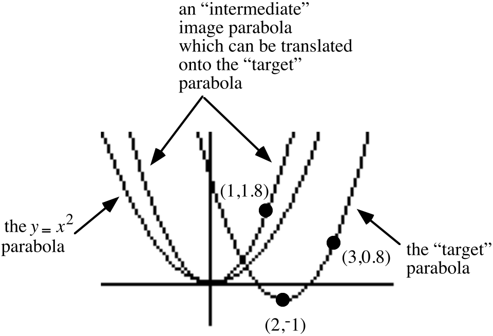

If you sketch an intermediate parabola, it is important to accurately determine the coordinates of one point on it other than the origin.  Think about the relationship between (3,0.8) on the target parabola and (1,1.8) in the intermediate image parabola.  Do you see how the coordinates of the vertex of the target parabola give information about the relationship between the coordinates of these two points?

Use PROGRAM QUADC to get a scatter plot of points on a parabola whose vertex is not the origin.

A. Give an image formula for the translation that will map the origin to the vertex of the parabola that will pass through the scatter plot points.

B. Sketch the intermediate image parabola.  That is, the parabola that will be mapped onto the scatter plot parabola by your answer to “A”.  Label on that sketch the coordinates of any one point other than the origin.

C. Create a connection diagram linking the $y=x^{2}$ parabola to the scatter plot parabola.

D. Give an equation equivalent to your final image equation in the form $y=\text{a}\cdot \mathrm{(}x+\text{h}\mathrm{)}^{2}+\text{k}$.  Use this equation as the basis for making entries when given the “A=?,” “H=?” and “K=?” prompts.  If the parabola that appears does not pass through the scatter plot points, check all your work and make any needed corrections.

## Assignment #88

### I.

Give an equivalent to each of the following equations in the form $\text{a}\cdot x^{2}+\text{b}\cdot x+\text{c}=0$

A. $4\cdot x^{2}-5\cdot x-10=0$      B. ${}^{-}4\mathrm{.}9\cdot x^{2}+40\cdot x=10$

### II.

<strong>Preliminary Formulas for Computing any and all Complex Number Solutions of any Equation of the Form</strong>  $\text{a}\cdot x^{2}+\text{b}\cdot x+\text{c}=0$

Equations of the form $\text{a}\cdot x^{2}+\text{b}\cdot x+\text{c}=0$ occur in the course of answering many interesting questions about real events.  These equations are commonly called <strong>quadratic</strong> equations.  “Quad” is based on a Latin word meaning “square.” The reference is to the power of the first addend of the left side of the equation.  In this course you will write equations of this form to answer questions about the flight of a ball that has been projected straight up into the air.

Over 500 years ago some mathematicians realized that it was possible to create formulas to write the solutions of a quadratic equation.  Here is an outline of the creation of such formulas based on work you have been doing in recent assignments:

Step #1: Replace $\text{a}\cdot x^{2}+\text{b}\cdot x+\text{c}=0$ with $x^{2}+\frac{\text{b}}{\text{a}}\cdot x+\frac{\text{c}}{\text{a}}=0$ by multiplying each side of the original equation by $\frac{\text{1}}{\text{a}}$.  The use of a distributive form helps develop the new equation.

Step #2: Fill in the blanks as shown to “complete a square” and make it easier to discern the form of any solutions:

$\begin{array}{l}x^2+\frac ba\cdot x+\underset{B}{\frac{b^2}{4\cdot a^2}}=\frac{{}^{-}c}{a}+\underset{C}{\frac{b^2}{4\cdot a^2}} \\ \left(x+\underset{A}{\frac12\cdot\frac ba}\right)^2=\underset{D}{\frac{{}^{-}4\cdot a\cdot c+b^2}{4\cdot a^2}}\end{array}$

Step #3: Transform $\frac{\sqrt{\text{b}^{\text{2}}+{}^{-}\text{4}\cdot \text{a}\cdot \text{c}}}{\sqrt{\text{4}\cdot \text{a}^{\text{2}}}}$ and $\frac{{}^{-}\sqrt{\text{b}^{\text{2}}+{}^{-}\text{4}\cdot \text{a}\cdot \text{c}}}{\sqrt{\text{4}\cdot \text{a}^{\text{2}}}}$, the solutions of $x^{\text{2}}=\frac{\text{b}^{\text{2}}+{}^{-}\text{4}\cdot \text{a}\cdot \text{c}}{\text{4}\cdot \text{a}^{\text{2}}}$, onto the solutions of $\left( x+\frac{\text{b}}{\text{2}\cdot \text{a}} \right)^{\text{2}}=\frac{\text{b}^{\text{2}}+{}^{-}\text{4}\cdot \text{a}\cdot \text{c}}{\text{4}\cdot \text{a}^{\text{2}}}$ by using the translation T with T(<em>x</em>)=$x+\frac{{}^{-}\text{b}}{\text{2}\cdot \text{a}}$.  These solutions are $\frac{{}^{-}\text{b}}{\text{2}\cdot \text{a}}+\frac{\sqrt{\text{b}^{\text{2}}+{}^{-}\text{4}\cdot \text{a}\cdot \text{c}}}{\sqrt{\text{4}\cdot \text{a}^{\text{2}}}}$ and $\frac{{}^{-}\text{b}}{\text{2}\cdot \text{a}}+\frac{{}^{-}\sqrt{\text{b}^{\text{2}}+{}^{-}\text{4}\cdot \text{a}\cdot \text{c}}}{\sqrt{\text{4}\cdot \text{a}^{\text{2}}}}$.

Step #4: The expressions $\frac{{}^{-}\text{b}}{\text{2}\cdot \text{a}}+\frac{\sqrt{\text{b}^{\text{2}}+{}^{-}\text{4}\cdot \text{a}\cdot \text{c}}}{\sqrt{\text{4}\cdot \text{a}^{\text{2}}}}$ and $\frac{{}^{-}\text{b}}{\text{2}\cdot \text{a}}+\frac{{}^{-}\sqrt{\text{b}^{\text{2}}+{}^{-}\text{4}\cdot \text{a}\cdot \text{c}}}{\sqrt{\text{4}\cdot \text{a}^{\text{2}}}}$ provide formulas for any solutions of any quadratic equation.

In summary,

The solution or solutions of an equation of the form  $\text{a}\cdot x^{2}+\text{b}\cdot x+\text{c}=0$ can be computed from the expressions

$\frac{{}^{-}\text{b}}{\text{2}\cdot \text{a}}+\frac{\sqrt{\text{b}^{\text{2}}+{}^{-}\text{4}\cdot \text{a}\cdot \text{c}}}{\sqrt{\text{4}\cdot \text{a}^{\text{2}}}}$ and $\frac{{}^{-}\text{b}}{\text{2}\cdot \text{a}}+\frac{{}^{-}\sqrt{\text{b}^{\text{2}}+{}^{-}\text{4}\cdot \text{a}\cdot \text{c}}}{\sqrt{\text{4}\cdot \cdot \text{a}^{\text{2}}}}$.

The formulas given in the box above are absolutely correct, but there are more convenient equivalents that are in common use.  Your work on question III of this assignment will move you toward an acquaintance with the common equivalents that constitute the <strong>quadratic formula</strong>.

A. For the open sentence $x^{2}=\mathrm{[}9\mathrm{,}\text{ }180^{\text{o}}\mathrm{]}$,

1\. List all the solutions in polar notation.

2\. List all the solutions in “a.<strong>i</strong>” notation.

B. The expression “$\text{b}^{\text{2}}+{}^{-}\text{4}\cdot \text{a}\cdot \text{c}$,” which appears under the radical bar in the solutions formulas in the box above is called the <strong>discriminant</strong>.    For each of the following equations, identify the “a,” “b,” and “c” numbers, compute the discriminant number and give the square roots of the discriminant number in any convenient notation:

1\. $5\cdot x^{2}+7\cdot x+2=0$      2. $5\cdot x^{2}+4\cdot x+1=0$

C. A quadratic equation, of the form$y=\text{a}\cdot x^{2}+\text{b}\cdot x+\text{c}$, has a discriminant, b2 - 4.a.c, which is equal to 49.  The value of a is -2 and the value of b is 11. Use the solution expressions in the box above to make a list of the two solutions of that equation.

### III.

A.

1\. If “a” represents a positive real number, give equivalents for both $\frac{{}^{-}\text{b}}{\text{2}\cdot \text{a}}+\frac{\sqrt{\text{b}^{\text{2}}+{}^{-}\text{4}\cdot \text{a}\cdot \text{c}}}{\sqrt{\text{4}\cdot \text{a}^{\text{2}}}}$ and $\frac{{}^{-}\text{b}}{\text{2}\cdot \text{a}}+\frac{{}^{-}\sqrt{\text{b}^{\text{2}}+{}^{-}\text{4}\cdot \text{a}\cdot \text{c}}}{\sqrt{\text{4}\cdot \text{a}^{\text{2}}}}$ in the form of the sum of two fractions. There should not be a radical sign in the denominator of any of the fractions in your two answers.

2\. Give an equivalent to each of your two answers to “A,1” right above in the form of a single fraction.

B.

1\. If “a” represents a negative real number, give equivalents for both   $\frac{{}^{-}\text{b}}{\text{2}\cdot \text{a}}+\frac{\sqrt{\text{b}^{\text{2}}+{}^{-}\text{4}\cdot \text{a}\cdot \text{c}}}{\sqrt{\text{4}\cdot \text{a}^{\text{2}}}}$ and $\frac{{}^{-}\text{b}}{\text{2}\cdot \text{a}}+\frac{{}^{-}\sqrt{\text{b}^{\text{2}}+{}^{-}\text{4}\cdot \text{a}\cdot \text{c}}}{\sqrt{\text{4}\cdot \text{a}^{\text{2}}}}$ in the form of the sum of two fractions. There should not be a radical sign in the denominator of any of the fractions in your two answer.

2\. Give an equivalent to each of your two answers to “B,1” right above in the form of a single fraction.

C. Based on your answers to “A,1” and “B,1” above, does it appear that two different pairs of formulas are needed for the solutions of a quadratic equation?  In other words, must we have one pair of formulas for equations in which “a” represents a positive number and a different pair of formulas for equations in which “a” represents a negative real number?

### IV.

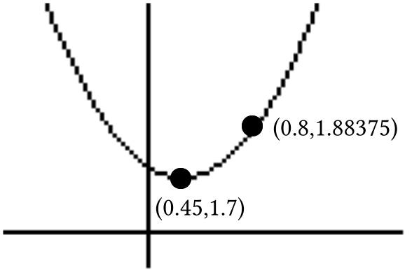

(0.45,1.7) is the vertex of the parabola in the illustration.

A. Give an image formula for the translation that will map the origin to the vertex of the parabola in the illustration.

B. Sketch the parabola with vertex (0,0) that will be mapped onto the parabola in the illustration by your answer to “A.”  Label on that sketch the coordinates of any one point other than the origin.

C. Create a connection diagram linking the $y=x^{2}$ parabola to the parabola in the illustration.

D. Give an equivalent to your final image equation in the form $y=\text{a}\cdot \mathrm{(}x+\text{h}\mathrm{)}^{2}+\text{k}$.

### V.

This question is about the line that passes through (¯3,5) and (7,21).

A. Give the slope of that line.

B. Give an equation for the line through the origin parallel to the line through the two given points.

C. Write a connection diagram that begins with your answer to “B” right above and ends with an equation for the line through the two given points.

D. Give an equivalent to your answer to “C” right above in the form $y=\text{a}\cdot x+\text{b}$.  “a” and “b” should be expressed as fractions with integer numerators and denominators.

### VI.

This question is about the system: $\left\{ \begin{array}{l}{}^{-}3\cdot a+1\cdot b=5 \\ \text{ }7\cdot a+1\cdot b=21\end{array} \right.$

A. Give the matrix of coefficients of the system.

B. Give the matrix of constants of the system.

C. Give the inverse of the matrix of coefficients.  The entries should be in the form of fractions.  You can use your calculator to do this.

D. Use your answers to “B” and “C” right above to compute the exact solution of the system.

### VII.

Give an equivalent to each of the following as the sum of three addends.

A. $\mathrm{(}x+{}^{-}6\mathrm{)}^{2}$  B. $\mathrm{(}x+{}^{-}6\mathrm{)}^{2}+7$  C. $3\cdot \mathrm{(}x+{}^{-}6\mathrm{)}^{2}+7$

### VIII.

Copy this connection diagram and supply the missing image formula.

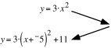

### IX.

A.  Compute the solution of each of these systems.

1\. $\left\{ \begin{array}{l}{}^{-}3\cdot x_{1}+5\cdot y_{1}=1 \\ 2\cdot x_{1}+1\cdot y_{1}=0\end{array} \right.$      2. $\left\{ \begin{array}{l}{}^{-}3\cdot x_{2}+5\cdot y_{2}=0 \\ 2\cdot x_{2}+1\cdot y_{2}=1\end{array} \right.$

B. Give the inverse of the matrix $\left[ \begin{matrix}{}^{-}3 & 5 \\ 2 & 1\end{matrix} \right]$.

## Assignment #89

### I.

<strong>The Common Form of the Quadratic Formula</strong>

The expressions $\frac{{}^{-}\text{b}}{\text{2}\cdot \text{a}}+\frac{\sqrt{\text{b}^{\text{2}}+{}^{-}\text{4}\cdot \text{a}\cdot \text{c}}}{\sqrt{\text{4}\cdot \text{a}^{\text{2}}}}$ and $\frac{{}^{-}\text{b}}{\text{2}\cdot \text{a}}+\frac{{}^{-}\sqrt{\text{b}^{\text{2}}+{}^{-}\text{4}\cdot \text{a}\cdot \text{c}}}{\sqrt{\text{4}\cdot \text{a}^{\text{2}}}}$ can be used as formulas to compute the solutions of an any equation of the form $\text{a}\cdot x^{2}+\text{b}\cdot x+\text{c}=0$ in which “<em>a</em>” represents a non-zero real number.  However, there are equivalents to those expressions that are more familiar to people who do mathematics.

If “a” represents a positive real number, the expressions $\frac{{}^{-}\text{b}}{\text{2}\cdot \text{a}}+\frac{\sqrt{\text{b}^{\text{2}}+{}^{-}\text{4}\cdot \text{a}\cdot \text{c}}}{\sqrt{\text{4}\cdot \text{a}^{\text{2}}}}$ and $\frac{{}^{-}\text{b}}{\text{2}\cdot \text{a}}+\frac{{}^{-}\sqrt{\text{b}^{\text{2}}+{}^{-}\text{4}\cdot \text{a}\cdot \text{c}}}{\sqrt{\text{4}\cdot \text{a}^{\text{2}}}}$ are equivalent to $\frac{{}^{-}\text{b}}{\text{2}\cdot \text{a}}+\frac{\sqrt{\text{b}^{\text{2}}+{}^{-}\text{4}\cdot \text{a}\cdot \text{c}}}{\text{2}\cdot \text{a}}$ and $\frac{{}^{-}\text{b}}{\text{2}\cdot \text{a}}+\frac{{}^{-}\sqrt{\text{b}^{\text{2}}+{}^{-}\text{4}\cdot \text{a}\cdot \text{c}}}{\text{2}\cdot \text{a}}$, respectively.  Furthermore these two sums of two fractions are equivalent to $\frac{{}^{-}\text{b}+\sqrt{\text{b}^{\text{2}}+{}^{-}\text{4}\cdot \text{a}\cdot \text{c}}}{\text{2}\cdot \text{a}}$ and $\frac{{}^{-}\text{b}+{}^{-}\sqrt{\text{b}^{\text{2}}+{}^{-}\text{4}\cdot \text{a}\cdot \text{c}}}{\text{2}\cdot \text{a}}$.  The last two fractional expressions are the ones that appear in the quadratic formula most would give.

However, if “a” represents a negative real number, the expressions $\frac{{}^{-}\text{b}}{\text{2}\cdot \text{a}}+\frac{\sqrt{\text{b}^{\text{2}}+{}^{-}\text{4}\cdot \text{a}\cdot \text{c}}}{\sqrt{\text{4}\cdot \text{a}^{\text{2}}}}$ and $\frac{{}^{-}\text{b}}{\text{2}\cdot \text{a}}+\frac{{}^{-}\sqrt{\text{b}^{\text{2}}+{}^{-}\text{4}\cdot \text{a}\cdot \text{c}}}{\sqrt{\text{4}\cdot \text{a}^{\text{2}}}}$ are equivalent to $\frac{{}^{-}\text{b}}{\text{2}\cdot \text{a}}+\frac{\sqrt{\text{b}^{\text{2}}+{}^{-}\text{4}\cdot \text{a}\cdot \text{c}}}{{}^{-}\text{2}\cdot \text{a}}$ and $\frac{{}^{-}\text{b}}{\text{2}\cdot \text{a}}+\frac{{}^{-}\sqrt{\text{b}^{\text{2}}+{}^{-}\text{4}\cdot \text{a}\cdot \text{c}}}{{}^{-}\text{2}\cdot \text{a}}$, respectively.  It might thus appear there needs to be two pairs of fractional expressions in any formula for the solutions of a quadratic equation.  But this is not so because $\frac{{}^{-}\text{b}}{\text{2}\cdot \text{a}}+\frac{\sqrt{\text{b}^{\text{2}}+{}^{-}\text{4}\cdot \text{a}\cdot \text{c}}}{{}^{-}\text{2}\cdot \text{a}}$ is equivalent to

$\frac{{}^{-}\text{b}}{\text{2a}}+\frac{{}^{-}\text{1}\cdot \sqrt{\text{b}^{\text{2}}+{}^{-}\text{4}\cdot \text{a}\cdot \text{c}}}{{}^{-}\text{1}\cdot {}^{-}\text{2}\cdot \text{a}}=\frac{{}^{-}\text{b}}{\text{2}\cdot \text{a}}+\frac{{}^{-}\sqrt{\text{b}^{\text{2}}+{}^{-}\text{4}\cdot \text{a}\cdot \text{c}}}{\text{2}\cdot \text{a}}=\frac{{}^{-}\text{b}+{}^{-}\sqrt{\text{b}^{\text{2}}+{}^{-}\text{4}\cdot \text{a}\cdot \text{c}}}{\text{2}\cdot \text{a}}$

and $\frac{{}^{-}\text{b}}{\text{2}\cdot \text{a}}+\frac{{}^{-}\sqrt{\text{b}^{\text{2}}+{}^{-}\text{4}\cdot \text{a}\cdot \text{c}}}{{}^{-}\text{2}\cdot \text{a}}$ is equivalent to

$\frac{{}^{-}\text{b}}{\text{2}\cdot \text{a}}+\frac{{}^{-}\text{1}\cdot {}^{-}\sqrt{\text{b}^{\text{2}}+{}^{-}\text{4}\cdot \text{a}\cdot \text{c}}}{{}^{-}\text{1}\cdot {}^{-}\text{2}\cdot \text{a}}=\frac{{}^{-}\text{b}}{\text{2}\cdot \text{a}}+\frac{{}^{-}\text{1}\cdot {}^{-}\text{1}\sqrt{\text{b}^{\text{2}}+{}^{-}\text{4}\cdot \text{a}\cdot \text{c}}}{\text{2}\cdot \text{a}}=\frac{{}^{-}\text{b}+\sqrt{\text{b}^{\text{2}}+{}^{-}\text{4}\cdot \text{a}\cdot \text{c}}}{\text{2}\cdot \text{a}}$

Therefore the same formulas, known jointly a <strong>the quadratic formula</strong> can be used to compute the solutions of an equation of the form $\text{a}\cdot x^{2}+\text{b}\cdot x+\text{c}=0$ in which “a” represents a non-zero real number. The common form of the Quadratic Formula is

The solutions of an equation of the form  $\text{a}\cdot x^{2}+\text{b}\cdot x+\text{c}=0$, (with a$\neq$0)

can be computed from the expressions

$\frac{{}^{-}\text{b}+\sqrt{\text{b}^{\text{2}}+{}^{-}\text{4}\cdot \text{a}\cdot \text{c}}}{\text{2}\cdot \text{a}}$ and $\frac{{}^{-}\text{b}+{}^{-}\sqrt{\text{b}^{\text{2}}+{}^{-}\text{4}\cdot \text{a}\cdot \text{c}}}{\text{2}\cdot \text{a}}$.

The fractional expressions in the box above are called the <strong>quadratic formula</strong>.  This formula is used so frequently that it is worth memorizing.

A. Memorize the quadratic formula.

B. Use the quadratic formula to write the two solutions of the equation $2\cdot x^{2}+{}^{-}7\cdot x+4=0$.

### II.

The data in the following table were collected using a motion sensor as a volleyball traveled up and down over it in the air.  Enter the data into lists #1 and #2.

Use Plot1 to get a view of a scatter plot of the data.  Then do the following:

A. Consider the highest point on the scatter plot as the vertex of a parabola that should capture the trend in the data.  Then give an image formula for a translation that will map a parabola with its vertex at the origin onto a parabola for the scatter plot data.

B. Sketch the pre-image parabola with vertex (0,0) which is mapped by the translation described by your answer to “A” right above, and label on that sketch the coordinates of any one point other then the origin.

C. Create a connection diagram between the $y=x^{2}$ parabola and a parabola for the scatter plot data.

D. Give an equivalent to your final image equation in the form $y=\text{a}\cdot \mathrm{(}x+\text{h}\mathrm{)}^{2}+\text{k}$.  Then use this equation as a basis for an expression that you enter as Y1.  Have your calculator generate a graph from this expression and comment on how well you think it does capture the trend in the volleyball data.

### III.

Run PROGRAM QUADC.  After you see a scatter plot of points, push \[ENTER\] so that you can read the coordinates of the points on the scatter plot.

A. Give an image formula for the translation that will map the origin to the vertex of the parabola that will pass through the scatter plot points.

B. Sketch the intermediate image parabola.  That is, the parabola that will be mapped onto the scatter plot parabola by your answer to “A.”  Label on that sketch the coordinates of any one point other than the origin.

C. Create a connection diagram linking the $y=x^{2}$ parabola to the scatter plot parabola.

D. Give an equivalent to your final image equation in the form $y=\text{a}\cdot \mathrm{(}x+\text{h}\mathrm{)}^{2}+\text{k}$ and use this equation as the basis for making entries when given the “A=?,” “H=?” and “K=?” prompts.  If the parabola that appears does not pass through the scatter plot points, check all your work and make any needed corrections.

### IV.

A. Give the coordinates of the vertex of the parabola with equation $y=x^{2}$.

B. Give the coordinates of the vertex of the parabola with equation $y=3\cdot x^{2}$.

C. Give the coordinates of the vertex of the parabola with equation $y=\mathrm{(}x+2\mathrm{)}^{2}+{}^{-}5$.

D. Give the coordinates of the vertex of the parabola with equation $y=3\cdot \mathrm{(}x+2\mathrm{)}^{2}+{}^{-}5$.

### V.

Replace each of the given equations with an equivalent of the form $y=\text{a}\cdot x^{2}+\text{b}\cdot x+\text{c}$.

A. $y=\mathrm{(}x+{}^{-}5\mathrm{)}^{2}+3$      B. $y=2\cdot \mathrm{(}x+{}^{-}5\mathrm{)}^{2}+3$

### VI.

A. Calculate the slope of the line that passes through (2,5) and (11,22).

B. Create a connection diagram that begins with an equation for the line through the origin parallel to the line passing through (2,5) and (11,22) and ends with an equation for the line that passes through those two points.

C. Give an equivalent of the form $y=\text{a}\cdot x+\text{b}$ to the image equation in your connection diagram from “B” right above.

### VII.

The line passing through (2,5) and (11,22) has an equation of the form $y=\text{a}\cdot x+\text{b}$.  The coordinates of the point (2,5) can be used to create the equation $5=2\cdot \text{a}+1\cdot \text{b}$.  Create a second equation from $y=\text{a}\cdot x+\text{b}$ by using the coordinates of the point (11,22).

### VIII.

Calculate the solution of the system $\left\{ \begin{array}{l}2\cdot a+1\cdot b=5 \\ 11\cdot a+1\cdot b=22\end{array} \right.$ by using matrix multiplication.

### IX.

An object moved 20 feet in a straight line in 2 seconds. What was its average speed in feet per second?

### X.

A.  Give the Gauss Elimination Coding for the second, third, fourth, and fifth matrix displays.

$\left[\begin{array}{cc|cc}5 & 3 & 1 & 0 \\ 4 & 3 & 0 & 1\end{array}\right]$ $\begin{array}{l}A_1 \\ B_1\end{array}$

$\left[\begin{array}{cc|cc}1 & \frac35 & \frac15 & 0 \\ 4 & 3 & 0 & 1\end{array}\right]$ $\begin{array}{l}A_2= \\ B_2=\end{array}$

$\left[\begin{array}{cc|cc}1 & \frac35 & \frac15 & 0 \\ 0 & \frac35 & \frac{{}^{-}4}{5} & 1\end{array}\right]$ $\begin{array}{l}A_3= \\ B_3=\end{array}$

$\left[\begin{array}{cc|cc}1 & \frac35 & \frac15 & 0 \\ 0 & 1 & \frac{{}^{-}4}{3} & \frac53\end{array}\right]$ $\begin{array}{l}A_4= \\ B_4=\end{array}$

$\left[\begin{array}{cc|cc}1 & 0 & 1 & {}^{-}1 \\ 0 & 1 & \frac{{}^{-}4}{3} & \frac53\end{array}\right]$ $\begin{array}{l}A_5= \\ B_5=\end{array}$

B. Compute the solutions of each system.

1\. $\left\{ \begin{array}{l}5\cdot x_{1}+3\cdot y_{1}=1 \\ 4\cdot x_{1}+3\cdot y_{1}=0\end{array} \right.$      2. $\left\{ \begin{array}{l}5\cdot x_{2}+3\cdot y_{2}=0 \\ 4\cdot x_{2}+3\cdot y_{2}=1\end{array} \right.$

C. Compute the inverse of $\left[ \begin{matrix}5 & 3 \\ 4 & 3\end{matrix} \right]$.

## Assignment #90

### I.

<strong>The Discriminant–a Key Part of the Quadratic Formula</strong>

“$\text{b}^{\text{2}}+{}^{-}\text{4ac}$” appears under the radical in the numerator of each of the fractions of the quadratic formula.  The number computed from “$\text{b}^{\text{2}}+{}^{-}\text{4ac}$” is called the “discriminant” of the solution or solutions.  You will be asked below what it is that the “discriminant” might discriminate.

<strong>A New Notation for the Square Roots of Negative Real Numbers</strong>

You have already learned that if “¯a” represents a negative real number, its two square roots are the square roots of its opposite, “a,” rotated 90 degrees.  So far you have learned that the square roots of the negative real number “¯<em>a</em>” can be represented by:

<strong>i</strong>$\cdot \sqrt{\text{a}}$ and <strong>i</strong>$\cdot {}^{-}\sqrt{\text{a}}$ (=${}^{-}$<strong>i</strong>$\cdot \sqrt{\text{a}}$).

The square root radical sign is also used to represent the square roots of a negative real number.  Thus if “¯a” represents a real number:

$\sqrt{{}^{-}\text{a}}$ represents the same square root as does <strong>i</strong>$\cdot \sqrt{\text{a}}$

and

${}^{-}\sqrt{{}^{-}\text{a}}$ represents the same square root as does ${}^{-}$<strong>i</strong>$\cdot \sqrt{\text{a}}$.

For example, the square roots of ${}^{-}11$are represented by $\sqrt{{}^{-}11}$ and ${}^{-}\sqrt{{}^{-}11}$.

A. Replace each of the given equations with an equivalent of the form $\text{a}\cdot x^{2}+\text{b}\cdot x+\text{c}=0$.

1\. ${}^{-}15\cdot x^{2}-31\cdot x-5=0$                           2. ${}^{-}16\cdot x^{2}+100\cdot x=125$

3\. ${}^{-}16\cdot x^{2}+100\cdot x+91=200$

B. For each of the following open sentences, compute the discriminant ($\text{b}^{\text{2}}+{}^{-}\text{4}\cdot \text{a}\cdot \text{c}$) and then give the exact square roots of the discriminant in any convenient notation:

1\. $5\cdot x^{2}+6\cdot x+3=0$        2. $5\cdot x^{2}+8\cdot x+3=0$            3. $4\cdot x^{2}+12\cdot x+9=0$

C. For a certain quadratic equation of the form $\text{a}\cdot x^{2}+\text{b}\cdot x+\text{c}=0$the discriminant is $\text{25}$, a = ¯3 and b = 10.  List all the solutions of the equation.

D. For a certain quadratic equation of the form $\text{a}\cdot x^{2}+\text{b}\cdot x+\text{c}=0$the discriminant is ${}^{-}\text{25}$ = , a = ¯3 and b = 10.  List all the solutions of the equation.

### II.

A. If the coefficients of a quadratic equation of the form $\text{a}\cdot x^{2}+\text{b}\cdot x+\text{c}=0$ are all real numbers and the discriminant ($\text{b}^{\text{2}}+{}^{-}\text{4ac}$) is equal to 0, what information does this give about the solutions of the equation?

B. If the coefficients of a quadratic equation of the form $\text{a}\cdot x^{2}+\text{b}\cdot x+\text{c}=0$ are all real numbers and the discriminant ($\text{b}^{\text{2}}+{}^{-}\text{4ac}$) is negative, what information does this give about the solutions of the equation?

### III.

The line passing through (4,¯3) and (21,10) has an equation of the form $y=\text{a}\cdot x+\text{b}$.

A. Use the coordinates of the given points and the given form to create a system of two equations which have “<em>a</em>” and “<em>b</em>” as their variables.

B. Use matrix multiplication to calculate the solution of the system you gave as your answer to “A” right above.

C. Give an equation of the form $y=\text{a}\cdot x+\text{b}$for the line passing through (4,¯3) and (21,10).

### IV.

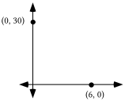

Trace the coordinate system above onto your homework paper:

A. Add to your tracing dots representing the points (1,29.4), (5,5.4) and (6,14.4).

B. Now add to your tracing a sketch of a parabola that passes through the three points whose representation you just made as your response to “A” right above.

### V.

A parabola passing through (1,29.4), (5,5.4) and (6,14.4) has an equation of the form $y=\text{a}\cdot x^{2}+\text{b}\cdot x+\text{c}$.  The fact that the point (1,29.4) is on the graph can be used to create the equation 29.4 = $\text{a}\cdot \text{1}^{\text{2}}+\text{b}\cdot \text{1}+\text{1}\cdot \text{c}$.  Use the points (5,5.4) and (6,14.4) to create two other similar equations from $y=\text{a}\cdot x^{2}+\text{b}\cdot x+\text{c}$.

### VI.

For the system $\left\{ \begin{array}{l}1\cdot a+1\cdot b+1\cdot c=29\mathrm{.}4 \\ 25\cdot a+5\cdot b+1\cdot c=5\mathrm{.}4 \\ 36\cdot a+6\cdot b+1\cdot c=14\mathrm{.}4\end{array} \right.$

A. Give the matrix of coefficients.          B. Give the matrix of constants.

### VII.

Give the coordinates of the vertex of the parabola with equation $y=3\cdot \mathrm{(}x+{}^{-}4\mathrm{)}^{2}+2\mathrm{.}4$

### VIII.

Give the Gauss Elimination coding that connects the matrices in the following sequence:

$\left[ \left. \begin{matrix}8 & 2 \\ 11 & 3\end{matrix} \right|\begin{matrix}1 & 0 \\ 0 & 1\end{matrix} \right]$ $\begin{array}{l}A_1 \\ B_1\end{array}$

$\left[ \left. \begin{matrix}1 & \frac{1}{4} \\ 11 & 3\end{matrix} \right|\begin{matrix}\frac{1}{8} & 0 \\ 0 & 1\end{matrix} \right]$ $\begin{array}{l}A_2= \\ B_2=\end{array}$

$\left[ \left. \begin{matrix}1 & \frac{1}{4} \\ 0 & \frac{1}{4}\end{matrix} \right|\begin{matrix}\frac{1}{8} & 0 \\ \frac{{}^{-}11}{8} & 1\end{matrix} \right]$ $\begin{array}{l}A_3= \\ B_3=\end{array}$

$\left[ \begin{matrix}1 & \frac{1}{4} \\ 0 & 1\end{matrix}\left| \begin{matrix}\frac{1}{8} & 0 \\ \frac{{}^{-}11}{2} & 4\end{matrix} \right. \right]$ $\begin{array}{l}A_4= \\ B_4=\end{array}$

$\left[ \begin{matrix}1 & 0 \\ 0 & 1\end{matrix}\left| \begin{matrix}\frac{12}{8} & {}^{-}1 \\ \frac{{}^{-}11}{2} & 4\end{matrix} \right. \right]$ $\begin{array}{l}A_5= \\ B_5=\end{array}$

### IX.

In this equation, X is a matrix variable.  What is the solution?

$\left[ \begin{matrix}4 & {}^{-}2 & 1 \\ 1 & 1 & 1 \\ 9 & 3 & 1\end{matrix} \right]\cdot \text{X=}\left[ \begin{matrix}4 & {}^{-}2 & 1 \\ 1 & 1 & 1 \\ 9 & 3 & 1\end{matrix} \right]$

### X.

The $2\times 2$ systems $\left\{ \begin{array}{l}\text{ }8\cdot x_{1}+2\cdot y_{1}=1 \\ 11\cdot x_{1}+3\cdot y_{1}=0\end{array} \right.$ and $\left\{ \begin{array}{l}8\cdot x_{2}+2\cdot y_{2}\text{ }=0 \\ 11\cdot x_{2}+3\cdot y_{2}=1\end{array} \right.$ are based on the matrix product

$\left[ \begin{matrix}8 & 2 \\ 11 & 3\end{matrix} \right]\cdot \left[ \begin{matrix}x_{1} & x_{2} \\ y_{1} & y_{2}\end{matrix} \right]=\left[ \begin{matrix}1 & 0 \\ 0 & 1\end{matrix} \right]$.

Write three $3\times 3$ systems based on the matrix product

$\left[ \begin{matrix}4 & {}^{-}2 & 1 \\ 1 & 1 & 1 \\ 9 & 3 & 1\end{matrix} \right]\cdot \left[ \begin{matrix}x_{1} & x_{2} & x_{3} \\ y_{1} & y_{2} & y_{3} \\ z_{1} & z_{2} & z_{3}\end{matrix} \right]=\left[ \begin{matrix}1 & 0 & 0 \\ 0 & 1 & 0 \\ 0 & 0 & 1\end{matrix} \right]$

### XI.

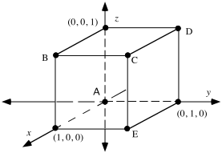

Shown in the illustration above is a representation of the edges of a figure known as the unit cube.  The figure is placed in a 3-dimensional rectangular coordinate system.  The axes and the coordinates of the three 3-dimensional basis points are labeled.

A. For the five lettered vertices of the cube, make a list of the five letters and the three coordinates (in parentheses, and in the proper order) of the points named with the letters.

B. How many edges does the cube have?

C. How many square faces does the cube have?

## Assignment #91

### I.

The parabola passing through the points (¯2,8), (1,2) and (3,18) can be described by an equation of the form $y=\text{a}\cdot x^{2}+\text{b}\cdot x+\text{c}$.   The coordinates of the point (¯2,8) can be used to create the equation $\text{8}=\text{(}{}^{-}\text{2)}^{\text{2}}\cdot \text{a}+{}^{-}\text{2}\cdot \text{b}+\text{1}\cdot \text{c.}$  Use the coordinates of (1,2) and (3,18) to create two other similar equations from the form $y=\text{a}\cdot x^{2}+\text{b}\cdot x+\text{c}$.

### II.

<strong>A New Approach to Determining the Inverse of a 2X2 Matrix</strong>

Earlier in the course you learned a pattern that would allow you to write the inverse of any $2\times 2$ matrix that had a non-zero determinant.  This pattern was discovered by taking clues from looking at pairs of matrices for inverse rotations.  Shortly after that time you learned that by using the$\left[ x^{{}^{-}1} \right]$ key on your calculator after getting the name of a  stored $2\times 2$ matrix on the home screen the inverse of the stored matrix is computed.

In questions IX and X of assignment #90 you were presented with a new approach to computing the inverse of a $2\times 2$ matrix.  This new method can be extended to computing the inverse of a $3\times 3$ matrix--something that might be quite difficult to do by thinking about three-dimensional transformations.

In question X you are shown the 4-variable equation

$\left[ \begin{matrix}8 & 2 \\ 11 & 3\end{matrix} \right]\cdot \left[ \begin{matrix}x_{1} & x_{2} \\ y_{1} & y_{2}\end{matrix} \right]=\left[ \begin{matrix}1 & 0 \\ 0 & 1\end{matrix} \right]$

The four numbers in the solution of this equation would be the four entries in the inverse of the matrix $\left[ \begin{matrix}8 & 2 \\ 11 & 3\end{matrix} \right]$.

By matching the 1,1 and 2,1 address entries from the product on left of the equal sign in $\left[ \begin{matrix}8 & 2 \\ 11 & 3\end{matrix} \right]\cdot \left[ \begin{matrix}x_{1} & x_{2} \\ y_{1} & y_{2}\end{matrix} \right]=\left[ \begin{matrix}1 & 0 \\ 0 & 1\end{matrix} \right]$ with the numbers in the 1,1 and 2,1 address in the matrix on the right side of the equal sign, the system $\left\{ \begin{array}{l}\text{ }8\cdot x_{1}+2\cdot y_{1}=1 \\ 11\cdot x_{1}+3\cdot y_{1}=0\end{array} \right.$ is created.

Before you used matrix multiplication or PROGRAM SYSTEM to calculate the solution of a system, you used the procedure known as Gauss Elimination on the augmented matrix for the system.  You should now look back at question VIII of assignment #90.  If you ignore for the moment the fourth column of the augmented matrix you will see a reminder of how the Gauss Elimination operations on rows can be used to systematically move from $\left[ \begin{array}{cc|c}8 & 2 & 1 \\ 11 & 3 & 0\end{array} \right]$ to $\left[ \begin{array}{cc|c}1 & 0 & \frac{12}{8} \\ 0 & 1 & \frac{{}^{-}11}{2}\end{array} \right]$.    $\left[ \begin{array}{cc|c}1 & 0 & \frac{12}{8} \\ 0 & 1 & \frac{{}^{-}11}{2}\end{array} \right]$ is the augmented matrix for the system $\left\{ \begin{array}{l}1\cdot x_{1}+0\cdot y_{1}=\frac{12}{8} \\ 0\cdot x_{1}+1\cdot y_{1}=\frac{{}^{-}11}{2}\end{array} \right.$ whose solution is easy to see.  It is $\left( \frac{12}{8}\mathrm{,}\frac{{}^{-}11}{2} \right)$, the point whose coordinates appear to the right of the vertical augmentation bar in the augmented matrix to which the Gauss Elimination process led.

Now if the 1,2 and 2,2 entries from the product on the left on the equation, $\left[ \begin{matrix}8 & 2 \\ 11 & 3\end{matrix} \right]\cdot \left[ \begin{matrix}x_{1} & x_{2} \\ y_{1} & y_{2}\end{matrix} \right]=\left[ \begin{matrix}1 & 0 \\ 0 & 1\end{matrix} \right]$ are matched with the numbers in the 1,2 and 2,2 addresses of the matrix on the right the system $\left\{ \begin{array}{l}\text{ }8\cdot x_{2}+2\cdot y_{2}=0 \\ 11\cdot x_{2}+3\cdot y_{2}=1\end{array} \right.$ is created. Notice that this system has the same coefficient matrix as the system $\left\{ \begin{array}{l}\text{ }8\cdot x_{1}+2\cdot y_{1}=1 \\ 11\cdot x_{1}+3\cdot y_{1}=0\end{array} \right.$.  This means that exactly the same Gauss Elimination steps can be used to convert its augmented matrix, $\left[ \begin{array}{cc|c}8 & 2 & 0 \\ 11 & 3 & 1\end{array} \right]$, to $\left[ \begin{array}{cc|c}1 & 0 & {}^{-}1 \\ 0 & 1 & 4\end{array} \right]$ as were used to convert $\left[ \begin{array}{cc|c}8 & 2 & 1 \\ 11 & 3 & 0\end{array} \right]$ to $\left[ \begin{array}{cc|c}1 & 0 & \frac{12}{8} \\ 0 & 1 & \frac{{}^{-}11}{2}\end{array} \right]$.   $\left[ \begin{array}{cc|c}1 & 0 & {}^{-}1 \\ 0 & 1 & 4\end{array} \right]$ is the augmented matrix for the system $\left\{ \begin{array}{l}1\cdot x_{2}+0\cdot y_{2}={}^{-}1 \\ 0\cdot x_{2}+1\cdot y_{2}=4\end{array} \right.$ whose solution is (¯1,4).

The solutions of $\left\{ \begin{array}{l}\text{ }8\cdot x_{1}+2\cdot y_{1}=1 \\ 11\cdot x_{1}+3\cdot y_{1}=0\end{array} \right.$ and $\left\{ \begin{array}{l}\text{ }8\cdot x_{2}+2\cdot y_{2}=0 \\ 11\cdot x_{2}+3\cdot y_{2}=1\end{array} \right.$ can be combined to form the four-dimensional solution of $\left[ \begin{matrix}8 & 2 \\ 11 & 3\end{matrix} \right]\cdot \left[ \begin{matrix}x_{1} & x_{2} \\ y_{1} & y_{2}\end{matrix} \right]=\left[ \begin{matrix}1 & 0 \\ 0 & 1\end{matrix} \right]$.  That solution is $\left[ \begin{matrix}\frac{12}{8} & {}^{-}1 \\ \frac{{}^{-}11}{2} & 4\end{matrix} \right]$.  This is the matrix to the right of the vertical augmentation bar in the fifth augmented matrix of question VIII of assignment #89.  It is also the inverse of the matrix $\left[ \begin{matrix}8 & 2 \\ 11 & 3\end{matrix} \right]$.

The above is meant to demonstrate that Gauss Elimination can be used to create the inverse of a matrix in a quite efficient way.  The matrix whose inverse is sought is written to the left of the vertical augmentation bar and the identity for matrix multiplication is written to the right of the vertical augmentation bar.  In question VIII this took the form

$\left[ \left. \begin{matrix}8 & 2 \\ 11 & 3\end{matrix} \right|\begin{matrix}1 & 0 \\ 0 & 1\end{matrix} \right]$.

After using a correct combination of Gauss Elimination steps the identity matrix appears to the left of the vertical augmentation bar while the inverse sought appears to the right of the augmentation bar.  In question VIII this took the form

$\left[ \begin{matrix}1 & 0 \\ 0 & 1\end{matrix}\left| \begin{matrix}\frac{12}{8} & {}^{-}1 \\ \frac{{}^{-}11}{2} & 4\end{matrix} \right. \right]$.

The identity for multiplication of $3\times 3$ matrices is $\left[ \begin{matrix}1 & 0 & 0 \\ 0 & 1 & 0 \\ 0 & 0 & 1\end{matrix} \right]$.  You will find this matrix to the right of the vertical augmentation bar in the first matrix of this question.  You will also find it to the right of the augmentation bar in the last matrix of the question.  This question is about using Gauss Elimination to calculate the inverse of a $3\times 3$ matrix.

For the following, give the missing Gauss-Elimination coding.

$\left[\begin{array}{ccc|ccc}4 & {}^{-}2 & 1 & 1 & 0 & 0 \\ 1 & 1 & 1 & 0 & 1 & 0 \\ 9 & 3 & 1 & 0 & 0 & 1\end{array}\right]\quad\begin{array}{l}A_1 \\ B_1 \\ C_1\end{array}$  $\left[\begin{array}{ccc|ccc}1 & \frac{{}^{-}1}{2} & \frac14 & \frac14 & 0 & 0 \\ 1 & 1 & 1 & 0 & 1 & 0 \\ 9 & 3 & 1 & 0 & 0 & 1\end{array}\right]\quad\begin{array}{l}A_2= \\ B_2= \\ C_2=\end{array}$

$\left[\begin{array}{ccc|ccc}1 & \frac{{}^{-}1}{2} & \frac14 & \frac14 & 0 & 0 \\ 0 & \frac32 & \frac34 & \frac{{}^{-}1}{4} & 1 & 0 \\ 0 & \frac{15}{2} & \frac{{}^{-}5}{4} & \frac{{}^{-}9}{4} & 0 & 1\end{array}\right]\quad\begin{array}{l}A_3= \\ B_3= \\ C_3=\end{array}$  $\left[ \left. \begin{matrix}1 & \frac{{}^{-}1}{2} & \frac{1}{4} \\ 0 & 1 & \frac{1}{2} \\ 0 & \frac{15}{2} & \frac{{}^{-}5}{4}\end{matrix} \right|\begin{matrix}\frac{1}{4} & 0 & 0 \\ \frac{{}^{-}1}{6} & \frac{2}{3} & 0 \\ \frac{{}^{-}9}{4} & 0 & 1\end{matrix} \right]$ $\begin{array}{l}A_4= \\ B_4= \\ C_4=\end{array}$

$\left[\begin{array}{ccc|ccc}1 & 0 & \frac12 & \frac16 & \frac13 & 0 \\ 0 & 1 & \frac12 & \frac{{}^{-}1}{6} & \frac23 & 0 \\ 0 & 0 & {}^{-}5 & {}^{-}1 & {}^{-}5 & 1\end{array}\right]$ $\begin{array}{l}A_5= \\ B_5= \\ C_5=\end{array}$  $\left[\begin{array}{ccc|ccc}1 & 0 & \frac12 & \frac16 & \frac13 & 0 \\ 0 & 1 & \frac12 & \frac{{}^{-}1}{6} & \frac23 & 0 \\ 0 & 0 & 1 & \frac15 & 1 & \frac{{}^{-}1}{5}\end{array}\right]\quad\begin{array}{l}A_6= \\ B_6= \\ C_6=\end{array}$

$\left[\begin{array}{ccc|ccc}1 & 0 & 0 & \frac1{15} & \frac{{}^{-}1}{6} & \frac1{10} \\ 0 & 1 & 0 & \frac{{}^{-}4}{15} & \frac16 & \frac1{10} \\ 0 & 0 & 1 & \frac15 & 1 & \frac{{}^{-}1}{5}\end{array}\right]\quad\begin{array}{l}A_7= \\ B_7= \\ C_7=\end{array}$

### III.

A. Copy and complete this connection diagram:

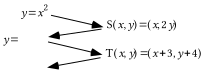

B. Give the image of (0,0) under the composite $\text{T}\circ \text{S}$.

C. Give an equivalent to the final image equation in the connection diagram in the form $y=\text{a}\cdot \mathrm{(}x+\text{h}\mathrm{)}^{2}+\text{k}$.

D. Give the coordinates of the vertex of the parabola described by the final image equation.

### IV.

Use the quadratic formula to create a list of all the solutions of the given open sentences.  Give exact representations of the solutions, not decimal approximations:

A. $2\cdot x^{2}+{}^{-}2\cdot x+{}^{-}24=0$    B. $x^{2}+4\cdot x+{}^{-}13=0$

### V.

A. If an object moved 6 feet in 2 seconds, what was its average velocity in feet per second?

B. If an object moved 6 feet in 0.2 seconds, what was its average velocity in feet per second?

### VI.

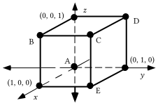

As you answer the following questions, assume that each edge of the cube in the illustration at the bottom of the previous page has a length of 1 centimeter.

A. Give the total length of the edges of the cube in the illustration above.  This will be called the “perimeter” of the cube.

B. Give the total area of the faces of the cube.  This will be called the “surface area” of the cube.

C. Give  the volume of the cube.

### VII.

A. Create a connection diagram that begins with $y=x^{2}$ as the pre-image equation and ends with an equation for the parabola that contains (1,6) that has the vertical coordinate axis as its line of reflection symmetry and (0,0) as its vertex.

B. Give an equivalent to your image equation from “A” right above in the form $y=\text{k}\cdot x^{2}$.

### VIII.

Give an equation for the line that passes through the origin and (1, 12).

### IX.

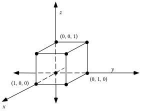

Trace the cube above onto your homework paper.  Add to your tracing the image of the cube under the 3-dimensional size transformation with image formula S($x\mathrm{,}y\mathrm{,}z\mathrm{)}=\mathrm{(}2\cdot x\mathrm{,}2\cdot y\mathrm{,}2\cdot z\mathrm{)}$.  Then label the coordinates of all the vertices of the image not at the origin.

## Assignment #92

### I.

<strong>Inverses of 3X3 Matrices</strong>

In the equation

$\left[ \begin{matrix}\text{a} & \text{b} & \text{c} \\ \text{d} & \text{e} & \text{f} \\ \text{g} & \text{h} & \text{i}\end{matrix} \right]\cdot \left[ \begin{matrix}x_{1} & x_{2} & x_{3} \\ y_{1} & y_{2} & y_{3} \\ z_{1} & z_{2} & z_{3}\end{matrix} \right]=\left[ \begin{matrix}1 & 0 & 0 \\ 0 & 1 & 0 \\ 0 & 0 & 1\end{matrix} \right]$

the nine letters in the left most matrix represent the entries in a “typical” 3$\times$3 matrix.  The subscripted letters in the second matrix from the left can be thought of as 9 variables.  If this 9-dimensional equation has a unique solution, the nine coordinates of that solution can be used to write the inverse of the matrix on the left.

The 9-dimensional equation can be replaced with three 3-dimensional systems by using matrix multiplication.  These systems are:

$\left\{ \begin{array}{l}\text{a}\cdot x_{1}+\text{b}\cdot y_{1}+\text{c}\cdot z_{1}=1 \\ \text{d}\cdot x_{1}+\text{e}\cdot y_{1}+\text{f}\cdot z_{1}=0 \\ \text{g}\cdot x_{1}+\text{h}\cdot y_{1}+\text{i}\cdot z_{1}=0\end{array} \right.$  $\left\{ \begin{array}{l}\text{a}\cdot x_{2}+\text{b}\cdot y_{2}+\text{c}\cdot z_{2}=0 \\ \text{d}\cdot x_{2}+\text{e}\cdot y_{2}+\text{f}\cdot z_{2}=1 \\ \text{g}\cdot x_{2}+\text{h}\cdot y_{2}+\text{i}\cdot z_{2}=0\end{array} \right.$  and $\left\{ \begin{array}{l}\text{a}\cdot x_{3}+\text{b}\cdot y_{3}+\text{c}\cdot z_{3}=0 \\ \text{d}\cdot x_{3}+\text{e}\cdot y_{3}+\text{f}\cdot z_{3}=0 \\ \text{g}\cdot x_{3}+\text{h}\cdot y_{3}+\text{i}\cdot z_{3}=1\end{array} \right.$

For efficiency, we could attempt to compute the three 3-coordinate solutions of these systems can be computed by using Gauss-Elimination on the augmented matrix.

$\left[ \left. \begin{matrix}\text{a} & \text{b} & \text{c} \\ \text{d} & \text{e} & \text{f} \\ \text{g} & \text{h} & \text{i}\end{matrix} \right|\begin{matrix}\text{1} & \text{0} & \text{0} \\ \text{0} & \text{1} & \text{0} \\ \text{0} & \text{0} & \text{1}\end{matrix} \right]$

If it is possible to use Gauss-Elimination to replace the augmented matrix above with the a new augmented matrix whose first three columns have the form

$\left[ \left. \begin{matrix}1 & 0 & 0 \\ 0 & 1 & 0 \\ 0 & 0 & 1\end{matrix} \right| \right.$,

the next three columns will form the inverse of the matrix represented by $\left[ \begin{matrix}\text{a} & \text{b} & \text{c} \\ \text{d} & \text{e} & \text{f} \\ \text{g} & \text{h} & \text{i}\end{matrix} \right]$.

Some sophisticated “symbolic manipulation” software can be use to do Gauss-Elimination steps on the augmented matrix

$\left[ \left. \begin{matrix}\text{a} & \text{b} & \text{c} \\ \text{d} & \text{e} & \text{f} \\ \text{g} & \text{h} & \text{i}\end{matrix} \right|\begin{matrix}\text{1} & \text{0} & \text{0} \\ \text{0} & \text{1} & \text{0} \\ \text{0} & \text{0} & \text{1}\end{matrix} \right]$

Here is a partial display of the result showing only the first of the three columns to the right of the augmentation bar.

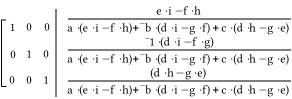

There are many simple patterns in this result based on computing the determinants of various 2$\times$2 matrices.  The same is true for the second and third columns that are not shown.  You can take a college level course called Linear Algebra in which you can learn some fascinating things about these patterns.  However, at this point you only need to know that the people who engineered your calculator built into it the capability to compute the inverse of a 3$\times$3 matrix.  That capability is based on the patterns in the fractions shown.

Inverses were introduced in this course as a tool for solving certain types of equations.  The system

$\left\{ \begin{array}{l}\text{a}\cdot x+\text{b}\cdot y+\text{c}\cdot z=\text{k} \\ \text{d}\cdot x+\text{e}\cdot y+\text{f}\cdot z=\text{l} \\ \text{g}\cdot x+\text{h}\cdot y+\text{i}\cdot z=\text{m}\end{array} \right.$

can be put in the matrix form

$\left[ \begin{matrix}\text{a} & \text{b} & \text{c} \\ \text{d} & \text{e} & \text{f} \\ \text{g} & \text{h} & \text{i}\end{matrix} \right]\cdot \left[ \begin{matrix}x \\ y \\ z\end{matrix} \right]=\left[ \begin{matrix}\text{k} \\ \text{l} \\ \text{m}\end{matrix} \right]$.

Then if the matrix of coefficients, $\left[ \begin{matrix}\text{a} & \text{b} & \text{c} \\ \text{d} & \text{e} & \text{f} \\ \text{g} & \text{h} & \text{i}\end{matrix} \right]$ is edited in as \[A\] and the matrix of constants, $\left[ \begin{matrix}\text{k} \\ \text{l} \\ \text{m}\end{matrix} \right]$, is edited in as \[C\], the solution of the system should appear if \[ENTER\] is pushed after entering $\left[ \text{A} \right]^{{}^{-}\text{1}}\ast \left[ \text{C} \right]$ at the home screen.  This will not work if the matrix of coefficients has no inverse, but no such coefficient matrix will appear in this course.

A. Create a 3$\times$3 system with variables “a,” “b,” and “c” based on the fact that the points (2,¯13.3), (4,2.7) and (10,¯45.3) are all on the graph of a parabola described by an equation of the form $y=\text{a}\cdot x^{2}+\text{b}\cdot x+\text{c}$.

B. If \[A\] is the matrix of coefficients for the system you created as your answer to “A” right above, give this matrix \[A\] on you homework paper and enter it into your calculator.

C. If \[C\] is the matrix of constants for the system you created as your answer to “A” right above, give the matrix \[C\] on your homework paper and enter it into your calculator.

D. Give the exact solution of the matrix equation $\mathrm{[}\text{A]}\cdot \text{X}=\text{[C]}$ where \[A\] and \[C\] are your answers for “B” and “C” right above.

### II.

<strong>A Way to Take Advantage of Some Capabilities of Your Calculator to Compute at Least Very Close Approximations of Solutions of Quadratic Equations</strong>

The equation ${}^{-}16x^{2}+118\cdot x+{}^{-}150=0$ has the <strong>standard quadratic form</strong> $\text{a}\cdot x^{2}+\text{b}\cdot x+\text{c}=0$ and the fractions

$\frac{{}^{-}\text{b}+\sqrt{\text{b}^{\text{2}}+{}^{-}\text{4ac}}}{\text{2a}}$  and $\frac{{}^{-}\text{b}+{}^{-}\sqrt{\text{b}^{\text{2}}+{}^{-}\text{4ac}}}{\text{2a}}$

provide formulas for computing its solution or solutions, even if they are not real numbers.

Your calculator has some capabilities that can be exploited to get at least very good approximations of these solutions.  Here are some screen displays showing a way to make good use of the calculator:

Display #1:

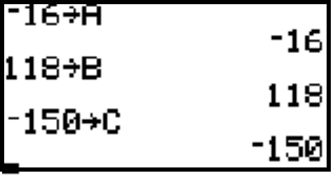

This display shows how the coefficients from the left member of the equation can be stored in the calculator’s memory using letters that correspond to the position of these numbers in the equation.

Display #2:

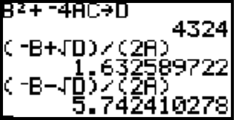

The first line of this second display shows how the stored coefficients can be recalled to compute the discriminant, the number computed from $\text{b}^{\text{2}}+{}^{-}\text{4ac}$ which appears under the radical in the numerator of the formulas.  If this number had been negative, the solutions would not be real numbers, but you could represent the solutions as fractions using “a·<strong>i</strong>” notation for the second addend of the numerators.

The second entry on the left of the display is an expression from which the calculator was able to compute a very close approximation of one solution of the equation.  Notice the convenience of using “D” to recall the computed discriminant from the calculator’s memory.

The third entry on the left of the display was created by first using the \[2nd\] and \[ENTER\] keys to recall $\text{(}{}^{-}\text{B}+\sqrt{\text{D}}\text{)/(2A)}$. Then this was edited to $\text{(}{}^{-}\text{B}-\sqrt{\text{D}}\text{)/(2A)}$ by placing the cursor on the “+” sign and pushing the \[-\] (the key over the \[+\] key.)  When \[ENTER\] was pushed, a very close approximation of the second solution appeared.  Notice the fact that ${}^{-}\text{b}+{}^{-}\sqrt{\text{b}^{\text{2}}+{}^{-}\text{4ac}}$ is equivalent to  ${}^{-}\text{b}-\sqrt{\text{b}^{\text{2}}+{}^{-}\text{4ac}}$.

For the quadratic equation   ${}^{-}16\cdot x^{2}+120\cdot x+{}^{-}200=0$

A. Use your calculator to compute the discriminant and write it on your homework paper.

B. Follow the procedure described above to compute the solutions of the equation accurate to two decimal places.

### III.

A. Make an entry for Y1 based on $y={}^{-}16\cdot x^{2}+120\cdot x$. Then use your calculator to compute the second coordinate of the point on the graph generated from the Y1 expression for which the first coordinate is 0.01.

B. If an object moves 1.1984 feet in 0.01 seconds, what, accurate to the nearest hundredth, is its average velocity in feet per second?

C. If an object moves 0.119984 feet in 0.001 seconds, what, accurate to the nearest hundredth, is its average velocity in feet per second?

### IV.

A. Use the fact that both (0,0) and (6.3,- 5.2) are on the graph with equation $y={}^{-}16\cdot x^{2}+\text{b}\cdot x+\text{c}$ to create a 2$\times$2 system using “b” and “c” as the variables whose solution will give the values of “b” and “c.”

B. Give the solution of the system you created as your answer to “A” right above.

### V.

A. Copy and complete this connection diagram:

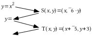

B. Give the image of (0,0) under the composite $\text{T}\circ \text{S}$.

C. Give an equivalent to the final image equation in the connection diagram in the form $y=\text{a}\cdot \mathrm{(}x+\text{h}\mathrm{)}^{2}+\text{k}$.

D. Give the coordinates of the vertex of the parabola with the final image equation.

### VI.

In each case, give the coordinates of the vertex of the parabola with the given equation.

A. $y={}^{-}7\cdot \mathrm{(}x+6\mathrm{)}^{2}+8$  B. $y=7\cdot \mathrm{(}x+{}^{-}6\mathrm{)}^{2}+8$

C. $y={}^{-}7\cdot \mathrm{(}x+6\mathrm{)}^{2}+{}^{-}8$  D. $y=4\mathrm{.}2\cdot \mathrm{(}x+{}^{-}1\mathrm{.}6\mathrm{)}^{2}+{}^{-}4\mathrm{.}5$

### VII.

Copy the following equations and fill in all the blanks so that all three of them are equivalent:

$\begin{array}{l}y=x^{2}+4\cdot x+5 \\ y=x^{2}+4\cdot x+4+5+\mathrm{\_\_\_} \\ y=\mathrm{(}x+\mathrm{\_\_\_)}^{2}+\mathrm{\_\_\_}\end{array}$

### VIII.

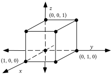

A. If the cube in the illustration above is mapped with the origin centered 3-dimensional size transformation with image formula S$\mathrm{(}x\mathrm{,}y\mathrm{,}z\mathrm{)}=\mathrm{(}3\cdot x\mathrm{,}3\cdot y\mathrm{,}3\cdot z\mathrm{)}$, give the coordinates of all the vertices of the image other than the origin.

B. Copy this table onto your homework paper and fill in all the missing numbers.  Assume that each edge of the pre-image is 1 centimeter long.

|  | pre-image | image |
| --- | --- | --- |
| perimeter |  |  |
| surface area |  |  |
| volume |  |  |

### IX.

A. Create a connection diagram that begins with $y=x^{2}$ as the pre-image equation and ends with an equation for a parabola with vertex (0,0) that passes through (2,24).

B. Give an equivalent to your image equation from “A” right above in the form $y=\text{k}\cdot x^{2}$.

C. Create a connection diagram that begins with $y=x^{2}$ as the pre-image equation and ends with an equation for the parabola with a vertical line of reflection symmetry and vertex (0,0) that passes through (3,54).

D. Give an equivalent to your image equation from part “C” in the form $y=\text{k}\cdot x^{2}$.

### X.

Give an equation for the line that passes through the origin and (2,24).

## Assignment #93

### I.

Enter the coordinates of the points (1,116.24), (3,250.64) and (7,135.44) into lists #1 and #2 of your calculator:

A. Create a 3$\times$3 system whose solution will give the coefficients “a,” “b,” and “c,” for an equation of the form $y=\text{a}\cdot x^{2}+\text{b}\cdot x+\text{c}$ for the parabola passing through the three given points.

B. Give an expression that can be entered as Y1 so that the representation of a parabola generated from that expression will pass through the points of the scatter plot made from lists #1 and #2.  Use the solution of the system you created as your answer to “A” right above.

### II.

For the open sentence:    ${}^{-}16\cdot x^{2}+141\cdot x+{}^{-}175=0$

A. Give the discriminant.    B. Give the solutions accurate to two decimal places.

### III.

<strong>Computing the Average Velocity of a Moving Object over a Span of Time</strong>

If an object moved a total distance represented by “d” over an interval of time whose length is represented by “t,” the average velocity of the object over that time interval is computed as $\frac{\text{d}}{\text{t}}$.

When we used a motion sensor in class, the numbers that measure distance were in meters and the numbers measuring time were in seconds.  Therefore, if numbers from a motion sensor experiment are used to compute an average velocity, they would have the unit designations shown:

$\frac{\text{d meters}}{\text{t seconds}}$.

The number computed by dividing “d” by “t” is given the unit designation “meters per second.”  The average velocity is also sometimes represented as

$\frac{\text{d}}{\text{t}}\hspace{0.5em}\frac{\text{meters}}{\text{second}}$.

Here the units are formed into a separate fraction.

Soon we will be doing an experiment about a moving object in which we will be measuring distances in feet and time in seconds.  If an object moved “d” feet in “t” seconds, the average velocity of the object was:

$\frac{\text{d}}{\text{t}}\hspace{0.5em}\frac{\text{feet}}{\text{sec}}$.

Here are some variations on how this average velocity can be expressed:

#1: Since there are 60 seconds in each minute:  $\frac{\text{d}}{\text{t}}\hspace{0.5em}\frac{\text{feet}}{\text{sec}}\cdot \frac{60\text{ sec}}{\text{1 min}}=\frac{\text{d}\times \text{60}}{\text{t}}\text{ }\frac{\text{feet}}{\text{min }}$

#2: Since there are 60 minutes in each hour:  $\frac{\text{d}\times \text{60}}{\text{t}}\text{ }\frac{\text{feet}}{\text{min }}\cdot \frac{60\text{ min}}{\text{1 hr}}=\frac{\text{d}\times \text{60}\times \text{60}}{\text{t}}\text{ }\frac{\text{ft}}{\text{hr}}$

#3: Since there are 5280 feet in each mile:  $\frac{\text{d}\times \text{60}\times \text{60}}{\text{t}}\text{ }\frac{\text{ft}}{\text{hr}}\cdot \frac{1\text{ mile}}{\text{5280 feet}}=\frac{\text{d}\times \text{60}\times \text{60}}{\text{5280}\times \text{t}}\text{ }\frac{\text{miles}}{\text{hr}}$

In science books the conversion from feet per second to miles per hour is sometimes presented as follows:

$\frac{\text{d feet}}{\text{t sec}}\times \frac{\text{60 sec}}{\text{1 min}}\times \frac{\text{60 min}}{\text{1 hr}}\times \frac{\text{1 mile}}{\text{5280 feet}}=\frac{\text{d}\times \text{60}\times \text{60}}{\text{5280}\cdot \text{t}}\text{ }\frac{\text{miles}}{\text{hr}}$.

Perhaps you are impressed with the neatness of this format for unit change.  You can practice it as you do this question.

A. Enter an expression for Y1 based on $y={}^{-}16\cdot x^{2}+141\cdot x$.  Then compute the second coordinate of the point generated from this expression with first coordinate 0.01

B. If an object moved 1.4084 feet in 0.01 seconds, what was its average velocity in feet per second?

C. Re-express your answer to “B” in “miles per hour” accurate to the nearest tenth.

D. If an object moved 0.140984 feet in 0.001 seconds, what was its average velocity in feet per second?

### IV.

A. Use the fact that both (0,0) and (7.1,¯5.2) are on the graph of solutions of $y={}^{-}16\cdot x^{2}+\text{b}\cdot x+\text{c}$ to create a $2\times 2$ system using “b” and “c” as the variables whose solution will give the values of “b” and “c.”

B. Give the solution of the system you created as your answer to “A” right above.

### V.

In each case give the vertex of the parabola with the given equation:

A. $y=5\cdot \mathrm{(}x+{}^{-}4\mathrm{)}^{2}+13$  B. $y={}^{-}16\cdot \mathrm{(}x+{}^{-}3\mathrm{.}2\mathrm{)}^{2}+140$

C. $y=\left( x+\frac{\text{b}}{\text{2}\cdot \text{a}} \right)^{2}+\text{s}$

### VI.

Copy the following equations and fill in all the blanks so that all three of them are equivalent.

$\begin{array}{l}y=x^{2}+5\cdot x+{}^{-}3 \\ y=x^{2}+5\cdot x+\frac{25}{4}+{}^{-}3+\mathrm{\_\_\_} \\ y=\mathrm{(}x+\mathrm{\_\_\_)}^{2}+\mathrm{\_\_\_}\end{array}$

### VII.

Copy the following equations and fill in all the blanks so that all four of them are equivalent.

$\begin{array}{l}y=2\cdot x^2+10\cdot x+{}^{-}3 \\ y=2\cdot(x^2+\underline{\quad}\cdot x)+{}^{-}3 \\ y=2\cdot(x^2+5\cdot x+\frac{25}{4})+{}^{-}3+\underline{\quad} \\ y=2\cdot(x+\underline{\quad})^2+\underline{\quad}\end{array}$

### VIII.

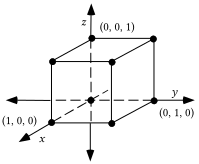

A. Copy this table and fill in all the missing numbers about the original cube (magnitude 1) and its images under some 3-dimensional size transformations.

| magnitude of size transformation | perimeter | surface area | volume |
| --- | --- | --- | --- |
| 1 |  |  |  |
| 2 |  |  |  |
| 3 |  |  |  |
| 4 |  |  |  |

B. Enter the size transformation magnitudes into list #1 in the same top to bottom order in which they appear.  Then enter the perimeters into list #2, the surface areas into list #3, and the volumes into list #4 and do the following:

1\. Have your calculator generate a scatter plot of the list #1, list #2 data and tell which type of geometric figure you think would “cover and connect” the points of that scatter plot.

2\. Have your calculator generate a scatter plot of the list #1, list #3 data and tell which type of geometric figure you think would “cover and connect” the points of that scatter plot.

3\. Have your calculator generate a scatter plot of the list #1, list #4 data and tell which type of geometric figure you think would “cover and connect” the points of that scatter plot.

### IX.

If the parabola with an equation of the form $y=\text{k}\cdot x^{2}$ passes through (1,6), what is the value of “k”?

### X.

Look at your table for question VIII and tell which of the following phrases seems to most accurately describe the relationship between the size transformation magnitudes and the surface areas associated with them:

Phrase #1: The surface areas vary directly as the magnitudes.

Phrase #2: The surface areas vary directly as the squares of the magnitudes.

Phrase #3: The surface areas vary directly as the cubes of the magnitudes.

## Assignment #94

### I.

Enter the coordinates of the points (0.5,7.23), (1,6.45), and (1.5,¯2.2) into lists #1 and #2 of your calculator.

A. Create a $3\times 3$ system whose solution will give the coefficients, “a,” “b,” and “c,” for an equation of the form $y=\text{a}\cdot x^{2}+\text{b}\cdot x+\text{c}$ that describes the parabola passing through the three given points.

B.  Give an expression that can be entered as Y1 so that the representation of a parabola generated from that expression will pass through the points of the scatter plot made from lists #1 and #2.  Use the solution of the system you created as your answer to “A” right above

### II.

For the open sentence:  ${}^{-}16\cdot x^{2}+117\cdot x+{}^{-}150=0$

A. Give the discriminant.

B. Give the solutions accurate to two decimal places.

### III.

A. Enter an expression for Y1 based on $y={}^{-}16\cdot x^{2}+117\cdot x$.  Then compute the second coordinate of the point generated from this expression with first coordinate 0.01

B. If an object moved 1.1684 feet in 0.01 seconds, what was its average velocity in feet per second?

C. If an object moved 0.116984 feet in 0.001 seconds, what was its average velocity in feet per second?

### IV.

A. Use the fact that both (0,0) and (5.85,- 5.2) are on the graph described by $y={}^{-}16\cdot x^{2}+\text{b}\cdot x+\text{c}$ to create a 2$\times$2 system using “b” and “c” as the variables whose solution will give the values of “b” and “c.”

B. Give the solution of the system you created as your answer to “A” right above.

### V.

A. Copy the following equations and fill in all the blanks so that all three of them are equivalent.

$\begin{array}{l}y=x^{2}+11\cdot x+4 \\ y=x^{2}+11\cdot x+\frac{121}{4}+4+\mathrm{\_\_\_} \\ y=\mathrm{(}x+\mathrm{\_\_\_)}^{2}+\mathrm{\_\_\_}\end{array}$

B. Give the coordinates of the vertex of the parabola described by the third equation in “A” right above.

### VI.

A. Copy the following equations and fill in all the blanks so that all four of them are equivalent.

$\begin{array}{l}y=4\cdot x^{2}+12\cdot x+{}^{-}3 \\ y=4\cdot \mathrm{(}x^{2}+\mathrm{\_\_\_}\cdot x\mathrm{)}+{}^{-}3 \\ y=4\mathrm{(}x^{2}+3\cdot x+\frac{9}{4}\mathrm{)}+{}^{-}3+\mathrm{\_\_\_} \\ y=4\cdot \mathrm{(}x+\mathrm{\_\_\_)}^{2}+\mathrm{\_\_\_}\end{array}$

B. Give the coordinates of the vertex of the parabola with the fourth equation in “A” right above.

### VII.

A. Copy the following equations and fill in all the blanks so that all three of them are equivalent:

$\begin{array}{l}y=x^{2}+\frac{\text{b}}{\text{a}}\cdot x+\frac{\text{c}}{\text{a}} \\ y=x^{2}+\frac{\text{b}}{\text{a}}\cdot x+\frac{\text{b}^{\text{2}}}{\text{4}\cdot \text{a}^{\text{2}}}+\frac{\text{c}}{\text{a}}+\mathrm{\_\_\_} \\ y=\mathrm{(}x+\mathrm{\_\_\_)}^{2}+\mathrm{\_\_\_}\end{array}$

B. Represent the coordinates of the vertex of the parabola with the third equation in “A” .

### VIII.

Copy the following equations and fill in all the blanks so that both of them are equivalent:

$y=\text{a}\cdot x^{2}+\text{b}\cdot x+\text{c}\hspace{3.75em}y=\text{a}\cdot \mathrm{(}x^{2}+\mathrm{\_\_\_}\cdot x\mathrm{)}+\text{c}$

### IX.

A. If the parabola with an equation of the form $y=\text{k}\cdot x^{2}$ passes through (2,24), give the value of “k.”

B. If the parabola with an equation of the form $y=\text{k}\cdot x^{2}$ passes through (3,54), give the value of “k. ”

C. If the simple cubic curve with an equation of the form $y=\text{k}\cdot x^{3}$ passes through (3,27) give the value of “k.”

### X.

<strong>Describing the Way Size Transformations Affect Lengths, Surface Areas, and Volumes</strong>

| magnitude of size transformation | perimeter | surface area | volume |
| --- | --- | --- | --- |
| 1 | 12 | 6 | 1 |
| 2 | 24 | 24 | 8 |
| 3 | 36 | 54 | 27 |
| 4 | 48 | 96 | 64 |

The information in the table at the bottom of the previous page is about a cube and three of its size transformation images.  It is clear from the numbers that size transformations have different effects on perimeters (a measure of length), surface area and volume. For example when the magnitude is doubled from 1 to 2 or again from 2 to 4, the perimeters are doubled, but the surface areas are multiplied by 4 and the volumes are multiplied by 8.

In the triple graph below, a line through the origin covers and connects the points made from pairing size transformation magnitudes with perimeters.  However, when those same magnitudes are paired with surface areas, the points with those coordinates are not collinear.  Instead they lie on a parabola with its vertex at the origin.

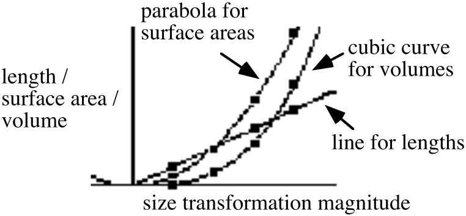

When a third set of pairs was formed from the magnitudes and the volumes, it required a curve described by an equation of the form $y=\text{k}\cdot x^{3}$ to cover and connect the points.  Curves described by equations of the form $y=\text{k}\cdot x^{3}$ are called <strong>simple cubic curves</strong>.  In this case the cubic curve also passes through the origin.

The graphs show that as the size transformation magnitudes increase, the perimeters, the surface areas and the volumes all increase along with them.  It is common in both mathematics and science to use the following phrases to describe the three patterns of change illustrated in this case:

#1: The <strong>perimeters</strong> are said to <strong>vary directly</strong> as the size transformation

magnitudes.  Geometrically this means that the (magnitude, perimeter) points

are collinear with each other and with the origin.  Algebraically this means that

an equation of the form   describes the line covering and connecting

the points involved in simple direct variation.

#2: The <strong>surface areas</strong> are said to <strong>vary directly as the square of</strong>

the size transformation magnitudes.  Geometrically this means that the

(magnitude, surface area) points all lie on the same parabola with its vertex at

the origin.  Algebraically this means that an equation of the form

describes a curve that covers and connects the points involved.

#3: The <strong>volumes</strong> are said to <strong>vary directly as the cube of</strong> the size transformation magnitudes.  Geometrically this means that the (magnitude, surface area)

points all lie on the same simple cubic curve passing through the origin.

Algebraically this means that an equation of the form   describes a curve

that covers and connects the points involved.

Several pairs of numbers are in lists #1 and #2.  The list #2 numbers vary directly as the square of the list #1 numbers in the same row with them.  To generate a graph that covers and connects a scatter plot made from the (list #1, list #2) points, which of the following do you think would be the form for an expression to be entered into the \[Y=\] list?

Form #1: $\text{k}\cdot \text{X}$    Form #2: $\text{k}\cdot \text{X}^{2}$    Form #3: $\text{k}\cdot \text{X}^{3}$

### XI.

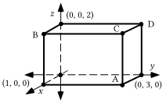

In the above figure, when any two edges meet, the angle formed is a right angle.  This makes the figure a <strong>rectangular solid</strong>.

A. Give the coordinates of the four points, A, B, C, and D.  Give the letters with the coordinates.

B. Give the perimeter of the rectangular solid.

C. Give the surface area of the rectangular solid.

D. Give the volume of the rectangular solid

E. Compute the exact distance from the origin to point A.

## Assignment #95

### I.

Here again is a table first seen in assignment #88:

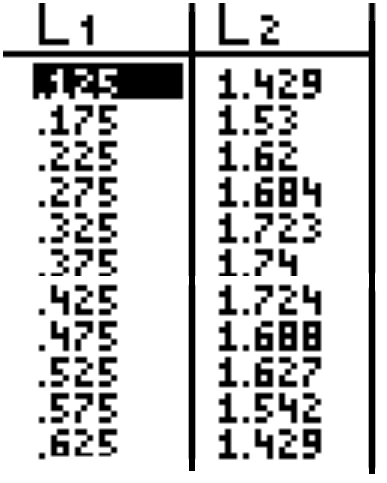

The data in the lists was collected by tossing a volleyball in the air over a motion sensor.  To begin this question, enter the data into your calculator and generate a scatter plot of it.  Now do the following:

A. Select a “representative” sample of three points from the lists and use them to create a 3$\times$3 system whose solution will give values for the coefficients of an equation of the form $y=\text{a}\cdot x^{2}+\text{b}\cdot x+\text{c}$ for the parabola that passes through the three points you chose.  This parabola should at least come close to passing through those points that you did not choose.  On your homework paper, list the three points you chose and the system you created by making use of them.

B. Use matrix multiplication to calculate the solution of the system you created as your answer to “A” right above.  Use that solution to help get an expression to enter into the \[Y=\] list.  Check your entry by checking how close the parabola generated from it comes to passing through the points of the scatter plot.  When you are satisfied with the “fit,” give the expression on your homework paper with the coefficients accurate to the nearest hundredth.

### II.

A. A segment 1 meter long is 39.37 inches long.  If an object is 4.94 meters long, what is that length in inches?

B. Use your answer to A to give the length of an object 4.94 meters long in feet accurate to the nearest hundredth of a foot.

### III.

A. The first coordinate of the vertex of the parabola described by $y={}^{-}16\cdot x^{2}+131x$ is $\frac{131}{32}$.  Calculate the second coordinate of the vertex accurate to the nearest tenth.

B. Give the second coordinate of the point with first coordinate 0.0001 on the  parabola described $y={}^{-}16\cdot x^{2}+131x$.

C. If an object moved 0.01309984 feet in 0.0001 seconds, what was its average velocity in feet per second?  Give an answer with all the accuracy the given numbers allow.

D. Calculate an equivalent to your answer to “C” right above in miles per hour accurate to the nearest tenth.

### IV.

Copy the following equations and fill in all the blanks so that all four of them are equivalent:

$\begin{array}{l}y=\text{a}\cdot x^{2}+\text{b}\cdot x+\text{c} \\ y=\text{a}\cdot \mathrm{(}x^{2}+\mathrm{\_\_\_}\cdot x\mathrm{)}+\text{c} \\ y=\text{a}\cdot \mathrm{(}x^{2}+\mathrm{\_\_\_}\cdot x+\frac{\text{b}^{\text{2}}}{\text{4}\cdot \text{a}^{\text{2}}}\mathrm{)}+\text{c}+\mathrm{\_\_\_} \\ y=\text{a}\cdot \mathrm{(}x+\mathrm{\_\_\_)}^{2}+\text{c}+\mathrm{\_\_\_}\end{array}$

### V.

In each case give <strong>only the first coordinate</strong> of the vertex of the parabola with the given equation:

A. $y={}^{-}16\mathrm{(}x+3\mathrm{.}2\mathrm{)}^{2}+17$

B. $y=\text{a}\cdot \left( x+\frac{\text{b}}{\text{2}\cdot \text{a}} \right)^{2}+\left( \text{c}+\frac{{}^{-}\text{b}^{\text{2}}}{\text{4}\cdot \text{a}} \right)$

### VI.

Create an equation of the form $y={}^{-}16\cdot x^{2}+\text{b}\cdot x+\text{c}$ for the parabola that passes through (0,0) and (6.31,¯2.4).

### VII.

<strong>Two Methods for Calculating the Surface Area of the Image of a Rectangular Solid</strong>

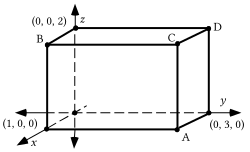

Method #1: The rectangular solid in the illustration above has six rectangular faces.  The area of each of the two faces parallel to the $y-z$ plane is 2$\times$3 = 6.  The area of each of the two faces parallel to the $x-z$ plane is 2$\times$1 = 2, and the area of each of the two faces parallel to the $x-y$ plane is 3$\times$1 = 3.  Therefore, the total surface area of the solid is 2$\times$6 + 2$\times$2 + 2$\times$3 = 22 square units.  If this solid is mapped with an origin centered size transformation with magnitude 3.4 we could calculate the surface of the image by doing the following:

First, we could calculate the coordinates of the images of each of the vertices.

Second, we could then calculate the areas of each of the rectangular faces of the image.

Third, we could calculate the sum of the areas of the rectangular faces to get the surface area of the image of the original solid.

However, there is an alternative to taking these steps.  The surface areas of the images of a three-dimensional figure vary directly as the square of the magnitudes of the size transformations used to map them.  Geometrically this means that the points whose coordinates are (magnitude, surface area) pairs all lie on the same parabola and this parabola has its vertex at the origin.  Algebraically, it means that an equation of the form $y=\text{k}\cdot x^{2}$ describes the parabola that covers and connects all the (magnitude, surface area points).

The (magnitude, surface area) points are all solutions of an equation of the form $y=\text{k}\cdot x^{2}$.  We already know the surface area when the size transformation is the identity transformation with magnitude 1–it is 22.  Therefore we know one solution the equation of the form $y=\text{k}\cdot x^{2}$ must have.  That solution is (1,22).  If we write the coordinates of that solution in the variables of the equation form we create:

$22=\text{k}\cdot 1^{2}$.

This will be a true statement only if “k” has a value of 22.  Therefore the equation of the form $y=\text{k}\cdot x^{2}$ we seek must in fact be

$y=22\cdot x^{2}$.

22, the value of “k,” is called <strong>the constant of variation</strong>.

Since we want to know the surface area of the image of the solid when it is mapped with a size transformation with magnitude 3.4. That is, we want to know the second coordinate of a solution of $y=22\cdot x^{2}$ when the first coordinate is 3.4.  The second coordinate can be computed from

$22\cdot \mathrm{(}3\mathrm{.}4\mathrm{)}^{2}$= 254.32.

The surface area of the image is therefore 254.32 square units.

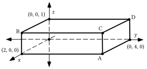

The illustration above is of a rectangular solid.  For all the computations, use centimeters as the unit.

A. Give the coordinates of points A, B, C, and D.

B. Compute the perimeter of the solid.

C. Compute the surface area of the solid.

D. Compute the volume of the solid.

E. If the magnitudes of various origin centered 3-dimensional size transformations are entered into list #1 and the perimeter of the images of the solid under each size transformation are placed in matching positions in list #2:

1\. What is the number in list #2 that should be paired with “1” in list #1?

2\. Which of the following is the form of an equation for a graph that would cover and connect a scatter plot of the list #1, list #2 points?

#1: $y=\text{k}\cdot x^{2}$    #2: $y=\text{k}\cdot x$    #3: $y=\text{k}\cdot x^{3}$

3\. Use the answer to “1” right above and your answer to “2” right above to give the value of “k,” the constant of variation.

4\. Calculate the perimeter of the image of this solid when it is mapped with a size transformation of magnitude 3.4.

F. If the magnitudes of various origin centered 3-dimensional size transformations are entered into list #1 and the surface areas of the images of the solid are placed in matching positions in list #2:

1\. What is the number in list #2 that should be paired with “1” in list #1?

2\. Which of the following is the form of an equation for a graph that would cover and connect a scatter plot of the list #1, list #2 points?

#1: $y=\text{k}\cdot x^{2}$    #2: $y=\text{k}\cdot x$    #3: $y=\text{k}\cdot x^{3}$

3\. Use the answer to “1” right above and your answer to “2” right above to give the value of “k,” the constant of variation.

4\. Calculate the surface area of the image of the solid when it is mapped with a size transformation with a magnitude of 3.4.

G. If the magnitudes of various origin centered 3-dimensional size transformations are entered into list #1 and the volumes of the images of the solid are placed in matching positions in list #2:

1\. What is the number in list #2 that should be paired with “1” in list #1?

2\. Which of the following is the form of an equation for a graph that would cover and connect a scatter plot of the list #1, list #2 points?

#1: $y=\text{k}\cdot x^{2}$    #2: $y=\text{k}\cdot x$    #3: $y=\text{k}\cdot x^{3}$

3\. Use the answer to “1” right above and your answer to “2” right above to give the value of “k,” the constant of variation.

4\. Calculate the volume of image of the solid when it is mapped with a size transformation with magnitude 3.4.

## Assignment #96

### I.

A. Use the quadratic formula to compute the solutions of

${}^{-}16\cdot x^{2}+117\cdot x=100$

accurate to the nearest hundredth.

B. Use the quadratic formula to compute the solutions of the

${}^{-}16\cdot x^{2}+117\cdot x+{}^{-}100=0$

accurate to the nearest hundredth.

### II.

The parabola with the equation $y={}^{-}16\cdot x^{2}+117\cdot x$ almost exactly passes through points described as (time in seconds since an object was launched straight up, the distance of that object from the launch point).  Write an equation that you think might be useful in seeking an answer to the question, “How many seconds after it was launched was the object 100 feet above the launch point?”

### III.

<strong>Identifying the Vertex of a Parabola from an Equation for it</strong>

When a parabola is used to express the trend in data, the vertex of that parabola often gives special information about an event.  In the illustration below, the vertices of the two parabolas are labeled with their coordinates. There are methods that can be used to determine the coordinates of the vertex of a parabola from an equation for the parabola.

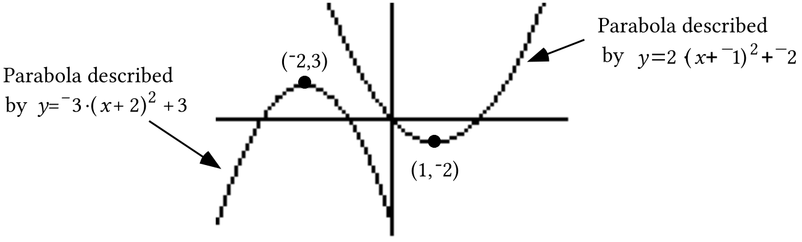

At the top of the next page are connection diagrams relating the two parabolas in the illustration to the $y=x^{2}$ parabola.

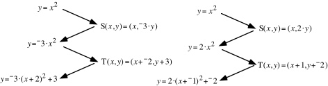

The images of the vertex of the pre-image parabola described by $y=x^{2}$ can be traced through transformations of the diagrams as follows:

$\mathrm{(}0\mathrm{,}0\mathrm{)}\rightarrow \mathrm{(}0\mathrm{,}0\mathrm{)}\rightarrow \mathrm{(}{}^{-}2\mathrm{,}3\mathrm{)}$ for the frowning parabola to the left in the illustration

and

$\mathrm{(}0\mathrm{,}0\mathrm{)}\rightarrow \mathrm{(}0\mathrm{,}0\mathrm{)}\rightarrow \mathrm{(}1\mathrm{,}{}^{-}2\mathrm{)}$for the smiling parabola to the right in the illustration.

Notice that the scale changes have no effect on the pre-image vertex.  The change was caused only by the translations, and the “evidence” of these translations in the image equations make it possible to identify the vertices of the images without creating the connection diagrams.

A pattern for identifying the vertex of a parabola is:

If the parabola has an equation of the form

$y=\text{a}\cdot \left( x+\text{h} \right)^{2}+\text{k}$

that equation shows the evidence of the translation T with T($x\mathrm{,}y\mathrm{)}=\mathrm{(}x+{}^{-}\text{h}\mathrm{,}y+\text{k}\mathrm{)}$

and the vertex of the parabola has coordinates $\left( {}^{-}\text{h,k} \right)$.

In some situations we will create an equation for a parabola in the form $y=\text{a}\cdot x^{2}+\text{b}\cdot x+\text{c}$.  Since “a” will not equal zero, an equation of this form is equivalent to each of the following:

$y=\text{a}\cdot \mathrm{(}x^{2}+\frac{\text{b}}{\text{a}}\cdot x+\frac{\text{b}^{\text{2}}}{\text{4}\cdot \text{a}^{\text{2}}}\mathrm{)}+\left( \text{c}+\frac{{}^{-}\text{b}^{\text{2}}}{\text{4}\cdot \text{a}} \right)$

and

$y=\text{a}\cdot \left( x+\frac{\text{b}}{\text{2}\cdot \text{a}} \right)^{2}+\left( \text{c}+\frac{{}^{-}\text{b}^{\text{2}}}{\text{4}\cdot \text{a}} \right)$.

These two equations were created by the process known as <strong>completing the square</strong>.  From the second of the two equations the vertex can be identified as the point with coordinates $\left( \frac{{}^{-}\text{b}}{\text{2}\cdot \text{a}}\text{, c}+\frac{{}^{-}\text{b}^{\text{2}}}{\text{4}\cdot \text{a}} \right)$.

Since we will need to determine the coordinates of parabolas described by equations of the form $y=\text{a}\cdot x^{2}+\text{b}\cdot x+\text{c}$, we could memorize $\left( \frac{{}^{-}\text{b}}{\text{2}\cdot \text{a}}\text{, c}+\frac{{}^{-}\text{b}^{\text{2}}}{\text{4}\cdot \text{a}} \right)$ as a formula for the coordinates of the vertex.  This would make it unnecessary to do the completing the square process.  However there is a simpler alternative:

When a parabola has an equation of the form

$y=\text{a}\cdot x^{2}+\text{b}\cdot x+\text{c}$

the first coordinate of the vertex can be computed from $\frac{{}^{-}\text{b}}{\text{2}\cdot \text{a}}$.

The second coordinate of the vertex can then be computed by using

this number in “<em>x</em>” in $y=\text{a}\cdot x^{2}+\text{b}\cdot x+\text{c}$.

A. A parabola with an equation of the form $y={}^{-}16\cdot x^{2}+\text{b}\cdot x+\text{c}$ passes through the points (0,0) and (6.8,¯5.2).  Use the coordinates of these points to help create a system whose solution will give values for “b” and “c<em>.</em>”

B. Compute an estimate of the solution of the system you created as your answer to “A” right above.  Round the coordinates of the solution to the nearest thousandth.

C. Use your answer for “B” to create an equation of the form $y={}^{-}16\cdot x^{2}+\text{b}\cdot x+\text{c}$ for the parabola from part “A.”

D. Compute, accurate to the nearest thousandth,  the first coordinate of the vertex of the parabola described by your answer for “C.”

E. Compute the second coordinate of the vertex of the same parabola.

F. The parabola described by the equation you created as your answer for “C” comes very close to passing through the points described as (time in seconds  since an object was launched straight up, the distance of that object from the launch point).  Calculate the distance traveled by that object during the first 0.001 second.

G. Use your answer to “F” right above to calculate an estimate of the velocity of the object during the first one-thousandth of a second of its flight.

H. Calculate an equivalent to your answer to “G” in miles per hour accurate to the nearest tenth.

### IV.

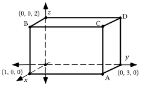

Suppose the illustration above represents a rectangular solid.  These questions are about the image of that solid when it is mapped with the 3-dimensional scale change with image formula S$\mathrm{(}x\mathrm{,}y\mathrm{,}z\mathrm{)}=\mathrm{(}2\cdot x\mathrm{,}2\cdot y\mathrm{,}2\cdot z\mathrm{)}$.

A. Use prime notation to name the images of points A, B, C, and D and give the coordinates of these images.

B. Give the perimeter of the image.

C. Give the surface area of the image.

D. Give the volume of the image.

E. Compute the exact distance from the origin to point A.

F. Compute the exact distance from the origin to point C.

### V.

A rectangular solid with a perimeter of 24 inches is mapped with a size transformation with magnitude 4.6.  What is the perimeter of the image?

### VI.

A rectangular solid with a surface area of 22 square inches is mapped with a size transformation with magnitude 4.6.  What is the surface area of the image?

### VII.

A rectangular solid with a volume of 6 cubic inches is mapped with a size transformation with a magnitude 4.6.  What is the volume of the image?

### VIII.

When describing journeys over the surface of the Earth, the direction of a motion is sometimes given as a compass heading.  Compass headings are measured in degrees clockwise from north.  Trace the direction indicator below onto your homework paper.

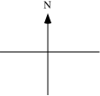

Now add to your tracing an arrow beginning, at the intersection of the north-south and east-west segments, which can be used to represent a straight line journey on a heading of 110˚.  Make this arrow about 2 inches long.

### IX.

A. Give the image of (7,3) under the same translation that maps (10,0) to the origin.

B. Represent as the sum of two squared numbers the square of the distance from the origin to your answer to “A” right above.

C. Represent as the sum of two squared numbers the square of the distance from (7,3) to (10,0).

### X.

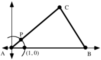

A. For the triangle represented in the illustration above, side AB has length 12.  Give the coordinates of point B.

B. The measure of angle BAC is 40˚.  Somehow represent exactly the rectangular coordinates of point P.

### XI.

Give an equivalent to (a + b)2 in the form of the sum of three addends.

## Assignment #97

### I.

<strong>Answering Questions about the Flight of an Object from a Quadratic Model</strong>

If the equation $y={}^{-}16\cdot x^{2}+117\cdot x$ has been created to express the trend in data points described as (time in seconds since an object was launched straight up into the air, distance in feet of the object above the launch point), that equation can be used to help answer questions about the flight of the object.

<strong>Computing the greatest distance of the object above the launch point and computing the time to reach that distance</strong>

The $\frac{{}^{-}\text{b}}{\text{2}\cdot \text{a}}$ can be used to compute $\frac{{}^{-}117}{2\cdot {}^{-}16}$ = 3.65625 as the first coordinate of the vertex of the parabola described $y={}^{-}16\cdot x^{2}+117\cdot x$.  When the first coordinate of the vertex is used in “<em>x</em>” the second coordinate of$y={}^{-}16\cdot \mathrm{(}3\mathrm{.}65625\mathrm{)}^{2}+117\cdot \mathrm{(}3\mathrm{.}65625\mathrm{)}$ =  213.890625.  Since the graph described by $y={}^{-}16\cdot x^{2}+117\cdot x$ is a frowning parabola, the vertex is the highest point on the graph.  The ordered pairs on the graph are supposed to conform very closely to the (time in seconds since an object was launched straight up into the air, distance in feet of the object above the launch point) pairs for the flight of the object. <strong>Since the coordinates of the vertex are about (3.656, 213.891) means that the object would reach its greatest distance above the launch point about 3.656 seconds after it left the launch point.  It also means that this highest point was about 213.891 feet above the launch point.</strong>

<strong>Computing the time or times when the object was at a certain height above the launch point:</strong>

The second coordinates of the points on the graph described by $y={}^{-}16\cdot x^{2}+117\cdot x$ should be good estimates of the distance above the launch point.  Thus, if a number, such as 100, is put in place of “<em>y</em>,” the second coordinate variable, the equation formed is

$100={}^{-}16\cdot x^{2}+117\cdot x$.

If this equation is replaced with the equivalent

${}^{-}16\cdot x^{2}+117\cdot x+{}^{-}100=0$,

the “Quadratic Formulas” for the solutions can be used.  The discriminant is $b^{2}+{}^{-}4\cdot a\cdot c=\mathrm{(}117\mathrm{)}^{2}+{}^{-}4\cdot {}^{-}16\cdot {}^{-}100=7289$.  Since the discriminant is positive, the equation has two real solutions.  By using the formulas, these solutions can be computed as approximately 0.998 and 6.324.  These numbers can be used in “<em>x</em>,” the first coordinate variable, to make expressions that are very close to 0.  Since the first coordinates on the graph of $y={}^{-}16\cdot x^{2}+117\cdot x$ are supposed to be good estimates of times in seconds since the launch, <strong>these solutions mean that the object was at a point 100 feet above the launch point at two different times–the first was about 0.998 seconds after the launch.  This was on its way up to its highest point over the launch point.  The second was about 6.324 seconds after the launch.  This was on its way back toward the ground.</strong>

By referring to the geometric illustration below, you can see how useful a graph can be to help understand how the algebra you do provides meaningful answers to questions.

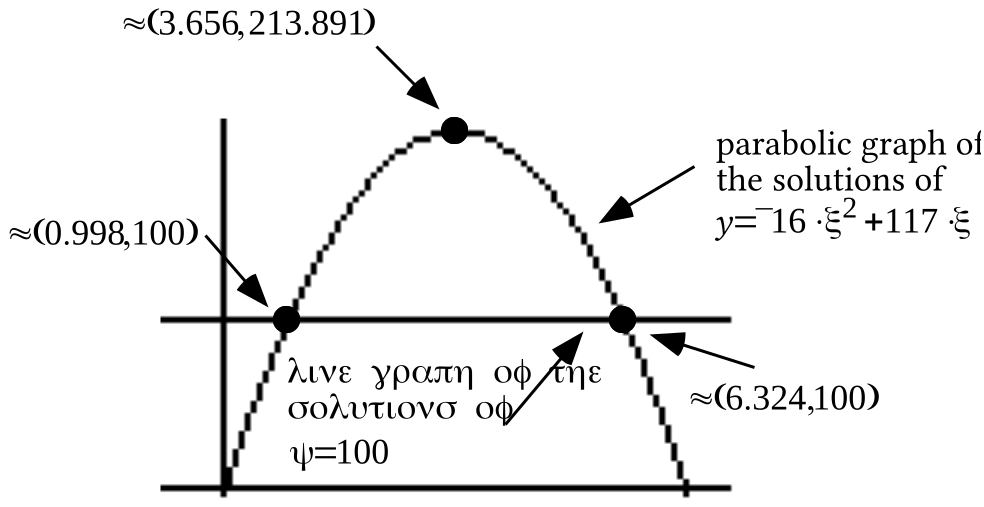

An equation of the form $y={}^{-}16\cdot x^{2}+\text{b}\cdot x+\text{c}$ is to be used to express algebraically the pattern expected for a set of data pairs related to the flight of an object launched straight up into the air.  The data pairs can be described as (the elapsed time in seconds since the object was launched, the distance of the object above the launch point.).  Suppose the object leaves the launch point at time 0 and lands at a point 5.2 feet <strong>below</strong> the launch point 7.8 seconds later.

A. Based on the information given, compute values for the coefficients “b” and “c.”

B. Give the amount of time that lapsed between the launch of the object and the moment it reached its greatest distance above the launch point.

C. Give the distance from the launch point to the highest point reached by the object.

D. Make an “educated” guess about the average velocity in feet per second of the object during the very beginning of its flight.  Then check this guess by computing its average velocity in feet per second during the first thousandth of a second.

E.

1\. Copy this equation and fill in the blank in the numerator in the second fraction.

$\frac{{}^{-}16\cdot \mathrm{(}0\mathrm{.}001\mathrm{)}^{2}+124\mathrm{.}13\cdot \mathrm{(}0\mathrm{.}001\mathrm{)}}{0\mathrm{.}001}=\frac{0\mathrm{.}001\cdot \mathrm{(\_\_\_\_\_\_\_\_\_\_\_\_\_\_\_\_\_)}}{0\mathrm{.}001}$

2\. Give an equivalent to the two fractions in the equation in “1” right above that is not in the form of a fraction.

3\. True or False: 124.13 is a reasonable estimate of the value of the number represented by the two fractions in “1” right above.

F. Create an equation which can be used to help answer the question, “At what times after the launch of the object was it at a point 150 feet above the launch point?”

G. Accurate to the nearest hundredth of a second, at what times after the launch was the object 150 feet above the launch point?

H. Create an equation which can be used to help answer the question, “At what times after the launch of the object was it at a point 300 feet above the launch point?”

I. Was the object ever as high as 300 feet above the launch point?

### II.

Suppose a rectangular solid has a perimeter of 42 inches.

A. If the object is mapped with a three-dimensional size transformation with magnitude 3, what is the perimeter of the image?  Besides writing your answer on your homework paper, enter the magnitude in list #1 and your answer in list #2.

B. If the object is mapped with a three-dimensional size transformation with magnitude 5, what is the perimeter of the image?  Besides writing your answer on your homework paper, also enter the magnitude in list #1 and your answer in list #2.

C. If the object is mapped with a three-dimensional size transformation with magnitude 6, what is the perimeter of the image?  Besides writing your answer on your homework paper, also enter this third magnitude in list #1 and your answer in list #2.

D. Write an equation for a figure that will pass through your the three points now in lists #1 and #2.  Check this answer by using it as the basis of an expression to be entered into the \[Y=\] list.  Then use your calculator to generate a graph from that expression and see if it passes through the points on a list #1, list #2 scatter plot.  If it does not, try to find an error in your work.

### III.

Suppose a rectangular solid has a surface area of 35 square inches.

A. If the object is mapped with a three-dimensional size transformation with magnitude 3, what is the surface area of the image?  Besides writing your answer on your homework paper, enter the magnitude in list #1 and your answer in list #2.

B. If the object is mapped with a three-dimensional size transformation with magnitude 5, what is the surface area of the image?  Besides writing your answer on your homework paper, also enter the magnitude in list #1 and your answer in list #2.

C. If the object is mapped with a three-dimensional size transformation with magnitude 6, what is the surface area of the image?  Besides writing your answer on your homework paper, also enter this third magnitude in list #1 and your answer in list #2.

D. Write an equation for a figure that will pass through your the three points now in lists #1 and #2.  Check this answer by using it as the basis of an expression to be entered into the \[Y=\] list.  Then use your calculator to generate a graph from that expression and see if it passes through the points on a list #1, list #2 scatter plot.  If it does not, try to find an error in your work.

### IV.

Suppose a rectangular solid has a volume of 30 cubic inches.

A. If the object is mapped with a three-dimensional size transformation with magnitude 3, what is the volume of the image?  Besides writing your answer on your homework paper, enter the magnitude in list #1 and your answer in list #2.

B. If the object is mapped with a three-dimensional size transformation with magnitude 5, what is the volume of the image?  Besides writing your answer on your homework paper, also enter the magnitude in list #1 and your answer in list #2.

C. If the object is mapped with a three-dimensional size transformation with magnitude 6, what is the volume of the image?  Besides writing your answer on your homework paper, also enter this third magnitude in list #1 and your answer in list #2.

D. Write an equation for a figure that will pass through the three points now in lists #1 and #2.  Check this answer by using it as the basis of an expression to be entered into the \[Y=\] list.  Then use your calculator to generate a graph from that expression and see if it passes through the points on a list #1, list #2 scatter plot.  If it does not, try to find an error in your work.

### V.

<strong>Compass Headings for Legs of a Journey</strong>

On the next several assignments you will be doing questions that make reference to the “headings” of legs of journeys.  The heading indicates the direction of travel.  It is common in navigation questions to give headings in degrees measured clockwise from north.  It will take a little concentration to work with “headings” since we have been giving rotation magnitudes in degrees measured counterclockwise from (1,0) on the $x-\text{axis}\mathrm{.}$  In the illustration below, you will see some arrows used to represent two different legs of a journey’s originating from direction indicators oriented so that north is toward the top of the paper.

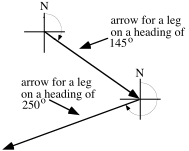

Trace the direction indicator below onto your homework paper.

A. Add to your tracing an arrow beginning at the intersection of the north-south and east-west segments that can be used to represent a straight line journey on a heading of 250˚.  Make this arrow about 2 inches long.

B. At the tip of the arrow you drew as your answer to “A” right above, sketch a second direction indicator, including an “N” to indicate north.  Then sketch a second arrow beginning at the tip of the first one you sketched.  This second arrow should represent a straight line journey on a heading of 40˚.  Make this arrow about 2 inches long also.

### VI.

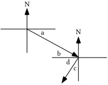

A. If the longer oblique arrow in the illustration above represents the leg of a journey taken on a heading of 115˚:

1\. What is the angle measure represented by “a”?

2\. What is the angle measure represented by “b”?

B. If the shorter oblique arrow in the illustration above represent the leg of a journey taken on a heading of 214˚:

1\. What is the angle measure represented by “c”?

2\. What is the angle measure represented by “d”?

C. What is the measure of the smaller of the two angles formed by the two arrows in the illustration?

### VII.

A. Give the image of (11,8) under the same translation that maps (17,0) to the origin.

B. Represent, as the sum of two squared numbers, the square of the distance from the origin to your answer to “A” right above.

C. Represent, as the sum of two squared numbers, the square of the distance from (11,8) to (17,0).

### VIII.

A. Use the FOIL pattern to represent (a·b + ¯d).(a·b + ¯d) as the sum of four addends.

B. Give an equivalent to ¯1.a·b·d + ¯1.a·b·d that contains a plus sign, but only one “a,” one “b,” and one “d.”

C. Give an equivalent to your answer to “B” that does not contain a plus sign.

### IX.

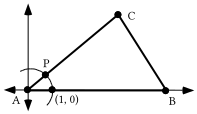

A. In the illustration above, side AB has a length of 31.  Give the coordinates of point B.

B. Angle BAC has a measure of 41˚.  Give the exact coordinates of point P.

C. Side AC has a length of 17.  Give the exact coordinates of point C.

## Assignment #98

### I.

<strong>Getting an Estimate of the Average Velocity of a Launched Object over a Short Time Interval at the Beginning of its Flight</strong>

When you did question III of assignment #96 you should have found that the parabola described by $y={}^{-}16\cdot x^{2}+124\mathrm{.}13\cdot x$ would be a good choice to express the trend in (time since launch in seconds, distance above the launch point in feet) data points for the flight of an object projected straight up into the air from a launch point 5.2 feet above the ground if that object hit the ground 7.8 seconds later.

When 0.001 is written in place of “<em>x</em>” to get ${}^{-}16\cdot \mathrm{(}0\mathrm{.}001\mathrm{)}^{2}+124\mathrm{.}13\cdot \mathrm{(}0\mathrm{.}001\mathrm{)}$, this is a representation in feet of the distance the object moved in the first 0.001 seconds.  The fractions in the equation

$\frac{{}^{-}16\cdot \mathrm{(}0\mathrm{.}001\mathrm{)}^{2}+124\mathrm{.}13\cdot \mathrm{(}0\mathrm{.}001\mathrm{)}}{0\mathrm{.}001}=\frac{0\mathrm{.}001\cdot \mathrm{(}{}^{-}16\cdot \mathrm{(}0\mathrm{.}001\mathrm{)}+124\mathrm{.}13\mathrm{)}}{0\mathrm{.}001}$

both represent the average velocity of the object during the first 0.001 seconds of its flight.  As can be seen from the second of the two fractions, this average velocity is also represented by

${}^{-}16\cdot \mathrm{(}0\mathrm{.}001\mathrm{)}+124\mathrm{.}13$.

This can be described as “the product of ¯16 and the time of the flight plus the coefficient of ‘<em>x</em>’ in the parabola equation.”  Since the time of the flight is quite small, this average velocity is just a little less than 124.13, the coefficient of “<em>x</em>” in the parabola equation.

The coefficient of “<em>x</em>” provides a quick and highly accurate estimate

of the average velocity of the flight over a very short time interval just as

the flight begins.

You should see that this estimate is even better if the time interval is even shorter than 0.001 seconds.

This question is about an object that is launched straight up from a point 5.2 feet above the ground. The object hit the ground very near the launch point 8.13 seconds after the launch.

A. Write an equation of the form $y={}^{-}16\cdot x^{2}+\text{b}\cdot x+\text{c}$ that algebraically expresses the pattern in a collection of data points that can be described as (the time in seconds since the launch, the distance of the object above the launch point).

B. Accurate to the nearest tenth of a foot per second, what was the approximate velocity of the object during the first small portion of a second?

C. For how many seconds during the flight was the object at least 100 feet above the launch point?

D. Answer Yes or No:  Does the object ever get to a point 350 feet above the launch point?  Give a reason for your answer.

E. During the flight, at it highest, how far was the object above the launch point?

F. At the highest point during the flight, how far was the object above the ground?

### II.

Suppose a certain rectangular solid has a perimeter of 72 inches.

A. The perimeters of the images of this solid varies directly as the magnitudes of the 3-dimensional size transformations used to produce the images. Create an equation whose solutions are of the form (magnitude of a size transformation, perimeter of an image).

B. Show how to use your answer to “A” right above to calculate the perimeter of the image of this solid under a 3-dimensional size transformation with magnitude 6.5.

### III.

Suppose a certain rectangular solid has a surface area of 105 square inches.

A. The surface areas of the images of this solid varies directly as the square of the magnitudes of the 3-dimensional size transformations used to produce the images. Create an equation whose solutions are of the form (magnitude of a size transformation, surface area of an image).

B. Show how to use your answer to “A” right above to calculate the surface area of the image of this solid under a 3-dimensional size transformation with magnitude 6.5.

### IV.

Suppose a certain rectangular solid has a volume of 112 cubic inches.

A. The volumes of the images of this solid varies directly as the cube of the magnitudes of the 3-dimensional size transformations used to produce the images. Create an equation whose solutions are of the form (magnitude of a size transformation, volume of an image).

B. Show how to use your answer to “A” right above to calculate the volume of the image of this solid under a 3-dimensional size transformation with magnitude 6.5.

### V.

A. Represent the image of (8·cos(72˚), 8·sin(72˚)) under the same translation that maps (17,0) to the origin.

B. Copy the following and fill in the blanks so that the result represents the square of the distance from the origin to your answer to “A” right above.

$\left( \hspace{5.0em} \right)\text{ }^{2}+\left( \hspace{4.25em} \right)\text{ }^{2}$

C. Use the FOIL pattern to write a sum of four addends equivalent to the  following:

$\mathrm{(}8\cdot \mathrm{cos(}72{}^{\circ}\mathrm{)}+{}^{-}17\mathrm{)}\cdot \mathrm{(}8\cdot \mathrm{cos(}72{}^{\circ}\mathrm{)}+{}^{-}17\mathrm{)}$

### VI.

A. Use your calculator to compute each of the following accurate to five decimal places:

1\. (cos(72˚))2 + (sin(72˚))2          2. (cos(137˚))2 + (sin(137˚))2

B. If “a” represents a “typical” rotation magnitude, give the exact value of the following without using “cos” or “sin.”

(cos(a))2 + (sin(a))2

### VII.

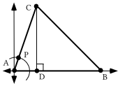

The measure of angle BAC in the triangle above is 71˚ and point P is collinear with points A and C.  Side AC of the triangle has a length of 4.8.

A. Point P is on the unit circle.  Give the exact coordinates of point P.

B. Give the exact coordinates of point C.

C. Give the exact length of the altitude, CD.

D. If side AB has a length of 7.3, give the coordinates of point B.

E. Represent the exact area of triangle ABC.

F. Give the exact coordinates of the image of point C under the same translation that will map point B to the origin.

G. Represent as the sum of two squares the square of the distance from point C to point B.

### VIII.

A. Use the FOIL pattern to represent $\mathrm{(}4\mathrm{.}8\cdot \mathrm{cos(}71^{\text{o}}\mathrm{)}+{}^{-}7\mathrm{.}3\mathrm{)}^{2}$ as the sum of four addends.

B. Use a distributive form to represent

${}^{-}1\cdot \mathrm{(}7\mathrm{.}3\mathrm{)}\cdot \mathrm{(}4\mathrm{.}8\mathrm{)}\cdot \mathrm{cos(}71^{\text{o}}\mathrm{)}+{}^{-}1\cdot \mathrm{(}7\mathrm{.}3\mathrm{)}\cdot \mathrm{(}4\mathrm{.}8\mathrm{)}\cdot \mathrm{cos(}71^{\text{o}}\mathrm{)}$

as a product in which three of the four factors are $7\mathrm{.}3\mathrm{,}\text{ }4\mathrm{.}8\text{ and}\mathrm{cos(}71^{\text{o}}\mathrm{)}$.

C. Use a distributive form to represent  $4\mathrm{.}8^{2}\cdot \mathrm{(cos(}71^{\text{o}}\mathrm{))}^{2}+4\mathrm{.}8^{2}\cdot \mathrm{(sin(}71^{\text{o}}\mathrm{))}^{2}$

as a product of two factors, one of which is $4\mathrm{.}8^{2}$.

D. Give an equivalent to your answer to “C” right above that does not contain either “cos” or “sin.”

### IX.

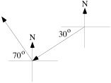

The arrows in the illustration above represent legs of a journey.

A. Give the precise heading of the leg in the south westerly direction.

B. Give the precise heading of the leg in the north westerly direction.

C. Give the measure of the smaller angle formed by the arrows for the two legs of the journey.

### X.

A. Give the number of any and all expressions below that has the form of the sum of two products:

Expression #1: $\mathrm{(}3+x\mathrm{)(}5+y\mathrm{)}$    Expression #2: $\frac{2}{3}\cdot 360+\frac{1}{2}\cdot 360$

Expression #3: $\text{a}\cdot x+\text{b}\cdot y$

B. Give the number in the 1,2 address of this matrix product in the form of a sum of three products:

$\left[ \begin{matrix}50 & 36 & 90\end{matrix} \right]\cdot \left[ \begin{matrix}\frac{1}{4} & \frac{1}{2} & \frac{1}{4} \\ \frac{1}{3} & \frac{1}{6} & \frac{1}{2} \\ \frac{3}{8} & \frac{1}{4} & \frac{3}{8}\end{matrix} \right]$

## Assignment #99

### I.

The sphere represented in the illustration below has a radius of 1 and its center is (0,0,0).

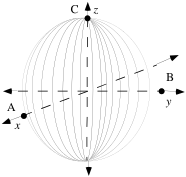

A. Give the coordinates of the points A, B and C.

B. By using a technique you will learn in a later course, it can be determined that the volume of the sphere represented in the illustration, the unit sphere, is $\frac{4}{3}\pi$.  Write an equation with two variables whose solutions will have the form (magnitude of a three-dimensional size transformation mapping the sphere, volume of the image).

C. Use your answer to “B” above to compute the exact volume of the image of the sphere under a size transformation with magnitude 4.

D. Give the volume of a sphere with radius 4.

### II.

A. Use two direction markers and two arrows to represent a two-legged journey meeting the following description:

“The first leg was on a heading of 62˚ for a distance of 300 miles and the second leg was on a heading of 310˚ for a distance of 500 miles.”

B. Give the measure of the smaller angle formed by the arrows in your sketch representing the legs of the journey.

### III.

The measure of angle BAC in the triangle at the bottom of the previous page is 117˚ and point P is collinear with points A and C.  Side AC of the triangle has a length of 3.9.

A. Give the exact coordinates of point P.

B. Give the exact coordinates of point C.

C. Give the exact length of the altitude, CD.

D. If side AB has a length of 6.4, give the coordinates of point B.

E. Represent the exact area of triangle ABC.

F. Give the exact coordinates of the image of point C under the same translation that will map point B to the origin.

G. Represent as the sum of two squares the square of the distance from point C to point B.

### IV.

<strong>An Important Relationship Involving the Coordinates of the Image of (1,0) Under any Origin Centered Rotation</strong>

If (1,0) is mapped by the origin-centered rotation with a magnitude $\theta$, the pair $\mathrm{(cos(}\theta \mathrm{),sin(}\theta \mathrm{))}$ represents the coordinate of the image.

The distance from the origin to the image represented by $\mathrm{(cos(}\theta \mathrm{),sin(}\theta \mathrm{))}$ is 1 since the image is on the unit circle that has a radius of 1.  By applying the Pythagorean Theorem, the square of the distance from the origin to the image point is:

$\left( \mathrm{cos(}\theta \mathrm{)} \right)^{2}+\left( \mathrm{sin(}\theta \mathrm{)} \right)^{2}=1^{2}=1$

The equation

$\left( \mathrm{cos(}\theta \mathrm{)} \right)^{2}+\left( \mathrm{sin(}\theta \mathrm{)} \right)^{2}=1$

expresses a relationship involving the coordinates of the image

of (1,0) under origin centered rotations.

A true statement is formed whenever the Greek letter <em>theta,</em> $\theta$, in this equation is replaced with a rotation magnitude.  You will have an opportunity to do this below:

A. Use the FOIL pattern to represent

$\mathrm{(}3\mathrm{.}9\cdot \mathrm{cos(}117^{\text{o}}\mathrm{)}+{}^{-}6\mathrm{.}4\mathrm{)}^{2}$

as the sum of four addends.

B. Use a distributive form to represent

${}^{-}1\cdot \mathrm{(}6\mathrm{.}4\mathrm{)}\cdot \mathrm{(}3\mathrm{.}9\mathrm{)}\cdot \mathrm{cos(}117^{\text{o}}\mathrm{)}+{}^{-}1\cdot \mathrm{(}6\mathrm{.}4\mathrm{)}\cdot \mathrm{(}3\mathrm{.}9\mathrm{)}\cdot \mathrm{cos(}117^{\text{o}}\mathrm{)}$

as a product of four factors, three of which are $6\mathrm{.}4\text{, }3\mathrm{.}9\text{ and }\mathrm{cos(}117^{\text{o}}\mathrm{)}$.

C. Use a distributive form to represent

$3\mathrm{.}9^{2}\cdot \mathrm{(cos(}117^{\text{o}}\mathrm{))}^{2}+3\mathrm{.}9^{2}\cdot \mathrm{(sin(}117^{\text{o}}\mathrm{))}^{2}$

as a product of two factors, one of which is $3\mathrm{.}9^{2}$while the other is a sum of two addends.

D. Give an equivalent to your answer to “C” right above that does not contain either “cos” or “sin.”

### V.

The Green Taxi Cab Company has a fleet of 720 cabs that it operates in Gatville.  Each morning the dispatcher sends half the cabs to the west side of the city and the remainder to the east side.  Past experience has shown that each cab gets new riders about each half hour.  Past experience has also shown that two-thirds of the people picked up on the west side of town ask to go to another location on the west side while the others ask to go to some point on the east side.  Meanwhile, only one-half of those picked up on the east side ask to go to a point on the east side and the remainder ask to go to a point on the west side.

A.

1\. First, represent the number of cabs on the west side of town after the first half-hour as the sum of two products.

2\. Compute from your answer to “1” right above the number of cabs on the west side of town after the first half-hour.

B.

1\. First, represent the number of cabs on the east side of town after the first half-hour as the sum of two products.

2\. Compute from your answer to “1” right above the number of cabs on the east side of town after the first half-hour.

### VI.

For the matrix product $\left[ \begin{matrix}360 & 360\end{matrix} \right]\cdot \left[ \begin{matrix}\frac{2}{3} & \frac{1}{3} \\ \frac{1}{2} & \frac{1}{2}\end{matrix} \right]$:

A. Represent the number in the 1,1 address as the sum of two products.

B. Compute the product using your calculator and give the results, with the proper dimensions, on your homework paper.

### VII.

Enter matrix \[A\] = $\left[ \begin{matrix}360 & 360\end{matrix} \right]$ and matrix \[B\] = $\left[ \begin{matrix}\frac{2}{3} & \frac{1}{3} \\ \frac{1}{2} & \frac{1}{2}\end{matrix} \right]$ into your calculator.  Then use your calculator to compute each of the following products.  Store the results as directed and also record them on your homework paper.

A. \[A\].\[B\]  and store the answer as matrix \[C\].

B. \[C\].\[B\]

C. \[B\].\[B\] and store the answer as matrix \[D\].

D. \[A\].\[D\]

E. Your answers to “B” and “D” above should match.  If they do not, re-compute the products.  If they do, what property of matrix multiplication is illustrated by the results?

## Assignment #100

### I.

<strong>The Initial Disposition and Transition Matrices for the Distribution of Taxi Cabs</strong>

In the question about the taxicabs, the dispatcher began each day by sending half of the cabs to the west side of town and the rest to the east side.  Since there were 720 cabs altogether, there would initially be 360 on the west side and 360 on the east side.  Here is how this information can be stored in a matrix.

This matrix is called <strong>the initial disposition matrix</strong>.  The reason for making the initial disposition matrix 1$\times$2 instead of 2$\times$1 will become clear when you see how the information about the movement of cabs during each half-hour period is stored.  Here is a matrix for this movement:

This 2$\times$2 matrix is called <strong>the transition matrix</strong> for the movement of the cabs during any one-half hour period.

A 2$\times$2 matrix can be multiplied by a 1$\times$2 matrix on its left.  This means that the product

can be computed.  In the 1,1 address of the product is the sum of two-product factors, $360\cdot \frac{2}{3}+360\cdot \frac{1}{2}$.  Since two-thirds of the cabs initially on the west side remain on the west

side while one-half of the cabs initially on the east side go the west side, the 1,1 address number $360\cdot \frac{2}{3}+360\cdot \frac{1}{2}=420$ represents the number of cabs on the west side after the first half-hour.

The 1,2 address of the product, $360\cdot \frac{1}{3}+360\cdot \frac{1}{2}$ is also a meaningful sum of two-factor products.  Since one-third of the 360 cabs initially on the west side will go to the east side during the first half-hour and one-half of the 360 initially on the east side will remain on the east side during the first half hour, $360\cdot \frac{1}{3}+360\cdot \frac{1}{2}=300$ represents the number of cabs still on the east side after the first half hour.

$\left[ \begin{matrix}420 & 300\end{matrix} \right]$ the computed product of the initial disposition matrix, , and the transition matrix, $\left[ \begin{matrix}\frac{2}{3} & \frac{1}{3} \\ \frac{1}{2} & \frac{1}{2}\end{matrix} \right]$ gives the disposition of the cabs after the first half-hour.

Here again is information about the Green Taxi Cab Company.  It has a fleet of 720 cabs that it operates in Gatville.  Each morning the dispatcher sends half the cabs to the west side of the city and the remainder to the east side.  Past experience has shown that each cab gets new riders about each half hour.  Past experience has also shown that two-thirds of the people picked up on the west side of town ask to go to another location on the west side while the others ask to go to some point on the east side.  Meanwhile, only one-half of those picked up on the east side ask to go to a point on the east side and the remainder ask to go to a point on the west side.

A. Copy the diagram below and fill in the missing entries for  the “AFTER THE 1st HALF HOUR” row and all the entries for the “AFTER THE 2nd HALF HOUR” row.

B. After the first half hour, how many taxis are on the west side of Gatville and how many are on the east side?

C. After the second half hour, how many taxis are on the west side of Gatville and how many are on the east side?

### II.

Represent each of the following as a product.  Do not compute the product.

A. Two-thirds of one-half.

B. Two-thirds of one-half of three-hundred-sixty.

### III.

Match each expression with the description that describes it:

Expressions:  Descriptions:

#1: $360\cdot \left( \frac{2}{3}\cdot \frac{2}{3}+\frac{1}{3}\cdot \frac{1}{2} \right)+360\cdot \left( \frac{1}{2}\cdot \frac{2}{3}+\frac{1}{2}\cdot \frac{1}{2} \right)$  A: A sum of two two-factor products.

#2: $360\cdot \frac{2}{3}\cdot \frac{2}{3}+360\cdot \frac{1}{3}\cdot \frac{1}{2}+360\cdot \frac{2}{3}\cdot \frac{1}{3}+360\cdot \frac{1}{3}\cdot \frac{1}{2}$  B: A sum of four three-factor products.

### IV.

A. If the equation $0\cdot x=\text{a}$ has at least one solution, what is the value of a?

B. Find at least one solution of the system: $\left\{ \begin{array}{l}x+2\cdot y=12 \\ 3\cdot x+6\cdot y=36\end{array} \right.$

C. What is the determinant of the matrix of coefficients for the system in “B” right above?

### V.

A. Use two direction markers and two arrows to represent a two-legged journey meeting the following description:

“The first leg was on a heading of 320˚ for a distance of 200 miles and the second leg was on a heading of 200˚ for a distance of 300 miles.”

B. Give the measure of the smaller angle formed by the arrows in your sketch representing the legs of the journey.

### VI.

For the triangle in the illustration, the length of side AC is 8.3, the length of side AB is 11.4 and the measure of angle BAC is 58˚.

A. Give the exact coordinates of point C.

B. Give the exact coordinates of point B.

C. Give the length of the altitude, segment CD.

D. Represent exactly the area of triangle ABC.

E. Represent as a sum of two squares the square of the length of side BC.

### VII.

A. Represent the exact area of triangle ABC in the illustration above.  Hint: can the triangle from question VI above be mapped onto the triangle shown in this illustration by transformations that preserve distance and angle measure?

B. Represent the square of the length of side BC as the sum of two squares.

### VIII.

Copy the following and fill in all the blanks so that all six lines of expressions are equivalent.

$\begin{array}{l}\mathrm{(}8\mathrm{.}3\cdot \mathrm{cos(}58^{\text{o}}\mathrm{)}+{}^{-}11\mathrm{.}4\mathrm{)}^{2}+\mathrm{(}8\mathrm{.}3\cdot \mathrm{sin(}58^{\text{o}}\mathrm{))}^{2} \\ =\mathrm{(}8\mathrm{.}3\cdot \mathrm{cos(}58^{\text{o}}\mathrm{)}+{}^{-}11\mathrm{.}4\mathrm{)}\cdot \mathrm{(}8\mathrm{.}3\cdot \mathrm{cos(}58^{\text{o}}\mathrm{)}+{}^{-}11\mathrm{.}4\mathrm{)}+\mathrm{(}8\mathrm{.}3\cdot \mathrm{sin(}58^{\text{o}}\mathrm{))}^{2} \\ =\mathrm{(}8\mathrm{.}3\cdot \mathrm{cos(}58^{\text{o}}\mathrm{))}^{2}+8\mathrm{.}3\cdot {}^{-}11\mathrm{.}4\cdot \mathrm{cos(}58^{\text{o}}\mathrm{)}+8\mathrm{.}3\cdot {}^{-}11\mathrm{.}4\cdot \mathrm{\_\_\_\_\_}+\mathrm{(}{}^{-}11\mathrm{.}4\mathrm{)}^{2}+8\mathrm{.}3^{2}\cdot \mathrm{\_\_\_\_\_\_} \\ =\mathrm{\_\_\_\_}\cdot \mathrm{(cos(}58^{\text{o}}\mathrm{))}^{2}+{}^{-}1\cdot 8\mathrm{.}3\cdot 11\mathrm{.}4\cdot \mathrm{cos(}58^{\text{o}}\mathrm{)}+{}^{-}1\cdot 8\mathrm{.}3\cdot 11\mathrm{.}4\cdot \mathrm{\_\_\_\_\_}+\mathrm{(}11\mathrm{.}4\mathrm{)}^{2}+8\mathrm{.}3^{2}\cdot \mathrm{\_\_\_\_\_\_} \\ =8\mathrm{.}3^{2}\cdot \mathrm{(cos(}58^{\text{o}}\mathrm{))}^{2}+8\mathrm{.}3^{2}\cdot \mathrm{(sin(}58^{\text{o}}\mathrm{))}^{2}+11\mathrm{.}4^{2}+\mathrm{(}{}^{-}1+{}^{-}1\mathrm{)}\cdot \mathrm{\_\_\_\_\_\_\_\_\_\_\_} \\ =\mathrm{(\_\_\_\_\_\_\_\_\_\_\_\_\_\_\_\_\_\_)}\cdot 8\mathrm{.}3^{2}+11\mathrm{.}4^{2}+{}^{-}2\cdot \mathrm{\_\_\_\_\_\_\_\_\_\_\_\_\_}\end{array}$

### IX.

Give an equivalent to $5^{2}\cdot \mathrm{((cos(}17^{\text{o}}\mathrm{))}^{2}+\mathrm{(sin(}17^{\text{o}}\mathrm{))}^{2}\mathrm{)}$ that contains neither “cos” nor “sin.”
